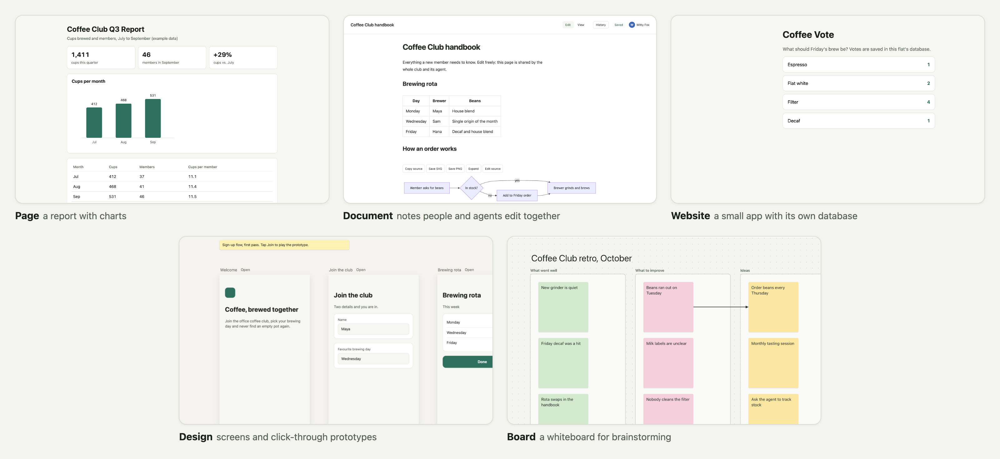

<!-- PROTECTED BRANDING: Do not modify the image or copy in this block without an explicit user request. -->
<p align="center">
  
</p>

<p align="center">
  <strong>Open-source alternative to sites/artifacts</strong>
</p>
<!-- END PROTECTED BRANDING -->

<h1 align="center">Flats</h1>

<p align="center">
  Ask your AI agent for a web page, a shared document, a small app, a design or
  a whiteboard. Flats hosts it on your own machine and gives you a link.
</p>

<p align="center">
  <a href="https://github.com/gosuda/flats/releases"></a>
  <a href="https://github.com/gosuda/flats/actions/workflows/ci.yml"></a>
  <a href="LICENSE"></a>
</p>

<p align="center">
  <a href="#quick-start">Quick start</a> ·
  <a href="#what-you-can-make">What you can make</a> ·
  <a href="#how-flats-compares">How Flats compares</a> ·
  <a href="docs/README.md">Documentation</a>
</p>

---

Each thing Flats hosts is a **flat**: one web page, document, app, design or
board with its own name and link. Your agent creates and updates flats. You
decide in the Flats console what goes live and who can open it.

<p align="center"></p>

1. **Ask your agent:** "Make a one-page report of our Q3 numbers with a chart
   and put it on Flats."
2. **Approve it** in the Flats console. The agent sends you the approval link.
3. **Open the link.** The page starts Private, on your machine. Share it on
   a private network such as Tailscale, or make it Public when you are ready.

## What you can make

| You want | Flats makes a | How it changes |
| --- | --- | --- |
| A report or dashboard with charts you can send around | **Page**: one HTML document with its assets | You approve saving and publishing each version |
| Notes, a handbook or meeting minutes that people and agents edit together | **Document**: live, collaborative Markdown | Edits apply at once and are kept as revisions |
| A small internal tool with a database, such as a poll, tracker or form | **Website**: a static site, or a small JavaScript server app with SQLite | You approve saving and publishing each version |
| Screen mock-ups and click-through prototypes | **Design**: a canvas of HTML artboards | Edits apply at once and are kept as revisions |
| A brainstorm, retro or flowchart that people rearrange by hand | **Board**: an infinite whiteboard with sticky notes, shapes and connectors | Edits apply at once and are kept as revisions |

Every flat starts Private. Making any flat Public, or Private again, always
waits for your approval. [How changes go live](#how-changes-go-live) has the
details for each type, and [content types](docs/content-types.md) has the full
reference.

## How Flats compares

| | Flats | Hosted AI artifacts and sites (for example Claude Artifacts) | App hosting (for example Vercel, Netlify) |
| --- | --- | --- | --- |
| Where it runs | Your own Mac or Linux machine, or your own server | Usually the provider's cloud | Usually the provider's cloud |
| Where your data lives | Files and SQLite databases on that machine | Usually your account with the provider | Usually your account with the provider and the services you add |
| Which agents can use it | Any MCP client; a plugin for Claude Code, Codex and Cursor | Often the provider's own assistant | Usually any tool that can deploy there, such as a CLI or a Git push |
| Server code and a database | JavaScript server apps with SQLite and persistent files ([details](#static-and-server-flats)) | Varies by product | Often available through the provider's functions and add-ons |
| People and agents editing together | Documents, designs and boards, with history | Varies by product | Usually outside the hosting itself |
| Who decides what goes live | You approve every publish and visibility change in your console | Varies by product | Varies with your deployment setup |

Other products change often; check their current documentation for details.

## Quick start

### 1. Install Flats

On macOS or Linux, with an amd64 or arm64 machine:

```sh
curl -fsSL https://raw.githubusercontent.com/gosuda/flats/main/install.sh | sh
```

The installer verifies the release, installs `flats` to `~/.local/bin` and
starts it as a background service, without sudo. The console is at
[127.0.0.1:7878](http://127.0.0.1:7878). The default network is Local, so
flats open only on this machine; other providers are off.

### 2. Connect your agent

Install the Flats plugin. In Claude Code:

```sh
claude plugin marketplace add gosuda/flats && claude plugin install flats@flats
```

In Codex:

```sh
codex plugin marketplace add gosuda/flats && codex plugin add flats@flats
```

Then restart or reconnect the agent. [Connecting agents](docs/agents.md)
covers Cursor, other MCP clients and agents on another machine.

### 3. Ask for something

Try one of these:

- "Make a one-page report of last quarter's sales with a bar chart and put it
  on Flats."
- "Start a Flats document for our team handbook."
- "Build a lunch poll on Flats that saves votes."

### 4. Approve and open it

For a page or website, the agent saves a Private Draft and sends you a console
link. Approve two requests there: saving the Draft as version 1, then
publishing that version. Then open the link the agent gives you, such as
`http://coffee-report.localhost:7879`. A document, design or board opens at
once, without an approval.

<details>
<summary><strong>Deploy without an agent, from the command line</strong></summary>

```sh
mkdir -p hello
printf '<h1>Hello from Flats</h1>\n' > hello/index.html
flats save-draft hello ./hello
```

Run the exact `flats create-version` command printed by the save above; its
`--revision` and `--hash` freeze the files you saved, even if someone edits
the Draft afterwards. The command asks to save that Draft as version 1. Follow the approval URL it
returns, or open the [local console](http://127.0.0.1:7878), and approve it.
That creates v1 but puts nothing live yet. Deploy it with **Publish v1** in
the console, or request it from the CLI and approve that request too:

```sh
flats deploy --flat hello --version 1
```

Then visit [hello.localhost:7879](http://hello.localhost:7879).

> `flats deploy` returns exit code **3** while a request awaits approval,
> including with `--json`. Saving a Draft or a version does not make a site
> live; only deploying a version does.

Run `flats status` to check the host. See
[installation and upgrades](docs/release.md#installing-a-host) for installer
options, upgrades and backups.

</details>

<details>
<summary><strong>Other ways to run Flats: container, foreground or source</strong></summary>

#### Container

A Linux image for amd64 and arm64 is published with every release. On Linux,
use host networking so the console, CLI and agents reach it on loopback:

```sh
docker run -d --name flats --restart unless-stopped --network host \
  -v flats-data:/data ghcr.io/gosuda/flats:latest
```

From a checkout, you can instead use Docker Compose (including Docker Desktop,
on a host with trusted local containers):

```sh
docker compose up -d --wait
```

This keeps the console and local flats on host loopback and persists data in a
named volume. See the [Compose setup](docs/container.md#docker-compose) for
image pinning, configuration and upgrades.

Never publish the console port to your network: anything that reaches it can
approve deploys. See [Running Flats in a container](docs/container.md) for
other Docker hosts and network modes.

#### Foreground

```sh
flats serve --config ./flats-demo-data/config.json
```

On first start, this creates a host with the defaults in `./flats-demo-data`.
It never does that over a directory that already holds Flats data. Each
running host needs its own data directory and ports; see
[Configuration and storage](docs/configuration.md).

#### From source

Requires Go 1.27.1 or newer:

```sh
go install github.com/gosuda/flats/cmd/flats@latest
```

Use `@main` for unreleased changes. This build does not include NetBird; see
[Serving through NetBird](docs/networking.md#serving-through-netbird) to build
the release binary from a checkout.

</details>

## How changes go live

Websites and pages follow the **version model**: you work on a Private Draft
while the live version keeps serving, and previews use isolated data. Saving a
version (v1, v2, ...) and deploying it are separate approved steps, so a
version can exist without ever going live. Publication and rollback require
console approval.

Documents, designs and boards are edited live by people and agents together:
private visitors can edit while public visitors read, unless you approve
guest editing for a Public board, and changes to an already Public flat are
visible immediately. Documents merge agent saves into
people's edits; designs keep every change as a whole-canvas revision. Boards
record each agent write as one revision and group each person's edits into
revisions. **Changing visibility in either direction requires approval for
every type.**

Explore [content types](docs/content-types.md) for the full lifecycle and
agent tools, including `save_page`, `update_document` and `save_design`. The
[Boards guide](docs/content-types.md#boards) covers `get_board`, `update_board`,
live collaboration, imports and history. Choose a board for ideas people will
move and connect; choose a design for HTML screens and prototypes.

## Agent integration

Connect **Claude Code, Codex or Cursor** with the Flats plugin, which runs
`flats mcp` (the `flats` CLI must be on the agent's `PATH`) to relay the
selected host's MCP endpoint; any other MCP client registers
`http://127.0.0.1:7878/mcp` directly. The install commands are in the
[Quick start](#2-connect-your-agent).

Without the plugin, register the MCP endpoint yourself. `flats mcp-config` prints
the commands for Claude Code, Codex and Cursor with your host's address:

```sh
claude mcp add --transport http flats http://127.0.0.1:7878/mcp
```

Restart or reconnect the agent and list its tools to check the connection. In a
terminal, `flats status` checks that the CLI reaches the host. `flats connect`
chooses which host the CLI and the plugin talk to (loopback by default). It does
not register an agent.

[Connecting agents](docs/agents.md) covers the other clients, remote hosts
(`flats connect`), client updates and llms.txt. The agent starts with
read-only `check_client`, then reads the server's current `guide`.
For the whole server contract in one document, read resource
`flats://docs/runtime-api/v1` or call **`get_runtime_reference` with `{}`**.
The [runtime API v1 reference](docs/runtime-api-v1.md) is embedded in the host
and available through MCP without an installed skill or source checkout.

## Static and server flats

Static builds need an `index.html`. For a JavaScript app, add a `flats.json`:

```json
{"kind":"server"}
```

Then create `server.js`:

```js
export default {
  async fetch(request, env) {
    env.DB.exec("CREATE TABLE IF NOT EXISTS hits (n INTEGER)");
    env.DB.exec("INSERT INTO hits VALUES (1)");
    const [{ n }] = env.DB.query("SELECT count(*) AS n FROM hits");
    return Response.json({ hits: n });
  }
};
```

Save the directory with `flats save-draft <slug> <dir>`, create a version with
`flats create-version <slug>`, then deploy that version after approval. JavaScript runs in
QuickJS on WebAssembly, with SQLite (`env.DB`), persistent string files
(`env.FILES`), Web Crypto and WebSocket callbacks. There are no Node.js APIs;
bundle imports into the uploaded version. Server-side `fetch` can call exact
operator-granted HTTP(S) origins; see [Calling external APIs](docs/external-api.md).

<details>
<summary><strong>WASI, persistent data and environment variables</strong></summary>

A `.wasm` server is a WASI preview1 command instantiated afresh per request:
request JSON on stdin, response JSON on stdout, only the flat's configured
environment variables and secrets, with no inherited host environment, plus
clocks and randomness. It has **no SQLite/FILES host ABI, filesystem mounts,
outbound network or WebSocket API**. See the
[capability table and response format](docs/design.md#server-flats-handler-abi).

Data survives deploys and ordinary rollbacks. `flats rollback hello` restores
code; `--restore-data` requests a separately approved restore of the
pre-deploy DB and FILES snapshot. Preview data is isolated from live data.

Ordinary environment variables (`flats env set hello GREETING 'Hello'`) and
encrypted secrets reach server code as `env.NAME`, or as environment variables
for WASI. Saving a value leaves running workers on their snapshot. The live
worker picks up current values at the next approved deployment, redeployment,
rollback or data restore, or when the Flats host restarts; a newly created
preview also loads them. See
[App environment variables](docs/design.md#app-environment-variables) and
[Secrets](docs/design.md#secrets).

</details>

## Private and public access

Start locally, then enable the providers you need in
**Settings → Network providers**. Allow a provider for an individual flat
under **Networks** on its Settings tab.

| Access | Providers |
| --- | --- |
| **Private** | Local (always on), Tailscale (tailnet ACLs), NetBird¹ (access policies), your reverse proxy (its own access control) |
| **Public** | Portal, Tailscale Funnel, zrok, Cloudflare quick tunnel, NetBird Expose¹, your reverse proxy |

¹ NetBird and NetBird Expose are in the release binary (`install.sh` and the
container image) but not in `go install`; see
[NetBird setup](docs/networking.md#serving-through-netbird).

Host permission alone does not grant a provider to a flat. Configured provider
defaults can grant providers to new flats; changing those defaults does not
retroactively change existing flats. Tailscale permission does not imply
Funnel permission.

Making a flat Public requires an approved transition and a configured,
permitted public route. Websites and pages also need a published version;
documents, designs and boards run without publication. Configuration alone never
publishes or changes visibility. Wait for a route to report ready and verify
its endpoint before sharing it: relay availability and network connectivity
are external dependencies.

See [Private and public access](docs/networking.md) for provider setup,
tailnet consoles, [serving flats behind your own reverse proxy](docs/networking.md#serving-flats-behind-a-reverse-proxy)
and upgrades from older hosts.

## Security

- **Sandboxed execution.** Server code runs in separate worker processes with
  WebAssembly memory and time limits, bounded request bodies and WebSocket
  connections, SQLite and FILES quotas, and restricted host capabilities.
  Each flat and preview gets its own origin.
- **Privileged console.** The management listener and console can approve
  deployments. Approval decisions require the console header and a same-origin
  browser request. That is CSRF protection, not authentication: a local
  process that sends those headers can decide
  approvals. Run only trusted agents on the host and restrict console access
  with tailnet ACLs. Autopilot, an opt-in experiment that is off by default,
  also lets agents decide approvals of the operations the operator allows, over
  MCP ([Autopilot](docs/spec/autopilot.md)).
- **Local secrets.** Secrets are encrypted with the local `secret.key`; secret
  APIs expose names only. A flat can read and return its own secrets, so
  deploy code you trust with them. Anyone who can read the data directory
  can recover those secrets.
- **Back up your data.** Immutable code versions are not data backups. Back up
  the data directory, including `secret.key`; see
  [what to back up](docs/configuration.md#what-to-back-up).

Read the [design and trust model](docs/design.md) for the details.

## Under the hood

Flats is one Go binary built without CGO, for macOS and Linux. It serves a web
console, a CLI, an HTTP API and an MCP endpoint. There is no hosted Flats
service. By default the console and the Local flat listener bind only to
loopback (`127.0.0.1:7878` and `127.0.0.1:7879`), so other networks reach your
flats only through the providers you turn on. Binding either listener to
another address (`host.console_addr`, `host.local_addr` or `--local-addr`)
changes that: anyone who can reach it can open the console or Local routes,
including Private flats. See [config.json](docs/configuration.md#configjson).

## Documentation

| Get started | Build and operate |
| --- | --- |
| [Install and upgrade](docs/release.md) | [Runtime API reference](docs/runtime-api-v1.md) |
| [Connect an agent](docs/agents.md) | [Content types and lifecycles](docs/content-types.md) |
| [Configure a host](docs/configuration.md) | [Call external APIs](docs/external-api.md) |
| [Run in a container](docs/container.md) | [Design and trust model](docs/design.md) |
| [Set up networking](docs/networking.md) | [Verification gates](docs/gates.md) |

Browse the **[complete documentation index](docs/README.md)** for contracts,
internal design and verification guides, and the
**[product specs](docs/spec/README.md)** for what Flats is meant to do,
including targets that are not fully implemented yet.

---

<p align="center">
  <a href="LICENSE">MIT licensed</a> ·
  <a href="https://github.com/gosuda/flats/releases">Releases</a> ·
  <a href="https://github.com/gosuda/flats/issues">Issues</a>
</p>
