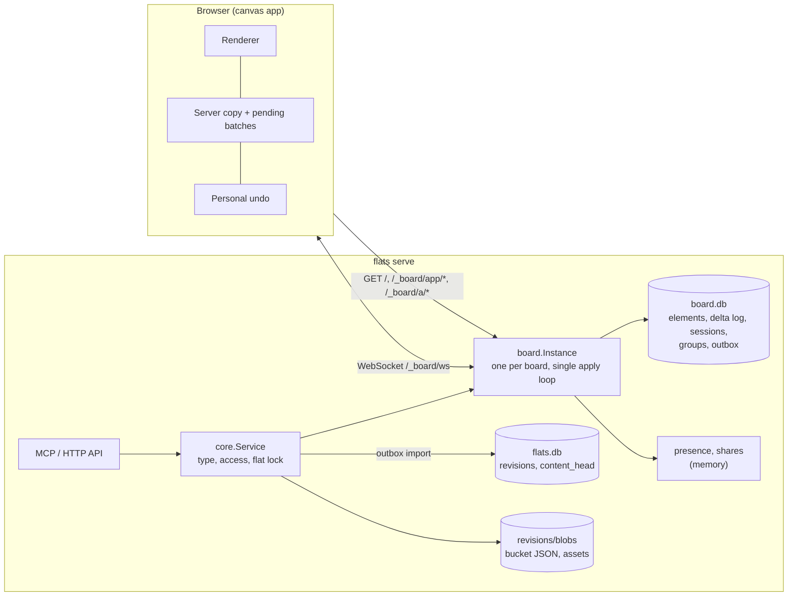
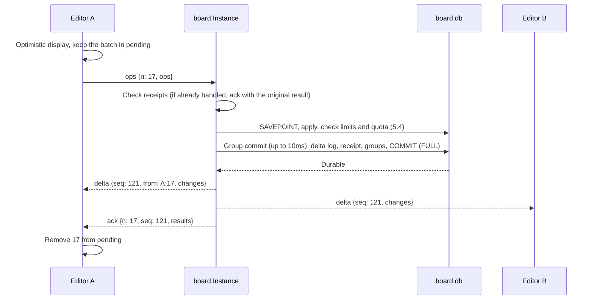

# Board content type technical design

Status: design for the unshipped board type (2026-10-19). Implemented on an unreleased branch; the measurements of section 14 are not done.
Base: `d9a1381` (origin/main, 2026-10-19). Product contract: [board.md](board.md).

This page designs the B1 scope of the [board product spec](board.md). Rule
and principle numbers refer to the numbered items of that spec. Plain section
numbers such as (4.1) refer to sections of this page.

## 1. Decision summary

| Topic | Decision |
|---|---|
| Where it runs | Like design, a **Go handler inside the host process** (`internal/board`). It uses no worker |
| Concurrent editing model | **Server authority with last writer wins per property bundle** (the Figma approach). Values are always absolute. Frame and group members follow the actual movement of their container. Membership, groups, order and deletion are **semantic operations** that the server computes from the current state. Every explicit target carries an expected incarnation that the server checks |
| State synchronization | The client's server copy changes only through **canonical deltas with consecutive seqs**. An ack only removes the pending batch |
| Live transport | One same-origin WebSocket. The RFC 6455 implementation in `internal/runtime/ws.go` moves into `internal/wsconn` for reuse |
| Current state | A board database inside the flat directory, `flats/<slug>/board/board.db` (counted by the disk quota). It is **the only source of truth** |
| History | The same **outbox pattern** as the docs worker. Each change and its revision boundary are written in one board.db transaction, and the host imports them idempotently into the [revision store](../revision-store.md) |
| Revision snapshot | 256 bucket JSON files with user content only, plus assets. Concurrency metadata (incarnations, group versions) stays out, so a rollback reuses the blobs as they are |
| Client | A plain JS module with no build step and no third-party code (`internal/board/web`), using Canvas 2D with a DOM overlay |
| Agents | New MCP tools `get_board`, `update_board`, `get_board_share` and `import_board`. The revision tools stay as they are |

## 2. Structure



- **board.Instance.** There is one per board. People's batches, agent writes,
  rollbacks, imports and group closing all pass through the instance's
  **single apply loop**. This order is the "order in which the server received
  them" of [rule 29](board.md#concurrency-rules).
- The instance accepts only requests on which core set `X-Flats-Access`. When
  the board is renamed, deleted or shut down, the instance stops, refuses new
  requests with 503 and closes every hijacked socket.
- It works regardless of the server flats setting.

### Why this structure

| Alternative | Assessment |
|---|---|
| A worker with a Yjs CRDT, like docs | Adds a build step, a third-party runtime and a worker lifecycle. A board merges per property bundle of an element, so B1 gets no benefit from a character-level CRDT |
| A file head with refusal on a failed guard, like design | [Principle 3](board.md#principles) and the [concurrency rules](board.md#concurrency-rules) require merging people's edits, not refusing them. The 512-file limit does not fit either |
| Current state in flats.db | The disk quota does not count flats.db (revision-store "Disk quota"). Current state and history boundaries could not share one transaction either |
| **Server authority, semantic operations and a board.db outbox** | Fits the single-host premise and reuses the proven docs pattern that keeps "a change and its boundary exist together or not at all" through a crash |

## 3. Data model

### 3.1 Elements

An element has **content fields** (which go into revisions) and **runtime
fields** (which exist only in board.db).

```json
{
  "id": "e_7Hk2pQ9xLm", "type": "sticky",
  "x": 120, "y": 80, "w": 200, "h": 200, "rot": 0,
  "z": "a0V", "frame": "e_frame01aaa", "group": null, "locked": false,
  "text": "Onboarding is too long",
  "style": {"color": "yellow"},
  "by": "ts:alice@example.com", "at": 1760846400
}
```

| Content field | Meaning |
|---|---|
| `id` | Unique within the board. `e_` plus 10 base62 characters. The client creates it. If the id already exists (including in a deleted state) or has the wrong form, the server ignores that `add` |
| `type` | `sticky`, `text`, `shape`, `connector`, `pen`, `image`, `frame` |
| `x, y, w, h, rot` | Canvas coordinates (CSS px at 100%). Finite numbers, coordinates ±10,000,000, size 1 to 100,000, rotation 0 to 360 |
| `z` | Stacking order. A fractional index string (base62). The full order is `(z, id)` in lexicographic order, so every client draws ties in the same order. A newly created frame goes **behind** every element, so the elements then moved into it stay above its fill (opaque unless it is `none`); any other new element goes in front. The browser client sends that `z` when it creates or pastes elements (pasted frames behind in their order, the rest in front), an agent call computes it for an `add` without `z` (8.1), and the recovery import puts its "Recovered edits" frame behind the file's elements (9.3). Element recovery from a revision (7) and `import_board` add keep the copied elements' relative order, above every element. A person `add` without `z` gets a key above every alive element |
| `frame`, `group` | Explicit membership ([rule 3](board.md#content)) |
| `locked` | Lock |
| `text` | Plain text of a sticky, text box, shape, frame (its name) or connector (its label). At most 4,000 characters (200 for a frame name or connector label), stored exactly as received without NFC normalization |
| `style` | Style per type, with the keys, values and defaults of [Appendix A](#appendix-a-schema). Colors are stored as semantic names (`yellow`, `blue`, ...), and client tokens choose the actual color for each theme (11.4). Unknown keys are refused; a missing key means its default |
| `by`, `at` | The creating editor's key and time (informational). **Never sent to Public** (7.3) |

Content fields per type:

| Type | Fields |
|---|---|
| `shape` | `style.shape`: `rect`, `round`, `ellipse`, `diamond` |
| `connector` | `ends`: the two ends. Each end is `{"el": id, "at": [ax, ay]}` (the target element and a normalized position from 0 to 1 inside the target's bounding box) or `{"pt": [x, y]}` (a free coordinate). `style.route`: `straight`, `elbow`. A connector's `x,y,w,h,rot` are not stored; the server computes them from the endpoints |
| `pen` | `pts`: `[x0,y0,x1,y1,...]`, normalized coordinates inside the element box (integers from 0 to 10,000), 2,000 points per stroke. **Set at creation and never changed** by edits (the B1 eraser deletes whole strokes); only a whole-board rollback or replacement can give a surviving pen other points, keeping its incarnation (4.11, 4.12). Moving and resizing change only `geom`. `style.width`: `pen`, `marker` |
| `image` | `asset`: the asset hash, `alt`: alternative text (at most 1,000 characters), `natural`: `[w, h]`. `asset` and `natural` are fixed like a pen's `pts`: only a whole-board rollback or replacement changes them (4.11, 4.12) |
| `frame` | `text` is the frame name |
| `connector` label | `text` is the label, drawn at the middle of the path |

Runtime fields (a row of the board.db `elements` table):

| Runtime field | Meaning |
|---|---|
| `inc` | Incarnation. An element receives the seq of the batch when it first appears, and again when a deleted id reappears (`revive`, rollback). Seqs are never reused, so incarnations are never reused either |
| `v` | The seq of the last change per bundle. Guards and undo use it. One more key, `fixed`, is no bundle: it is the seq of the last rollback or replacement that changed a field outside every bundle (`by`, `at`, a pen's `pts`, an image's `asset` or `natural`) of an element that kept its incarnation (4.11, 4.12). Nothing else sets it, so such a change still raises the element's `ver` (8.1). Only bundle names and `fixed` are written today; readers treat any other key in `v` as opaque |
| `deleted`, `del_seq` | The deleted state and the seq of the batch that deleted the element |
| `pre_rel` | The relations from **before the batch that deleted this element started** (4.1): this element's `frame` and `frame_inc`, `group`, (for a connector) each end's target and incarnation, (for a target) the connector ends attached to it `[{conn, conn_inc, end, at}]`, (for a frame) its members `[{id, inc}]` |
| `end_inc`, `end_last` | Connectors only: for each attached end, the target's incarnation, and the end's world coordinate computed when the connector was deleted (4.4) |

### 3.2 Property bundles

The property groups of [rule 27](board.md#concurrency-rules) become fixed keys.
This page calls them bundles, to keep them apart from element groups and from
the edit groups of 5.3. A client's ordinary `set` changes values only per
bundle.

| Bundle key | Fields | Allowed in an ordinary `set` |
|---|---|---|
| `geom` | `x, y, w, h, rot` | Yes (move, resize, rotate, as absolute values). Connectors have no such bundle. A pen's `pts` is an immutable field, not a bundle |
| `end0`, `end1` | `ends[0]`, `ends[1]` | Yes |
| `text` | `text` | Yes |
| `style.<k>` | One key of `style` | Yes |
| `alt` | Image alternative text | Yes |
| `locked` | Lock | Yes |
| `z` | Stacking order | Yes |
| `frame`, `group` | Membership | **No**. Only semantic operations (4.3) change them |

### 3.3 Board metadata

`board.json` holds `{"format": 1, "title": "...", "grid": true}`. The
metadata is a **pseudo-element** with id `_board`: bundles `title` and `grid`,
a `v` per bundle, and a single `board.json` file instead of buckets. The
metadata therefore takes the same paths as elements for deltas
(`{id: "_board", set: {...}}`), dirty marking, recording (5.3), rollback
(4.11) and undo guards. `_board` cannot be deleted or revived.

## 4. Operations

### 4.1 Basic operations

Every explicitly targeted element carries its **expected incarnation**
(`inc`). The server applies the operation only when that element is alive and
its incarnation matches (otherwise `void:gone`). Old input therefore never
reaches an element that was deleted and later revived under the same id
([rule 31](board.md#concurrency-rules)).

**Elements this session created.** A client cannot know the incarnation of an
element it created in a batch that the server has not acknowledged yet. So an
expected incarnation of `0` (in `inc`, `inc_of`, `refs` or `frame_inc`) means
"the incarnation that this session's own `add` or `revive` of this id
produced". The server keeps one row per element a session created or revived
(board.db `created`, kept until the session expires) and resolves `0` through
it. When the session has no such row, or the element's current incarnation
differs from it, the operation is `void:gone`. This covers creating an element
and editing it before the ack, creating and connecting in one batch (quick
creation), and resending such batches after a reconnect, because the session
survives the reconnect. When the delta arrives, the client replaces `0` with
the real incarnation in later batches. An `add` writes its `created` row
before the later operations of the same batch evaluate `0`, and when this
session's own undo or redo revives an element, its `created` row moves to the
new incarnation (the same rule as "Linking incarnations" in 4.10).

| Operation | Form | Condition to apply (otherwise ignored, with a reason) |
|---|---|---|
| `add` | `{op:"add", el, refs?}` | No row with that id exists (a row left in the deleted state still gives `exists`). `refs` holds the expected incarnations of the elements that `el` references (`frame`, `group`, connector end targets; for assets in 7.2, the hash) |
| `set` | `{op:"set", id, inc, g, val, if_v?, base_v?, carry?, refs?}` | Alive with a matching incarnation. `g` is a bundle allowed in an ordinary `set` (3.2). With `if_v`, `v[g] == if_v` (`stale`). When locked, only `g == "locked"` (`locked`). When `val` references another element (a connector end), the incarnation in `refs` must match |
| `revive` | `{op:"revive", ids, if_del}` | Revives each element when all `ids` are in the deleted state from the same batch (`del_seq == if_del`) (otherwise only that element is `stale`). Counts as one, like a semantic operation |

- The incarnation is checked **before** the value is checked against the
  element's type. A rollback or replacement (4.11, 4.12) that reuses an id
  for another type gives it a new incarnation, so a pending `set` of `text`,
  `geom`, an end or a style key against the old incarnation is `void:gone`
  like any other operation against an old incarnation, and the rest of its
  batch applies ([rules 30 and 31](board.md#concurrency-rules)). The form of
  a `set` is still checked whatever the board holds: a `g` that no element
  type can set, or a `val` that no type with bundle `g` accepts, is a format
  error. A `val` that the matching incarnation's own type does not accept is
  a format error too, since the client named that incarnation and so knew
  its type.
- `val` is the **absolute value** of the whole bundle (`{x,y,w,h,rot}` for
  `geom`). A partial value is a format error. When two people move the same
  element at once, the later value therefore stays as it is
  ([rule 29](board.md#concurrency-rules)).
- The server applies the operations of a batch in order and reports a result
  (`ok`, `void:<reason>`) for each operation. Ignored operations do not stop
  the rest from applying ([rule 30](board.md#concurrency-rules)).
- **Relation originals are per batch.** While applying a batch, the server
  copies the batch-start value of every element whose relation fields
  (`frame`, `group`, connector ends) it changes for the first time
  (copy-on-write). The `pre_rel` of an element that this batch deletes comes
  from these batch-start values. The original connection therefore survives
  when one batch runs `delete_frame_contents` twice, or when an earlier
  operation detaches a connector and a later one deletes it. All deletions in
  one batch share the same `del_seq` (the seq of that batch).
- The server handles `revive` in **two phases**, so the result does not depend
  on order. Relations come back from `pre_rel`.
  1. Decide the set S to revive (the `ids` with `del_seq == if_del`) and first
     assign every element of S its new incarnation (the seq of this batch).
     A revived element keeps the `v` it had when it was deleted.
  2. Restore the relations.
     - **Relations inside S** (connector ends, frame membership, groups) come
       back as in `pre_rel`, linked to the new incarnations. Connections
       deleted together in one batch return regardless of deletion order.
     - **Relations with elements outside S** fall into two cases.
       - **Reference only** (an end of a revived connector attached to an
         outside element X, a revived element belonging to an outside frame
         F): the outside element does not change, so the relation comes back
         when X (or F) is alive and its incarnation equals the value in
         `pre_rel`. Locks do not matter. Otherwise the connector end becomes
         a free end at its coordinate just before deletion, and the
         membership becomes empty.
       - **Changing an outside element** (reattaching the end of an outside
         connector C that the deletion detached, putting back an outside
         element whose membership the frame deletion cleared): the server
         changes it only when C (or that element) is alive, not locked, has
         the same incarnation, and the `v` of the bundle concerned is still
         that deletion seq. Otherwise the outside element stays as it is.
     - Last, the server checks the group invariant (all current members of a
       group are in the same frame). In a group that breaks it, outside
       elements this revive put back into a frame leave it again first; then
       every element of S that still breaks it loses its `group`. An undo
       runs this check after its relation step (4.10).

### 4.2 Moves that follow a container

The server defines the movement of frame and group members as a **rule that
follows the container's actual movement**. The client sends only the absolute
`geom` of the elements it grabbed directly.

- **Frame.** When a frame's `set geom` carries `carry: "members"`, the server
  moves **every current member** by the difference (dx, dy) between the
  frame's old and new positions at that moment. It moves locked members too
  ([rule 3](board.md#content): a lock blocks only direct manipulation). The client
  sends `carry: "members"` on every move of a frame (a drag, arrow keys,
  align and distribute) and never when a person resizes it, so resizing from
  the left or top edge (which changes `x` or `y`) leaves members where they
  are.
- **No double moves.** When a batch moves a frame with `carry: "members"` (or
  an element with `carry: "group"`), the client leaves that container's
  members out of the batch, so a selection holding a frame and some of its
  members moves each member once. A test aligns a selection that holds a
  frame and one of its members.
- **Group.** When `set geom` carries `carry: "group"`, the server moves the
  other current members of the same group by the difference between that
  element's old and new positions.
- For every element that moved along, `v.geom` becomes the seq of this batch
  and the delta carries the resulting value. A connector member has no
  `geom`, so the server moves **only its free ends** by the same amount and
  updates `v.end0`/`v.end1` for those ends. Attached ends follow their targets
  on their own.

How this rule relates to [rule 29](board.md#concurrency-rules): bundle last-writer-wins
decides the container's own `geom`, and members move "by as much as the
container actually moved" as a derived effect. For example, when A moves a
frame to x=10 and B moves it to x=20 at the same time, the frame keeps B's
value 20. The members move +10 when A's batch applies and +10 when B's
applies, so they end up +20 together with the frame. If C meanwhile moved one
member to an absolute coordinate, that member moves on from C's position by
the frame's remaining movement (members follow their container).

When several elements are dragged together, one batch holds the frames and
groups under the rules above and every other element with its own absolute
`geom`. The client does not send the elements inside a frame separately.
Moving a frame that holds 10,000 elements is one `set`. A test checks that resizing a frame from its top-left corner keeps every member at its world position.

### 4.3 Semantic operations

For these operations the server computes the result from **the current state
at the moment of applying**. Explicit targets carry expected incarnations.

| Operation | Form | Server computation |
|---|---|---|
| `reparent` | `{op:"reparent", ids, inc_of, frame, frame_inc?}` (`frame` is an id or `null`; `frame_inc` is required with an id) | Moves all group members of a target together (group invariant). A frame cannot go inside a frame. Ignored when the target frame does not exist or its incarnation differs. A locked direct target is ignored (`locked`); locked members of its group change membership along with it |
| `group` | `{op:"group", ids, inc_of, group: new id}` | All targets must be alive, not locked, in the same frame (or all outside frames) and in no other group. Otherwise the whole operation is ignored (`invalid_group`), as [rule 34](board.md#concurrency-rules) states |
| `ungroup` | `{op:"ungroup", group}` | Clears `group` on every current member of that group (including locked members, because ungrouping acts on the group itself). Every `group` operation creates a new group id and ids are never reused, so no incarnation is needed: the board records every group id it has used (board.db `created`, under no session, never expiring), and a `group` naming one is ignored (`invalid_group`) even after an ungroup, after its members' rows are purged and after a restart |
| `delete` | `{op:"delete", ids, inc_of, if_v?}` | Each element must be alive, have the same incarnation and not be locked (otherwise only that element is ignored). With `if_v` (per element `{g: v}`), every bundle must match (`stale`). The server first captures `pre_rel` for the whole set to delete, **before changing anything**. Then, for a frame, it clears the `frame` of members outside the set, and replaces the attached ends of connectors outside the set with free coordinates computed from the shape just before deletion, clamped to the coordinate range (±10,000,000): a target at the edge of the range reaches past it with its size and rotation |
| `delete_frame_contents` | `{op:"delete_frame_contents", frame, inc}` | Deletes the frame and its current members under the rules above. **Locked members are not deleted**; only their membership is cleared. The result reports how many locked elements remain |
| `zorder` | `{op:"zorder", ids, inc_of, to, if_v?}` (`if_v` is used by undo) | `to`: `"front"`, `"back"`, `{"after": id, "inc"}`, `{"before": id, "inc"}`. Locked targets are ignored. The server creates a new `z` from the current order |
| `meta` | `{op:"meta", g, val, if_v?}` | A board metadata bundle (the `_board` pseudo-element, 3.3) |
| `undo` / `redo` | `{op:"undo"}`, `{op:"redo"}` | Reverts one entry of that session's server-side undo stack, with guards (4.10) |

- One semantic operation counts as one toward the batch limit (4.5),
  regardless of how many elements it affects.
- The server sends the result as a canonical delta (4.6). The client's
  optimistic display is an approximation, and the delta replaces it when it
  arrives.

### 4.4 Connectors

- The actual coordinate of an endpoint comes from the target element's
  current `geom` and `at` (including rotation). The server and the client use
  the same function (`endpointWorld`), and shared test vectors keep the Go and
  JS implementations equal.
- Dragging a connector moves **only its free ends**, through `set end0`/
  `set end1` (an absolute `pt`). Attached ends stay. A connector with both
  ends attached does not move when dragged; the person has to drag an end and
  reattach it ([rule 4](board.md#content)). Connectors have no `geom` bundle.
- A `set end` that attaches an end to an element gives the target's expected
  incarnation in `refs`.
- Copy and paste, element recovery and data import relink references inside
  the copied range to the new ids, and turn references outside the range into
  free ends at the coordinate of that moment. The client (paste) and the
  server (import, element recovery) use the same rule and test vectors.
- When a target element is deleted, the 4.3 `delete` detaches the ends in the
  same batch. The delta carries the detached coordinates and end versions.
- When a connector itself is deleted, it keeps the world coordinate of each
  attached end at that moment in `end_last`, clamped to the coordinate range
  like a detached end. A rollback or replacement (4.11, 4.12) takes these
  coordinates from the board as it was before the reset installed any new
  content, so a target id that the new content reuses for another type does
  not lend the new element's geometry to the deleted connector's ends. When
  the connector is revived,
  each attached end stays attached if its target is alive with an
  incarnation equal to `end_inc`, and otherwise becomes a free end at the
  `end_last` coordinate (the case where the connector was deleted first, the
  target later, and then only the connector was revived).
- When an end attaches (`add`, `set end`, revive), the server records the
  target's current incarnation in `end_inc`. An attached end's target is
  always alive with that incarnation, so a delta's `set` of an end carries
  no `end_inc`: a Private client that keeps `end_inc` takes it from its copy
  of the target after applying the whole delta (0 for a free end); the board
  page does not use it. Elements sent whole (`add`,
  `revive`, snapshots) carry `end_inc`.
- **Default attachment point.** An agent end attached without `at` (8.1)
  gets the middle of one side of its target (`[1, 0.5]`, `[0, 0.5]`,
  `[0.5, 1]` or `[0.5, 0]`), so the line starts on the outline instead of
  crossing the target's text. The server takes the direction from the
  target's center to the other end, turns it into the target's rotated
  frame and picks the side through which that ray leaves the box
  (`|dx|·h ≥ |dy|·w` picks left or right, a tie included). The other end
  counts at its `endpointWorld`, at its coordinate when free, and at its
  target's center when it has no `at` either, so the choice does not depend
  on the order of the ends. The server chooses after the call's layout help
  (8.1) has placed every element, and stores the result as an ordinary
  `at`. The function is `defaultAt` in both Go and JS, with shared test
  vectors next to `endpointWorld`'s.
- **Attaching in the canvas.** The connector tool and an end drag attach at
  the point under the cursor when it lies on the target's outline (within
  8 screen px, snapping to a side's middle nearby), and otherwise at the
  `defaultAt` side facing the other end, never at the center.

### 4.5 Batches, limits and refusals

- One action of a person (a drag, a paste, an alignment and so on) is one
  batch. A batch holds at most 500 operations (semantic operations, `revive`,
  `undo` and `redo` count as one).
- When a serialized batch exceeds 256 KiB (pasting many elements, pasting a
  large data import), the client splits it into `ops_part {n, part, parts,
  data}`. `data` is a slice of the batch's serialized JSON text, cut so that each whole
  `ops_part` frame, measured after encoding, stays within the 256 KiB limit
  for client-to-server frames. `parts` is from 2 to 32 and the parts come in
  order one at a time, and a duplicate or skipped part is a protocol error. When
  the actual accumulated bytes exceed 8 MiB, or the parts do not finish
  within 30 seconds after the first, the server discards them and reports a
  transient failure (`retry: true`). Each connection assembles at most one
  batch, and assembly memory for the whole host is 64 MiB; beyond that, the
  server defers new assemblies as transient failures. After all parts arrive,
  the server applies them atomically as one batch. The server handles undo
  (4.10), so undo never becomes a large request.
- When a drag ends with an element's center inside a different frame (for
  elements that are not frames) or outside its frame, the client adds a
  `reparent` to the same batch. When a person creates an element inside a
  frame (a tool, paste, quick creation, a dropped image), the client sets
  `frame` in the `add` to the topmost frame that contains the element's
  center ([rule 3](board.md#content)). Agents set `frame` or use `layout.in`
  explicitly. Only these explicit fields and operations change membership.
- Per-item limits (section 12): after applying a batch, the server refuses it
  when some item is over its limit and that item's excess **grew compared
  with before the batch** ([rule 7](board.md#content)). Each state's excess
  is measured against the limit of that state's element type, so an id that
  a replacement (4.12) reuses for another type is judged by the new type's
  limit: a sticky's 1,000 characters refuse it as a frame name. Element
  recovery (a copy from an earlier revision) is an ordinary edit and goes
  through this check. Only a whole-board rollback skips it.
- There are two kinds of refusal.

| Kind | Examples | Server | Client |
|---|---|---|---|
| Permanent refusal `reject {n, code, retry: false}` | Format error, limit, disk quota, permission | Consumes the batch number: records the refusal in the receipt and advances `max_n` | Drops the batch from `pending` and tells the person |
| Transient failure `reject {n, code, retry: true}` | No quota budget, instance busy, waiting for import | Does not consume the number (no receipt, `max_n` unchanged) | Keeps the batch and its number and resends it with exponential backoff starting at 1 second. Later batches wait until then |

### 4.6 Server apply loop and canonical deltas



- **Canonical delta.** A delta holds what one batch actually produced, as
  result values per element and bundle. It includes the server's side effects
  too (moves that followed a container, detached connector ends, new
  incarnations, new `z` values, membership cleanup).
  `{seq, from?, by?, reset?, changes: [{id, inc, set: {g: [val, v]}, overwrote?: v} | {id, inc, add: el} | {id, del: del_seq} | {id, inc, revive: el}]}`.
  `reset` is `{kind: "rollback", of: R}` or `{kind: "replace"}` (4.11, 4.12).
  `by` and `at`, a pen's `pts` and an image's `asset` and `natural` belong
  to no bundle, so an element whose such field a reset changed goes out
  whole as `revive`, keeping its incarnation, with `v.fixed` set to the
  reset's seq (3.1), and its bucket counts as changed. A surviving
  connector whose end a reset kept while giving the end's target id a new
  incarnation (the content reused the id for another type) changes only its
  `end_inc`, which no `set` carries, so it goes out whole as `revive` too,
  keeping its incarnation. A Private copy that applies the delta then equals
  a fresh snapshot. Its bucket does not change, since `end_inc` is a runtime
  field and stays out of revision snapshots (5.1).
- Every committed batch goes out as a delta, **including to its sender**. Only
  batches that changed something get a seq. A batch whose operations were all
  ignored leaves only a receipt and no delta, and its ack's `seq` is the
  current seq at that time.
- **Large deltas.** When a serialized delta frame would exceed 512 KiB, the
  server sends it as `delta_part {gen, seq, part, parts, data}`. The client applies it at once
  after receiving every part. When a delta would take a Private connection's
  send queue over its 4 MiB cap, the server drops that connection's queue
  and switches to the snapshot of that seq with `resync {seq}` (4.8); when a
  snapshot is already pending there, it closes the connection instead (6). The client's `pending` and the server's
  receipts stay as they are. Each switch increments a per-connection
  generation number (`gen`); the client discards any `delta_part` it was
  assembling and ignores parts of earlier generations.
- Group commit: the server puts the batches that arrive within at most 10ms
  into one transaction and sends deltas and acks only after COMMIT
  (`synchronous=FULL`). "Saved" therefore appears only after a durable write
  ([rule 35](board.md#disconnection-and-reconnection)).

### 4.7 Client state machine

The client keeps `server` (the server copy), `watermark` (the last applied
seq) and `pending` (the list of sent batches). The screen is `server` with
`pending` applied again on top.

1. When `delta.seq == watermark + 1`, apply it to `server` and raise
   `watermark`. When `from` names one of its own batches, remove that batch
   from `pending`.
2. When `delta.seq > watermark + 1` (a gap), do not apply it; fetch again with
   `hello` (4.8).
3. Ignore `delta.seq <= watermark`.
4. `ack {n, seq, results}`: remove that batch from `pending`. **Do not change
   `server`.** The `void` results and the undo summary only drive notices
   (overwritten text, skipped undo).
5. `reject`: as in the 4.5 table.

Every client applies the same deltas in the same order, so the screen equals
the server once `pending` is empty. Even when an ack is lost and another
person overwrites the same bundle, `server` follows only the delta order and
does not drift.

### 4.8 Sessions, reconnects and duplicate prevention

- **Session.** The server issues it: `{id: 128 random bits, expires}`. It lives
  in board.db `sessions` and expires 24 hours after its last activity.
- **Batch number.** An `n` per session that increases from 1. The server keeps
  the session's `max_n` and `receipts(session, n) → {seq, results or reject}`.
  - `n <= max_n` with a receipt: the server does not apply it again and
    resends the original result (an ack or a permanent reject).
  - `n == max_n + 1`: apply.
  - `n <= max_n` without a receipt (the receipt was trimmed, see below):
    `fatal {code: "receipt_expired"}`. The client stops and creates a
    recovery file (9.3).
  - Anything else: a protocol error that closes the connection.
- **Reconnect.** `hello {v, session?, watermark?, pending: {count, first_n?}, editor, name?}`. `first_n` is present when `count > 0`.
  - Private, with a live session: when the delta log holds every entry
    from `watermark + 1` on without a gap and those deltas take at most half
    the send queue cap (2 MiB), the server sends those deltas; otherwise (a
    trim removed any of them, or the catch-up is larger) it sends a
    snapshot. A snapshot carries `seq`, and whether a rollback or replacement
    happened between `watermark` and that seq (`reset: true`, decided from
    the seqs recorded in `meta.resets`). The client then resends `pending` with
    the same numbers.
  - No session or an expired one: when `pending.count == 0`, the server gives
    a new session and starts with a snapshot. When `pending.count > 0`, it
    sends `fatal {code: "session_expired"}`. The client stops editing and
    creates a recovery file (9.3) ([rule 39](board.md#disconnection-and-reconnection)).
  - Public: always starts from a public snapshot (7.3).
- Deleting the board, renaming it and changing its type are also `fatal`.
- Retention, with byte caps far below any useful quota:
  - delta log: the most recent 20,000 entries, 1 hour or 16 MiB, whichever
    limit is reached first;
  - receipts: for the lifetime of the session, at most 16 MiB per board. Over
    the cap, receipts of expired sessions go first, then the oldest receipts;
  - undo: see 4.10.

  - deleted element rows: at most 16 MiB per board. Beyond that the oldest
    rows go first, their `deleted_refs` go down so their blobs can be swept,
    and undoing those deletions is then skipped as `gone`.

  After trimming or cleaning up rows, the server runs `PRAGMA
  incremental_vacuum` (board.db uses `auto_vacuum=INCREMENTAL`), so the file
  shrinks. The quota counts `page_count − freelist_count`, so freed pages
  never count, even before the vacuum runs. Deleted element rows still count
  while they exist, within their 16 MiB cap. A test fills the delta log with large container moves, lets it
  trim, and checks that later edits are accepted. The server cleans up deleted
  element rows once 24 hours have passed since the last revision boundary and
  only sessions that expired after it remain. The `created` rows of a session go with the session. Incarnations come from seqs, so
  reusing an id never collides with an old incarnation.
- `beforeunload`: warns when `pending` is not empty. When the person stays on
  the page, a top banner shows "Download unsent edits".

### 4.9 Actions in progress and text

- Drags, resizes, pen strokes being drawn and editing indicators go only
  through presence (20 times per second, not stored). Releasing the pointer
  or committing text sends one batch.
- **IME** ([rule 17](board.md#editing-in-the-browser)): while the editing overlay is composing,
  `text` deltas for that element apply to `server` but not to the overlay.
  Even when the element is deleted or rolled back during composition, **the
  overlay and the input buffer stay until composition ends.** When it ends, a
  surviving element gets an ordinary commit; for a vanished element the
  client does not commit and shows the "Keep my text" notice instead.
- **Overwritten-text notice.** A `set text` carries `base_v`, the `v.text` the
  person saw when editing started. When `v.text` differs from `base_v` at the
  moment the server applies it, the write still applies (last writer wins),
  and the delta marks the change with `overwrote: <the v.text it replaced>`.
  A client shows the notice only when `overwrote` equals the version of its
  own last `text` write to that element: that person's text was replaced by
  a concurrent edit. A later, sequential edit (whose author saw the current
  text) carries a matching `base_v`, has no `overwrote`, and shows nothing.
  "Keep my text" `add`s a new `text` element with that text, 24px to the right
  of the original element. Tests cover the concurrent and the sequential case.
  At most 8 notices that carry an action or stay until closed remain on
  screen; a ninth removes the oldest, so with more than 8 unanswered "Keep my text" notices the oldest
  text is no longer offered.

### 4.10 Personal undo (server-side stack)

The undo stack lives **on the server per session** (board.db `undo`). A
session exists only in tab memory, so a reload gives a new session and a new
empty stack ([rule 21](board.md#editing-in-the-browser): each tab has its own history, and a reload clears it). The
client sends only `{op: "undo"}` and `{op: "redo"}`. A large inverse change
does not affect the request size.

**Recording entries.** When the server applies one **ordinary edit** batch of a
session (one action of a person), it pushes what that batch actually changed
as one undo entry and clears the redo stack. `undo` and `redo` batches do not
follow this rule. An undo pops the top entry of the undo stack and pushes
what it actually changed as a redo entry; a redo pops the top entry of the
redo stack and pushes what it actually changed as an undo entry. The
opposite entry is recorded like an ordinary batch, so it covers side effects
too (connector ends a deletion detached or a revive reattached, members a
frame deletion released) and leaves out what was skipped. When nothing
changed, nothing goes onto the opposite stack. Fixed
tests: edit, undo, redo; consecutive undos; a new edit after undo clearing
redo.

| Original change | Record |
|---|---|
| Bundle value change (direct, including container following) | For each `(id, inc, g)`, the previous value (changed fields only), `prev_v`, `my_v` |
| Creation | `(id, inc)` and the `my_v` of every bundle at that moment |
| Deletion | The deleted set and `del_seq` (the relations are in the row's batch-start `pre_rel`) |
| Membership or group change | For each `(id, inc)`, the previous `frame`, `frame_inc`, `group`, `prev_v`, `my_v` |
| Stacking order | For each `(id, inc)`, the previous neighbor (`after`) and `my_v` |

**Applying undo** (inside the apply loop, receiving a seq like an ordinary
batch):

1. **Content bundles.** For each `(id, g)`, revert to the previous value when
   the element is alive, has the same incarnation, `v[g] == my_v` and is not
   locked (`g == "locked"` regardless of lock). A record whose element, or
   whose previous connector end target, is still deleted waits until after
   step 3. The side effects of relation restore (4) and deletion undo (3) do
   not change locked elements either.
   Undo does no container following. So when B moved member X after A's
   frame move, only X stays at B's position.
2. **Creation undo.** Deletes the element only when every bundle equals its
   recorded `my_v` (nobody but me changed it).
3. **Deletion undo.** The same two phases as `revive {ids, if_del}` (4.1),
   without the final group invariant check, which waits for step 4.
4. **Relations.** **First compute the final relations** of the candidates that
   passed the guards (`v.frame` and `v.group` equal `my_v`), then check the
   invariant (all members in the same frame, the frame alive) for each set
   connected by groups, counting elements revived in step 3 with the
   relations they came back with. Skip only the sets that break it and apply
   the rest. Do not widen the targets to new members that someone else added
   to the group later. Example: after group AB moved from F1 to F2 and nobody
   touched it, A and B return to F1 together as one set. **Then** the revive's
   group invariant check (4.1) runs on the elements step 3 revived and the
   outside members it put back into a frame. So when
   one batch moved group AB from F1 to F2 and deleted A, the undo revives A
   into F1 (its batch-start frame), step 4 returns B to F1, and A keeps its
   group.
5. **Order.** Revert by neighbor, guarded by `v.z`.

**Guards judge the start of the undo.** A step can change a bundle as a side
effect (a creation undo releasing a frame's members, a revive restoring a
relation). Every guard compares `my_v` with the version the bundle had when
the undo started, not with that side effect, so what others did before is
judged and the undo's own steps do not skip each other. When such a side
effect already set the bundle to the record's previous value, the record
counts as undone and its lineage carries on, but only when its guard passes
at the start: if someone else changed the bundle before the undo, the record
is stale and its lineage stays, even though the side effect wrote the
previous value (A creates X, then creates frame F and moves X into it; B moves
X out and back; undoing A's second batch deletes F and so releases X, but the
membership record is stale, and undoing X's creation keeps X). An element the
undo revives was deleted when the undo started, and nobody changes a deleted
element, so its versions at deletion are its start versions.

**Lineage.** When an undo succeeds on `(id, g)` and creates a new version `s'`,
the server looks at the nearest entry below it in the same session stack
with the same `(id, g)`, and changes that entry's `my_v` to `s'` only when it
equals the `prev_v` of the entry just reverted. Otherwise (someone else came
in between) it leaves it, and a later undo of that entry is skipped. Example:
A x=1 (s1) → B x=2 (s2) → A x=3 (s3). The first undo gives x=2 (s4). The
lower entry's `my_v` (s1) differs from the reverted entry's `prev_v` (s2), so
it stays, and the next undo is skipped because `v = s4 ≠ s1`, leaving B's x=2.
Redo records only what the undo actually changed, in the same way.

**Linking incarnations.** When a deletion undo performed by this session's
undo or redo gives an element a new incarnation, the server changes the
incarnation from the old value to the new one in that element's entries of
**the same session's** undo and redo stacks (and in the relation records that
reference the element). A deletion record keeps its relations in the deleted
rows' `pre_rel`, so the server also relinks the references to the element in
the `pre_rel` of every row that a deletion record of these stacks names:
otherwise a connector deleted before its target comes back with a free end
once both deletions are undone. "Edit text → delete → undo delete → undo text edit"
therefore works. New incarnations created by other sessions or by rollback
are not linked (those are someone else's re-creation).

**Result.** The ack's `results` carry `{undone: applied count, skipped:
{stale, locked, gone, invalid_group}}`, and when something was skipped the
client shows "Changes other people made later were not undone." Everyone
receives the changes as an ordinary delta.

**Retention.** The most recent 100 entries per session, and undo storage for
the whole board of 32 MiB, or one sixteenth of the flat's disk quota when
that is smaller (with no disk quota, 32 MiB) (beyond that, the oldest entries of the oldest
session go first, and when that session reaches such an entry it gets
"cannot undo further"). When a session expires, its stacks are deleted. The
undo table lives in board.db, so the disk quota counts it. An entry holds
only the changed fields, so even moving a frame of 10,000 elements stays
around 1 MB or less.

**Clearing.** A whole-board rollback or replacement (4.11, 4.12) clears every session's stacks
([rule 21](board.md#editing-in-the-browser)). Reconnects and `resync` do not clear them.

### 4.11 Whole-board rollback

[Rule 32](board.md#concurrency-rules). This is one item of the apply loop.

1. **Hold.** The host inserts `(flat, op_id, R)` into `flats.db`
   `content_holds` (retention cannot delete R until the rollback finishes).
2. **One board.db transaction.**
   1. Batches that arrived earlier have already applied. When an open person
      group is dirty, record a `person` outbox entry (5.3).
   2. Read R's buckets (blobs) and set the elements table to R's content.
      - An element alive now and present in R: **keeps its incarnation**.
        Only the bundles whose content differs change, and their `v` becomes
        the rollback seq. Its `by` and `at` become R's, and so do a pen's
        `pts` and an image's `asset` and `natural` when R holds other values
        under the same id and type; the element then goes out whole (4.6)
        and its `v.fixed` becomes the rollback seq (3.1), so its `ver` grows
        and an agent guard read before the rollback no longer matches (8.1).
        Only an id that R holds with a different element type is deleted
        and created again with a new incarnation, as in 4.12.
      - An element absent now and present in R: revived with a new
        incarnation (the rollback seq).
      - An element alive now and absent in R: deleted (`del_seq` is the
        rollback seq). Its `pre_rel` and, for a connector, its `end_last`
        describe the board before the rollback, even when R reuses a
        target's id for another type (4.4).
   3. Set the `_board` metadata bundles from R's `board.json` under the same
      rule (change only differing bundles and update their `v`).
   4. Rebuild the asset rows from the result: every asset that an element
      alive after the rollback references gets a row with the matching
      `refs` count. A row that was cleaned up comes back from R's
      `assets/<hash>.*` revision file (its blob exists because the hold keeps
      R), with the type and size read from that blob's header. Elements that
      became deleted move their references to `deleted_refs`. Every changed
      bucket gets `dirty_seq`, and every changed element row its new `bytes`.
   5. Clear every session's undo and redo stacks.
   6. Append the delta row of this change to the delta log.
   7. Record a forced `rollback` entry with R's file list as it is (no new
      blobs), and record `op_id` in `ops`. Append the rollback seq to
      `meta.resets`.
3. Send a delta with `reset: {kind: "rollback", of: R}` (the 4.6 large-delta
   rule applies when it is large). Clients keep their `pending` batches and
   resend them as usual.
4. Synchronous import (5.3). The hold is released when the import turns the
   rollback entry into a revision.

**Settling holds.** At startup and after a failed rollback, for every board
hold: when board.db `ops` has its `op_id`, the rollback finished and the host
waits for the import; otherwise step 2 did not commit and the host releases
the hold. The docs hold settlement (`settleHoldsLocked`) is extended to cover
boards.

Batches that arrive after the rollback apply under the ordinary rules. Edits
to elements that stayed alive apply on top of R's values. Elements that
vanished and elements that were revived (with a different incarnation) give
`gone`.

Element recovery (copying elements from an earlier revision, 7) and `add`
imports restore asset rows the same way as step 2.4 for the assets they bring
back. A test rolls back to a revision with an image whose asset row was
cleaned up, runs a sweep after the grace period, and checks the image still
loads.

### 4.12 Whole-board replacement

`import_board {mode: "replace"}`, `POST /_board/api/import` with
`mode=replace`, and `update_board {replace: true}` replace the board's
content. This is one item of the apply loop, with the steps of 4.11 and a file
or call as the source instead of R:

1. All checks of 9.2 (or of the call's operations) pass first; otherwise
   nothing changes. The images of the archive or the call go through the
   section 10 checks, are stored as blobs and get asset rows with
   `held_until`, like an upload, before the transaction references them.
2. One board.db transaction:
   1. When an open person group is dirty, record a `person` entry.
   2. Set the elements table to the new content. Ids that are alive now and
      present in the new content keep their incarnation and change only the
      differing bundles, the author fields and a pen's `pts` or an image's
      `asset` and `natural` (4.6), setting `v.fixed` to the replacement seq
      when one of those fields changes (3.1, 8.1); ids absent now get a new
      incarnation; ids alive now and absent from the new content become
      deleted, with `pre_rel` captured as for a deletion and a connector's
      `end_last` taken from the board before the replacement (4.4). An id that the new content reuses for a
      different element type is treated as deleted and created again.
   3. Set `_board`, rebuild asset rows (4.11 step 2.4), set dirty buckets.
   4. Clear every session's undo and redo stacks.
   5. Append the delta row to the delta log.
   6. Record a forced `import` entry and the `op_id` in `ops`, and append its
      seq to `meta.resets`.
   7. Measure the quota (5.4) after all of these writes; when it does not
      fit, roll back the whole transaction and refuse the call with nothing
      changed.
3. Send a delta with `reset: {kind: "replace"}`. Clients keep and resend their
   `pending` batches, which then apply by the ordinary rules.
4. Synchronous import (5.3).

## 5. Storage

### 5.1 board.db

`flats/<slug>/board/board.db` (WAL, `synchronous=FULL`, `auto_vacuum=INCREMENTAL`, `busy_timeout`). The
disk quota measurement includes it as it is. Only the instance's apply loop opens it for writing.

| Table | Contents |
|---|---|
| `meta` | `store` (a random id for this outbox), `seq`, `newest` (the file list of the last outbox entry), `resets` (recent rollback and replace seqs), `share_n` (the last share number), `wal_truncate` |
| `elements` | `id PK, inc, data (content JSON), v (JSON), deleted, del_seq, pre_rel (JSON), end_inc (JSON), end_last (JSON), bucket, bytes`. The `_board` row is the metadata. `inc`, `v`, `deleted`, `del_seq`, `pre_rel`, `end_inc` and `end_last` are runtime fields and are left out of revision snapshots, data files and the public projection |
| `buckets` | `bucket PK, dirty_seq, bytes`: the serialized size of a bucket and whether it changed since the last outbox entry. `board.json` is one row too |
| `deltas` | `seq PK, from_session, n, by, changes (JSON), at` |
| `sessions` | `id PK, key (editor key), label, verified, max_n, last_at` |
| `created` | `session, id, inc`, PK `(session, id)`: the incarnation each `add` or `revive` of a session produced, to resolve an expected incarnation of `0` (4.1). Rows with an empty session record every group id the board has used, with the seq that first used it (4.3); they never expire |
| `receipts` | `session, n, seq, results (JSON)`, PK `(session, n)` |
| `groups` | `editor PK, label, started_at, last_at, dirty` (the same meaning as in the docs worker) |
| `undo` | `session, stack (undo\|redo), idx, data (JSON), bytes`, PK `(session, stack, idx)`: server-side undo entries (4.10) |
| `outbox` | `seq PK AUTOINCREMENT, created_at, kind, authors, message, rollback_of, op, files (JSON: [{path, hash, size}])` |
| `snapshots` | `hash PK, data, refs`: bucket JSON that outbox entries reference and that the host may not have stored as a blob yet |
| `assets` | `hash PK, mime, w, h, bytes, refs, deleted_refs, held_until`: assets that live elements reference (`refs`), **that rows in the deleted state reference** (`deleted_refs`, for deletion undo), or that are protected right after upload (`held_until`) |
| `ops` | `id PK, kind, request_hash, outbox_seq, result (JSON), at`: operation ids and final results of agent calls, imports and rollbacks. Kept for 24 hours after their outbox entry is imported (never deleted before the import). The revision number is found in the host's `board_imports` (5.3) |

### 5.2 Revision snapshots

A snapshot is expressed as revision store "files". It holds **content fields
only**.

```text
board.json                  board metadata
elements/00.json … ff.json  256 buckets. Bucket = first byte of sha256(id). An empty bucket has no file
assets/<sha256>.<ext>       only the assets that elements alive at that moment reference
```

- A bucket file is canonical JSON of `{"<id>": {content fields}}` with sorted
  keys. Equal content gives an equal hash, so revisions share storage. A
  rollback uses R's file list as it is, so it adds no new blobs
  ([rule 45](board.md#revisions)).
- Size: with an average element of 300 B, 10,000 elements give about 12 KB per
  bucket. With only maximum-size elements (4,000 characters, a 2,000-point
  pen), a bucket reaches at most about 1.5 MB. The bucket count stays the
  same, and this worst case goes into the quota calculation (5.3) and the
  transfer limits.
- The number of changed elements of a revision ([rule 46](board.md#revisions)) is
  computed during import by comparing the changed buckets with the previous
  revision, and kept in the host table `board_rev_stats(flat, number, added,
  changed, removed)` (cascade-deleted with the revision row). When it is
  missing, it is computed again on open. For a board, the revision's
  `changes` column holds bucket paths as for any revision, but the History
  panel and `list_revisions` report the element counts of `board_rev_stats`
  instead of paths.
- `content_head` holds the file list of the last imported entry, as for a
  design. It can lag board.db, which stays the source of truth; only the
  sweep and revision reads use it.

### 5.3 Outbox and import

This adapts the rules of the docs worker's
[Recording](../internal/docs-app.md#recording) to boards.

**record** (inside the caller's board.db transaction):

1. Serialize the buckets with `dirty_seq` set (and `board.json`) in memory and
   hash them. Every other bucket keeps its hash from `meta.newest`.
2. The asset list is the assets that live elements reference.
3. When the record is not forced and the file list equals `meta.newest` (the
   content became equal to the last entry again), create no entry and clear
   only the buckets' `dirty_seq` and the groups' `dirty`. `snapshots` stays
   untouched.
4. Otherwise insert only the buckets with new hashes into `snapshots` (raise
   the reference count of those already present), insert the outbox entry,
   update `meta.newest`, and clear the buckets' `dirty_seq` and every group's
   `dirty`.

**Boundaries** (each in one board.db transaction):

| Boundary | In the same transaction |
|---|---|
| A person's batch | Update the editor's group (keep `started_at`, set `last_at`, `dirty=1`), set the buckets' `dirty_seq` |
| Closing a group (5-second ticker, 30 seconds idle or 5 minutes) | When dirty, a `person` entry (current state, attributed to the editors of the dirty groups); delete expired groups |
| An agent write | When dirty, a `person` entry; then delete every group, apply the operations, and when something changed, record an `agent` entry (operation id in `ops`) |
| Rollback | 4.11 |
| Whole-replacement import | When dirty, a `person` entry; then replace the content and record a forced `import` entry |
| Creation | A forced `created` entry |

When any of an agent write's validation, limits or quota fails, the whole
transaction rolls back, so the groups do not change either
([rule 33](board.md#concurrency-rules)).

**Import** (the host, under the flat lock) uses the same
`content_state.import_store/import_seq` cursor as docs.

1. Read the entries after the cursor in order.
2. Store the `snapshots` and asset blobs that an entry references in
   `flats/<slug>/revisions/blobs` (reusing those already present).
3. A `flats.db` transaction: set `content_head` to the entry's file list, add
   the revision row (kind, authors, message, rollback_of), add
   `board_imports(flat, store, outbox_seq, op_id, revision)`, advance the
   cursor, write `board_rev_stats`, run `retainTx`. For a rollback entry,
   release `content_holds`.
4. An item of the instance's apply loop, in one board.db transaction: delete
   entries up to that one, lower the `snapshots` reference counts (deleting
   rows that reach 0), and drop the cached flat measurement (5.4). Running it
   in the apply loop means no batch commits between the deletion and the
   cache drop.

`board_imports` goes into the same transaction as the revision row, so a stop
between steps 3 and 4 does not lose the mapping from operation id to revision
number. A repeated request with the same `op_id` returns the result in `ops`
with the revision number from `board_imports` added. `board_imports` rows are
cascade-deleted with their revision, and a revision already deleted is
reported as "deleted by retention".

Even when the host stops between steps 2 and 3 or between 3 and 4, the cursor
prevents importing an entry twice, and board.db gets its acknowledgement again
on the next import. The host imports every 5 seconds when the outbox holds entries, right after an
agent write or rollback (synchronously), and before History reads. An agent
write's response holds its revision number after the synchronous import
finishes. When the import fails, the response holds `revision: null` and a
warning. The change has already committed, and resending the same `op_id`
does not apply it again; it returns the final result (with the revision
number when the import finished) (8.1).

### 5.4 Disk quota

This section implements the product spec's [disk quota rules](board.md#disk-quota). It follows the docs worker's [disk quota](../revision-store.md#disk-quota)
method: measure the actual size plus future recording **after the writes
inside the transaction**, and roll back when it is over.

```
usage = other                         size of the flat directory without board.db and its WAL (measured in-process, 5.4)
      + (page_count − freelist_count + R) × page_size  board.db in the transaction after its writes, plus the reservation for future recording
      + Σ new snapshot bytes of remaining outbox entries   what the import will soon store as blobs
      + Σ dirty bucket bytes               what becomes new blobs at the next boundary
      + protected uploads stored after the measurement
      + WAL idle bound or actual WAL     32 + 64 × (page_size + 24), or the actual size while truncation fails
R = Σ dirty buckets ⌈bytes × 1.25 / (page_size − 64)⌉     pages the next boundary inserts as snapshots.data
  + 2 × ⌈(files_bytes + 512) × 1.25 / page_size⌉         the full file list of the next outbox row and the meta.newest update
  + ⌈reference update rows / 50⌉ + 8                      snapshots reference updates, room for B-tree splits
files_bytes = size of the current file list JSON (≤ 257 buckets + ≤ 512 assets, about 120 B each)
```

- The next boundary creates at most one outbox entry (a person boundary
  records every dirty bucket at once), so one file-list reservation is
  enough. Agent writes and imports measure directly inside their own
  transactions and need no reservation.
- Each batch has a SAVEPOINT. **After all of the batch's persistent writes
  (elements, delta log, receipt, groups, dirty buckets, `created` rows)**, the
  server computes this formula, and when it is over, it runs `ROLLBACK TO` for
  that batch only and refuses it permanently (`disk_quota`). The next batch in
  the group commit is measured again, including the pages the earlier batch
  wrote. The delta log pages of a large container move enter the check this
  way.
- Thanks to this reservation, an accepted person edit never exceeds the quota
  at a later boundary (`record`). Boundaries themselves do no quota check.
- **Measuring `other`.** The instance runs in the host process and measures
  the flat directory with a plain directory walk that takes no lock (it never
  takes the flat lock). The walk runs in a helper goroutine, never inside the
  apply loop. The apply loop uses the cached value, which lives at most 60
  seconds. Events that change the directory outside board.db never empty
  the cache: an upload, the images of an agent write or a data file import,
  and an outbox import's step 4 (5.3) add the bytes they stored to an
  in-memory "stored since the measurement" list (the "protected uploads
  stored after the measurement" term) that the formula adds to `other`
  until a measurement that includes them replaces it. A blob stored under
  the flat lock is ordered against measurements taken under it; when an
  upload, which takes no flat lock, stored a blob that a measurement may or
  may not include, the server measures again so that it counts once. A blob
  sweep and a quota change start a new measurement and keep the old value
  until it arrives (a sweep only shrinks the directory, so the old value
  errs on the safe side). While the instance has Private connections, the
  helper refreshes the value every 45 seconds, and a Private connection
  that opens without a value younger than that starts a measurement at
  once, so the first batch after opening a board normally finds a fresh
  value and a cache miss is rare.
  An agent write, which holds the flat lock, measures before it enters the
  apply loop and passes the value in. On a miss the apply
  loop starts a measurement and refuses the batch as a transient failure
  (`retry: true`), and the client resends it. An idle board therefore never
  waits for a host budget, and no lock holder can block the loop through a
  measurement. A batch that applies between an import's blob store (step 2) and
  its outbox deletion (step 4) counts those bytes twice, which only errs on
  the safe side. When measuring fails, people's batches fail as transient
  and agent calls return `unavailable`. Tests leave a board idle for more
  than 2 minutes and then edit, and make an editor's batch miss the cache
  while a rollback holds the flat lock.
- **Requests that bring new images.** An upload (7.2), an agent write with
  `assets` (8.1) and a data file import (9.2) store image blobs outside
  board.db. Blobs the board already holds (an asset row or a retained
  revision file) are not new. Before it stores any new blob, the server
  admits the request: an agent write or import runs the whole request once
  in a board.db transaction that is always rolled back, with the new blob
  bytes added to the formula, and an upload checks the formula plus its
  bytes. A request refused there stores nothing. An admitted request
  reserves its new bytes in the measurement before writing them, so every
  other quota check (people's batches, concurrent uploads and writes)
  counts them until they are stored and counted as stored since the
  measurement. The request then applies for real and is measured again. A
  request refused after passing its dry run (the board changed in between)
  can leave its blobs in the flat directory until the blob sweep (5.5); they
  were counted against the quota.
- WAL: after a commit, `wal_checkpoint(NOOP)` reads the frame count, and above
  64 the server runs `TRUNCATE` with a busy timeout of 0, so a reader outside
  the instance (a backup, an operator's `sqlite3` shell) never makes the apply
  loop wait. Every other statement keeps the 5-second busy timeout. A busy
  result or failure is recorded in `meta.wal_truncate` and retried after every
  following commit, the 5-second tick included. The truncation only bounds the
  log's size: every commit is already durable in the log
  (`synchronous=FULL`) before it runs.
- Only rollback is not checked: it stores no new content (it reuses R's
  files), and writes only element rows and a delta row. A whole-board
  replacement brings new content, so it measures inside its transaction like
  an agent write and is refused with nothing changed when it does not fit.
- **Over quota.** A rollback can leave the board over its quota. Then every
  batch is refused, a deletion included, because each still adds a delta
  row, a receipt and later a revision (the same rule as for documents in
  [revision-store.md](../revision-store.md#disk-quota)). The board accepts
  edits again when the operator raises the quota or space is freed by
  revision retention (a lower revision quota, unpinning) ([rule 59](board.md#disk-quota)).
  A test rolls back into an over-quota state, checks that a deletion is
  refused, raises the quota and edits successfully.

### 5.5 Asset protection and the blob sweep

- Upload: the server checks the bytes (section 10), reserves them against
  the disk quota (5.4), stores the blob, and adds
  the hash to board.db `assets` with `held_until = now + 1 hour`. When an `add` that references the asset
  commits, `refs` goes up and the protection is no longer needed.
- Deleting an image element moves its `refs` to `deleted_refs`. Rows in the
  deleted state stay until every session that can know about the deletion has
  expired (4.8), so the assets that a tab's deletion undo needs stay too. When
  the row is cleaned up, `deleted_refs` goes down. These assets live in the
  flat directory, so the disk quota counts them as they are.
- A revision includes only the assets that elements alive at that moment
  reference. Assets that are only protected are left out.
- For boards, the blob sweep first imports the outbox (skipping the flat when
  entries remain), and treats **board.db `assets` (those with any of `refs`,
  `deleted_refs` or `held_until`) and `snapshots`** as references, together
  with `content_head` and `revision_files`. The 10-minute grace stays.

**Serialization order.** Take the flat lock, then stop the instance's apply
loop (a barrier), then read board.db. The apply loop itself never waits for the flat lock. Work
that needs the flat lock (agent writes that create a boundary, rollback,
import, sweep, reads of current state and revisions) first takes the flat
lock, then puts its work into the apply loop and waits for it to finish. An
export takes no flat lock: it chooses and leases its assets inside the apply
loop, as described below.
So no write such as `revive` comes in while the sweep reads references, and
there is no deadlock. Reads choose state and hashes in this order, take the
existing read lease, and then release the lock and the stop (revision-store
"Reading").

The lease lasts until the work that uses the hashes is done. An export
chooses the assets alive elements reference inside the apply loop and leases
them there, before any later edit can drop their rows (the sweep reads those
rows through the apply loop, so it either keeps them or sees the lease); the
lease ends when the archive is written. A board upload that reuses an
existing blob takes the lease before it looks for the file and refreshes
its modification time; the sweep checks the lease, checks the time again
and removes the blob under the lease lock, so either the sweep keeps the
blob or the upload finds no file and stores it again. The fresh time then
protects the blob until its `assets` row commits. An export that cannot read a chosen
blob fails: with an error before its response starts, by aborting the
transfer after, never as a complete-looking file. Element recovery keeps the
lease of the revision it reads until its copy commits, when the copied
images' `assets` rows (`held_until`, then `refs`) protect the blobs.

## 6. Live protocol

`GET /_board/ws` upgrades to a WebSocket. JSON text frames, protocol version 1.

| Direction | Message | Contents |
|---|---|---|
| C→S | `hello` | `{v: 1, session?, watermark?, pending: {count, first_n?}, editor, name?}` |
| S→C | `welcome` | `{session, expires, access, me: {key, name, verified, color}}` |
| S→C | `snapshot` | `{gen, seq, reset?, part, parts, elements, meta}`, in several parts |
| C→S | `ops` | `{n, ops}` (private) |
| S→C | `delta` / `delta_part` | The 4.6 form. Public gets the 7.3 public projection |
| S→C | `resync` | `{seq}`: switch to the snapshot of this seq (queue overflow) |
| S→C | `ack` / `reject` | `{n, seq, results}` / `{n, code, retry, detail}` |
| C↔S | `pres` | 6.1 (private) |
| C→S / S→C | `share` / `shared` | `{ids}` / `{n}` (private) |
| S→C | `fatal` | `{code}` |

- **Snapshot transfer.** The apply loop takes the board's state for
  snapshots once per seq and shares it among every connection that gets a
  snapshot of that seq. Parts are encoded one at a time when it is their
  turn to be sent, each at most 512 KiB, so a connection holds one encoded
  part, never the whole board. The server sends the next part only while
  less than 1 MiB of the connection's frames are in flight. Deltas committed while a
  snapshot is being sent pile up in that connection's queue, and only those
  after the snapshot's `seq` follow.
- **Send queue caps.** Every outgoing frame (deltas, acks, rejects,
  presence, `resync`, snapshot parts) counts toward the connection's queue
  cap, so a client that sends faster than it reads cannot grow its queue.
  A connection whose queue would exceed its cap is closed with 1008 and its
  client reconnects. A Private connection that falls behind on deltas gets
  a `resync` to a snapshot first (4.6), and is closed only when a snapshot
  is already pending there. A reconnect whose catch-up from the delta log
  would take more than half the cap gets a snapshot (4.8).
- Limits: client-to-server frames 256 KiB, server-to-client frames 512 KiB
  (snapshot parts and `delta_part`s are cut to fit; `internal/wsconn` takes
  the maximum message size per use), 500
  operations per batch, 30 batches per second per connection (burst 60),
  presence 20 per second. A ping every 30 seconds; the connection closes
  after 2 minutes without a response.
- **Separate connection pools.** Private connections have their own pool of
  64 per board, and Public connections a pool of 256 per board. Public
  traffic reaches the host through proxying providers (Portal, Funnel,
  NetBird expose, reverse proxies), so there is no trustworthy client address
  and no per-address cap. Public snapshot starts are limited to 8 per second per
  board; a Public connection waits for its turn up to 10 seconds and then
  closes, and its client retries with backoff. A Public connection's send
  queue is capped at 1 MiB (Private: 4 MiB, counting the bytes in flight),
  and Public traffic of the whole host at 256 MiB: the Public send queues,
  Public snapshot parts waiting to be sent, and the snapshot states Public
  connections send from. Admission to this total is atomic across boards (one
  host-wide reservation for queued frames, snapshot parts and states), and a
  frame keeps its charge until the socket has taken it. A snapshot part
  reserves a whole frame before it is encoded; a part that does not fit
  closes the connection with 1008. A shared snapshot state is charged once, with an
  estimate per element, while any Public connection sends from it; when it
  does not fit, the connection is closed (1013) and its client retries. A
  Public connection over either queue cap is closed with 1008 and its client
  reconnects with a fresh snapshot. A full Public pool never
  refuses an editor. A test fills the Public pool through a proxying provider with more than 8 viewers and then admits an editor.

### 6.1 Presence

```json
{"t":"pres","c":[340,212],"vp":[0,0,1440,900,1.0],"sel":["e_7Hk2pQ9xLm"],"drag":{"e_7Hk2pQ9xLm":[400,260,200,200,0]},"edit":null}
```

- `vp` (the visible area and zoom) lets the participant list move to that
  person's position ([rule 24](board.md#collaboration)).
- **Identity.** The editor key is `ts:<login>` (verified) when
  `Tailscale-User-Login` is present, and otherwise `browser:<editor id>`
  (unverified, with a name from `hello.name` of at most 80 characters). The
  Tailscale provider sets that header from WhoIs
  (`internal/expose/tsnet/tsnet.go`), core removes identity headers on Public
  routes (`internal/core/service.go`, `serveSite`), and the NetBird provider
  removes them on its routes (`netbird/netbird.go`). The board reads the
  header only when `X-Flats-Access` is `private`.
  The server fills in the name, color and verified flag and discards the
  client's values.
- Public connections can neither send nor receive presence, the participant
  list or shares.
- Agent deltas carry `by: {kind: "agent", label}`, so the client shows an
  "An agent changed N elements" notice and a 2-second highlight
  ([rule 25](board.md#collaboration)).

### 6.2 Sharing a selection

`share {ids}` stores `{n, ids, key, label, verified, at}` in instance memory and
returns `shared {n}`. `n` comes from the counter `meta.share_n` in board.db,
so a number is never reused for this board, even after a restart. A board keeps the
most recent 50 for 24 hours, and they disappear when the instance stops
([rule 26](board.md#collaboration)).

## 7. HTTP routes and access

| Route | Access | Use |
|---|---|---|
| `GET /` | Everyone | Canvas app shell |
| `GET /_board/app/<file>` | Everyone | Built-in app assets |
| `GET /_board/ws` | Everyone (writes are private) | Live updates |
| `GET /_board/a/<hash>` | 7.2 | Images |
| `POST /_board/api/assets` | Private | Image upload → `{hash, w, h}` |
| `GET /_board/api/revisions[/{n}]`, `POST …/{n}/pin`, `POST …/{n}/rollback` | Private | History |
| `GET /_board/api/revisions/{n}/elements` | Private | Viewing an earlier revision (for element recovery) |
| `POST /_board/api/recover` | Private | Copying elements of an earlier revision (new ids, remapped connections) |
| `GET /_board/export.zip` | Everyone | Data file of the current content (Public gets the 7.3 public one) |
| `POST /_board/api/import` | Private | Importing a data or recovery file |

### 7.1 Common rules

- Access trusts only the `X-Flats-Access` that core sets. A missing or unknown
  value means public.
- Every POST and WebSocket upgrade requires `Sec-Fetch-Site: same-origin`
  (or, without it, an `Origin` equal to the request's scheme and host). POST
  also requires `X-Flats-Board: 1`.
- App shell CSP: `default-src 'self'; img-src 'self' blob: data:; style-src 'self'; script-src 'self'; connect-src 'self'; frame-ancestors 'self'; base-uri 'none'; form-action 'none'`.
- Public withdrawal and instance stop: the WebSocket goroutine watches the
  request context and closes the hijacked `net.Conn` when it is cancelled.
  Core's public route epoch cancellation (the same path as docs) ends this
  context, so open public sockets close at once on a switch to Private, a
  route stop, a rename or a deletion ([rule 53](board.md#lifecycle-and-access)).

### 7.2 Asset access

- Private: only when the hash is in board.db `assets` (referenced or
  protected), or appears as `assets/<hash>.*` in the `revision_files` of a
  retained revision of this flat.
- Public: only when the hash is an asset that **an element alive now
  references**. Assets that existed only in the past give 404.
- Response: the `Content-Type` decided at upload, `nosniff`,
  `Content-Security-Policy: sandbox; default-src 'none'`,
  `Cache-Control: private, max-age=31536000, immutable`. The server takes a
  read lease before sending.

### 7.3 Public projection

Public connections and public exports receive only a public schema rebuilt
from an **allow-list**.

- Elements: the 3.1 content fields without `by` and `at`. There is no `inc`,
  `v`, `deleted`, `del_seq`, `pre_rel`, `end_inc` or `end_last`. Elements
  inside a delta's `add` and `revive` are rebuilt by the same function.
- Deltas: `{seq, changes}` only. There is no `from`, `by` or `reset`, and no
  bundle versions in `set`. Even when the change has nothing in the public
  projection (for example a change between deleted-state rows), **the server
  sends the seq with empty `changes`.** Public clients therefore see
  consecutive seqs too.
- A reconnect always starts from a new public snapshot. The server never
  reads back through the delta log.

Text written and deleted before publication, and editor names, therefore
never go out to Public ([rule 52](board.md#lifecycle-and-access)).

## 8. Agent interface

### 8.1 MCP tools

| Tool | Input | Result |
|---|---|---|
| `create_flat {type: "board"}` | slug, name | An empty board (revision 1, `created`) |
| `get_board` | `slug`, `revision?`, `frame?`, `rect?`, `ids?`, `format?: "full"\|"outline"`, `cursor?`, `limit?` | `{seq, revision, pending, elements, next?}` |
| `update_board` | `slug`, `op_id`, `ops`, `assets?`, `layout?`, `if_seq?`, `message?`, `replace?` | `{revision, seq, ids, layout, results}` |
| `get_board_share` | `slug`, `n?` | One share or the recent list (deleted elements are `missing`) |
| `import_board` | `slug`, `op_id`, `archive` (base64), `mode: "add"\|"replace"` | `{revision, ids}` |
| Revision tools | Unchanged | `get_revision` returns the file list for a board and points to `get_board {revision}` for reading elements |

**get_board**

- `pending`: whether there are person edits that have not become a revision
  yet. `seq`: the identifier of the current state (used for guards).
- `outline`: only the element types per frame, short ids, text and
  connections ("A → B"). Saves tokens.
- Pages: cut at the element count (default 500, at most 2,000) or 1 MiB of
  response, whichever comes first. Sorted by id. For a read of the current
  state that needs more than one page, the first page takes one consistent
  snapshot (one board.db read transaction inside the apply loop) and keeps
  the filtered result in memory; the `next` cursor names it. Later pages come
  from that snapshot, so edits in between do not disturb the read. A board
  keeps at most 4 such snapshots, each for 60 seconds and at most 32 MiB; the
  whole host keeps at most 256 MiB. A filtered result larger than 32 MiB is
  refused with `invalid` ("narrow the read by frame, area or ids, or read a
  revision"), and a full host returns `unavailable`. The cursor is a 128-bit
  random token bound to the slug. An expired or evicted cursor returns
  `conflict` ("cursor expired; read again"). Revision reads are immutable and need no snapshot: each page is encoded on its own after the cursor, so a revision of any size is read page by page and the 32 MiB limit does not apply.
- With the content fields, each element gets `ver` = max(`inc`, every value
  of `v`) (for element guards). A revive raises `inc` to the seq of that
  batch, so `ver` always grows. The values of `v` include `v.fixed` (3.1):
  a rollback or replacement that keeps an element's incarnation and changes
  only fields outside every bundle (its author fields, a pen's `pts`, an
  image's `asset` or `natural`) sets it to the reset's seq, so `ver` grows
  then too and every change to an element raises its `ver`. Edits prepared
  against the kept incarnation still apply (4.11).

**update_board**

```json
{
  "if_seq": 233,
  "op_id": "sort-onboarding-1",
  "ops": [
    {"op": "add", "ref": "$f1", "el": {"type": "frame", "text": "Onboarding", "x": 0, "y": 0, "w": 900, "h": 600}},
    {"op": "add", "ref": "$s1", "el": {"type": "sticky", "text": "Fewer sign-up steps"}},
    {"op": "reparent", "ids": ["$s1", "e_7Hk2pQ9xLm"], "frame": "$f1"},
    {"op": "set", "id": "e_frame00002", "fields": {"x": 1200}},
    {"op": "set", "id": "e_7Hk2pQ9xLm", "fields": {"style": {"color": "blue"}}, "if_ver": 57},
    {"op": "add", "el": {"type": "connector", "ends": [{"el": "$s1"}, {"el": "e_7Hk2pQ9xLm"}]}},
    {"op": "delete", "ids": ["e_old0000001"]}
  ],
  "layout": [{"kind": "grid", "ids": ["$s1", "e_7Hk2pQ9xLm"], "in": "$f1", "columns": 4, "gap": 24}],
  "message": "Group the onboarding feedback into a frame"
}
```

- A `ref` (with a `$` prefix) names a new element within the same call, and
  the result's `ids` give the actual ids.
- `set.fields` uses field names, and the server splits them into bundles.
  When only part of a bundle is given, the server fills the rest with the
  current values.
- Guards: `if_seq` (the whole board has not changed since the read) and
  `if_ver` (that element's `ver` = max(`inc`, `v[*]`), `v.fixed` included,
  matches). Both use the
  current board.db, including uncommitted person edits. `if_ver` judges each
  element as it was when the call started, so the call's own earlier
  operations do not count. It is a number for an operation on one element
  or `{id: ver}`. `set`, `reparent`, `group`, `delete`, `zorder`, `meta`
  (the board), `delete_frame_contents` (the frame) and `ungroup` (a group is
  no element, so its guard names members as `{id: ver}`) take it; a
  mismatch refuses the whole call with `conflict`. A revive changes the
  seq and `inc` (and so `ver`), so the guards also catch "deleted and revived
  under the same id".
- When a target element does not exist now, the whole call returns `conflict`
  ([rule 33](board.md#concurrency-rules)). Agent operations carry no `inc`; the server uses
  the incarnation at the moment of applying. `if_seq`/`if_ver` catch the case
  where an element was deleted after the read and revived under the same id.
- Changing only a frame's `x` or `y` moves its members along by default
  (4.2); a change that also sets `w` or `h` does not, unless the call gives
  `carry: "members"`. `carry: false` keeps members in place, and
  `carry: "group"` moves the group members along.
- Stacking of new elements: an `add` that gives `z` keeps it. Without `z`,
  a frame goes below every alive element except the frames this call
  already added that way, and above those, so the call's frames keep their
  call order among themselves behind everything; an element the call later
  sends to the back, or adds with a lower explicit `z`, is below the frames
  added before it. Any other element without `z` goes above every alive
  element. With `replace: true` the call's own elements are the board: its
  frames without `z` go below all its other elements in call order, and its
  other elements without `z` above those with `z`. A frame added in front
  would hide the members the same call moves into it (3.1).
- `replace: true` replaces the whole board with the call's `add` operations
  (4.12). The call's `layout` then places those elements as in an ordinary
  call, and ends attached without `at` take their sides from the placed
  elements; a layout that fails refuses the call with the board unchanged.
- Locked elements: `conflict` unless an earlier operation in the same call
  unlocked them with `locked: false`. Layout help also checks locks at the
  time it applies.
- `op_id` (required, 8 to 120 characters): board.db `ops` keeps the request
  hash and the final result (`seq`, `ids`, `layout`, `results`, and
  `revision` after the import) for 24 hours. The same id with the same request
  returns that result without applying again; the same id with a different
  request returns `conflict`.
- New elements without coordinates: without `layout`, they go in a row to the
  right of the current bounding box. For `replace: true` that is the box of
  the call's own elements that give `x` and `y`, not the board being
  replaced; with none, the row starts at (0, 0) as on an empty board. An
  element the call's `layout` names takes no place in that row: until the
  layout places it, its coordinates stay on the canvas, and only its final
  place is checked (off the canvas refuses the whole call). Default sizes: sticky 200×200, shape
  160×100, text fitted to its content. A connector always needs `ends`
  (`invalid` without them); an attached end without `at` (or with `at: null`)
  attaches at the side facing the other end once layout is done (4.4).
- A slug that does not exist: the server creates a board (like design's adopt
  rule, it also adopts an empty untyped flat) and applies the call.

**Layout help** (`layout`): `grid` (column count, gap), `row`, `column`. It
places elements in input order, and the same input gives the same
coordinates. With `in`, placement starts 32px inside the frame, and a frame
that is too small grows. The result's `layout` is `{id: [x, y]}`.

### 8.2 HTTP and CLI

- HTTP: `GET /api/flats/{slug}/board`, `POST /api/flats/{slug}/board` (an
  update_board body), `POST /api/flats/{slug}/board/import`.
- Import size: an MCP `import_board` archive is at most `upload_max_bytes`
  (it travels as base64 in the call). The HTTP and CLI import and
  `POST /_board/api/import` accept a body of up to `upload_max_bytes × 4`
  (80 MiB by default), streamed to a temporary file. The export dialog says
  when a board's data file is larger than that and cannot be imported back.
- CLI: `flats board get <slug> [--outline]`, `flats board apply <slug> <ops.json>`,
  `flats board import <slug> <file.zip> [--replace] [--op-id id]`. The HTTP
  import takes `op_id` as a query parameter and uses a random one when it is
  absent; the CLI sends `--op-id` or a random id and prints the id it used,
  so a resend after a timeout with the same id imports the file once.
- `rollback_revision` on a board succeeds once the board committed the
  rollback. When its revision is not recorded yet (the import is pending, or
  retention already deleted it), the result has no revision and a `warning`;
  resending would restore again.
- Add a board row to the [surfaces.md](../surfaces.md) table.

### 8.3 Refusal categories

| Situation | Category |
|---|---|
| A board tool on a flat that is not a board | New `not_board` |
| A Version tool on a board | `invalid`, pointing to the revision tools |
| Guard mismatch, missing target, locked, expired paging cursor | `conflict` |
| Disk quota | New `board_capacity` |
| No budget, import failed | `unavailable` |
| Limits, format | `invalid` |

Register each new category together in `ErrorCategories`, `ErrorCategory`,
the MCP, HTTP and CLI mappings, and a `refusal.<category>` guide section.

## 9. Data files

### 9.1 Format

`.zip`: `board.json` (with `format`), `elements.json` (an array of content
fields sorted by id), `assets/<sha256>.<ext>`, and optionally `recovery.json`.

### 9.2 Import checks

These checks implement [rule 70](board.md#export-import-and-safety).

- At most 1,024 entries; the actual streamed decompressed total at most
  `upload_max_bytes × 4` (declared sizes are not trusted), read through a
  limiting reader for every entry; a compression ratio of at most 100 per
  image entry. The JSON entries have no ratio limit: a legal
  `elements.json` of repetitive text or pen points compresses far beyond
  any fixed ratio, and Flats must import its own export. The decompressed
  total bounds them.
- Every image in the archive goes through the section 10 checks.
- Paths only in the forms above; duplicate paths refused; the sha256 of an
  asset file's content must equal its name; every referenced asset must be
  present (only a recovery file's `missing_assets` are exempt).
- Element schema: the 3.1 ranges, server-managed fields (`inc`, `v` and so on)
  refused, referenced target types (a connector end is an element that is not
  a connector, `frame` is a frame), and the group and frame invariants.
- The server applies the file in one transaction only after every check
  passes. Its images are stored under the flat lock, and only once the dry
  run of 5.4 admits the import, so a refused import stores no blob.
- `mode=add`: the server assigns new ids and relinks internal references
  (4.4). It checks the per-item limits (4.5) as for an ordinary edit.
  References outside the range become free ends and no membership. Imported
  elements go to the right of the current bounding box. It uses the same
  boundary as an ordinary agent write (5.3).
- `mode=replace`: the whole-replacement boundary of 5.3.

### 9.3 Recovery files

Recovery files implement [rules 39 and 40](board.md#disconnection-and-reconnection).
The client creates one when it receives `fatal`, or when the person chooses
it in the banner. It is the same zip format with `recovery.json` added.

- It holds the **resulting elements** of applying the pending batches on top
  of `server`: newly created elements and changed elements (with the original
  id in `recovered_from`).
- It **includes the bytes of the images** those elements reference. A tab keeps
  the bytes of an image it uploaded in memory until a batch that references
  that image is acknowledged. When they are needed after that, it fetches
  them from `/_board/a/<hash>`. Images it cannot fetch (for example after the
  board was deleted) are listed in `recovery.json` `missing_assets`, and the
  import turns those image elements into text elements reading "Could not
  recover image: <alternative text>".
- Deleted elements stay only as a "Deleted elements: id, text" list in
  `recovery.json` (a recovery file does not delete them again).
- The import uses `mode=add`. It creates a new frame named "Recovered edits
  (time)", behind every element of the file, and puts into it only the
  elements that **are not frames and do not belong to a frame in the file**.
  Frames in the file stay at the top level (no nesting), and their members
  stay with them. A group stays only when all its members are in the same
  place; otherwise it is ungrouped. After the conversion, the server checks
  the membership invariants again.

## 10. Image checks

- Allowed: PNG, JPEG, GIF and **still WebP**, decided by byte signature. B1
  does not accept animated WebP (`ANIM`/`ANMF` chunks): the pinned
  `golang.org/x/image/webp` does not decode animation frames, so the server
  cannot verify them. SVG is not accepted either.
- Upper bounds: file size `upload_max_bytes`, 24 megapixels per image, 16,384px
  per side. GIF: 500 frames, and a sum of frame size × count of 200
  megapixels.
- **Check before allocation.** Before decoding, the server walks the headers to
  compute the size (for GIF, walking every block to the end) and the frame
  count and accumulated pixels, and refuses without decoding when an upper
  bound is exceeded. The memory and time of decoding are therefore bounded
  (a 24 MP RGBA image is about 96 MB, and a 200 MP GIF is decoded one frame at
  a time).
- **Actual decode.** PNG and JPEG through `image.Decode`, GIF frame by frame so
  that every frame is verified, WebP through `x/image/webp`. A truncated or
  undecodable file is refused. The whole host decodes one image at a time
  (there is no separate time limit: the upper bounds limit the cost instead of
  a goroutine that cannot be interrupted).
- The server never re-encodes stored assets.

## 11. Client

### 11.1 Rendering

- Layers: (1) a static canvas (elements), (2) a dynamic canvas (selection,
  cursors, transforms in progress, snap guides), (3) a DOM overlay (text
  editor, toolbar, menus, panels).
- Spatial index: a uniform 512px grid. Large elements that span more than 4
  cells (frames, long connectors, large images) go into a separate list,
  filtered by bounding box only.
- Derived bounds: a **reverse index** from target element to attached
  connectors. When an element's `geom` changes or it is deleted, the client
  recomputes the old and new bounds of the attached connectors and adds them
  to the index and the redraw region. When a frame moves, its members also
  arrive in the delta and take the same path.
- Redraw: only the union of the changed elements' bounding boxes. While
  panning, the client shifts the existing bitmap and draws only the newly
  exposed strip. While zooming, it shows the scaled bitmap and redraws when
  zooming stops.
- Detail by zoom level: below 25%, gray lines instead of text; at 10%,
  stickies as plain colored rectangles.
- Images: a decode cache budget of 256 MB (128 MB on iPad), LRU. The client
  makes reduced copies that fit the zoom.
- Fonts: system fonts only. Sticky text shrinking is a display-only
  computation (not stored), at least 10px, with an overflow mark at the
  bottom right when the text still does not fit.
- Pen: simplified with RDP at a 0.5px radius, capped at 2,000 points, drawn
  with quadratic curves.
- Elbow connectors: a simple rule that computes an orthogonal path from the
  directions of the two ends (no obstacle avoidance). An attached end leaves
  perpendicular to the side it sits on.
- Attached ends are drawn on the target's outline (the box, ellipse or
  diamond). An end stored inside its target, such as a center attachment
  from before 4.4's default, is drawn where a straight line leaves the
  target, and an elbow path leaves from the `defaultAt` side facing the
  other end. Only the drawing changes; the stored `at` and `endpointWorld`
  stay as they are.

### 11.2 Interaction rules

| Item | Rule |
|---|---|
| Zoom | 10% to 400%. Ctrl/⌘+wheel, trackpad pinch, two-finger pinch. Shortcuts `⌘+`, `⌘-`, `⇧1` (fit all), `⇧2` (fit selection) |
| Pan | Wheel/trackpad scroll, Space+drag, the hand tool, one-finger touch (when the pen tool is not active) |
| Tool shortcuts | V select, H hand, S sticky, T text, R rectangle, O ellipse, D diamond, L connector, P pen, E eraser, F frame, I image |
| Touch and pen | `pointerType: "pen"` always draws, `touch` pans and zooms ([rule 20](board.md#editing-in-the-browser)) |
| Snap | 8px grid, within 6px of other elements' edges and center lines. Holding Alt turns it off |
| Align | With 2 or more selected: align left/center/right/top/middle/bottom, distribute horizontally/vertically. The result is one batch of `set geom` |
| Quick create | The + handles on four sides of a selected sticky or shape: one batch that creates an element of the same type and size 80px away and connects it with a connector |
| Paste | Into the text while editing; otherwise one sticky per line (asking above 20 lines); images are uploaded and then `add`ed; the board element clipboard (`application/x-flats-board+json`) gets new ids |
| Find | `⌘F`. Searches the text, labels, frame names and image alternative text of current elements with case-insensitive substring matching, and steps through the results in order with highlighting |
| Frame list | The left panel. Clicking a frame zooms to fit it |

### 11.3 Save status

| State | Condition | Display |
|---|---|---|
| Saved | No `pending`, connected | "Saved" |
| Saving | `pending` present, connected | "Saving…" |
| Connecting | Before the first `welcome`, and during an intentional reconnect (a name change, a gap) until its `welcome` | "Connecting…" |
| Disconnected | Socket closed, reconnecting | "Disconnected · Reconnecting" (pending count) |
| Editing stopped | `fatal` | A red banner and "Download unsent edits" |
| No longer public | A Public board whose reconnect failed twice gets a non-OK answer to a `HEAD` of the board page, with no `welcome` since that request began (an answer that arrives after a reconnect is stale and ignored) | A banner, removed by the next `welcome` |
| Over quota | The latest batch got `reject disk_quota` | A yellow banner; the next edits may be refused too |

### 11.4 Color tokens

The 6 sticky colors (`yellow`, `orange`, `pink`, `blue`, `green`, `gray`) and
the 8 shape and line colors are stored as semantic names, and the app's token
table sets the actual values for the light and dark themes. An app test checks
that every combination has a text contrast of at least 4.5:1.

### 11.5 Accessibility

This implements [rule 13](board.md#viewing).

- A visually hidden element list next to the canvas (`role="tree"`). Frames
  are branches and elements are leaves, ordered per frame from top to bottom
  and left to right.
- Example item name: "Sticky, yellow: Onboarding is too long. Frame
  Onboarding. Connected to: Sign-up screen".
- Keyboard: Tab enters the canvas, arrows move, Enter edits text,
  Shift+arrow moves 10px, Delete deletes, Esc clears the selection. The
  focused element gets a focus ring on the canvas, and the view moves to it
  when it is off screen.
- Other people's selections use both a color and a name tag.

### 11.6 PNG export

- Range: the whole board, one frame or the selection. Bounding box = the
  target elements plus connectors with both ends attached inside the targets,
  with a 32px margin.
- The client draws only after every image has finished decoding.
- Scale 1x, 2x or 4x. The total result pixels are capped at 64 MP on desktop
  and 16 MP on tablets. Beyond that, the client suggests a lower scale.

### 11.7 App layout

Targets of 250 KB of JS and 30 KB of CSS before compression, with no build
step. Modules: `state.js` (server copy, pending, delta application), `net.js`
(sessions, reconnects), `render.js`, `index.js` (spatial index),
`tools/*.js`, `undo.js`, `a11y.js`, `history.js`, `export.js`, `geom.js`
(`endpointWorld` and others, with test vectors shared with Go).

Caching. Every app file has a version, the first 16 hex digits of the
sha256 of its content. The shell links `boot.js`, `app.css` and `app.js` as
`/_board/app/<file>?v=<version>` and carries an inline import map that maps
every module path to its versioned URL, so the modules' own relative
imports load versioned URLs too. The shell's CSP allows that one inline
script by its `sha256-` hash.

| Request | Answer |
|---|---|
| The shell | `Cache-Control: no-cache`, ETag |
| An app file with its current `v` | `Cache-Control: public, max-age=31536000, immutable`, ETag |
| An app file without `v` | `Cache-Control: no-cache`, ETag |
| An app file with another `v` (a shell of another binary), an empty or a repeated `v`, or a query that does not parse | 404, `Cache-Control: no-store` |
| `boot.js` with any of those | The current file, `Cache-Control: no-store` |

Conditional requests (`If-None-Match`) get a 304, for GET and HEAD. A page
whose shell came from an earlier binary loads the files that did not change
from its cache or the host, and gets a 404 for each one that changed.
`boot.js`, a classic script the shell runs first, then reloads the page
once, which brings a shell and files of one version; it does not reload
again within 10 seconds, nor without session storage, so a host that keeps
failing shows the failure. `boot.js` imports nothing and does the same in
every version, so it is served in any version: an old shell always gets a
`boot.js` that can reload it. A browser without import maps loads the
unversioned module URLs, which it revalidates.

## 12. Limits

| Item | Value | Note |
|---|---|---|
| Elements | 10,000 | Fixed after measurement ([open question 2](board.md#open-questions)) |
| Text | 4,000 characters per element | |
| Pen points | 2,000 per stroke | Simplified on save |
| Assets | 512, each `upload_max_bytes`, 24 MP | GIF animation: 200 MP over all frames |
| Images in one `update_board` call | About one `upload_max_bytes` in total | The request carries them as base64: an HTTP body is at most `upload_max_bytes × 4/3` plus 16 MiB and an MCP request at most `upload_max_bytes × 1.5` plus 1 MiB. Larger sets go over several calls (a later call names an image by the hash the result returned) or in a data file through the HTTP or CLI import (9) |
| Operations per batch | 500 for people, 2,000 per agent call | A semantic operation counts as one |
| Layout help targets | 1,000 per call | |
| `get_board` page | 500 by default, 2,000 at most, 1 MiB | Whichever comes first |
| Messages | 256 KiB client to server, 512 KiB server to client | Parts of batches, snapshots and deltas fit these |
| Connections | 64 Private and 256 Public per board | Separate pools |
| Delta log | 20,000 entries, 1 hour or 16 MiB | Whichever comes first |
| Receipts | 16 MiB per board | `fatal receipt_expired` when a needed one was trimmed |
| Undo | 100 entries per session; 32 MiB per board, or a sixteenth of the disk quota when that is smaller | |
| Deleted element rows | 16 MiB per board | Oldest first beyond that; undo of those deletions is then skipped as `gone` |
| Paging snapshots | 4 per board, 60 seconds, 32 MiB each, 256 MiB per host | |
| Shares | 50 per board, 24 hours | |
| Data files | 1,024 entries, `upload_max_bytes × 4` decompressed | |
| `z` length | 32 characters | Beyond that, the server rekeys without changing the order. This normalization does not change `v.z`, so it does not affect undo guards |

## 13. Changes elsewhere in Flats

| Place | Change |
|---|---|
| `contenttype` | Add `board`. `content_state.type = "board"` marks the type |
| `core` type checks | `flatType`, the type change message, refusing Version tools (`ErrBoardUnversioned`), the allow-list of revision tools |
| `core.storeDir` | board → `flats/<slug>/revisions` (the same blob root as docs) |
| `core.CreateBoard` | The design creation steps (row, `content_state` init, activating the shell `flats.json` `{"type":"board"}`, ready) plus board.db initialization and the `created` entry |
| Flat views | The shell version stays internal: the HTTP API, console and MCP report a board, like a design, with `running` and without a live version, versions, Draft or publication. The CLI shows it as running like a document |
| `core.CloseDueGroups` | Boards are excluded, because the instance's 5-second ticker handles them inside board.db. The host ticker only imports the outbox |
| `core.RollbackRevision` | A board branch: hold, the instance apply loop, synchronous import (4.11). Extend the hold settlement (`settleHoldsLocked`) to boards |
| `retainTx` paths | On a `system.revision_quota` change or a per-flat change, boards also import before retention |
| Blob sweep | The board references of 5.5 (board.db `assets`, `snapshots`) |
| Startup | For each board: open board.db, check integrity, settle holds, import the outbox. Until the import, only History reads wait |
| Console | Board label and icon, canvas link. Versions, previews, DB and server settings hidden |
| guide | `topic.board`, the route table of `topic.index`, a sentence in `topic.canvas` saying it is the design topic, new refusal sections |
| Metrics | `flats_board_batches_total{result}`, `flats_board_connections`, `flats_board_import_seconds` |
| `internal/wsconn` | The runtime frame codec, moved out (no behavior change apart from a per-use maximum message size) |
| `internal/store` | A migration adding `board_imports` and `board_rev_stats` with foreign keys to `revisions` (cascade), and `board` as a `content_state.type` value |
| `docs/revision-store.md` | Boards: `content_head` semantics, blob root, sweep references, holds |

## 14. Validation plan

| Category | Contents |
|---|---|
| Reference model | An **independent reference model** (in Go, small and slow) that transcribes the product [concurrency rules](board.md#concurrency-rules) (rules 27 to 34) directly. Tests compare the server implementation with it on the same input. It judges not only convergence but whether the result is "correct by the rules". It does not cover TECH-only mechanisms (frame following, undo lineage, incarnations, revive); deterministic tests and invariant checks (below) cover those |
| Deterministic counterexamples | The counterexamples found in review become fixed tests: edits to elements that stayed alive after a rollback, a lost ack plus another person's overwrite, session expiry with pending batches, number retention after a transient failure, a member's membership changing while a group moves into a frame, two people moving a frame at once, a late operation on an element revived after deletion, connector detach coordinates when the target is deleted, consecutive undos with interleaved edits, undo after a frame move where someone else moved a member, undo of a group's frame move, creation undo after undoing my own edit of the created element, deletion undo of an element someone else deleted again, deletion undo after deleting a connector and its target at once (in both deletion orders), deletion undo of a group member deleted in the same batch that moved its group to another frame (the revived member keeps its group), undo of a frame move with 10,000 pens, splitting the delta of a large frame move, no author fields in public deltas, create-then-edit before the ack, create-then-connect in one batch, both resent after a reconnect, resizing a frame from its top-left corner, an idle board edited after more than 2 minutes, a delta log filled and trimmed, a full Public pool admitting an editor, concurrent and sequential text edits, rollback to a revision whose image asset row was cleaned up, whole-board replacement with pending batches, a replacement just over the quota refused with nothing changed, rollback into an over-quota state, same-type pen and image replacement and rollback that keep the incarnation for pending edits, connector ends freed from targets at the edge of the coordinate range (deletion, frame contents, rollback, revival after the target is gone) |
| Randomized tests | 3 to 5 clients, random operations, delivery order, disconnects and rollbacks. Every screen = the server = the reference model, and invariants hold after every step (group members share a frame, no attached end points at a dead element, every alive element's assets have rows). 2,000 seeds in CI; 100,000 locally before a release |
| Crashes | Kill at each boundary: before and after a batch commit; during an outbox import after storing blobs, after the flats.db commit and before deleting the outbox; during a rollback; with a concurrent sweep; WAL busy. After restart, the revision count and content and board.db match expectations, there is no empty revision, and every edit shown as saved exists |
| Quota | Refusing a person batch just below the quota (no delta), several batches in one group commit, groups unchanged when an agent write is refused, rollback succeeding |
| Security | Public refused for `ops`/`pres`/`share`, no presence or `by` received, no past deltas on reconnect, 404 on revision routes, 404 for past-only assets, Origin mismatch, sockets closing on public withdrawal |
| Images and zip | Forged signatures, truncated files, pixel and frame bombs, zip bombs (forged declared sizes), duplicate paths, hash mismatches, SVG |
| Browser automation | Headless Chrome (CDP): tools, keyboard interaction, element tree, PNG export ([scripts/board-e2e](../../scripts/board-e2e/README.md)) |
| Real devices | Safari (macOS) and iPad Safari for touch and pen, remote changes during Korean IME composition, VoiceOver reading. Automation cannot replace these, so they are recorded as a manual checklist before release |
| Performance | Measured with the exact browser and OS versions recorded in the report. A baseline data generator `internal/board/benchdata` (fixed seed, the mixed 5k/10k data of the [success criteria](board.md#success-criteria)). Frame times of a 60-second pan and zoom script, 10 minutes of remote latency with 5 load bots, first screen (with and without cache) ([scripts/board-perf](../../scripts/board-perf/README.md)) |
| Agents | A task to organize 30 stickies with a real MCP client. Overlap, text size and connections are judged automatically ([scripts/board-agent-eval](../../scripts/board-agent-eval/README.md), task in [task.md](../../scripts/board-agent-eval/task.md)) |

## 15. Implementation order

1. Split out `internal/wsconn` (no behavior change).
2. **Server semantics and state machine**: element model, basic and semantic
   operations, canonical deltas, sessions and receipts, rollback, the
   reference model with deterministic counterexamples and randomized tests.
   No UI.
3. **Storage and recovery**: board.db, outbox and import, quota, asset
   protection, sweep, crash tests.
4. **Renderer performance experiment**: draw mixed 5k/10k in Chrome, Safari and
   on iPad and measure frame times. If the targets are not met, the work
   returns to the design stage with the measurements, because a different
   renderer is a design change.
5. MCP `get_board`/`update_board`, creation, the type, refusal categories.
6. Canvas app: viewing, live updates, every tool, presence, undo, IME,
   reconnects, save status.
7. History, element recovery, export, import and recovery files, find,
   accessibility, guide, console.

## 16. Open questions (technical)

1. **10ms group commit wait and FULL synchronization.** If measurement cannot
   meet the p95 200ms remote display target, whether to shorten the wait or
   lower to `NORMAL`, and realign the meaning of "Saved" with the product spec
   (it survives a process restart but not a power loss).
2. **Animated WebP.** B1 does not accept it. It reopens if needed, after
   choosing a decoder that can verify it.

## Appendix A. Schema

The text, examples and tests follow this appendix. An expected incarnation
`Inc` may be `0` (4.1). The implementation pins it
as Go structs and one JSON Schema file (`internal/board/schema/v1.json`), and
the tests of the JS client and the Go server read the same file.

**Common forms**

| Name | Form |
|---|---|
| `Id` | `^e_[0-9A-Za-z]{10}$` or `_board` |
| `GroupId` | `^g_[0-9A-Za-z]{10}$` |
| `Inc`, `Seq`, `V` | A positive integer (at most 53 bits) |
| `Num` | A finite number, stored rounded to 1 decimal place |
| `IfV` | `{Id: {bundle key: V}}` |
| `End` | `{"el": Id, "at": [Num, Num]}` or `{"pt": [Num, Num]}`; `at` and `pt` have exactly 2 numbers (null is refused); an empty `el` is refused, never read as a free end |

**Elements**

Common fields: `id`, `type`, `x`, `y`, `w`, `h`, `rot` (not for connectors),
`z`, `frame?`, `group?`, `locked` (default `false`), `by`, `at`. Per-type fields
and `style` keys (any other key is refused; a missing key takes its default):

| Type | Fields | `style` keys |
|---|---|---|
| `sticky` | `text` | `color`: `yellow` (default), `orange`, `pink`, `blue`, `green`, `gray`. `fontSize`: `"auto"` (default) or an integer 10 to 72 |
| `text` | `text` | `color`: an ink color (below), default `ink`. `fontSize`: 12 to 144, default 20. `align`: `left` (default), `center`, `right` |
| `shape` | `text` | `shape`: `rect` (default), `round`, `ellipse`, `diamond`. `fill`: `none`, `white` (default) or a sticky color. `stroke`: an ink color, default `ink`. `strokeWidth`: 1, 2 (default) or 4. `dash`: `solid` (default), `dashed`, `dotted`. `fontSize`: 10 to 72, default 14 |
| `connector` | `ends: [End, End]`, `text` (label) | `stroke`, `strokeWidth`, `dash` as for shapes. `route`: `straight` (default), `elbow`. `head0`: `none` (default) or `arrow`. `head1`: `arrow` (default) or `none`. `fontSize`: 10 to 32, default 12 |
| `pen` | `pts` | `stroke`: an ink color or `highlight`, default `ink`. `width`: `pen` (default), `marker` |
| `image` | `asset`, `alt` (at most 1,000 characters by default), `natural` | none |
| `frame` | `text` (name) | `fill`: `white` (default), `none`, `gray` |

The alternative text limit is a host limit like the text limit (12) and is
judged by the same "excess grew" rule (4.5).

Ink colors: `ink`, `gray`, `red`, `orange`, `green`, `blue`, `purple`. Each
color name maps to light and dark theme values in the client (11.4).

**Client operations** (elements of WebSocket `ops`)

```text
add      {op, el: Element, refs?: {Id: Inc}}
set      {op, id, inc, g, val, if_v?: V, base_v?: V, carry?: "group"|"members", refs?: {Id: Inc}}
revive   {op, ids: [Id], if_del: Seq}
reparent {op, ids: [Id], inc_of: {Id: Inc}, frame: Id|null, frame_inc?: Inc}
group    {op, ids: [Id], inc_of: {Id: Inc}, group: GroupId}
ungroup  {op, group: GroupId}
delete   {op, ids: [Id], inc_of: {Id: Inc}, if_v?: IfV}
delete_frame_contents {op, frame: Id, inc: Inc}
zorder   {op, ids: [Id], inc_of: {Id: Inc}, to: "front"|"back"|{after|before: Id, inc: Inc}, if_v?: IfV}
meta     {op, g: "title"|"grid", val, if_v?: V}
undo     {op}
redo     {op}
```

A bundle value (`set` `val`, `meta` `val`) is never `null`: a `null` value is
a format error, so it cannot clear text or unlock an element. Only the
membership bundles `frame` and `group` read `null` as "none".

**Results.** The ack's `results` stay at most 64 KiB for the whole batch. When
they exceed it, the server first replaces every operation's result with a
summary `{ok: count, void: {reason: count}}`, and then fills samples of
ignored ids, starting from the first operation, only within the remaining
byte budget. A test checks the final serialized size. Each operation gives
`"ok"` or `"void:exists|gone|stale|locked|ref|invalid_group"`. A semantic
operation over several elements gives `{"ok": [Id], "void": {Id: reason}}`.
`undo`/`redo` give `{undone, skipped: {stale, locked, gone, invalid_group}}`.

**WebSocket messages**

```text
C→S hello    {t, v: 1, session?, watermark?: Seq, pending: {count, first_n?}, editor, name?}
S→C welcome  {t, session, expires, access: "private"|"public", me: {key, name, verified, color}}
S→C snapshot {t, gen, seq, reset?: bool, part, parts, meta?, elements: [PrivateElement|PublicElement]}
C→S ops      {t, n, ops: [Op]}                      private
C→S ops_part {t, n, part, parts, data}              private, parts 2 to 32, data at most 192 KiB per part, 8 MiB total, 30 seconds
S→C delta    {t, gen, seq, from?: "session:n", by?: {kind: "person"|"agent"|"system", label}, reset?: {kind: "rollback"|"replace", of?: Seq}, changes}
S→C delta_part {t, gen, seq, part, parts, data}   gen as in snapshot; a resync discards partial assemblies
S→C resync   {t, gen, seq}
S→C ack      {t, n, seq, results}
S→C reject   {t, n, code, retry: bool, detail?}
C↔S pres     {t, c?, vp?, sel?, drag?, edit?, key?, name?, color?}   private, the server fills key/name/color
C→S share    {t, ids: [Id]}                          private
S→C shared   {t, n}
S→C fatal    {t, code: "session_expired"|"receipt_expired"|"deleted"|"renamed"|"type_changed"|"protocol"}
```

- `PrivateElement` = content fields + `inc` + `v` (+ `end_inc` for connectors).
  `PublicElement` = content fields without `by` and `at` (7.3).
- Elements of `changes`: `{id, inc, set: {g: [val, V]}, overwrote?: V}`,
  `{id, inc, add: PrivateElement}`, `{id, del: Seq}`,
  `{id, inc, revive: PrivateElement}`. The public projection uses
  `{id, set: {g: val}}`, `{id, add: PublicElement}`, `{id, del: true}`,
  `{id, revive: PublicElement}`.
