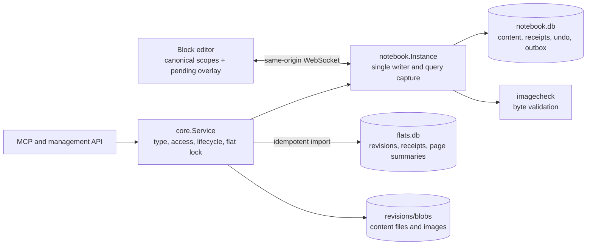
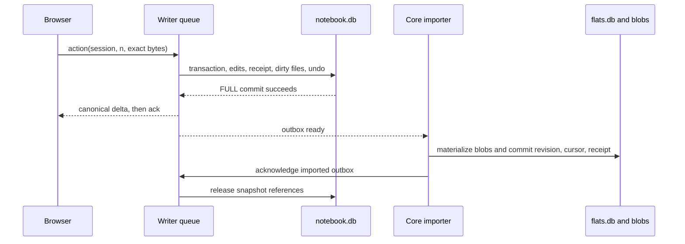

# Notebook content type technical design

Status: partly implemented. The design is implemented but not released; the
release measurements of section 22.5 are not done. See the product spec's
[Current state](notebook.md#current-state).
Base: `1cff80b` (origin/main). Product contract: [notebook.md](notebook.md), N1.

This page specifies N1's server, storage, browser, and agent contracts.
Rule numbers link to the product spec. Section numbers refer to this page.
Existing shared revision behavior is defined in [the revision store](../revision-store.md).

## 1. Decision summary

| Topic | Decision |
|---|---|
| Runtime | One `internal/notebook.Instance` per notebook, inside the host process. No worker, auxiliary server, or build step |
| State owner | `notebook.db` is the only current-state source of truth. SQL transactions own rollback. There is no second mutable server model |
| Concurrency | Absolute writes to fixed value groups, ordered by one writer queue. Semantic operations compute structure from current state |
| Identity | Typed, notebook-wide ids. Every existing mutation target and live dependency carries `{id, inc}`. Versions and incarnations are decimal strings on the wire |
| History | Durable outbox in the same transaction as the edit, imported idempotently into shared revision metadata and blobs |
| Revision files | Page headers, page-local block buckets, database schema and row buckets, and live assets. Runtime metadata never enters content files |
| Reuse | `wsconn`, core blobs, leases, locks, retention, and revision metadata. Move only image byte validation to `internal/imagecheck` |
| Browser | Plain JavaScript modules, per-block contenteditables, model-owned selection, composition buffers, and virtualized tables |
| Reads | One disk-backed snapshot reader for browser scopes, agent pagination, and History. No in-memory scope or result capture |
| Public | Read-only projection of current content. No sessions, presence, history, historical-only assets, or private-log replay |
| Delivery | One feature PR. Section 21 gives its commit order, not separate feature releases |

## 2. Current state and scope

The base has board and document editors, `wsconn`, shared revision storage,
route access decisions, storage journals, and content-type dispatch. It has no
notebook type, schema, tools, routes, or browser client. This document does not
claim that planned interfaces are available.

N1 includes every required browser and agent operation in the product spec.
It excludes search, downloadable export, notebook archives, and rows as pages.
The required Markdown agent read is not a separate export feature.
A row has its own identity and database owner. A later schema can add a block
root owned by that row without changing row or cell ids.

## 3. Package structure and alternatives



`internal/notebook` owns item codecs, semantic edits, schema rules, query
semantics, undo, recovery, persistence, transport, and the embedded client.
Mutation internals stay private to this package. There are no public `engine`
or `model` subpackages for transports to assemble themselves.

The package exposes `Open`, `Stop`, `Shutdown`, `ServeHTTP`, `Read`, and
`Update`. Its importer interface exposes `Outbox`, `SnapshotData`,
`Acknowledge`, `Op`, `References`, `Barrier`, and `Remeasure`.
Core calls one atomic `Update`, not a sequence of validation and recording
methods. The backend adapts shared host facilities without exporting core locks.

`items.go`, `groups.go`, and `decode.go` own the typed vocabulary.
`tree.go`, `schema.go`, and `edit.go` load bounded neighborhoods through SQL
indexes, plan semantic changes, and persist them. `query.go` owns comparisons
and read capture. `loop.go`, `record.go`, and `quota.go` own durability.
`undo.go`, `recovery.go`, `markdown.go`, and `paste.go` own their domain rules.
`ws.go`, `routes.go`, `public.go`, and `appfiles.go` own transport and admission.

### 3.1 Why not extract the board engine

The following census counts physical lines, including comments and blank
lines, in direct files at the base. It excludes Go test files from production
counts and excludes browser harnesses outside `web`.

| Existing code | Production lines | Test lines beside that code |
|---|---:|---:|
| `internal/board/*.go` | 7,877 | 10,426 |
| `internal/board/engine/*.go` | 5,278 | 5,922 |
| `internal/board/model/*.go` | 1,623 | 417 |
| `internal/board/web/*.{js,css,html}` | 6,773 | 0 |
| Board server, engine, and model | 14,778 | Browser harnesses are separate |
| Board server and embedded client | 21,551 | Benchmark generators are separate |

The census is reproducible with this repository-root command:

```sh
python3 - <<'PY'
from pathlib import Path
for name in ('internal/board', 'internal/board/engine', 'internal/board/model'):
	files = list(Path(name).glob('*.go'))
	print(name, sum(len(f.read_text().splitlines()) for f in files if not f.name.endswith('_test.go')),
		sum(len(f.read_text().splitlines()) for f in files if f.name.endswith('_test.go')))
print('client', sum(len(f.read_text().splitlines()) for f in Path('internal/board/web').iterdir()
	if f.suffix in ('.js', '.css', '.html')))
PY
```

Future diff sizes below are estimates, not measured patches.

| Alternative | Expected change | Decision |
|---|---|---|
| Extract a neutral board and notebook kernel | Touch about 3,000–5,000 shipped board and core lines, plus adapters. It might remove 1,500–2,500 duplicated lines later | Rejected for N1. Board undo, snapshots, measurement, spatial relations, and guest policy are not independent extension points today |
| Copy the board and cut unwanted features | Start with 14,778 Go lines and much of the 6,773-line client | Rejected. This retains spatial relations, guest editing, and duplicated mutable engine and SQL state until each is removed |
| One JSON page file with compare-and-swap | Small file interface, but callers must recreate merging, receipts, cascades, and undo | Rejected. Different-group concurrency cannot become whole-page refusal under [rule 30](notebook.md#concurrency-rules) |
| Current state in `flats.db` | Reuses the metadata connection | Rejected. It excludes current content from per-flat disk accounting and separates edits from their durable history boundaries |
| Notebook-owned SQL editor with selected adaptations | Adapt about 1,500–2,500 lines of queue, receipt, outbox, quota, and app-file patterns. Add about 200–400 shared core dispatch lines | Selected. Notebook rules have one owner without migrating shipped board semantics |

The image extraction moves about 290 decoder lines, changes about 30–60
wrapper and call lines, and moves validator tests. `board.AssetInfo` and
`board.CheckImage` retain their existing contract and error conversion.
One host-wide decode gate remains shared. No board editor, engine, or
WebSocket semantics change. App-file loading and fractional ordering remain
small notebook-owned adaptations, not new generic frameworks.

### 3.2 Lock order and lifecycle

Core orders storage-journal admission, the flat lock, and the notebook writer
in that order. A writer closure never acquires the flat lock, walks the flat
directory, performs blob I/O, or calls a host history API. Blob preparation,
historical reads, leases, and fresh agent quota measurements happen before
queue admission. Limits, lease bookkeeping, and outbox-ready notification
must be nonblocking when called by the writer.

Rename, deletion, and stop refuse new work with `unavailable`, cancel pending
scope transfers and snapshot readers, delete their spills, and close sockets
before moving or removing storage.
Creation uses the existing durable `content_state` initialization phases.
It creates one empty top-level page and its initial revision, then marks the
flat ready. Startup finishes interrupted initialization idempotently.
A refused first write to a new or untyped slug leaves no adopted notebook,
partial shell, or temporary database. Fixed-type admission remains in core
([rules 1](notebook.md#content) and [41](notebook.md#agents)).

## 4. Items, ids, values, and versions

### 4.1 Item identity

An id is a kind prefix followed by 26 lowercase, unpadded base32 characters
encoding 128 random bits. Prefixes are `p_`, `b_`, `d_`, `pr_`, `o_`, `r_`,
and `v_` for pages, blocks, databases, properties, options, rows, and views.
The final base32 character has canonical zero padding bits. The decoder
rejects noncanonical encodings, wrong prefixes, and unknown fields.
Ids are unique notebook-wide and are never reassigned by ordinary creation,
even after deletion. Image identities are lowercase SHA-256 hex hashes.

Every live item has `inc` and `ver`. A new or revived item receives the
current mutation sequence as its incarnation. The sequence is a monotonic
64-bit integer that never rolls back. Multiple creations in one action can
share a sequence because the id completes their identity. Decimal strings
avoid JavaScript integer rounding for sequences, versions, and incarnations.

A mutation reference is exactly `{"id":"b_…","inc":"42"}`.
Every existing target, destination parent, ordering anchor, property, option,
and view dependency uses that form. Content page links deliberately store
only a page id. They must reconnect when that page reappears
([rule 33](notebook.md#concurrency-rules)).

An earlier creation in the same call can be named with `{"tmp":"new-row"}`.
Temporary names are unique within that call and cannot refer forward.
Agent creates always receive server ids. Browser creates propose fresh ids
to preserve pending local references. Only browsers can use `inc:"0"`,
and only through their durable session's `created` mapping. Arbitrary zero
incarnations and zero-incarnation agent references are refused.

### 4.2 Typed content

Pages store a plain title, parent, and sibling position. Blocks store a page,
optional parent block, sibling position, and a tagged content value.
The content tags are `paragraph`, `heading1`, `heading2`, `heading3`,
`bullet`, `numbered`, `todo`, `toggle`, `quote`, `callout`, `code`, `divider`,
`image`, `page_link`, and `database`.

Rich text is an ordered list of `{text, marks, link?}` runs. `marks` is a
canonical ordered subset of `bold`, `italic`, `strike`, and `code`.
A link is `{"url":"https://…"}` or `{"page":"p_…"}`.
The server removes empty runs and coalesces adjacent runs with equal marks
and links. It preserves Unicode exactly, without NFC normalization.
Limits count Unicode code points, not UTF-16 code units.

A database has one owning block. Properties, rows, and views have one
immutable database owner. Options have one immutable property owner.
A cell is identified by its row and property, not a separate item id.
A missing cell means the empty value of the property's current type.
There is no orphan-database operation or row block tree in N1.

| Value type | Canonical representation |
|---|---|
| Title and text | UTF-8 string, including empty string |
| Number | Finite decimal string. Parse with exact decimal arithmetic, never binary floating point. Remove leading plus, redundant leading and trailing zeros, and negative zero |
| Select | Option id, or `null` |
| Multi-select | Unique option ids in id order. Display and conversion use current option order |
| Date | `YYYY-MM-DD` with optional `T HH:mm:ss` written without the space. Validate the Gregorian date, years 0001–9999, and 24-hour time. Never convert zones |
| Checkbox | Boolean, empty means `false` |
| URL | `http` or `https` URL string, or `null` |

Number input accepts a sign, decimal digits, an optional decimal point, and
an optional decimal exponent. Leading and trailing ASCII whitespace is
accepted only for text-to-number conversion. A canonical number has no
exponent. The 8,000-code-point cell bound also bounds its expanded decimal
representation. Invalid, nonfinite, or oversized direct assignments are
refused. Conversion treats a non-parsing value as empty.

Property and option names are unique by exact stored text within their
owner. There is no hidden trim, case fold, or Unicode normalization.
The fixed option palette is `gray`, `brown`, `orange`, `yellow`, `green`,
`blue`, `purple`, `pink`, and `red`. Theme tokens determine actual colors.

### 4.3 Fixed value groups

The groups implement [rule 29](notebook.md#concurrency-rules). No operation
can submit an arbitrary JSON path or change part of a group.

| Owner | Group key | Whole value |
|---|---|---|
| Page | `title` | Title |
| Page | `place` | Parent and position |
| Block | `content` | Kind and every field of that kind |
| Block | `place` | Page, parent block, and position |
| Database | `title` | Database title |
| Database | `property_order` | Ordered property ids |
| Database | `view_order` | Ordered view ids |
| Property | `definition` | Name, type, and number format |
| Property | `option_order` | Ordered option ids |
| Option | `definition` | Name and color |
| Row | `cell:<property id>` | One typed cell value |
| Row | `place` | Manual row position |
| View | `definition` | Name, layout, visible properties, widths, grouping, sort, and filter |

`group_versions` stores the last assigned sequence per group. An accepted
absolute assignment advances its group version even if the value is equal.
Otherwise an intervening equal write could disappear from undo guards.
Different groups never share a compare-and-swap requirement. Same-group
writes follow writer queue order, including text as one whole group
([rules 30 and 31](notebook.md#concurrency-rules)).

An item's `ver` is the maximum of its incarnation, own group versions, and
aggregate version. A row aggregate includes its cells. A database aggregate
includes its schema, options, views, row membership, cells, and manual order.
A page aggregate includes all blocks, inline databases, and ownership
changes on that page, but not content on descendant pages. Page-tree changes
advance the global state and the changed page's version. A guard for a whole
subtree must name its pages or use the global state token.
A cross-page move advances both affected page aggregates and each moved
block's place version, including descendants.

## 5. Positions and structural rules

Page, block, and manual-row order uses server-generated fractional keys.
The total order is `(position, id)`. Clients send a destination and either a
`before` sibling reference, an `after` sibling reference, or explicit
`before:null` for the end. The two anchors are mutually exclusive. They never
choose physical keys. A split anchors the new block `after` the block being
split, not `before` its next sibling.

The notebook adapts the board's 103-line fractional-key algorithm with a
32-character key cap. Before exceeding the cap, the server rebalances only
the affected sibling list inside the same transaction. Rebalancing changes
physical keys, not logical place versions, item guards, or undo entries.
Canonical deltas include the new keys. Semantic undo stores neighbors, not
old physical strings.

The server removes selected moving roots from their old positions before
resolving the destination. `after` uses the same live-anchor and sibling-list
checks as `before`. Selecting an ancestor and its descendant moves only the
ancestor root. Relative order among selected roots stays stable.
An anchor in the wrong sibling list is refused. A deleted or reincarnated
explicit anchor is ignored for a browser operation and aborts an agent call.
The server never silently substitutes append.

The following checks use the current tree, not a client's snapshot
([rule 34](notebook.md#concurrency-rules)):

- A page subtree has no cycle and fits within eight levels, with roots at one.
- A block subtree fits within six levels, with page-root blocks at one.
- Only `bullet`, `numbered`, `todo`, and `toggle` hold children.
- Every live child has a live owner. Every block belongs to one live page.
- Moving an inline database means moving its owner block and derived page location.
- Deleting a page expands its current page subtree and all owned content.
- Deleting an owning block expands its database, properties, options, rows, cells, and views.
- At least one page, exactly one title property per database, and at least one view per database remain.

Property, option, and view order uses whole id vectors because each order is
one value group. Duplicate ids and wrong owners are invalid. Browser writes
remove gone members, append omitted live members in current order, pin the
title property first, and report an adjustment. Agent writes naming gone
members or an invalid title position abort. Omitted live members are retained
at the end for both callers, not deleted by an order write.

## 6. Schema changes, conversions, and view repair

`set_block` assigns the whole content group, including kind and every field
of that kind. It follows last-writer-wins order, not a current-kind equality
guard. Identity is valid for every kind. When kinds differ, the current kind
must be convertible to the submitted kind under [rule 3](notebook.md#content).
The assignment uses the submitted fields, not text converted from the
current content. `turn_blocks` instead derives the new content from the
current content using the table below. Both operations apply the same child
movement in the same action.

If no conversion exists, a browser `set_block` is `ignored` with reason
`kind`. The tab reconciles to server content and offers its submitted text
through the overwritten-text notice and **Keep my text**, as required by
[rule 37](notebook.md#concurrency-rules). An agent call is refused whole with
reason `kind`.

| From | To | Result for `turn_blocks` |
|---|---|---|
| Any kind | Same kind | Preserve all fields |
| Any text kind | Another text kind | Preserve rich text. New `checked` is false, `open_default` is false, and tone is neutral |
| Text kind | Code | Concatenate visible text. Remove marks and link targets. Language is empty |
| Code | Text kind | One unmarked run, with defaults for the new kind |
| Divider, image, page link, or database | Any other kind | Refused |
| Any other kind | Divider, image, page link, or database | Refused. Use creation instead |

When the destination kind cannot hold children, direct children move after
the converted block at its parent level. Their subtrees and relative order
stay intact. A multi-block conversion validates every selected root before
changing any of them. The menu offers only the intersection of legal targets.

Property type conversion implements [rule 8](notebook.md#databases).
The title property's type never changes.

| From | To | Cell conversion |
|---|---|---|
| Any type | Same type | Preserve values and options. A format-only number change preserves decimals |
| Number | Text | Canonical decimal text, empty remains empty text |
| Text | Number | Parse the entire ASCII-trimmed string as a finite decimal. Non-parsing values become `null` |
| Select | Multi-select | Singleton set, or empty set |
| Multi-select | Select | First selected option in current option order, or `null` |
| Text | Select | One new option per distinct nonempty exact text, ordered by first occurrence in manual row order. Empty text becomes `null` |
| Every other pair | New type | New type's empty value |

Text-to-select is refused if an option name exceeds 200 code points or the
option-count excess increases. It never truncates or combines names.
Stopping a select or multi-select deletes its old options. Deleting an
option removes its id from all cells. Neither a rename nor an old property
write can revive it. These effects share the schema edit's transaction.

Before any property type change, the transaction records dirty person state
as a pre-conversion revision. The conversion belongs to a fresh browser
edit group or the agent's revision. A browser preview returns the property
reference, current state, conversion-input version, emptied-value count,
and options-created count. The input version includes affected cells and
option order. Confirmation recomputes the preview. Changed inputs require
another confirmation and cause no content mutation.

Every schema edit repairs saved views in the same transaction
([rule 10a](notebook.md#databases)):

1. Remove sort keys and filter conditions that no longer fit the property type.
2. Remove deleted visible properties and their widths.
3. Remove filter conditions naming a deleted option, including a whole condition with a deleted member in its option set.
4. Convert a kanban whose grouping property is gone or no longer select to a table with the same name and still-valid visibility, sort, and filter.
5. Advance each changed view's definition version and append a runtime adjustment notice.

A property type change does not remove a still-existing visible property
merely because its type changed. Both layouts can display every N1 type.
A table's title column remains visible. Column widths are integer CSS pixels
from 80 through 1,200, default 180, with title default 240.
A newly created database has a title property named `Name` unless supplied,
and one table named `Table` showing all properties.

A browser view write is sanitized against the apply-time schema and returns
`adjusted` with the removed parts. If a new kanban has no usable grouping
property, it becomes a table. An invalid agent view write aborts the whole
call. Runtime notices name each removal. A tab shows notices newer than its
view-open watermark. Reload can show them again. Notices never enter revisions,
and rollback never manufactures notices attributed to historical editors.

### 6.1 Query semantics

All filter conditions are ANDed. The operator applicability table is exactly
[rule 10](notebook.md#databases). Text uses Unicode simple case folding,
without locale collation or normalization. Go and JavaScript use the same
checked-in fold data and comparison vectors, not unrelated lowercase APIs.
Numbers compare exactly. Dates compare calendar parts, then wall-clock time,
with a date-only value before timed values on that date. False sorts before
true. Selects compare option ranks. Multi-selects compare sorted sequences
of option ranks lexicographically. Text and URLs compare folded code-point
sequences. Empty values sort last in either direction. Ties use manual row
order, then row id.

New rows in a filtered view receive defaults from `is` and `is checked`
conditions before explicit assignments. Contradictory conditions do not
invent a matching value. The new row remains visible to its creator as
hidden by the filter. Each tab keeps its own touched, nonmatching row ids
until leaving that view. Other tabs and Public viewers apply the filter at
once. This state is not stored in cells or revisions
([rule 11](notebook.md#databases)).

## 7. Operations and apply results

Browser and agent operations use one typed decoder and semantic executor.
Unknown operations and unknown fields are refused. The registry defines
input schemas and drives parity tests. It does not accept a universal object
with unrelated optional fields.

| Family | Operations |
|---|---|
| Pages | `create_page`, `set_page_title`, `move_page`, `delete_page`, `duplicate_page` |
| Blocks | `create_block`, `set_block`, `turn_blocks`, `move_blocks`, `delete_blocks`, `duplicate_blocks` |
| Databases | `create_database`, `set_database_title`. Delete and move through the owner block |
| Properties | `create_property`, `set_property`, `delete_property`, `set_property_order` |
| Options | `create_option`, `set_option`, `delete_option`, `set_option_order` |
| Rows | `create_row`, `set_cell`, `move_rows`, `delete_rows` |
| Views | `create_view`, `set_view`, `delete_view`, `set_view_order` |
| Import | `markdown_to_blocks`, with a placement and staged asset references |
| Browser control | `undo`, `redo`, `close_action`, and page recovery through the local History API |

Editor-built compounds implement the atomic editing steps in
[rule 32](notebook.md#concurrency-rules). They put one `unit_id` on every
operation in that unit.
These include split, merge, Tab, Shift+Tab, multi-block paste, duplicate,
moving a multi-block selection, and a kanban drop that moves and sets a cell.
A kanban move without sort changes both row place and grouping cell. With
sort it changes only the grouping cell. Database creation atomically creates
its owner block, title property, and initial view. Standalone database
deletion and replacement of its ownership edge do not exist.

A unit's operations are contiguous and execute in input order under one
savepoint. Split and merge record their source blocks, expected page and
parent, and merge's expected preceding sibling in `structure` checks on the
unit's first operation. The server checks these against the tree at unit
start, before any member executes. A gone dependency is `ignored:gone`.
A moved block or changed adjacency or parent is `refused:structure`. These
checks do not compare content versions or reject unrelated text edits.

If any operation is ignored or refused, the server rolls back the whole unit, including versions, temporary references, notices, and undo.
It skips the remaining operations in that unit and reports the first failure's
status, reason, and index on all its results. No rolled-back operation is
reported as applied. The client removes that unit's optimistic changes,
returns its display to server state, and offers all local text from the unit
through **Keep my text**. An adjusted operation does not fail a unit.

An operation without `unit_id` has its own savepoint. Gone or reincarnated
targets and live dependencies produce `ignored:gone`. A forbidden content-kind
change produces `ignored:kind`. Invalid values or structure produce `refused`.
Other units and plain operations in the same batch can still apply.
Malformed envelopes, including repeated noncontiguous unit ids, refuse the
entire action. Limits and disk quota are checked against the resulting action
and can refuse all its operations. Results preserve input order and identify
every applied, adjusted, ignored, and refused operation
([rules 32 and 37](notebook.md#concurrency-rules)).

`duplicate_blocks {blocks, after}` copies the selected current block subtrees
after a required live block anchor. Selected ancestor and descendant pairs
copy only the ancestor root. The copies take the anchor's current page and
parent and keep the selected roots' document order. The source roots need
not share a parent. `duplicate_page {page}` copies the complete current page
subtree next to its source, with the same titles. Both are single semantic operations, not lists of creates, and each
counts as one explicit operation regardless of the number of copied items.

Every copied item gets a fresh id and incarnation. Inline databases include
their schema, options, rows, typed cells, saved views, and order vectors.
The copy remaps ownership edges and internal references in two passes using
the same implementation as page recovery in section 11.2. Page links and
rich-text page links to copied pages follow the copies. External targets
remain unchanged. An agent result provides the complete source-to-copy
reference mapping for every copied item, inline or through the paged mapping
in sections 8 and 16.2. The browser ack contains only copied roots and per-kind
counts, with root samples if needed. Neither result includes copied content.
Section 8 bounds the encoded result and replay receipt to 64 KiB. Every copied
item reaches subscribed clients through the canonical delta, with
`delta_part` or scope resync when necessary. Agents
read the copies with `get_notebook`. The server checks the complete copied
content against current structure, item limits, serialized-data limits, and
disk quota. A failure leaves no partial copies. Each duplicate is one undo unit.

An agent call is strict. Any ignored target, invalid dependency, adjustment,
structure error, guard failure, limit, or quota failure rolls back the entire
call, including revision-group closures. Without guards, different-group
writes merge and same-group writes use the same order as browser actions
([rule 36](notebook.md#concurrency-rules)).

## 8. Writer loop, durable receipts, and revision boundaries



The queue orders browser actions, agent calls, timers, recovery, rollback,
import acknowledgements, and sweep barriers. Entry into this queue defines
the server's receive order. Browser actions can share one transaction for
at most 10 ms. Each keeps its own savepoint and final receipt.
Agent calls and rollbacks are queue boundaries and never interleave with
browser group commit.

For each browser action, the writer performs these steps:

1. Check the durable session receipt before execution. A matching replay returns its original outcome.
2. Allocate a mutation sequence, resolve references, and execute operations in order. Use one savepoint per compound `unit_id`, or per plain operation. Roll back a failed unit before continuing with independent operations.
3. Stage canonical effects, versions, undo, edit groups, dirty files, delta-log rows, and a receipt.
4. Compare every scoped item-limit excess against its start-of-action excess. Roll back the action if any excess increases.
5. Check post-write disk usage, including future revision space. Replace a refused action with a bounded refusal receipt.
6. Commit with `synchronous=FULL`. Publish canonical deltas and acknowledgements only after success.

Agent calls use the same writer and persist any paged result mapping with the
op-id outcome in the edit transaction. The quota check includes those mapping
rows before commit. A refusal rolls back both content and mapping.

A failed commit produces no successful acknowledgement or fanout. SQL
rollback is sufficient because no mutable server replica requires repair.
A state token is `{store, seq}` from the live database, never `content_head`.
Read-only capture does not advance it. A durable action receipt can advance
it without changing user content.

The five-second maintenance tick closes groups idle for 30 seconds or open
for five minutes, prunes bounded runtime state, and attempts WAL truncation.
A revision records the whole current notebook. A due boundary credits all
editors whose changes enter that snapshot. It clears their recorded dirty
state and closes due groups. A still-open group keeps its original clocks
until it closes or makes another edit. Before agent writes and rollbacks,
all open groups close together and credit all dirty editors
([rule 48](notebook.md#revisions)).

Each agent call produces one forced revision even for content-equal absolute
assignments. Creation and rollback also force revisions. A content-equal
person boundary can omit a duplicate content snapshot. Replaying a receipt
never creates another revision.

Every encoded ack, stored receipt outcome, and agent write result is at most
64 KiB, including its envelope. The server first keeps compact summaries of
operation statuses, reasons, failed-unit indexes, and per-kind copy counts.
Grouped input indexes preserve every operation's outcome without repeating
long unit ids or detail fields. Browser creates propose their own ids, so
acks carry no temporary-name map. A duplicate ack carries only copied roots,
with samples and explicit totals if the roots do not fit. The ack's `summary`
reports applied, ignored, and refused counts, copied roots, and `complete`.
The server adds warnings and detail samples within the remaining bytes.
Totals and explicit completeness flags distinguish complete fields from samples.

For agents, the complete mapping associates every temporary name, including
implicit creates, with its assigned `{id, inc}` and version. Each duplicate
also maps every source item to its copy, keyed by operation index. If the
complete mapping fits in the 64 KiB result, temporary-name references stay
inline in `refs` and every source-to-copy entry is in `mapping.copies`.
Otherwise the result
carries `mapping: {complete: false, total, cursor}`. The writer stores the full
mapping with the `op_id` row in `notebook.db` in the same transaction as the
write. These persistent bytes count against the flat's disk quota, not the
16 MiB bounded-receipt budget. `get_notebook {op_id, cursor}` pages this immutable
mapping without scanning current content or waiting for revision import.
The mapping and its cursor live exactly as long as the op-id replay row,
at least 24 hours after import and never removed before import.

This follows [board-TECH Appendix A](board-technical-design.md#appendix-a-schema) for bounded
outcomes. The server stores the bounded outcome and any paged mapping before
commit and replays that same outcome and cursor, not a larger result rebuilt
from current content. Replay and import-status fields have reserved space
within the bound. Result compaction never removes
content from a canonical delta or limits the size of a legal duplication.

Browser receipt storage reserves space before admitting an action so a quota
refusal can itself be durable. If that reserve is unavailable, admission
returns a retryable error and does not consume the action number.
Outbox backpressure similarly refuses new admission rather than discarding
committed edits. A successful live write with failed host import returns
`revision:null`, `revision_pending:true`, and a warning. It never says that
the edit failed or asks the caller to execute a new write.

## 9. Sessions, reconnect, and saved state

A tab holds its session token and undo identity in memory. Reload starts a
new session and clears undo. Ordinary reconnect reuses the existing session.
The server expires it after 24 hours without activity.
Only the core route decision supplies verified identity. Tailscale labels
are trusted. Local and NetBird names are unverified client labels, limited
to 200 code points. Client input cannot set a verified flag
([rule 27](notebook.md#collaboration)).

Browser actions use strictly increasing `n` per session. The server accepts
`max_n+1`. For `n<=max_n`, a matching canonical request hash returns the
stored receipt. Different content conflicts. A missing old receipt is an
explicit expired result, never permission to execute again. A gap in `n` is
a protocol error. Permanent refusals consume `n`; retryable admission
failures do not. Later pending actions wait behind a retryable failure.

The client maintains canonical subscribed state and a pending local-action
overlay. During hydration, canonical state is the captured base plus the
live-delta overlay described in section 13. The two overlays are separate.
Each session has a nonsecret `session_id` for source tags, separate from the
resume token. Deltas never expose another session's resume token.
Only canonical deltas and completed snapshot units change canonical state.
For databases, each completed row window is a snapshot unit under section 13.
Acknowledgements remove pending actions but never apply content themselves.
The server sends an action's complete delta or all replacement snapshot units
needed for that action's effects before its ack. Unrelated hydration windows
do not delay a delta or its ack.
Multipart deltas and resync follow section 13. A `from` tag can remove the corresponding overlay when the canonical delta
arrives. Duplicate sequences are ignored. Gaps cause resync.

On reconnect the client first hydrates the tree and every scope touched by
pending actions, including pages no longer selected. It then hydrates the
selected page and resends exact action numbers and contents. A retained log
can replace snapshots only for a compatible subscription and watermark.
Unknown sessions or expired receipts with pending edits stop editing and
show copyable text and downloadable plain-text or JSON recovery data.
The client never silently changes the pending payload or assigns a new
number. Unconfirmed text remains visible, and unload warns until the queue
is empty ([rules 38–40](notebook.md#disconnection-and-reconnection)).

The UI shows `Saved` only after durable confirmation of every local action.
It shows `Saving` while connected with pending work, and `Disconnected`
when the connection is absent. Typing changes flush within 200 ms, except
while composing. Disconnection preserves existing work but does not enable
new offline actions. Retry delay starts at one second, doubles to 30 seconds,
and stops at session expiry or a permanent error.

## 10. Personal undo and redo

Undo belongs to one tab, not a shared revision. Adjacent typing flushes in
one block share an `action_id`. The run closes after 750 ms idle, a caret
jump, blur, a remote content change to that block, or a non-typing action.
The server closes inactive runs after one second. Closed action ids never
reopen. A paste, move, deletion, conversion, cell edit, split, merge, nesting
change, or duplicate is one undo unit
([rule 25](notebook.md#editing-in-the-browser)). Compound `unit_id` boundaries
also bind their inverse dependency components. A failed compound adds no undo
entry. Independent successful units in the same batch keep their own entries.

An inverse stores before-images of touched groups, their old versions, the
versions this session wrote, created item stamps, and deleted item stamps.
It compares all guards against state at undo start. A plain inverse applies
only when the item incarnation matches and the group's current version is
exactly the version this session wrote. Later writes by anyone, including
equal-value writes, prevent that inverse from overwriting them.

The content assignment and child movements of a kind change form one inverse
dependency component. A split or merge also reverses as one component, so
undo cannot restore only one half of its text.

Structural inverse changes form dependency components. A property type
change, converted cells, option membership, and dependent view repairs are
inseparable when partial reversal would leave invalid types. If any required
guard fails, that component is skipped. Independent cells or groups can
still undo. The notice distinguishes later edits, missing items, and invalid
structure, and includes the product's later-edit message.

Undoing creation cannot cascade over later children added by another writer.
The original subtree must match its stamps and have no outside descendants,
or that component is skipped. Undoing duplication deletes exactly the copied
ids recorded by that operation, never the sources or uncopied external link
targets. The copy is one inverse
component. Later edits to a copy or new outside descendants skip that component
rather than cascading over them. Undoing deletion uses the original ids,
matching deletion sequence, and fresh incarnations. It validates current
parents, depth, minima, item limits, and disk quota. A missing page parent
falls back to a top-level page. A missing block parent can fall back to its
surviving original page root. A missing page is not invented.

Redo records only changes undo actually applied. New local edits clear redo.
When undo creates a new version, an older same-session inverse can relink to
it only if its recorded written version equals the just-reverted previous
version. An A→B→A writer history therefore cannot erase B on the next undo.
Fresh incarnations relink only this session's own stacks and `created`
rows. Other tabs' pending edits remain stale.

The server retains at most 100 entries per session and a per-flat undo
budget of `min(32 MiB, disk quota / 16)`, or 32 MiB with unlimited quota.
Eviction says that no earlier undo is available. Undo-held deleted content
and images remain sweep roots until their entries expire. Reconnect retains
undo. Reload and whole-notebook rollback clear it for all affected sessions.

## 11. Whole-notebook rollback and page recovery

### 11.1 Whole-notebook rollback

Core holds the retained target revision before selecting its files and
leases every hash while reading. It passes a whole-notebook reader, not a
page-only result, to the writer. In one transaction the writer closes dirty
person state, installs target content, updates runtime stamps, clears all
undo, emits a reset, and appends a forced rollback outbox entry
([rules 35](notebook.md#concurrency-rules) and [51](notebook.md#revisions)).

A surviving id of the same item type keeps its incarnation. Its differing
groups and aggregate versions advance. Removed items become tombstones.
Absent items brought back receive new incarnations. A changed block kind is
still a block, so a surviving block keeps its incarnation and its content
group advances. No pending input can reach a removed and revived item with
an old incarnation. Unchanged surviving items can receive ordinary later
edits. State sequence and store identity never roll back.

The rollback outbox references the target's exact file list and hashes.
It creates no content blobs, bypasses item limits and disk quota, and can
leave the notebook over quota. Runtime SQL and bookkeeping may grow under
the existing rollback exemption. The hold releases only after import or
positive proof that the operation never committed. A lookup failure retains
it. Open tabs resync, preserve unconfirmed text until its outcome is known,
and clear personal undo.

### 11.2 Page recovery

A historical read contains the chosen page's complete subtree, blocks,
schemas, rows, views, and referenced assets. Core leases that immutable
source outside the writer and retains the lease through commit.
Recovery is a normal, undoable browser action subject to current structure,
limits, and quota ([rule 53](notebook.md#revisions)).

The writer first builds a complete identity map. If the root page exists,
every item in the recovered subtree gets a new id. The root goes next to
the current page with the historical title plus ` (restored)`.
If the root is absent, absent ids are reused and each live collision gets a
new id. Tombstoned ids count as absent. Reused ids always get new incarnations.
The original parent is used when alive, otherwise the root becomes top-level.
Recovery refuses a resulting depth above eight. It never flattens history.

Page recovery and duplication share one two-pass copy implementation.
Recovery supplies the collision map above. Duplication maps every copied id
to a fresh id. The implementation takes the selected source, map, and root
placement rather than duplicating remap rules in separate executors.

A second pass rewrites all restored or copied ownership edges, block page
ids, database references, cells' property and option ids, view grouping,
filters, sorts, visibility, widths, and order vectors through the map. Page links and rich
page links follow remapped targets inside the subtree. External page targets
keep their original ids. Current pages and their links never change.
The browser response returns the recovered root reference and per-kind counts
under section 8's 64 KiB result bound. Recovery's full remap remains internal
to copying and undo. Agent duplicates instead expose every source-to-copy
reference through the inline or paged mapping. Clients receive every recovered
item through the canonical delta, and agents can read it with `get_notebook`.
Undoing recovery removes only the recovered content, subject to later-edit
guards, and never removes current objects that caused collisions.

## 12. Storage, revision files, import, quota, and assets

### 12.1 Notebook database

The live path is `flats/<slug>/notebook/notebook.db`. Shared content blobs
remain under `flats/<slug>/revisions/blobs`. All persistent notebook files stay inside the flat
root for existing rename and deletion journals. Snapshot-reader spill files
for browser scopes, agent queries, and History are ephemeral host scratch
files outside this root, as specified in section 16.1.
They are not content files, backups, revisions, or flat-quota usage.

The notebook schema starts at `user_version=1`, independent of the host
metadata schema. Opening a newer schema fails without writes. Before an
upgrade, the notebook uses a coherent SQLite backup. Each migration and its
version change commit together. Connections enable WAL, `synchronous=FULL`,
foreign keys, and incremental auto-vacuum. One connection owns writes.

| Table | Key and required data |
|---|---|
| `meta` | Singleton store id, sequence, reset sequence, newest file list, WAL maintenance state |
| `items` | `id` primary key, item type, incarnation, alive flag, deletion sequence, own and aggregate versions, typed content JSON |
| `pages` | Item id foreign key, parent, position. Index `(parent, position, id)` |
| `blocks` | Item id foreign key, page, parent block, position. Index `(page, parent, position, id)` |
| `databases` | Item id, unique owner block |
| `properties` | Item id, database, exact name key. Unique live `(database, name_key)` |
| `options` | Item id, property, exact name key. Unique live `(property, name_key)` |
| `rows` | Item id, database, position. Index `(database, position, id)` |
| `cells` | Primary key `(row_id, property_id)`, typed value |
| `group_versions` | Primary key `(item_id, group_key, property_id)`, version. Empty property id for non-cell groups |
| `orders` | Primary key `(owner_id, kind)`, ordered ids |
| `assets` | Hash, MIME type, dimensions, bytes, live and deleted reference counts, upload protection expiry |
| `sessions` | Token hash, editor key, label, verified flag, greatest action number, last activity |
| `created` | Primary key `(session, id)`, incarnation |
| `receipts` | Primary key `(session, n)`, canonical request hash, original outcome |
| `commands` | Agent or rollback op id, request hash, bounded original outcome, stable mapping cursor, committed state, outbox sequence, import status, retention deadline |
| `command_mappings` | `(op_id, offset)` primary key, operation index, temporary name or source reference, assigned reference and version. Same transaction and retention as `commands` |
| `deltas` | Sequence, canonical effects, source tag, encoded bytes, time |
| `undo` | Session, stack, entry order, dependency components, bytes |
| `groups` | Editor, start time, last edit time, dirty state and credited label |
| `files` | Path primary key, owning page, encoded size, dirty sequence, hash. Index on owner page |
| `outbox` | Monotonic sequence, kind, authors, message, rollback target, op id, full file list, new hashes |
| `snapshots` | Hash primary key, unimported encoded content, outbox reference count |
| `view_notices` | View id, notice sequence, removed settings and reasons |

Subtype rows can retain tombstone data for undo. Unique live name indexes
exclude dead items. Semantic edits, not foreign keys alone, enforce alive
owners, depth, and ownership. Expired tombstones can be removed only after
undo, `created` mappings, and bounded runtime references release them.
Ordinary proposed browser ids still cannot reuse a previously allocated id.
A compact allocated-id ledger remains after tombstone payload eviction.

### 12.2 Content files

Canonical JSON uses sorted object keys, deterministic number strings, UTF-8,
and no insignificant whitespace. Array order is semantic. Revision files
contain content only: no incarnation, version, editor, notice, receipt,
presence, deletion, or undo fields.

```text
notebook.json                                  {"format":1}
pages/<page>/page.json                          id, title, parent, position
pages/<page>/blocks/<hh>.json                    block content and place
pages/<page>/databases/<database>/schema.json    title, properties, options, views, orders
pages/<page>/databases/<database>/rows/<hh>.json  rows, positions, and cells
assets/<sha256>.<ext>                           live referenced images
```

`hh` is the first byte of SHA-256 over the UTF-8 item id, encoded as two
lowercase hexadecimal characters. Buckets contain items in id order.
Empty buckets are omitted. Every identifier and path is validated, never
joined from user-supplied path fragments. There are 256 possible block
buckets per page and 256 row buckets per database.

The page tree reconstructs from page headers. No redundant global tree or
page-hash manifest duplicates it. A text edit changes one block bucket,
not the database rows beside it. Cross-page block moves change file owners
and relevant buckets in both pages. Unchanged files reuse hashes.
The full notebook may have more than 512 files. Website and design bundle
limits and the board's fixed file-count assumptions do not apply.
Historical readers locate one page without decoding every row in the notebook.

### 12.3 Outbox and host metadata

At a boundary the writer encodes dirty files, hashes them, reuses all other
hashes, and writes a full file list plus new bytes to the outbox transaction.
All dirty-file and future-list reservations were charged before the edit's
ack. File-list encoding is streamed rather than constructing unbounded
intermediate strings.

Core imports under the flat lock in this order:

1. Re-acknowledge any previously committed host import cursor.
2. Validate outbox identity, paths, hashes, and source bytes.
3. Materialize new files in the shared durable blob store under leases.
4. In one `flats.db` transaction insert revisions, notebook import receipts, page summaries, head, cursor, hold releases, and retention results.
5. Acknowledge the committed cursor to the notebook writer. Only then release outbox snapshot references and update quota measurements.

Every crash between steps can replay without a second revision or missing
content. An imported and subsequently pruned revision is reported as pruned,
not pending or unapplied. A new host migration appends after migration 21
on this base, normally migration 22. It creates `notebook_imports` keyed by
`(flat, store, outbox_seq)` and `notebook_rev_pages` keyed by
`(flat, revision, page)`. Composite revision foreign keys cascade on update
and delete so rename, retention, and deletion preserve consistency.
Historical migration bodies and board tables remain unchanged.

Page summaries classify added, removed, and changed pages from file paths
and preserve title-before and title-after. They are metadata, not a second
content manifest, and can be reconstructed from retained files.
History catch-up, retention, quota settings, and sweep import notebook
outboxes before acting. A successful foreground import clears retry delay.
Background import uses bounded deadlines and backoff, not blocking writer I/O.

### 12.4 Disk quota formula

The quota follows [rule 58](notebook.md#lifecycle-and-access), including refusal
of deletions while already over quota. It counts per-flat persistent bytes,
not `flats.db`. The post-write estimate inside the action transaction is:

```text
usage = other + (used_pages + future_pages) * page_size
        + unimported_blob_bytes + dirty_unique_file_bytes
        + pending_new_blob_bytes + wal_allowance

used_pages = page_count - freelist_count
future_pages = sum(ceil(1.25 * dirty_file_bytes / (page_size - 64)))
             + 2 * ceil(1.25 * (full_file_list_bytes + 512) / page_size)
             + ceil(dirty_file_count / 50) + 8
wal_allowance = max(32 + 64 * (page_size + 24), untruncated_wal_bytes)
```

`other` is the measured flat-directory usage excluding `notebook.db`, its
WAL, and SHM, plus completed blob reservations not yet included in that
measurement. `unimported_blob_bytes` reserves the external blob copy of
unimported snapshots. Their SQL copy is already in used pages.
Dirty unique bytes reserve the eventual shared blob copy. Full file-list
bytes use the actual canonical paths, hashes, and sizes for the next
snapshot, never a constant 257-file bound. Use checked integer arithmetic
and round upward. Duplicate accounting is allowed until refresh, never
undercounting concurrent uploads.

Near the quota, a rolled-back dry-run of recording verifies the reservation
against actual SQLite page growth. The charged future-page value is at least
the larger of the formula and observed growth, including reference indexes.
The test suite must demonstrate this bound for large file lists and buckets.
Runtime maintenance reserves refusal-receipt headroom at admission and
charges receipt, persistent command-mapping, undo, delta, and dirty-row writes
before deciding success.
It never deletes user revisions merely to fit an edit.

Browser directory measurements have a 60-second lifetime and refresh every
45 seconds outside the writer. Missing or expired measurements return a
retryable unavailable result, never zero usage. Agent writes take a fresh
measurement under the flat lock before queue admission. Upload reservations
are atomic and included in both measurements and late checks.
Retention, sweep, settings, and reload trigger remeasurement.

WAL truncation is nonblocking after commits and ticks. While truncation is
busy, actual WAL bytes replace the idle allowance, including while a capture
blocks truncation. The capture progress floor is in section 16.1. Writers
continue under ordinary quota admission, including refusal when actual WAL
growth exhausts the quota; capture does not make them wait for truncation.
Query cursors never keep a SQLite read transaction open across network requests.
Runtime compaction can free bounded logs and undo, but must not run an
unbounded vacuum in the writer. Whole-notebook rollback remains exempt from quota admission.

### 12.5 Assets and sweep

`internal/imagecheck` accepts PNG, JPEG, GIF, and still WebP, not SVG.
It checks signatures and dimensions before allocation and performs a full
decode under one host-wide gate. Limits are 24 million pixels, 16,384 pixels
per side, at most 500 GIF frames and 200 million accumulated GIF pixels,
and the host's `upload_max_bytes`. MIME type and extension come from checked
bytes, not a filename or client header. Both notebook and board translate
neutral validator errors to their own errors.

Uploads undergo reservation and dry-run admission, durable core blob write
under lease, then a final mutation and quota check. A late refusal can leave
a quota-counted orphan until sweep grace, but never publishes partial
content. Staged uploads are protected for one hour. Live references, deletion
undo, retained revisions, rollback holds, unimported outbox bytes, and read
leases all protect assets. Sweep imports and collects runtime references
before deleting unleased blobs. Import or reference lookup failure skips
sweep. Reusing a blob refreshes its protection under the existing core
lease and durable-store protocol. Private historical asset reads hold
leases. Public reads require a current live reference.

## 13. Live protocol and subscriptions

The version-1 JSON protocol uses `wsconn` at `/_notebook/ws`.
Admission, origin, identities, and projections remain notebook responsibilities.
Appendix A defines message fields.

Each connection receives a consecutive sequence stream, including empty
projected deltas. Sidebar page headers remain live for every connection.
A watched page receives canonical block changes. A visible database
subscription hydrates its schema and rows. Unwatched page or database
changes carry scope invalidations and versions instead of invisible rows.
Thus page changes remain live without downloading all notebook content
([rule 14](notebook.md#viewing)).

A `watch` has a generation, selected page, visible database ids, and pending
scopes. The shared snapshot reader in section 16.1 streams the selected
scope at sequence S into a scratch spill from one SQLite read transaction,
then closes the transaction. The capture barrier defines S, but does not block
live delivery. Canonical deltas with seq > S keep flowing during capture and
hydration. The server never queues a delta behind hydration or keeps a frozen
page, database, or result in memory. The client discards old-generation parts
and installs a tree or page base only after all its parts arrive, with the
live-delta overlay applied on top.

Database hydration sends schema first, then row windows in `(position, id)`
order, with 1,000 rows per window except the last. Each window streams from
the same spill in frames of at most 512 KiB and commits to client canonical
base state only after all its parts arrive. A 5,000-row database becomes
interactive after the schema and first window, while later windows stream.
The client applies each complete delta at once to a canonical overlay keyed
by item and value group. Deltas carry absolute group values, so their values
always win over base windows at S. A deletion is an overlay tombstone.
Created items and place changes remain in the overlay before their window
arrives, or for the whole hydration if they have no window in that capture.
An arriving window cannot erase a newer value, revive a deleted item, or
create a second copy of an overlaid item. Incarnations distinguish revival
from an older captured item on Private; Public applies the projected ordered
creation and deletion records without Private stamps.

Sort and filter evaluate base plus overlay. Tables stay virtualized over this
combined state and say "loading" until the final window. Their ordering is
provisional while rows are missing. On completion, base plus overlay equals
a fresh snapshot at the latest applied sequence. Pending local actions use
their separate overlay and cannot settle before their canonical effects
arrive. Navigation keeps pending scopes subscribed until their actions settle.
Reset invalidates all hydrated scopes, spills, and old-generation parts.
A stale window never replaces newer content.

Frames are bounded by encoded UTF-8 bytes. Client frames are at most
256 KiB and server frames 512 KiB. Browser action assembly is at most
8 MiB, 32 parts, and 30 seconds, with a 64 MiB host-wide assembly budget.
Snapshot parts are sent one at a time. Each has a stable spill-wide index for
section 16.1's forward-progress accounting, independent of connection
generation and window-local part indexes. An over-budget hydration must take
a new part every 10 seconds while another reader waits. Replayed parts and
resumes at old windows do not renew its slot. Fitting spills keep their normal
60-second replay-renewable idle expiry. A canonical delta above the 512 KiB
frame limit uses `delta_part {generation, seq, part, parts, data}`, as in
[board-TECH section 4.6](board-technical-design.md#46-server-apply-loop-and-canonical-deltas).
Each part fits the frame limit, including its envelope and JSON escaping.
The client assembles one generation and sequence, then applies the complete
delta once. Partial deltas never change canonical state or settle overlays.

If a delta and its queued frames would exceed the connection's send queue
cap because live delivery itself cannot keep up, the server discards that
connection's queued deltas and switches to a scope snapshot at that sequence.
Hydration never queues live deltas, so slow window delivery alone cannot
trigger this resync. It increments the connection generation
and sends `resync {generation, seq}` before snapshot parts. The client drops
partial old-generation deltas and snapshots and ignores later parts from
those generations. The server preserves non-delta frames. An ack whose
effects are represented only by the replacement snapshot follows its required
snapshot units, not unrelated windows. Later canonical deltas keep flowing
with their own acks after those deltas. Pending actions and durable receipts
do not change. A snapshot already pending or a closing connection cannot
start another switch. If live delivery still cannot keep up after the one
resync attempt, the server closes the connection. Snapshot parts stream one
at a time within the queue cap and yield to live deltas. A slow hydration
does not reserve the full snapshot or accumulate a queue of later deltas.

Private send queues are 4 MiB and Public queues are 1 MiB, including in-flight bytes, acks, snapshots, and presence.
A lagging connection gets one resync attempt, then closes if it remains
behind. Admission is 64 Private and 256 Public connections per notebook.
Public snapshot starts are limited to eight per second with a ten-second
rate-limit wait. That timeout does not cap waits for spill admission. A
host-wide 256 MiB Public budget counts only queued and in-flight
encoded frames. Public scope capture uses the shared scratch spill budget and
retention and contended-slot progress rules in section 16.1, not an
in-memory frozen-data budget. A reader encodes at most one frame at a time
and sends it within these queue caps.
Spill admission pressure leaves the browser in a loading state under section
16.1. A shared-proxy IP is not
an identity or quota key.

Actions are limited to 30 per second with burst 60 per connection. Presence
is limited to 20 updates per second. Heartbeat interval is 30 seconds and
two minutes without response closes the connection. Private delta retention
is bounded by the first of 20,000 entries, one hour, and 16 MiB. Receipts
and deletion payloads each have a 16 MiB per-notebook runtime budget.
Each ack and stored receipt outcome also has the 64 KiB bound in section 8.
Receipt eviction produces explicit expiry on an old replay. It never permits
an old number to apply again. Unimported operation receipts cannot be evicted.

## 14. Presence, composition, and overwrite notices

Presence is ephemeral Private-only state containing a trusted display label,
current page, and optional block or database cell focus. It is not a lock,
not content, and not available to agents. A dropped connection loses its
presence immediately. Agent writes produce a short activity notice and a
1.5-second highlight on visible changed items. They do not create fake
human sessions ([rules 26–28](notebook.md#collaboration)).

On `compositionstart`, the editor captures the block incarnation, kind, base
content version, local DOM text, and selection. Remote changes continue to
update canonical state but cannot patch, remove, reparent, or change the
kind of that composing node. At `compositionend`, a same-incarnation block
submits the complete local content group with the captured kind. Section 6
checks conversion from the current kind to that captured kind. A permitted
write wins whole and moves children when required. An `ignored:kind` result
keeps the composed text in the overwritten-text notice with **Keep my text**.
The editor then reconciles the remote tree. It suppresses duplicate final
`input` submission. If deletion, revival, or reset removed that target, the
composed text remains copyable and can be inserted as a new paragraph in a
surviving page. No stale write reaches the revived item
([rule 19](notebook.md#editing-in-the-browser)).

Every block-content write carries `base_v` for overwrite detection, not as
a guard. A displaced writer's tab keeps its local rich text and receives an
overwrite notice. The server reports the replaced content version and source
receipt privately so the tab can match its retained text. A displaced receipt
from the same session with a lower action number is not an overwrite; a
different session remains a different writer even for the same person.
At most eight notices remain per tab. A local `ignored:kind` result and a
failed compound unit use the same notice and retain the submitted local
text even if no content version was replaced. Dismissal and reload discard
those buffers.
**Keep my text** inserts a new block after the original, or at a surviving
page root when the original is gone. It never writes the old text back into
the contested group ([rule 31](notebook.md#concurrency-rules)).

## 15. HTTP routes, access, and Public projection

| Route | Purpose | Access |
|---|---|---|
| `GET /` | Embedded shell and selected hash route `/#/<page id>` | Current content reader |
| `GET /_notebook/app/<version>/<file>` | Embedded versioned modules and styles | Reader |
| `GET /_notebook/a/<hash>.<ext>` | Checked notebook image | Current live reference on Public, live or retained leased reference on Private |
| `GET /_notebook/ws` | Upgrade and scope stream | Current reader, Private actions only |
| `POST /_notebook/api/assets` | Stage image upload | Private writer |
| `POST /_notebook/api/paste` | Convert inert clipboard HTML or Markdown to a semantic fragment | Private writer |
| `POST /_notebook/api/conversion-preview` | Preview current property conversion | Private writer |
| `GET /_notebook/api/revisions` | History metadata and changed-page summaries | Private writer |
| `GET /_notebook/api/revisions/<n>` | Historical tree, page, Markdown, or database query | Private writer |
| `POST /_notebook/api/recover` | Recover historical page subtree into current content | Private writer |
| `POST /_notebook/api/pin` | Pin or unpin a retained revision | Private writer |
| `POST /_notebook/api/rollback` | Whole-notebook rollback | Private writer |
| `GET /api/flats/<slug>/notebook` | Management structured or Markdown query | Existing agent API authorization |
| `POST /api/flats/<slug>/notebook` | Management atomic update | Existing agent API authorization |

Only core's exact trusted `X-Flats-Access: private` grants browser writes.
Missing or unknown access is Public. Core strips incoming forged access,
identity, and epoch headers. POST routes require same-origin validation and
`X-Flats-Notebook: 1`. Upgrades require same-origin validation too.
Origin comparison uses trusted request host and scheme, including the
existing proxy rewriting contract. `X-Flats-Public-Access: edit` never grants
notebook writes. Browser History stays on the flat's origin, not console
management routes ([rule 56](notebook.md#lifecycle-and-access)).

Public data is rebuilt from an allow-list of current content fields and
stream sequence. It excludes incarnations, item and group versions, state
store identity, receipt tags, editor names, reset metadata, adjustment
notices, undo, presence, and historical selectors. Public reconnect may resume
its connection-owned, content-only spill with `hello {spill, next_window}`
under the same current Public route epoch. It never resumes a Private spill,
a Private session, or private historical deltas. If sequence coverage is no
longer continuous, it rehydrates from a fresh current capture. Public `watch`
can navigate current pages and saved views. The shared snapshot
reader writes only this allow-listed Public projection to Public spills. It
never writes Private stamps, receipt data, or History metadata and removes
the spill when the reader finishes or is cancelled. An ordinary disconnect
retains a fitting spill for its 60-second idle period. An over-budget spill
instead follows section 16.1's forward-progress expiry and contended-slot
reclamation, even while disconnected. Row-window hydration follows section 13
even for retained over-limit current content.
Action, presence, upload, paste, preview, History, recovery, pin, and rollback
requests are refused server-side even if the UI omits their controls.

Current content and asset responses are `Cache-Control: no-store`.
Versioned application files can be immutable because they contain no notebook
content. The core Public route epoch cancels sockets and in-progress content
responses on withdrawal, stop, rename, and deletion. Cancellation stops the
snapshot reader and deletes its spills at once, including disconnected
spills and queued or pending resumed hydration. Resume rechecks the current
route epoch before reading or sending any part.
An old image URL returns 404 when it has no current live reference, even if
a revision retains it.
Already delivered bytes cannot be withdrawn from a viewer's device.
No guest sessions, safe-point pins, guest counters, or anonymous edit controls
are introduced ([rules 55 and 57](notebook.md#lifecycle-and-access)).

The shell has a self-only CSP for modules, styles, and connections. Images
allow self and local blob URLs. Frames, external fonts, remote image URLs,
and content script are absent. Render text with text nodes, never user
`innerHTML`. External links use `target="_blank"`, `rel="noopener noreferrer"`,
and `referrerpolicy="no-referrer"`. Internal page links stay in the fragment
router ([rule 60](notebook.md#lifecycle-and-access)).

## 16. Agent interface and Markdown

### 16.1 Structured reads and consistent paging

`get_notebook` accepts one selector: tree by default, page, database, an
opaque content cursor, or `{op_id, cursor}` for a stored write-result mapping.
Mapping reads use section 16.2, not the snapshot-spill lifetime below.
A page returns its header, nested blocks, inline database schemas, properties,
options, views, and order vectors. Database rows hydrate through a separate
database query. A query can select a saved view or supply
ad-hoc sort and filter, never both. Every mutable returned item includes
`id`, `inc`, and `ver`, with references in exactly the shape accepted by
`update_notebook`. Cell assignments return property references and option
references alongside canonical stored ids.

One snapshot reader serves agent content reads, Private and Public browser scope
hydration, and History reads. It writes the selected scope or query result to
a spill file in host scratch storage outside the flat directory. For current
content it streams records row by row from one SQLite read transaction
established at a writer-queue barrier. Schema, rows, query order, state token,
and Private stamps all come from that sequence. Public uses only its
content-only projection. History streams the selected immutable leased
revision into a scratch SQLite source alongside spill capture, rather than
building the whole source before spill output. Any scratch-source read
transaction ends with capture. Historical scratch-source bytes count against
the same spill budget as their spill and index. No path captures a page, database, or result in memory.

Capture holds one SQLite read transaction and writes only local scratch
storage. It runs outside the writer and has no total deadline. Unless it has
finished, a capture must write at least 1 MiB of new captured data to its spill
in every 10-second window. Rewriting bytes or writing only source or index
bytes does not count. The floor applies throughout capture, including History
source and index construction; those steps must stream with spill output,
not create an unbounded phase before or after that output. If capture falls
below the floor, the host closes its read transaction, deletes its scratch
files, and returns `unavailable`.

The transaction lasts only while capture makes that progress. Its occupancy
is bounded by the scope bytes divided by 0.1 MiB per second, with at most one
10-second window to finish a partial final MiB or cancel a stalled capture.
Every finite retained scope completes on a host that sustains the floor.
There is no fixed readable-size or whole-capture time limit. Small spills
that fit the shared budget remain admissible during a large capture. Writes
continue under ordinary quota behavior while actual WAL growth counts against
the flat's quota, rather than waiting for the capture to release truncation.

The read transaction ends when capture ends, before delivery, and never spans
network requests. Later pages and browser row windows read only the spill,
never a newer database state. The spill stores each source record once with
a disk-backed offset index. Sorting uses a scratch-file index, not an
in-memory copy of all values. The encoder holds at most one encoded part,
a 512 KiB browser frame or one agent page, including for a record larger
than that part. Typed references, empty cells, and Markdown are encoded from
this source as needed. The section 19 content limits do not bound retained
read sizes. A selected spill may exceed 1 GiB without truncation or refusal.

The cursor binds a random 128-bit snapshot token, query hash, and offset to
the flat and store identity.
A fitting spill expires 60 seconds after the reader last took a part. Its
idle clock starts at capture completion and resets on any part, including a
replay. An over-budget spill also starts with 60 seconds of idle retention
at capture completion, but renews only when the reader takes a part with a
higher index than every part it took before. Replaying a page or window, or
resuming at an old position, never renews that spill. Part indexes span the
whole spill, including continuation parts and all browser windows, and their
high-water mark survives reconnect. Replaying a retained cursor returns the
same page.
A cursor cannot change selectors, view, order, format, or page size. Expired
or evicted reads return `conflict` with reason `read_expired` and require a
new read ([rule 42](notebook.md#agents)).

The default page size is 500 logical records, maximum 2,000, with a 1 MiB
encoded response target. A block or row is not split unless its encoded
size alone exceeds that target. Such a record has explicit continuation
parts, never omitted fields. A schema uses the same explicit continuation
contract when needed. Markdown chunks use the same spill source and carry
byte offsets. The final response identifies completion, not a guessed total.
At most four active agent reads exist per notebook. At that cap, the host
evicts the oldest agent read and returns `read_expired` for its cursor.
Browser and History spills use the same fitting-spill idle clock and
over-budget progress rules. Browser spills belong to their connection and
remain available after a disconnect only until the applicable expiry or
contended-slot reclamation. `hello` can name `{spill, next_window}` to resume
the next uninstalled window. The handle binds the original scope, store, projection,
and route epoch and cannot grant access on its own. Resume rechecks access
and continues live sequence coverage from the client's watermark. A gap
without available sequence coverage requires a fresh capture, not skipped
deltas. Public never uses Private replay to fill that gap.

An expired or unknown browser spill starts a new capture. The client keeps
already-applied overlay deltas while the newer base arrives. For each complete
base unit at the new S, it subsumes overlay entries at or below S and keeps
entries above S. Scope completion also subsumes older entries for items
absent from that capture. Until then, the old combined state remains visible
with "loading". Neither a retry nor an arriving stale window rolls back applied
deltas. Scope completion releases browser and History spills. A fully
traversed agent spill remains replayable until idle expiry, eviction, or
cancellation. If that spill is over budget and a reader waits for its slot,
the host releases the completed spill at once.

Spills that fit share a 1 GiB host budget, including captures in progress,
History scratch sources, spills, and their indexes. Admission counts selected
source and index bytes without loading their values into memory. A spill
that does not fit the remaining budget is admitted whenever no other
over-budget spill is live. It does not block admission of spills that fit.
Queued over-budget readers wait first come, first served for that one slot.
Browser readers show "loading"; agent readers receive transient `unavailable`
with a retry hint that preserves their admission order. Only the queue's first
reader can take a newly available slot; new arrivals cannot bypass waiters.

Once another over-budget reader waits, the active spill's reader must take a
new part at least every 10 seconds. The first interval starts at the later of
capture completion and the start of contention, so a waiter that arrives
during capture leaves the capture under its own progress floor. Only a new
high-water part resets the interval. At expiry the host deletes
the spill and gives the slot to the first waiter. Later page requests for the
reclaimed spill return `conflict` with reason `read_expired` and message
"cursor expired; read again". Resume or replay cannot reset this interval.
If the active spill is already fully traversed when contention begins, or
finishes while a reader waits, the host releases it at once. Without waiters,
a completed agent spill keeps the normal 60-second idle expiry, measured from
its last forward part; replay still works until expiry but does not renew it.
Fitting spills keep their existing renewal and replay behavior.

After capture, the first waiter starts within the active reader's remaining
parts at one new part per 10 seconds, or within 10 seconds if it does not
advance. The finite part count is bounded by that captured scope's size.
If capture is still running, its remaining scope bytes divided by the capture
floor also bound the wait. A later waiter's bound includes each reader ahead
of it in the first-come, first-served queue. No reader can extend its slot by
replaying parts or resuming at an earlier position.

Host scratch use is at most 1 GiB plus one over-budget spill. The latter is
bounded by one notebook's stored content, which counts against that flat's
disk quota. This bound includes the spill's indexes and any History scratch
source. Admission must account for all of them, not allocate a second
unbudgeted copy. Small readers continue to share the 1 GiB while that spill
captures or delivers. Capture below the progress floor, idle expiry,
contended delivery without forward progress, completion with a waiter, and
cancellation release the over-budget slot. Host disk exhaustion is an ordinary
host failure reported as `unavailable`, not a notebook-capacity refusal.

Scratch bytes do not count against the flat's disk quota. The host closes
and unlinks spill files on expiry, eviction, cancellation, stop, rename, or
deletion, and removes abandoned files at startup. Public withdrawal also
cancels its reader and deletes its spills at once. It never truncates a result
or changes the state behind a cursor. Only the selected scope or result is
captured, not the entire notebook. Historical cursors use the same spill
format and hold blob leases until expiry or cleanup.

### 16.2 Atomic writes, guards, and replay

`update_notebook` accepts `slug`, `op_id`, optional message and guards,
operations, and staged image assets. Every existing mutation reference is
compulsory. Agents never derive incarnations from ids or versions.
A structured round trip is:

```json
{
	"get_notebook": {"slug":"notes","page":{"id":"p_aaaaaaaaaaaaaaaaaaaaaaaaaa","inc":"7"}},
	"result": {
		"state":{"store":"store-token","seq":"41"},
		"blocks":[{
			"ref":{"id":"b_aaaaaaaaaaaaaaaaaaaaaaaaaa","inc":"12"},
			"ver":"39","v":{"content":"39","place":"12"},
			"content":{"kind":"paragraph","text":[{"text":"Draft","marks":[]}]}
		}]
	}
}
```

The write copies `ref` unchanged and, when needed, the returned version:

```json
{
	"slug":"notes","op_id":"replace-summary-1",
	"guards":{"items":[{"ref":{"id":"b_aaaaaaaaaaaaaaaaaaaaaaaaaa","inc":"12"},"ver":"39"}]},
	"ops":[{"op":"set_block","block":{"id":"b_aaaaaaaaaaaaaaaaaaaaaaaaaa","inc":"12"},
		"content":{"kind":"paragraph","text":[{"text":"Approved","marks":[]}]}}]
}
```

Read selectors also accept a typed id alone so an agent can read a page
from a link or the tree without already holding an incarnation. Mutations
never have that shorthand. A cell write copies the row, property, and option
references returned by the read. Newly created items return references and
versions under their temporary names, including implicit title properties
and views under documented generated names. When the complete mapping fits
section 8's 64 KiB result, `refs` holds every temporary-name result and
`mapping.copies` holds every source-to-copy entry. Otherwise `mapping` contains
`{complete: false, total, cursor}` and `get_notebook {op_id, cursor}` reads
every mapping entry. Entries identify the operation index and either its
temporary name or a duplicate's source reference, plus the assigned reference
and version. Duplicate mappings include every copied item, not only roots.
Pages follow immutable operation and creation/source order and use the normal
agent page-size and large-record continuation bounds. Repeating a mapping
cursor returns the same entries, regardless of later edits, reorders, or import
status. The cursor binds the flat, op id, and offset. It cannot select live
content, change page size, or read another operation's mapping.

Mapping reads do not capture a new scope, use a scratch spill, or depend on
a still-live source item. Their lifetime is the op-id row's lifetime, not the
60-second spill idle period. Expiry removes the mapping and replay row
together; a later mapping read returns `conflict` with reason `result_expired`,
never a guessed match from current content.

A global guard compares `{store,seq}` against current live SQL state.
Item guards compare reference incarnation and aggregate `ver` at call start.
They include person edits not yet in a revision. Guard evaluation precedes
all commands and group closures. Temporary-name references need no guard.
Guard-free writes still require incarnations and preserve unrelated groups.

`op_id` is 1–128 ASCII characters from `[A-Za-z0-9._:-]`, scoped to the flat.
The canonical request hash includes guards, ordered operations, message,
and checked asset hashes, but excludes transport formatting. Matching
replay returns the original state, inline mapping or the same mapping cursor,
copy summaries, warnings, and committed/imported status without executing
again. The durable outcome follows section 8's 64 KiB summary-first rule.
Large mappings live in quota-counted `notebook.db` rows, not the bounded
receipt outcome. Different content under the same id is a conflict. The
mapping remains exactly as long as its op-id replay row, at least 24 hours
after revision import, and neither is removed before import. After that
window the caller must read and reconcile rather than assume an old id
remains deduplicated.

`get_revision` keeps metadata-only behavior and adds notebook `page`,
`database`, `format`, `cursor`, and paging selectors using the same reader.
A missing selected blob or incomplete historical subtree is an explicit
error, never a fabricated complete page. `list_revisions`, `pin_revision`,
and `rollback_revision` reuse shared revision semantics without approval
([rule 45](notebook.md#agents)). The CLI adds `notebook get` and
`notebook apply` with the same schema, cursors, op ids, and truthful
pending-revision output. There is no notebook archive subcommand.

### 16.3 Markdown conversion and read format

The server uses the existing CommonMark parser dependency, Goldmark 1.7.8,
with table, task-list, and strikethrough extensions. A semantic AST walk
produces blocks, not HTML. The same input yields the same content, order,
and warnings. Identity allocation is separate and produces fresh ids.
`markdown_to_blocks` always inserts at a supplied placement. It does not
replace existing items named by comments ([rule 44](notebook.md#agents)).

Headings 1–3, list items, tasks, fenced code and its language, dividers,
marks, links, and supported quote content map directly. Deeper headings
become heading 3. Excess list nesting becomes siblings at the deepest legal
level. Alert tones are NOTE→info, TIP→success, IMPORTANT→neutral,
WARNING→warning, and CAUTION→danger. A table creates a database with the
first column as title, other columns as text, and one table view.

Each image path must identify an existing notebook asset or a same-call
uploaded asset. An unknown or external path refuses the whole agent call
and names that path. Images within paragraphs split text and image blocks
in source order. Raw HTML and footnotes remain literal paragraph text.
Unsupported AST source ranges produce deterministic warnings with code,
source line, byte range, and explanation. The importer never drops them
silently or fetches remote content.

Quote blocks have one rich-text body and no children. Nested block content
inside a quote becomes representable sibling blocks with a warning.
Table cells contain plain text. Cell marks or non-text structure normalize
to visible text with warnings. Lossless round trips cover only the
representable subset in the release corpus, not these lossy cases.

The Markdown read places `<!-- flats:block b_… -->` immediately before each
exported block and returns a `references` sidecar mapping comment ids to
`{id,inc}` references and `ver`. A database fallback also supplies schema
and row references in the sidecar. The agent can copy a reference directly
into an update without constructing an incarnation. The importer recognizes
only this exact generated comment as metadata. It does not interpret it as
permission to overwrite or reuse an id. Arbitrary HTML comments remain
literal unsupported input.

Markdown reads emit documented readable fallbacks with warnings for toggles,
page-link blocks, image captions, and non-text database types that Markdown
cannot represent. Toggle content becomes a summary paragraph followed by
its children. A page-link block becomes a link using the target's title or
`Missing page`. Image captions become following paragraphs. Non-text database
cells use their display text in a table. This is a read format, not a
lossless notebook archive.

Browser paste distinguishes plain text, explicit Markdown, inert HTML, and
binary image data. Plain text inserts literal text. Server-side HTML parsing
uses an inert tokenizer, maps supported semantics into Markdown, and calls
the same AST mapper. It never attaches clipboard HTML to the live DOM or
loads image, script, stylesheet, or frame URLs. Binary image paste stages a
checked upload and inserts its image block in one browser action.

## 17. Refusal categories and surface parity

| Category | Condition and caller action |
|---|---|
| `not_notebook` | Existing flat has another fixed type. Use its matching operations |
| `invalid` | Malformed envelope, unknown field, invalid typed value, scheme, owner, or structural operation. Correct the named path |
| `conflict` | Global or item guard failed, stale agent reference, expired content read or result mapping, reused op id with different content, or stale conversion preview. Read again or confirm the refreshed preview; an expired mapping cannot recover a temporary-name correlation |
| `notebook_capacity` with reason `item_limit` | Current-item excess would increase. Includes the scoped item id, limit, current value, and proposed value |
| `notebook_capacity` with reason `disk_quota` | Edit cannot fit or flat is already over quota. Raise quota or free storage through existing retention and settings operations |
| `unavailable` | No current measurement, stopped instance, writer or outbox backpressure, read spill admission pressure, capture below its progress floor, or transient storage failure. Queued agent readers receive a retry hint. Retry only when explicitly marked retryable |
| `not_found` | Missing notebook, retained revision, historical asset, or selected page. Do not return an empty successful historical read |
| `forbidden` | Public write, presence, history, unknown access, or failed origin admission. Never retry through a less restricted route |
| `no_revisions` | Existing shared revision condition, unchanged |

Browser `ignored:gone` and `ignored:kind` are operation results, not successful
agent partial writes. An agent kind mismatch without a permitted conversion
is `invalid` with reason `kind`. A failed browser compound reports its first
failure on the whole unit, as required by [rule 32](notebook.md#concurrency-rules).
[Rule 37](notebook.md#concurrency-rules) includes the forbidden-kind ignore
reason. Browser `adjusted` identifies sanitized order or view fields.
Management API notebook-capacity errors use HTTP 422, malformed input 400,
conflict 409, unavailable 503, missing content 404, and denied access 403.
Flat-local handlers preserve these meanings without leaking protected
existence on Public asset and historical paths. Shared core error adapters
retain existing quota and access category spellings. Category census tests,
MCP refusal pages, API statuses, and CLI messages change together.
Version-model calls refuse notebooks and point to notebook and revision
operations ([rule 46](notebook.md#agents)).

## 18. Browser modules and difficult interactions

All modules, styles, and icons are embedded. App files use content-versioned
URLs, an import map, and a shell mismatch guard. There is no bundler or
external runtime dependency.

| Modules | Responsibility and required checks |
|---|---|
| `boot.js`, `app.js`, `theme.js` | Shell lifecycle, version mismatch, theme, and phone layout |
| `state.js`, `net.js` | Sparse captured bases plus live-delta overlays, separate pending local overlay, spill resume, exact replay, capture barriers, and reset |
| `editor.js`, `richtext.js` | Per-block contenteditable, `beforeinput`, safe run rendering, code-point and UTF-16 offset mapping, composition |
| `selection.js` | Model anchor and focus, cross-block selection, caret preservation, clipboard selection |
| `sidebar.js`, `blocks.js` | Accessible tree, breadcrumbs, hash routing, semantic headings, lists, toggles, images, and missing-page links |
| `actions.js`, `menu.js` | Slash filtering, handles, convert, duplicate, move, delete, pointer and keyboard equivalents |
| `table.js`, `kanban.js` | Typed cells, schema and view controls, conversion confirmation, row and card movement |
| `query-worker.js`, `virtual.js` | Database evaluation away from the main thread, measured windows, focus pinning, scroll anchoring |
| `presence.js`, `undo.js`, `history.js` | Private activity, inverse results, historical reads, pins, recovery, rollback |
| `paste.js`, `a11y.js` | Clipboard discrimination, staged images, focus movement, announcements, and keyboard parity |

Native selection works inside a block. The client records cross-block
selection as `{block, offset, affinity}` endpoints, not retained DOM ranges.
Pointer selection materializes endpoints and scrolls through virtualized
content. Shift-arrows extend selection across block boundaries. Move,
delete, duplicate, and convert operate on the model selection as one action.
Clipboard serialization reads the model, not accidental DOM fragments.

Enter and Backspace at boundaries emit semantic split and merge actions.
Enter continues lists, ends an empty list, or creates a paragraph. Tab nests
under the preceding eligible sibling and Shift+Tab unnests. Markdown
shortcuts apply outside composition. Safari `input` fallback covers missing
`beforeinput` cases without submitting twice. The server validates every
result rather than trusting browser DOM edits. `actions.js` assigns one
`unit_id` to each compound and retains its local text until the receipt is
known. Split places its new block after the block being split. Merge guards
its current dependencies through mutation references and applies its content
write and deletion in the same unit. Failed units discard their optimistic
changes and offer **Keep my text**, without discarding successful units.

Keyed patches preserve the active contenteditable, focus, and scroll anchors.
An unrelated delta never replaces the whole page DOM. For same-group
replacement, a bounded common-prefix and common-suffix mapping preserves
text offsets, then clamps. A deleted or non-text target moves focus to the
nearest surviving editable block and announces the change. Composition
buffers follow section 14 rather than this ordinary reconciliation path.

A database query worker returns ordered row ids over base windows plus the
live-delta overlay. Sort and filter remain provisional and the view says
"loading" until the final window, without delaying canonical deltas.
The first 1,000-row window enables interaction while the rest stream from
the scope spill, as specified in section 13. The renderer paints only
viewport rows plus overscan and pins the focused editor. Tables expose row
count and row index to assistive technology. Keyboard controls can navigate
to and materialize off-screen rows. Kanban uses option order plus a no-value
column. Sorted views disable reorder but permit grouping-cell changes.
Column resize writes one whole view definition on commit, not every pointer
move. Filter-retained own rows remain visibly marked.

At 400 px the sidebar is a menu, rich text wraps, and the page has no
horizontal scroll. Code and tables own their overflow. Kanban uses a column
chooser or stacked columns. Keyboard-only tests cover every control, including
block and row movement. Screen-reader tests check the actual tree, heading,
list, checkbox, and table behavior, not only ARIA attribute presence
([rules 17–24](notebook.md#viewing)).

## 19. Limits and resource budgets

Product content limits below are N1 targets marked **fixed after measurement**.
They are proposed release values, not measurements already completed.
Changing them requires evidence from the reference workload and an explicit
spec update before release. New text-field bounds use the same status.

| Limit | N1 value | Status or enforcement |
|---|---:|---|
| Pages per notebook | 2,000 | Fixed after measurement |
| Blocks per page, including nested blocks | 2,000 | Fixed after measurement |
| Rich-text code points per block, including caption where present | 8,000 | Fixed after measurement |
| Code text and image alt text code points | 8,000 each | Fixed after measurement |
| Page and database title code points | 8,000 | Fixed after measurement |
| Title and text cell code points | 8,000 | Fixed after measurement |
| Property, option, view, language, and identity name code points | 200 | Fixed after measurement |
| URL UTF-8 bytes | 2,048 | Fixed after measurement. Includes rich-text URL targets |
| Inline databases per notebook | 200 | Fixed after measurement |
| Rows per database | 5,000 | Fixed after measurement |
| Properties per database, including title | 32 | Fixed after measurement |
| Options per select or multi-select property | 100 | Fixed after measurement |
| Views per database | 10 | Fixed after measurement |
| Data per database (serialized row values) | 64 MiB | Fixed after measurement |
| Data per page (serialized blocks) | 64 MiB | Fixed after measurement |
| Page and block depth | 8 and 6 | Product structure rules |
| Explicit operations per call or browser action | 500 | Semantic import, cascade, conversion, and duplication may affect more items. Each duplicate counts as one operation |
| Assembled browser action | 8 MiB, 32 parts, 30 seconds | Admission bound |
| Agent operation JSON excluding image data | 8 MiB | Admission bound |
| Management and MCP update body | `8 MiB + 4 * ceil(upload_max_bytes / 3)` | Total decoded image bytes also limited to `upload_max_bytes` per call. Transport wrappers account for their own envelope bytes |
| Image dimensions and animation | 24 MP, side 16,384 px, GIF 500 frames and 200 MP cumulative | Shared validator |
| Snapshot-reader spills | 1 GiB shared plus one over-budget spill; 60 seconds idle | Shared by agent, browser, and History reads, including capture and indexes. Any part renews a fitting spill; only a higher-index part renews an over-budget spill. With waiters, reclaim the over-budget slot after 10 seconds without a new part, and release it at completion. Waiters are first come, first served. Browser reconnect can resume but cannot reset progress |
| Snapshot capture | At least 1 MiB of new spill data per 10-second window unless finished; no total deadline | Below the floor, close the SQLite read transaction, delete scratch, and return `unavailable`. Occupancy follows scope bytes / 0.1 MiB per second, with a final partial-window allowance. Delivery never holds a read transaction |
| Immutable agent reads | 4 per notebook | Evict the oldest agent read at this cap. Spill admission follows section 16.1 |
| Encoded read memory | One 512 KiB browser frame or one agent page per reader | Stream from the spill, including large-record continuations |
| Cursor page | Default 500, maximum 2,000 records, 1 MiB response target | Explicit continuation when one record is larger |
| Position key | 32 characters | Rebalance before overflow |
| Browser session | 24 hours idle | Expiry stops unsafe pending replay |
| Agent op-id receipt and full result mapping | At least 24 hours after import | Retain and remove together, never before import. Paged mapping and replay use the same cursor; mapping bytes count against disk quota |
| Revision idle and maximum age | 30 seconds and 5 minutes | Maintenance tick every 5 seconds |
| Revision and pin quota defaults | 100 and 20 | Shared per-flat settings, zero is unlimited |
| Undo | 100 entries per session | Per-flat byte budget in section 10 |
| Private delta log | 20,000 entries, 1 hour, or 16 MiB | First reached bound |
| Ack, receipt outcome, and agent write result | 64 KiB each, including envelope | Summaries first. Agent mappings are complete inline or paged from `notebook.db`. Browser acks have no temporary-name map and carry only copied roots for duplicates. Warning and detail samples have completeness flags. Exact bounded-outcome replay |
| Browser receipts and deletion payloads | 16 MiB each per notebook | Explicit expired results, allocated-id ledger retained |
| Public encoded frames | 256 MiB host-wide | Queued and in-flight encoded frames only. Scope source bytes use scratch spills, not frozen memory |
| Connections | 64 Private and 256 Public per notebook | Bounded host memory and send queues in section 13 |

Serialized-data limits count canonical UTF-8 content JSON, without runtime
versions, receipts, or undo. A database counts its row values with property
and option ids. A page counts the complete serialized block tree, including
inline databases' schema, options, rows, cells, and views owned by those
blocks. It excludes assets' file bytes and descendant pages. This count uses
the logical owned content, not just database ids in block-bucket files.
The same encoder counts bytes for writes, duplication, recovery, and undo.
Lowered limits and rollback can retain content above these targets. Reads
must still traverse that content. The snapshot reader admits one over-budget
spill alongside spills that fit under section 16.1. Neither the 64 MiB write
targets nor the 1 GiB shared spill budget is a maximum readable retained-result
size. Capture has a progress floor, not a whole-read deadline. Every finite
retained scope completes on a host that sustains at least 1 MiB of new spill
data per 10 seconds. Over-budget delivery renews only with forward parts;
when contended it must advance every 10 seconds and releases on completion.
Fitting spills keep their replay-renewable idle retention. Release fixtures
include those states.
Counters update in the edit transaction and are checked against a streaming
recount after reopen. Page moves and database edits check every affected
page as well as the database. These are content limits, not read-size errors.

Each content limit is judged separately against the action-start excess.
An already over-limit item permits unchanged or reduced excess, but never
increased excess. Scope ownership matters: moving blocks between pages
checks each affected page. No limit becomes a whole-notebook compare-and-swap.
Whole rollback bypasses these limits. Page recovery and personal undo do
not. Disk quota separately refuses every ordinary edit while already over
quota, even a shrinking edit ([rule 6](notebook.md#content)).

## 20. Changes elsewhere in Flats

The following checklist names integration sites, not every matching line.
A notebook is a new content type throughout the host, not only two MCP tools.

| Sites | Required change or deliberate reuse |
|---|---|
| `internal/contenttype`, `internal/bundle` | Register notebook and Revision-model membership. Admit an explicit notebook shell, reject content bundles and type changes, update enum and shell tests. Do not infer type from a slug or Markdown |
| `internal/core/service.go`, `flattype.go`, `lifecycle.go`, `version.go`, new `notebook*.go` | Creation, adoption, pending-init recovery, in-process build, stop-before-storage-move, hidden internal shell, and all Version-model refusal paths. Audit low-level version reads separately |
| `internal/core/design.go`, `docsrev.go`, storage lifecycle | Select `revisions`, not `design`, as storage directory. Extend catch-up, rollback, holds, sweep preparation, import tick, retention, and remeasurement. Reuse journal-aware locks and durable blob helpers |
| `internal/core/settings.go`, `reload.go`, `publicedit.go`, route epoch and content-type headers | Remeasure notebook quota on changes. Preserve trusted headers and cancellation. Keep notebook excluded from anonymous edit eligibility and safe points |
| `internal/store/content.go`, new notebook metadata, `migrate.go` | Reuse state, head, cursor, holds, pins, and retention. Append import and page-summary tables after migration 21 with rename, deletion, and retention cascades. Test 21-to-new upgrade, backup, failure, and restart |
| `internal/imagecheck`, `internal/board/image.go` | Move byte-level checks only, preserve board wrapper behavior and one shared decode gate. Run shipped board regressions |
| `internal/mcpx/tools.go`, new notebook adapter, `design.go` | Register get and update, creation enum, running state, strict operation schemas, historical-page selectors, and actionable refusals. Test both Autopilot states and pending-approval preservation for every tool |
| `internal/api`, `internal/cli` | Add notebook management GET and POST, CLI get and apply, bounded bodies, statuses, selectors, paging, and op-id replay. Keep console API separate. No archive import or new generic typed-create HTTP contract |
| Console `list.js`, `dom.js`, `flat.js`, `site.js`, `actions.js`, `share.js`, `settings.js`, `app.css` | Notebook label, icon, theme tokens, immediate running/open state, revision quotas, and onboarding. Hide version, preview, database, server, env, secrets, and server-network settings. Keep Public-edit choices board and docs only |
| Console UI and content-label tests | Extend every type loop, assert no forbidden settings requests, and stop list mounts to release approval polling. Analytics consumes `not_separate` rather than inventing notebook worker numbers |
| `internal/core/metrics.go`, `usage_contract.go`, new notebook metrics, `internal/metrics` | Classify notebook as in-process. Add notebook batches by applied, rejected, or retry result, current connections, and import-duration histogram. No page ids, names, or unbounded labels. Never increment board counters |
| `docs/agent/topics/index.md`, new notebook topic, references, refusals, `runtime_reference.go` | Explain type choice, groups, guards, temp references, Markdown, paging, recovery, and refusals. Register topic order and content-type sections. Keep initialize instructions within 2,300 bytes in both modes |
| `docs/instructions.go`, Autopilot overlays, MCP llms and reference renderers | Extend Revision-model wording and discovery without changing visibility and deletion approval requirements. Verify exact-text overlays and full guide parity |
| Generated content and runtime references, distributed bootstrap and plugin catalogs | Regenerate from `docs/agent`. If bootstrap prose changes, pair its revision, client-state constant, plugin release contract, and all catalogs. Guide-only edits do not invent a bootstrap bump |
| Project README, documentation and spec indexes, design, surfaces, revision store, configuration, lifecycle and metrics docs | Publish notebook chooser, storage, protocols, backups, schema ownership, refusals, current Public boundary, and accounting only when implemented. Fold this TECH into durable architecture docs at shipping |
| Networking docs, provider lifecycle, `internal/app` proxy and host tests | Reuse host startup, origin rewriting, trusted route decisions, and Public withdrawal on every supported provider. No new listener or worker; test with server runtime disabled |
| `scripts/ci-test.sh`, `ci-race.sh`, workflows, release and image fallback scripts | Discover notebook Go tests, add explicit race coverage and plain-JavaScript checks. A docs npm job does not test this client. If adding a shard, change every matrix, fallback, cache map, and shard census together |
| `internal/lifecyclecheck/gate.py`, discovery and lifecycle tests | Add notebook valid payloads and wrong-type outcomes. The base's missing board-tool census is a separate pre-existing gap, not evidence that notebook authority is checked |
| New notebook browser, performance, and agent scripts | Reuse neutral browser ownership and network helpers, not board geometry, pixel oracles, archive fixtures, shares, or guest workloads |

Existing design artboards, document-worker bundles, spatial board operations,
board archives, guest safe-point migrations, and historical reports stay
unchanged unless a shared regression requires an explicit correction.
There is no mechanical replacement of every occurrence of `board`.

## 21. Implementation order

One PR delivers N1. The order below is the commit order inside that PR.
Intermediate commits do not advertise partially available notebook tools.
Each unit includes its own executable checks. Integrated verification and
independent review remain required after the units combine.

| Commit unit | Output and exit check |
|---|---|
| 1. Vocabulary and SQL | Typed items, groups, codecs, schema, and fixtures. Reopen every value and prove independent cell versions |
| 2. Trees and semantic edits | Current-tree moves, cascades, conversions, and undo. Prove deletion and revival reject stale incarnations |
| 3. Database rules | Complete conversion, filter, comparator, and view repair behavior with shared Go and JavaScript vectors |
| 4. Durability, quota, and image extraction | Writer, receipts, outbox, reservation formula, shared validator, and board regression results |
| 5. Core and metadata | Additive migration, creation recovery, import, held rollback, retention, sweep, lifecycle, and quota settings |
| 6. Live transport and access | Scoped snapshots, pending replay, bounded queues, same-origin admission, and Public projection tests |
| 7. Markdown and clipboard | Semantic parser, safe HTML adapter, deterministic warnings, and fixed lossless and lossy corpora |
| 8. Page editor | Sidebar, block editing, selection, menus, marks, composition, keyboard and phone layout |
| 9. Database editor | Typed cells, schemas, views, virtualization, manual and sorted card behavior, and conversion preview races |
| 10. History and recovery | Historical page and row reads, assets, pins, page collision remap, undo, and rollback UI |
| 11. Host interfaces and discovery | MCP, management API, CLI, console registry, categories, metrics, source guidance, generated references, and census updates |
| 12. Integrated acceptance | Crash and race suites, complete browser workflows, agent corpus, measured success criteria, documentation gates, and final review corrections |

Freeze item, group, command, and protocol fixtures before parallel client
and host work. One owner integrates shared core dispatch and registration
files. Schema semantics stay in the server owner rather than being recreated
inside table controls. Measure actual duplication after N1 before deciding
whether another shared extraction is justified.

## 22. Validation plan and release evidence

### 22.1 Reference model and randomized tests

A small in-memory reference model implements items, groups, stamps, semantic
moves, cascades, schema repair, and guards without SQL or transport code.
It consumes the same typed commands but computes effects independently.
Randomized sequences compare canonical content, outcomes, group versions,
undo behavior, and invariants after every action and reopen.
Seed every run and print a minimized failing sequence.

Generators include legal and invalid moves, ancestor selections, concurrent
same-group and distinct-cell writes, option deletion, schema races, equal
writes, deleted anchors, deletion and revival, rollback, and recovery with
collisions. Check atomic browser compounds, partial success across independent
units and plain operations, and atomic agent calls separately.
Fuzz decoders, canonical JSON, Markdown source ranges, reference resolution,
and cursor replay. Decode each Appendix A browser creation variant with its
required proposed ids, including all four database-created identities and
Markdown's implicit-item entries. Accept the browser payload and preserve its
proposed ids. Reject the same proposed-id fields in agent operations, including
nested entries, and reject browser creates with missing, duplicate, extra,
wrong-kind, or previously allocated proposed ids. Go and JavaScript comparison
vectors cover all property types, operators, empty values, Unicode, ties, and
option-order changes.

Counterexample tests fix these receive orders and expected outcomes:

- Alice prepares a paragraph `set_block` containing `Draft`; Bob turns it
  into heading 1. Bob then Alice ends as paragraph `Draft`. Alice then Bob
  ends as heading 1 `Draft`. Both preserve the block incarnation. The later
  whole content group wins, and the displaced person gets the notice.
- Repeat with a toggle holding children and a paragraph content write. When
  the paragraph wins, its children move to the parent level directly after
  it, in order. Reverse the receive order and check the resulting toggle
  and already-moved children. Check every tree invariant after both actions.
- Repeat across each forbidden kind boundary and with same-kind image and
  page-link assignments. A forbidden conversion returns `ignored:kind` and
  preserves the person's text through **Keep my text**. An agent call with
  that conversion changes nothing. Identity writes still apply.
- Split `abcdef` into `abc` and `def`, with next sibling B. Delete B first.
  The split still succeeds because its new block anchors after the source,
  not before B. Delete the source anchor first and the entire split is
  `ignored:gone`. Move that source to a different parent or page first and
  the whole unit is `refused:structure`. Reverse each receive order and
  verify the complete split precedes the competing deletion or move.
  No successful half loses `def`.
- Merge adjacent rich-text blocks, then race deletion or movement of either
  source or destination anchor, and a changed parent or preceding sibling.
  Check both receive orders. A stale structural dependency rolls back the
  whole merge. A still-valid merge applies whole. Previously saved text
  remains in the surviving source state or the complete merged result,
  never only one half. The tab offers all rejected local text.
- Mix a failed split or merge unit, a successful independent unit, and a
  plain cell write in one batch. Only the failed unit rolls back. Results,
  versions, notices, temporary references, undo, and exact receipt replay
  agree. Repeat for Tab, Shift+Tab, multi-block paste, selection movement,
  duplication, and a kanban place-plus-cell drop.
- Duplicate a selection of 501 paragraphs onto a page where the resulting
  1,002 blocks fit. Separately duplicate an inline database with 501 rows,
  every property type, options, and both view layouts. Each command counts
  as one operation and commits once. Compare every copied field and order.
- Duplicate a page subtree with internal page-link blocks and rich-text
  page links, external links, nested blocks, and an inline database.
  Compare its remap with page recovery's shared implementation. One undo
  removes exactly the copies, with no partial rows or schema left. Later
  edits to a copy prevent that inverse component from deleting them.
  Item-limit or quota failure leaves no copied objects or undo entry.
- Duplicate a page with four sparse 5,000-row databases whose copied content
  fits current limits but whose full source-to-copy mapping exceeds 512 KiB
  and the 64 KiB receipt-outcome budget. The ack, receipt, and agent result
  contain copied-root summaries and per-kind counts under 64 KiB. The agent
  result carries a cursor for the complete source-to-copy mapping stored in
  the write transaction. Every copied item arrives through canonical
  `delta_part` frames or the required replacement snapshot units before the
  ack. Disconnect after commit and before ack, then reconnect and replay.
  Compare the original bounded outcome, mapping cursor, and copied ids, prove
  one effect and one revision, and page every copied reference with
  `get_notebook {op_id, cursor}` before reading its content.
  Repeat with 32 sparse 5,000-row databases and measure a full mapping above
  the separate 16 MiB notebook receipt-storage budget. Charge its persistent
  mapping rows to disk quota without storing them in the bounded receipt
  outcome or evicting the new receipt. Quota failure rolls back both the write
  and mapping. Separately exceed the result bound with selected-root mappings
  and warnings and verify summary-first samples, totals, completeness flags,
  and exact replay. Decode the compacted browser ack against Appendix A,
  including `summary` counts, copied roots, and `complete`; assert that browser
  creates need no temporary-name map.
- Create 500 identical rows with distinct 104-character temporary names.
  In a separate call, perform a large duplicate. Delay revision import while
  another writer reorders and edits the rows. Resolve every temporary name
  and every copied source item to its intended assigned id through the
  complete paged mapping, before and after replay. The replay must return the
  same cursor. No content matching, guessed identity, second write, or completed
  revision import is required.
  Verify mapping pages and the replay row remain through pending import and
  for at least 24 hours after import, then expire together.

### 22.2 Crash, quota, and lifecycle tests

Process-kill tests stop before and after SQLite commit, blob materialization,
host revision commit, and outbox acknowledgement. After restart they compare
live content, receipt hashes, single revision import, holds, and sweep roots.
Fault injection covers FULL commit failure, missing and corrupt snapshots,
failed initialization, failed type adoption, import backoff, retained and
pruned receipts, WAL readers, and interrupted rename and deletion journals.

Quota tests compare the formula and dry-run reservation with actual recording
growth, including enormous legal file lists, maximum text, sparse buckets,
concurrent uploads, and already-over-quota deletion refusal. Recovery uses
leased historical assets during sweep. Rollback uses the target's exact file
list with full disk quota and lowered item limits. Verify migration 21-to-new
preserves existing content, approvals, and Autopilot settings, and that every
new metadata row follows rename, retention, and deletion cascades.

Serialized-data tests cover a database and a page just below, exactly at,
and just above 64 MiB, including JSON escaping and multibyte text. A lowered
limit permits equal or shrinking excess but refuses increased excess. A
cell edit, schema edit, conversion, move, duplicate, recovery, and undo all
update the correct database and page counts. Rollback remains exempt.
Spill files remain outside the flat directory and its quota census. Expiry,
eviction, cancellation, lifecycle shutdown, and restart remove their files
and release historical blob leases. Throttle a scratch writer just above
1 MiB per 10 seconds and use a scope whose capture lasts longer than five
minutes. The capture must complete, close its read transaction, and deliver
the entire scope. Separately throttle below that floor, including a complete
stall. Within a failing 10-second window, capture returns `unavailable`, closes
the read transaction, deletes scratch, and releases the over-budget slot.
Repeat for History source and index construction as well as current capture.
During both the progressing and cancelled captures, admit small readers that
fit and continue writes. Check actual-size WAL accounting while truncation is
blocked, ordinary quota refusal rather than writer hangs, and WAL truncation
recovery after capture completion or cancellation.
Inject host disk exhaustion during a spill capture and delivery. Report
`unavailable`, clean up the spill, and never classify that failure as notebook
capacity or return partial success.

### 22.3 Browser and security tests

A new `scripts/notebook-e2e` suite drives real keyboard, pointer, clipboard,
and network events. It covers split and merge, list shortcuts, nested moves,
marks, slash menus, multi-block selection, database edits, filter retention,
undo, History, recovery, pins, and rollback. Chrome automation alone does
not establish Safari, iPhone, or screen-reader behavior.

Run Chrome and Safari on desktop and Safari on a recent physical iPhone.
Korean composition tests receive remote content replacement, move, deletion,
revival, reset, and kind conversion during composition. For paragraph and
heading 1, test the remote conversion both before and after completion. Assert the final kind, submitted text, child
placement, and incarnation, not only screenshots. A forbidden conversion
preserves the composed text in **Keep my text**, without submitting it twice.
Deletion, revival, and reset tests also assert copyable unsent buffers.
Keyboard-only and screen-reader checks cover every database and block action
at desktop and approximately 400 px.

Raw HTTP and WebSocket tests forge access and identity headers, wrong origins,
unknown access, Public write frames, presence, historical selectors, old
asset URLs, and guest-edit headers. Verify current-only projection and
immediate route cancellation through supported providers and trusted proxies.
Hostile paste tests prove no script execution, external request, or live-DOM
HTML insertion. Lagging viewers and transfer-budget attacks cannot bypass
send-queue limits. A quota refusal reaches no other participant's canonical
state.

A bulk edit producing a canonical delta above 512 KiB must arrive as
`delta_part` frames within the frame limit and apply once after the final
part, before its ack. Exercise both Private and Public queue caps. Overflow
must switch to a new-generation scope snapshot, discard partial old deltas,
retain pending actions and receipts, and send an ack only after that action's
canonical effects arrive through a delta or its required snapshot units.
Other hydration windows must not block later deltas or their acks. The complete
encoded ack and its durable outcome must each stay within 64 KiB without
dropping any canonical copied item.
A second live-delivery lag while resync is pending closes rather than
exceeding the cap or starting another snapshot. Slow hydration alone never
fills the delta queue or triggers that resync or close.

### 22.4 Markdown and agent corpora

Check in documents of at most 300 lines each, plus one combined document of
at most 300 lines. The lossless corpus contains headings 1–3, paragraphs,
soft and hard breaks, escapes, bullet and numbered lists through depth six,
tasks, representable simple quotes, fenced code and languages, all alerts,
dividers, every mark and mark combination, web and internal links, Korean,
emoji, and a plain-text GitHub table with escaped pipes.
Import, read as Markdown, strip only generated id comments, and normalize
whitespace, list markers, and emphasis markers. Compare the normalized
structure exactly. Re-import and export must reach a fixed point.

The lossy corpus fixes exact blocks, Markdown output, and ordered warnings
for headings 4–6, depth seven and beyond, raw HTML, footnotes, nested quote
structure, rich table cells, and unsupported constructs. Separate fixtures
refuse unknown and external image paths whole and accept current or same-call
uploaded assets. Markers cannot overwrite existing ids or forge incarnations.
HTML paste has a parallel hostile corpus.

A new `scripts/notebook-agent-eval` suite exercises real MCP get and update
calls in both Autopilot modes: temporary references, every creation family,
returned-incarnation round trips, state and item guards against unrecorded
person edits, deleted targets, invalid views, atomic failure, op-id replay,
stable cursor pages under edits, Markdown sidecars, earlier-page reads, and
truthful pending-import results. It also verifies pending visibility approval
survives immediate notebook edits.

Paging fixtures include a retained database with 5,000 rows and eight title
or text properties of 8,000 ASCII characters each. Build it with higher test
limits, record a revision, lower the serialized-data targets to 64 MiB, and
restore that revision through quota-exempt rollback. Its row text alone is
320,000,000 bytes, above the former 256 MiB in-memory snapshot budget. Rule 6
allows this retained over-limit state. Traverse it through agent, History,
and both Private and Public browser subscriptions using the shared reader.
The browsers must become interactive after the first 1,000-row window and
hydrate all 5,000 rows without truncation. Check virtualization over loaded
windows and loading indicators for unread windows.

Repeat with 32 title or text properties. Its row text alone is
1,280,000,000 bytes, above the 1 GiB host spill budget before metadata and
indexes. Keep one smaller spill live when an agent read and, separately,
Private and Public subscriptions request this result. Admit it into the one
over-budget slot while the smaller spill remains live. Admit later small
reads that fit the shared 1 GiB and queue further over-budget readers in
order. Agent waiters receive transient `unavailable` and a retry hint; browser
waiters show "loading". Verify the 1 GiB plus one-notebook spill bound, with
source and index bytes included. Every admitted result must complete without
truncation, changed limits, flat-quota changes, or perpetual retries. Repeat
capture with sustained scratch throughput just above the progress floor so
it crosses five minutes and still completes. Writes continue throughout;
no total capture deadline cancels the read.

Throttle both Private and Public browser hydration to 50 Mbps, so delivery
lasts longer than 60 seconds. Concurrently edit cells, insert and delete rows,
and reorder rows before and after their base windows arrive. Use equal-size
or shrinking edits and units that delete and insert rows without increasing
retained limit excess. Verify immediate
live-delta delivery, absolute-group overlay precedence, tombstones, and
created or moved rows with no base window. Slow hydration must not trigger
a queue-cap resync. Check provisional sort and filter over base plus overlay
and "loading" until the last window. After writes drain and hydration ends,
compare the complete browser state, sort, and filter results with a fresh
capture at the latest sequence.

Disconnect mid-hydration, then resume with `{spill, next_window}` during the
idle period. Verify already-applied deltas survive and remaining windows
arrive without restarting the prefix. Also expire or forget the spill and
verify a fresh capture subsumes older overlay entries without losing newer
ones. Withdraw Public access while resumed hydration is pending, including
while it waits for admission. The epoch check must cancel it and delete its
spill before any further window is sent.

Record exact source, spill, index, frame, response, and peak-memory bytes.
Traverse every continuation while concurrent edits change live content.
Agent and History concatenated results must match their captured state,
with no truncation or mixed-state rows. Browser bases match that state while
base plus overlay matches the latest applied live sequence. Server memory
must hold at most one encoded part per reader, never a frozen scope or
expanded result. Repeat agent reads at `limit:1`, maximum page size, and with
Markdown and historical selectors.
Public spills and frames must contain only the current Public projection.
Withdraw Public access mid-hydration. Assert immediate reader cancellation,
spill deletion, and no further row windows or Private or History metadata.
Repeat cancellation on route stop, rename, and deletion.

Fill the shared spill budget with reads from several notebooks and both
browser access modes. Verify first-come, first-served over-budget admission,
cleanup, transient pressure, and small-read admission while a result above
1 GiB captures or delivers. Have an agent replay the same page repeatedly
while another notebook's oversized reader waits. Include resumes at old
positions. None renews the active spill; the waiter obtains the slot within
10 seconds and completes. Queue multiple notebooks and verify their order.
Repeat with an agent that already traversed its spill; a new waiter reclaims
that slot at once. Without waiters, the completed agent spill stays replayable
for 60 seconds after its last forward part, with no renewal by replay.

Throttle browser hydration so it takes longer than 60 seconds but advances
to a new part at least every 10 seconds while a waiter queues. It must retain
the slot, complete, and release it to that waiter at once. Disconnect and
resume during a partial window; repeated prefixes do not reset the spill-wide
high-water mark or contended timer. Check that the wait follows the remaining
part count at one part per 10 seconds, not an unconditional total timeout.
Test a waiter that arrives while the active capture is still running: the
capture completes and the delivery interval starts only then.
Test the four-agent-read cap and oldest-agent eviction with `read_expired`.
For fitting spills, separately verify 60-second expiry and renewal on every
part, including replay, with no contended-slot reclamation. Capture uses its
spill-write progress floor, not the delivery idle clock. These are planned
tests, not completed measurements.

### 22.5 Reference data and performance scripts

A deterministic generator uses seed `20261025`, fixed timestamps, checked-in
local images, and a manifest of counts and content distributions. It creates
through domain operations and verifies counts before measurement:

- Exactly 1,000 pages, with breadth and at least one depth-eight chain.
- A small first top-level landing page with six representative blocks.
- A separate page with exactly 1,000 mixed blocks, every block kind, rich text, links, assets, and depth-six nesting.
- One inline database with exactly 5,000 rows, 12 properties covering every type, and four views: manual table, sorted table, filtered table, and select-grouped kanban.
- Separate boundary fixtures for each content limit, lowered-limit shrinking edits, and combinations with large file lists.

The benchmark environment matches [the success criteria](notebook.md#success-criteria):
M2-class desktop, stable Chrome and Safari at 1440×900, recent iPhone Safari,
tailnet RTT at most 50 ms, and throughput at least 50 Mbps. A control run
checks these prerequisites. Every script records commit, environment,
browser version, fixture digest and counts, cache state, viewport, network
conditions, and raw samples as JSON. No measurement is a pass without the
recorded prerequisites and correctness oracle.

| Success criterion | Planned script and release oracle |
|---|---|
| Open | `scripts/notebook-perf/open.mjs`: 30 warm and 30 cold runs per desktop browser. Navigation to painted first page, keyboardable sidebar, and a caret accepting input. Report median, p95, and maximum. Gate every valid run at 1.5 seconds warm and 3 seconds cold. Separately measure heavy-page open and database hydration |
| Typing | `typing.mjs`: 1,000 trusted keystrokes on the 1,000-block page. Key press to local paint, including marks and non-ASCII text. p95 at most 16.7 ms, not server-ack timing |
| Database | `database.mjs`: after 5,000-row hydration, 100 sort and filter changes with result hashes. Request to matching visible rows painted at most 200 ms. Thirty seconds of real scroll, p95 frame time at most 16.7 ms, focus retained |
| Remote display | `remote.mjs`: five independent editor sessions, two actions per second each for 60 seconds after warm-up. Server receive to remote canonical paint p95 at most 200 ms. Minimum-RTT clock calibration reports uncertainty |
| Concurrent editing | `convergence.mjs`: distinct groups, same groups, deletion and moves, schema and views during the same load. After drain, every hydrated scope equals server content and the serial-order oracle. Count applied, adjusted, ignored, and refused actions |
| Reconnection | E2E cuts before and after commit, delta, and ack. Replay each pending batch, navigate while disconnected, expire receipts, and reset while absent. One effect per admitted action, exact receipt replay, copyable rejected text |
| Recovery | Historical all-kind subtree and assets, edits and collisions, restart and sweep. Recover, undo, and rollback. Compare complete content and exact target file list at full quota |
| Refusal | Raw access and quota suite plus hostile paste corpus. No Public private-field, history, presence, or historical-asset leak. No fanout before quota admission |
| Agent | Fixed Markdown corpora and real MCP suite in section 22.4. Exact normalized output, warnings, references, guards, paging, and replay |
| Dependencies | Start one binary with server runtime disabled. No auxiliary process, account, external content request, or remote UI resource |

Record warm-up separately. Do not substitute synthetic `input` events for
trusted typing, a simulator for physical-phone evidence, or a screenshot for
convergence. Clock uncertainty that can change the remote latency verdict
requires another measurement rather than a claimed pass.

### 22.6 Repository gates

Run unit and Node checks after each unit. After integration run all Go test
shards, notebook and board race coverage, the lifecycle authority census,
MCP and plugin contracts, notebook browser suites, and performance scripts.
Run `make docs-verify` and `make docs-audit`. Account for every newly
unreachable document. Regenerate guide references from sources when they
change. Repeat shipped board suites after image extraction and every shared
core change. No planned script, unrun benchmark, or incomplete independent
stage review counts as release evidence.

## 23. Open technical questions

These questions do not relax a product requirement or assert measured results.

The shared snapshot reader, one over-budget spill alongside the shared 1 GiB,
fitting-spill idle retention and browser resume, capture progress floor,
forward-only over-budget renewal with contended reclamation, base-plus-overlay
hydration with immediate live deltas, and complete paged write mappings are
settled contracts. The 64 KiB result bound does not discard write identities.
Capture has no total deadline; its occupancy follows scope size divided by
the progress floor. Contended delivery follows remaining parts at one part
per 10 seconds, not a fixed total duration. The remaining questions concern
implementation evidence.

1. Can per-block contenteditables meet Safari and iPhone selection and composition gates without a third-party editor? A failing real-browser gate blocks release rather than reducing editing scope.
2. Do measured reference workloads require changing the marked content limits? Preserve raw results and update the proposed numbers before shipping, not after admitting incompatible data.
3. Does actual file-list and SQLite growth require a larger conservative quota reservation? The dry-run and crash suite must prove the bound before release. The current formula is a testable starting contract, not evidence of completed measurement.

## Appendix A. Wire schema

This appendix is a tagged schema contract, not executable implementation.
All objects reject unknown fields. Fields marked `?` are optional. `null`
means an explicit absent owner or end position, not an omitted dependency.
All sequence-like values are canonical unsigned decimal strings.

```text
Ref<K>       = {id: typed-id<K>, inc: decimal}
Target<K>    = Ref<K> | {tmp: name}
State        = {store: opaque-string, seq: decimal}
ItemGuard    = {ref: Ref<any>, ver: decimal}
Guards       = {state?: State, items?: ItemGuard[]}
Placement    = {page: Target<page>, parent: Target<block> | null,
               before: Target<block> | null} |
               {page: Target<page>, parent: Target<block> | null,
                after: Target<block>}
Run          = {text: string, marks: Mark[], link?: {url: string} | {page: page-id}}
Mark         = bold | italic | strike | code
TextContent  = {kind: TextKind, text: Run[], checked?: bool,
               open_default?: bool, tone?: Tone}
TextKind     = paragraph | heading1 | heading2 | heading3 | bullet | numbered
               | todo | toggle | quote | callout
Content      = TextContent | {kind: code, text: string, language: string}
               | {kind: divider}
               | {kind: image, asset: sha256, alt: string, caption: Run[]}
               | {kind: page_link, target: page-id}
               | {kind: database, database: database-id}
PropertyDef  = {name: string, type: title | text | number | select | multi_select
               | date | checkbox | url, format?: plain | comma | percent}
CellInput    = {property: Target<property>, value: typed-value}
OptionInput  = Target<option> | null
MultiInput   = Target<option>[]
Table        = {layout: table, visible: Target<property>[],
               widths: [{property: Target<property>, px: integer}]}
Kanban       = {layout: kanban, group_by: Target<property>,
               visible: Target<property>[], show_empty: bool}
Sort         = {property: Target<property>, direction: asc | desc}[]
Filter       = {property: Target<property>, op: applicable-operator,
               value?: typed-value-with-option-references}[]
ViewDef      = {name: string, display: Table | Kanban, sort: Sort, filter: Filter}
```

Irrelevant kind-specific fields are invalid, not silently retained. A cell's
property type determines its input union. Select input uses `OptionInput`
and multi-select uses `MultiInput`, so existing options carry incarnations.
Content page-link targets remain ids without incarnations by design.
Wire reads return a mutation-ready `ref` and `ver` for every mutable item,
plus canonical content, own group versions as `v`, and typed reference
fields wherever later mutation needs them.

```text
Update = {slug: string, op_id: string, message?: string, guards?: Guards,
          ops: Operation[], assets?: [{ref: name, data: base64}]}
Operation =
  {op: create_page, ref: name, parent: Target<page> | null,
   before: Target<page> | null, title: string}
| {op: set_page_title, page: Target<page>, title: string}
| {op: move_page, page: Target<page>, parent: Target<page> | null,
   before: Target<page> | null}
| {op: delete_page, page: Target<page>}
| {op: duplicate_page, page: Target<page>}
| {op: create_block, ref: name, place: Placement, content: Content}
| {op: set_block, block: Target<block>, content: Content, base_v?: decimal}
| {op: turn_blocks, blocks: Target<block>[], kind: TextKind | code}
| {op: move_blocks, blocks: Target<block>[], place: Placement}
| {op: delete_blocks, blocks: Target<block>[]}
| {op: duplicate_blocks, blocks: Target<block>[], after: Target<block>}
| {op: create_database, ref: name, block_ref: name, place: Placement,
   title: string, title_property_name?: string}
| {op: set_database_title, database: Target<database>, title: string}
| {op: create_property, ref: name, database: Target<database>, definition: PropertyDef}
| {op: set_property, property: Target<property>, definition: PropertyDef,
   confirmed_preview?: opaque-string}
| {op: delete_property, property: Target<property>}
| {op: set_property_order, database: Target<database>, properties: Target<property>[]}
| {op: create_option, ref: name, property: Target<property>, name: string, color: Color}
| {op: set_option, option: Target<option>, name: string, color: Color}
| {op: delete_option, option: Target<option>}
| {op: set_option_order, property: Target<property>, options: Target<option>[]}
| {op: create_row, ref: name, database: Target<database>, cells: CellInput[],
   before: Target<row> | null, view?: Target<view>}
| {op: set_cell, row: Target<row>, cell: CellInput}
| {op: move_rows, rows: Target<row>[], before: Target<row> | null}
| {op: delete_rows, rows: Target<row>[]}
| {op: create_view, ref: name, database: Target<database>, definition: ViewDef}
| {op: set_view, view: Target<view>, definition: ViewDef}
| {op: delete_view, view: Target<view>}
| {op: set_view_order, database: Target<database>, views: Target<view>[]}
| {op: markdown_to_blocks, place: Placement, markdown: string,
   asset_refs?: [{path: string, asset: sha256 | {tmp: name}}]}
RootMapping = {source: Ref<page> | Ref<block>, copy: Ref<page> | Ref<block>,
               ver: decimal}
MappingEntry = {index: integer, tmp: name, ref: Ref<any>, ver: decimal} |
               {index: integer, source: Ref<any>, ref: Ref<any>, ver: decimal}
CopyMapping = {index: integer, source: Ref<any>, ref: Ref<any>, ver: decimal}
ResultMapping = {complete: true, total: integer, copies: CopyMapping[]} |
                {complete: false, total: integer, cursor: string}
KindCounts = [pages: integer, blocks: integer, databases: integer,
              properties: integer, options: integer, rows: integer, views: integer]
CopySummary = {index: integer, roots_total: integer, other_counts: KindCounts,
               roots: RootMapping[], roots_complete: bool}
OutcomeGroup = {indexes: integer[], status: applied | adjusted | ignored | refused,
                reason?: string, failed_index?: integer}
SampleInfo = {total: integer, complete: bool}
WriteResult = {state: State, revision: integer | null, revision_pending: bool,
               replay: bool, created: bool, mapping: ResultMapping,
               refs?: {temporary-name: {ref: Ref<any>, ver: decimal}},
               applied: integer, warnings: Warning[], copies?: CopySummary[],
               samples: {warnings: SampleInfo}}
Warning = {code: string, path?: string, line?: integer,
           source_range?: [integer, integer], message: string}
```

`create_block` excludes `database` content, whose ownership edge can only be
created by `create_database`. `set_block` assigns the whole content group and
can change kind through a rule 3 conversion, including its child movements.
No permitted kind conversion gives a database block a different owner.
Identity writes retain that ownership edge. A forbidden kind change is
`ignored:kind` for a browser under [rule 37](notebook.md#concurrency-rules)
and refuses the whole agent call. Implicit database creates return
`<ref>.title` and `<ref>.view` temporary-name results,
reserved against explicit names.
Markdown-created references use deterministic source-order temporary names
within the call. Browser creation uses the `BrowserCreate` variants below,
not these agent creation shapes. Each proposed id has the item's kind prefix,
is fresh notebook-wide, and follows section 4.1's canonical encoding. Agents
reject every proposed-id field, including nested proposed ids. Browser
`set_block` requires `base_v`; it is optional for agents because agents can
instead use guards.

```text
ReadQuery = {slug: string, page?: typed-page-selector, database?: typed-db-selector,
             format?: structured | markdown, view?: typed-view-selector,
             sort?: Sort, filter?: Filter, limit?: integer, cursor?: string} |
            {slug: string, op_id: string, cursor: string}
MappingResult = {op_id: string, total: integer, entries: MappingEntry[],
                 next: string | null, complete: bool}
ReadResult = {state: State, revision: integer | null, pending: bool,
              tree?: PageHeader[], page?: PageData, rows?: RowData[],
              markdown?: string, references?: ReferenceEntry[],
              next: string | null, complete: bool, warnings: Warning[]}
ReferenceEntry = {marker: string, ref: Ref<any>, ver: decimal}
```

Content cursor requests contain only the slug and cursor. Mapping cursor
requests contain only the slug, op id, and cursor and return `MappingResult`,
not live content. `MappingEntry.tmp` names a creation. Its `source` alternative
names the original item of a duplicate. These are exclusive tags, and `index`
is the operation's input index. `ref` and `ver` identify the assigned item at commit.
`ResultMapping.total` counts every temporary-name and source-to-copy entry.
When `mapping.complete` is true, `refs` contains every temporary name and
`mapping.copies` contains every source-to-copy entry. When false, `refs` is
omitted and the persisted cursor pages every entry with stable offsets,
including descendants and implicit creates. The cursor and mapping expire
only with the op-id replay row, at least 24 hours after revision import and
never before import. Replay returns
the same cursor. A missing mapping returns `conflict:result_expired`.
Selector reads accept ids or full references. State-bearing output is Private
agent output, never the Public projection. A historical query also supplies
its immutable revision number. Markdown chunks specify `offset` and
`total_bytes` from the spill-backed encoding. Record continuations specify record id, part index, and part count.
All content pages and continuations come from the same scratch spill. Agent
content reads, browser scope hydration, and History use the same snapshot reader. Section
16.1 defines its four-agent-read notebook cap, oldest-agent eviction, and
1 GiB shared spill budget plus one over-budget spill bounded by one notebook's
quota-counted stored content. Fitting spills renew their 60-second idle clock
on any part, including replay. Over-budget spills renew only on a new
spill-wide high-water part, not on replays or resumes at old positions. While
a waiter queues, the active reader must take a new part every 10 seconds or
lose its spill. Completion releases that slot at once when contended; without
waiters a completed agent spill keeps its 60-second idle expiry. Reclaimed
cursors return `conflict:read_expired` with "cursor expired; read again".
Waiters are first come, first served, without blocking spills that fit.
Pressure returns retryable `unavailable` with a retry hint or browser "loading".
Unless finished, capture must write at least 1 MiB of new spill data per
10-second window, including during History source and index construction.
Below that floor it closes its read transaction, deletes scratch, and returns
`unavailable`. Capture has no total deadline. Its occupancy follows scope
bytes / 0.1 MiB per second, plus at most one final partial window. A finite
scope completes on a host that sustains the floor. Writers continue with
actual-size WAL quota accounting.
No content cursor retains an in-memory result or charges scratch bytes to the
flat quota. Stored write-result mappings are persistent quota-counted SQL
rows, not snapshot spills, and do not use this idle lifetime.

```text
C -> S hello {version: 1, session?: token, watermark?: decimal,
              pending: {count: integer, first_n?: decimal}, name?: string,
              page?: page-id, pending_scopes?: Scope[],
              spill?: opaque-string, next_window?: integer}
S -> C welcome {access: private | public, session?: token, session_id?: opaque-string,
                expires?: timestamp, me?: {label: string, verified: bool}}
C -> S watch {generation: integer, page: page-id,
              visible_databases: database-id[], pending_scopes: Scope[]}
S -> C snapshot {generation: integer, seq: decimal, scope: Scope,
                 spill: opaque-string, window?: integer, rows?: integer,
                 final_window?: bool, spill_part: integer,
                 part: integer, parts: integer, data: object}
StructureCheck = {block: Target<block>, page: Target<page>,
                  parent: Target<block> | null, after?: Target<block>}
BrowserCreate =
  {op: create_page, ref: name, proposed_id: page-id,
   parent: Target<page> | null, before: Target<page> | null, title: string}
| {op: create_block, ref: name, proposed_id: block-id,
   place: Placement, content: Content}
| {op: create_database, ref: name, proposed_id: database-id,
   block_ref: name, block_proposed_id: block-id, place: Placement,
   title: string, title_property_name?: string,
   title_property_proposed_id: property-id, view_proposed_id: view-id}
| {op: create_property, ref: name, proposed_id: property-id,
   database: Target<database>, definition: PropertyDef}
| {op: create_option, ref: name, proposed_id: option-id,
   property: Target<property>, name: string, color: Color}
| {op: create_row, ref: name, proposed_id: row-id, database: Target<database>,
   cells: CellInput[], before: Target<row> | null, view?: Target<view>}
| {op: create_view, ref: name, proposed_id: view-id,
   database: Target<database>, definition: ViewDef}
| {op: markdown_to_blocks, place: Placement, markdown: string,
   asset_refs?: [{path: string, asset: sha256 | {tmp: name}}],
   proposed_ids: [{ref: name, proposed_id: typed-id<any>}]}
BrowserShared = Operation excluding the create_page, create_block,
                create_database, create_property, create_option, create_row,
                create_view, markdown_to_blocks, and set_block variants
BrowserSetBlock = {op: set_block, block: Target<block>, content: Content,
                   base_v: decimal}
BrowserOp = (BrowserShared | BrowserCreate | BrowserSetBlock) &
            {unit_id?: string, structure?: StructureCheck[]}
C -> S action {n: decimal, action_id: string, typing_block?: Ref<block>,
               close?: bool, ops: BrowserOp[]}
C -> S action_part {n: decimal, part: integer, parts: integer, data: string}
S -> C delta {generation: integer, seq: decimal, tree: object[], scopes: object[],
              changes: object[], from?: {session_id: opaque-string, n: decimal},
              overwrote?: object[], reset?: bool}
S -> C delta_part {generation: integer, seq: decimal, part: integer,
                   parts: integer, data: string}
S -> C resync {generation: integer, seq: decimal}
S -> C ack {n: decimal, seq: decimal, outcomes: OutcomeGroup[],
            summary: AckSummary, results: OperationResult[],
            results_sample: SampleInfo, undo?: UndoSummary}
AckSummary = {applied: integer, ignored: integer, refused: integer,
              copied_roots: CopySummary[], complete: bool}
S -> C reject {n?: decimal, code: string, retry: bool, detail: object}
S -> C fatal {code: string}
C -> S presence {page: page-id, edit: {block: Ref<block>} |
                 {database: Ref<database>, row: Ref<row>, property: Ref<property>} | null}
S -> C presence {editors: [{label: string, verified: bool, page: page-id,
                           edit: object | null}]}
S -> C view_adjustment {view: view-id, notice_seq: decimal, removed: string[]}
S -> C activity {message: string, changed: typed-id[]}
Scope = {kind: tree} | {kind: page, id: page-id} | {kind: database, id: database-id}
OperationResult = {index: integer, unit_id?: string,
                   status: applied | adjusted | ignored | refused,
                   reason?: string, failed_index?: integer,
                   detail?: object}
UndoSummary = {applied: integer, skipped_later: integer,
               skipped_gone: integer, skipped_structure: integer}
```

`unit_id` is a nonempty action-local string, at most 128 ASCII characters.
All members are contiguous. `structure` appears only on a unit's first
operation, and all its checks run at unit start. A unit shares one savepoint
and one undo entry under [rule 32](notebook.md#concurrency-rules). A failed
unit reports the first status and reason, with `failed_index`, on every
member. Plain operations keep separate savepoints.
Agents reject browser-only `unit_id` and `structure` fields because their
whole call is already atomic. Their closed `Operation` variants also reject
`proposed_id`, `block_proposed_id`, `title_property_proposed_id`,
`view_proposed_id`, and `proposed_ids`.

A browser `create_database` proposes all four identities. `proposed_id`
names its database, `block_proposed_id` names its owner block,
`title_property_proposed_id` names `<ref>.title`, and `view_proposed_id` names
`<ref>.view`. All four are required and distinct. Browser Markdown creation
supplies exactly one `proposed_ids` entry for every deterministic source-order
temporary name, including implicit database owner blocks, title properties,
default views, properties, and rows. The paste conversion returns those names
before submission. The server recomputes the expected names and kinds and
refuses missing, extra, duplicate, or wrong-kind entries. Each listed item
uses its proposed id; later operations can refer to its temporary name or
session-owned zero-incarnation reference. Semantic duplication and page
recovery keep their server-assigned copy and recovery identities rather than
accepting proposed-id fields.

`CopySummary.roots` contains only selected source roots mapped to copied
roots, never descendant mappings. `other_counts` counts all other copied
items by kind, in the fixed `KindCounts` order. Every duplicate has its count
summary, even when root mappings do not fit. `roots_complete:false` and
`roots_total` identify a sampled root mapping. An agent's separate `mapping`
contains every temporary-name and copied-item correlation, inline or through
`get_notebook {op_id, cursor}`. Current content reads are not a substitute
for these correlations.

A browser ack's `summary.applied` includes adjusted operations; ignored and
refused counts are separate. `summary.copied_roots` carries the duplicate
summaries. `summary.complete` is false when any root mapping or operation
detail is sampled, and the nested totals and completeness flags identify
each omission. Counts and per-operation outcomes are always complete.
Browser creates propose ids and need no temporary-name map. Copies themselves
arrive through canonical deltas or replacement snapshot units, not the ack.

The complete encoded ack, receipt outcome, and agent write result each fit
64 KiB under section 8. `outcomes` preserves every operation's status by
input index. `results` holds detail samples in input order, with total and
completeness in `results_sample`. Agent warning samples use
`samples.warnings`. Agent identity mappings are complete inline or available
through their immutable paged cursor, never only samples. The server emits
summaries and the inline mapping or mapping locator first, then samples within
the remaining budget. It persists the same bounded outcome for replay.
There is no multipart ack or descendant map hidden in the receipt outcome.
Paged mappings live separately with the op-id row in `notebook.db`, in the
write transaction, and count against disk quota.

Parts use zero-based indexes. `action_part.data` is a fragment of the UTF-8
JSON action encoded as a JSON string. Assembly checks the final encoded
action hash, byte length, part count, and timeout before any execution.
`delta_part.data` is a JSON-string-encoded fragment of one complete delta.
The receiver groups parts by generation and sequence, requires all indexes,
and applies the decoded delta once. It never applies individual parts.
`resync` changes generation, drops old partial assemblies, and starts the
scope snapshot at `seq`. Live deltas above `seq` continue during hydration.
An ack follows the complete delta or replacement snapshot units for its
effects, without waiting for unrelated windows.
The 512 KiB frame and 4 MiB Private or 1 MiB Public queue caps include all
encoded envelopes. Section 13 defines the switch and close behavior.
Database snapshot window 0 contains schema and no rows. Windows 1 onward
contain up to 1,000 rows each in `(position, id)` order from the same spill.
`rows` gives the window's row count, and `final_window` marks scope completion.
An empty database completes with window 0. Parts assemble only within one
generation, scope, sequence, and window. The client installs a complete
base window, becomes interactive after the first row window, and keeps the
view "loading" until the final window. Complete canonical deltas above the
capture sequence apply immediately as absolute values in the item-and-group
overlay. Overlay values and deletion tombstones win over base windows; created
and moved items remain visible even if that spill has no window for them.
Sort and filter evaluate base plus overlay with provisional ordering until
completion. Non-database scopes omit the window fields and install their
complete base with the overlay applied.

Snapshot frames identify the connection-owned `spill`. On reconnect, `hello`
supplies both `spill` and the next uninstalled `next_window`, starting at 0
if schema is still missing. Scope and sequence remain those of the spill;
new frames use the resumed connection's generation. Partial windows are
restarted, not treated as installed. `spill_part` is the stable zero-based
index across every part of every window in the spill. A fitting spill expires
60 seconds after any part, including replay, and survives an ordinary
disconnect for that idle period. An over-budget spill renews only for a
`spill_part` above its previous high-water mark. Replaying a window or
resuming an old or partial window does not renew it until delivery advances
past that mark. While a waiter queues it must advance every 10 seconds or
lose the slot, and completion releases the slot at once. These rules and
the high-water mark survive disconnect and connection-generation changes.
Resume requires current access, the original projection and route epoch,
and continuous sequence coverage. Unknown or expired spills, or gaps that
cannot be filled, require a fresh capture. Already-applied overlay deltas stay
valid as the newer capture replaces base units under section 16.1.
Public withdrawal cancels disconnected spills and pending resumed hydration
at once, without sending another part.
All snapshot frames fit 512 KiB, including envelopes. Server memory holds
at most one encoded frame per reader, not a frozen scope.
Snapshot and canonical change payloads use the same typed item and group
codecs as reads, with deletion records and scope invalidations as explicit
tags. Public messages omit all optional Private metadata, use a separate
content-only codec, and cannot request or resume a Private session.
