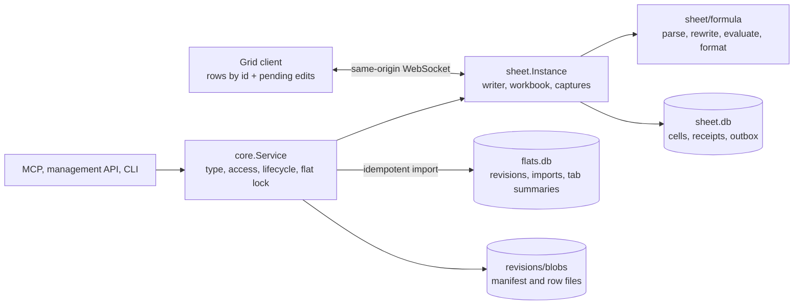

# Sheet content type technical design

Status: partly implemented. The server, the formula engine, the host
integration and the agent interface are implemented; see the product spec's
[Current state](sheet.md#current-state) for what is not measured or checked
yet, and [Appendix B](#appendix-b-implementation-notes) for where the
implementation differs from this page.
Base: `a9191bed` (origin/main). Product contract: [sheet.md](sheet.md), S1.

This page specifies S1's server, formula engine, storage, protocol, browser
and agent contracts. Rule numbers refer to the product spec. Section numbers
refer to this page. The shared revision behavior is defined in
[the revision store](../revision-store.md). The host seams follow the
[notebook technical design](notebook-technical-design.md), and this page says
where the sheet differs.

## 1. Decision summary

| Topic | Decision |
|---|---|
| Runtime | One `internal/sheet.Instance` per sheet, inside the host process. There is no worker, auxiliary server, build step or new dependency. |
| Formula engine | One engine, in Go, in the pure package `internal/sheet/formula`. The browser has no evaluator, parser or number formatter. The server sends each cell's value and shown text. |
| State owner | The instance holds the workbook in memory. Every accepted edit is written to `sheet.db` in the same transaction as its receipt and outbox entry before it is acknowledged. Calculated values are derived and are never stored. |
| Identity | Every tab, row and column has an integer id below 2^53 from a sheet-wide counter that is never lowered, so no id is ever reused. Memory and files follow live rows, never the id counter. People's edits name cells by row id and column id. Agents name cells by address and are checked against a state token. |
| Stored references | A formula is stored with its references relative to its own cell unless they carry `$`. A formula moved by an insert, a sort, a fill or a copy keeps the same stored text. |
| Concurrency | One writer goroutine orders all work. Edits are absolute writes to the value groups of rule 28, guarded by per-group sequence stamps. |
| Recalculation | Reverse index over single cells and an interval index over ranges, dirty set in dependency order, cycle detection, one deadline that covers dependency work and evaluation, results written to an overlay that is applied whole or discarded. Structural edits recalculate the whole sheet. |
| History | Durable outbox in the edit transaction, imported by core into the shared revision store. Revision files are a manifest, one axes file per tab and row files of at most 256 filled rows. The closing calculation date of each revision is revision metadata in the host store, not file content. |
| Reads | A read captures the cells it needs under a read lock and encodes outside it. Captures live in memory and are bounded by the sheet limits. There are no spill files. |
| Browser | Plain ES modules, a virtualized DOM grid with one element per visible row, a single text area as cell editor. Formula text is fetched when a cell becomes active. |
| Public | Read-only projection of the current tabs, cells, formula text, formats, widths and settings. No sessions, presence, undo or history. |
| Delivery | One feature PR built from four units that can be developed in parallel behind frozen interfaces (section 21). |

## 2. Scope and non-goals

S1 includes every browser and agent operation of the product spec. This page
adds no product behavior. Where a rule needs an interpretation to be
implemented, section 24 lists it as a question for the product spec and
states the reading this design uses.

Non-goals of this design:

- No shared kernel with the board or the notebook. The sheet copies small
  patterns (writer queue, receipts, outbox, app files) and owns its rules.
- No formula evaluation, reference rewriting or number formatting in
  JavaScript.
- No workbook file import or export, no arrays, no named ranges, and nothing
  else listed under [Not in S1](sheet.md#not-in-s1).
- No change to the Revision model, quotas, pins, approval rules or route
  access decisions.
- No guarantee for a file edited outside Flats. Flats trusts the files it
  wrote: `flats.db`, `sheet.db`, revision files and backups. It checks
  them for what a crash, a failed disk or another release can leave (the
  integrity check, the schema and release mark, hashes, declared sizes and
  the writer's structural rules) and refuses a file that fails. It makes
  no promise of bounded memory, bounded time or any particular behavior
  for a file another program edited to hold values Flats never writes.
  The class, length, count and path checks of sections 5 and 16.1 and of
  the backup stay as defence in depth, without a claim that they are
  complete. Who can write these files can already change what a flat
  serves.

## 3. Package layout and boundaries



| Package | Owns | Must not |
|---|---|---|
| `internal/sheet/formula` | Lexer, parser, stored reference form, structural transforms, evaluator, function library, number formats, typed entry, sort order, CSV fields. | Import anything from Flats, do I/O, read the clock, start goroutines or keep package state. |
| `internal/sheet` | Workbook model, operations, recalculation, limits, `sheet.db`, writer, receipts, undo, outbox, captures, live protocol, HTTP routes, Public projection, embedded client. | Take the flat lock, walk the flat directory or call host history APIs from the writer. |
| `internal/sheet/web` | The browser client, embedded with `go:embed`. | Calculate, parse formulas or format numbers. |
| `internal/core/sheet*.go` | Creation, type admission, build, import, rollback, catch-up, sweep, metrics, Public withdrawal. | Reach into the workbook. Core calls the instance's methods only. |

`internal/sheet` groups its files by job: model (`workbook.go`, `axis.go`,
`style.go`), operations (`ops*.go`, `decode.go`), calculation (`recalc.go`,
`deps.go`, `limits.go`), durability (`db.go`, `writer.go`, `receipts.go`,
`undo.go`, `outbox.go`, `files.go`, `quota.go`), reads (`capture.go`,
`read.go`, `csv.go`) and transport (`live.go`, `protocol.go`, `wire.go`,
`presence.go`, `projection.go`, `http.go`, `history.go`, `webfs.go`).
`wire.go` reads what clients and agents send (Appendix A).
`internal/sheet/benchdata` generates the reference sheet.

### 3.1 Alternatives

| Alternative | Decision |
|---|---|
| Evaluate formulas in the browser and on the server | Rejected. Two evaluators cannot keep principle 2 for 104 functions, number formats and coercions. |
| `sheet.db` as the only current state, as the notebook does | Rejected. Recalculation reads up to 20,000,000 cells per pass, which needs the cells in memory. A second copy in SQL is kept only for durability. |
| Positional row chunks in revision files | Rejected. An insert at the top would change every chunk. Chunks keyed by row id change only where content changed. |
| Formula references stored as A1 text | Rejected. An insert at the top of the reference sheet would rewrite 40,000 formulas in memory, in `sheet.db` and in revision files. |
| References bound to row and column ids | Rejected. Rule 22 says formulas outside sorted rows keep their addresses, so every sort would rebind them. |
| A third-party spreadsheet engine | Rejected. No Go engine matches the spec's reference rules, and the repository adds no dependency for this. |

### 3.2 Lock order and lifecycle

Core orders storage-journal admission, the flat lock and the sheet writer in
that order, as for the notebook. The writer never takes the flat lock, does
blob I/O or calls a host history API. Blob reads for rollback, revision
viewing and tab recovery happen before queue admission under a core lease.
A rollback lets the flat lock go while it calculates (section 10.5).

Inside the instance, `Instance.mu` (a `sync.RWMutex`) protects the workbook.
The writer holds the write lock while it changes memory and until the
`sheet.db` commit returns. Captures hold the read lock only while they copy
cell records.

Rename, deletion and stop refuse new work with `unavailable`, close sockets
and release captures before storage moves. Every caller that stops a
sheet waits for the same stop of its instance, also one that finds
another caller (the host's stop) already at it, so none moves or removes
the files before that stop has closed its handles or filed the release
of its storage (section 5). A stop ends a recalculation
that no edit started at its next check point (section 10.5) and refuses
the work that waited for the writer. A stop of the host stops every sheet
before it waits for its maintenance loop, so neither a calculation nor a
request that holds a sheet's flat lock through one delays the shutdown.
The other content types stop after the loop, as before. Creation uses the existing
`content_state` phases `init` and `ready`. A refused first write to a new or
untyped slug leaves no flat, shell or database.

An instance unloads its workbook after 10 minutes in which no session was
connected, no edit group was open, the outbox was empty and no capture was
live. The check and the stop are one step under the lock that admits
requests, after the writer has finished the work admitted before. A request
is therefore either admitted first and keeps the instance loaded, or it is
refused as `unavailable` with the reason `stopped` and the host opens a new
instance for it. A read that just returned a cursor never loses its capture
to an unload. The next request loads the workbook again through the restart
path of section 10.5. This bounds host memory to the sheets in use. Unload never happens
while a session is connected, so it never drops the undo history of a
person who has the sheet on screen. A reload, like a host restart, clears
undo history and the structural log (rule 23).

## 4. Data model

### 4.1 Identities and stamps

A tab id, a row id and a column id are positive integers below 2^53, so
they are exact as JSON numbers. Each kind comes from one counter for the
whole sheet, kept in `meta`: `next_tab`, `next_row` and `next_col`. A
counter is advanced in the transaction of the edit that allocates, and it
never goes back: not when a tab is deleted, not on restart and not on
rollback. An id therefore names one tab, row or column for the life of the
store, and every id in every revision of this store is below the counters.
A tab recovery refuses a revision whose tab breaks that (section 16.4),
and the first id of a chunk in a revision is below 2^53 like any id
(section 16.1).
A deleted tab leaves nothing behind that could be lost, because the
counters do not belong to it. The retained metadata is three integers,
whatever the sheet's history.

A counter cannot reach 2^53 in practice: at one million allocations per
second that takes 285 years. An allocation past it is refused as
`unavailable`. This guards against a corrupt counter and is not a product
limit.

Everything the instance keeps per row or column is keyed by live ids, never
sized by a counter. A sheet that has allocated 100,000,000 row ids and
holds 1,000 rows costs the memory and the revision files of a new sheet
with 1,000 rows (sections 4.2 and 16.1).

The sheet has one sequence, `seq`. Every accepted action, agent call,
rollback and calculation date change gets the next value. On the wire a
sequence is a decimal string. Stamps are sequence values kept on the model:

| Stamp | Kept on | Set when |
|---|---|---|
| `born` | tab, row, column | The item is created, or comes back through undo, tab recovery or rollback. |
| `seq` | cell content | A writer writes or clears the cell's content. A structural edit that only rewrites the references of a formula (section 8.2) does not set it. A cleared cell keeps a blank record with its stamp (section 7.5). |
| `text_seq` | cell content | A structural edit or a tab rename rewrites the stored form of the cell's formula, or an undo gives it its earlier form back (section 14). Writers' edits do not set it. |
| property stamps | cell format, one per property of rule 6 | That property is written. |
| `seq` | column width | The width is written. |
| `name_seq`, `settings_seq` | tab | The name or the frozen counts are written. |
| `struct_seq` | tab | Rows or columns of the tab are inserted before others, deleted or sorted. Rows and columns added at the end do not set it. |
| `tab_order_seq`, `tab_change_seq`, `reset_seq` | sheet | The tab order changes. A tab is renamed or deleted. The sheet is rolled back. |

Every stamp in this table is durable in `sheet.db`. Stamps never enter a
revision file. The `born` stamps of an axis are runs over its live ids and
no other id: a load refuses runs that hold id 0 or an id that is not on
the axis (section 5), since an id the counter gives out later would get
a second stamp.

### 4.2 Workbook in memory

```go
type Workbook struct {
	store                              string // random id of this sheet.db
	seq, resetSeq, tabChangeSeq        uint64
	nextTab, nextRow, nextCol          uint64 // sheet-wide id counters
	limited                            bool   // the state is in limited mode
	guardFloor                         uint64
	date                               formula.Date // calculation date
	tabs                               []*Tab       // tab order
	styles                             styleTable
	formulas                           map[uint64]weak.Pointer[formula.Formula] // by a hash of the stored text
	deps                               depIndex
	count                              counters // cells, formulas, text, reads
}
type Tab struct {
	id                                    TabID
	name                                  string
	born, nameSeq, settingsSeq            uint64
	structSeq                             uint64
	rows, cols                            axis
	widths                                map[ColID]width   // value and stamp
	frozenRows, frozenCols                int
	cells                                 map[cellKey]*Cell // {RowID, ColID}
	chunks                                []RowID           // first row id of each row file
}
type axis struct {
	ids  []uint64         // live ids in position order
	pos  map[uint64]int32 // position of each live id
	born runStamps        // sorted runs {first id, count, seq}, live ids only
}
type Cell struct {
	content formula.Content  // blank, number, text, boolean, date, time, formula
	f       *formula.Formula // set when the content is a formula
	val     formula.Value    // calculated value of a formula
	style   uint32           // id in the style table, 0 is the default
	seq     uint64           // content stamp: a writer wrote the cell
	textSeq uint64           // text stamp: a rewrite changed the stored formula
}
```

Cells that share a stored formula text share one immutable `*formula.Formula`.
In the reference sheet the 40,000 row formulas are two parsed formulas.
The table that finds the shared formula keeps none alive. An entry is a
hash of the text and a weak pointer, so a parsed formula lives only while
a cell, an undo record or a capture holds it, and neither the formula nor
its text outlives that. While anything holds the formula of a text, a later
write of the text gets the same one. The table is never replaced, so this
sharing holds across any number of writes, including with cells that no
write touched. Once the collector has freed a formula, a later write drops
its entry, up to 256 a write. The table holds at most 201,024 entries of a
few dozen bytes. A text that finds it full, or whose hash a live formula of
another text holds, gets a parsed formula of its own.

What a parsed formula keeps in memory is worked out from its tree when it
is parsed (`Formula.Size`): its record, its stored text, the pieces of
text around its references, its references, and every node of its tree
with its list of arguments, each at what the Go allocator takes for it. A
test checks it against the heap for every kind of formula the parser
builds. A sum of 4,000 terms of 8,000 characters takes about 580 KiB, a
formula of 950 references about 220 KiB. Parsed, formula text takes up to
about 75 bytes a character, so the last row of the table below is low by
up to about 3 GiB when all typed text is formula text. A holder outside
the live cells that may keep a formula after the cells let go counts it
in full, at that size and 192 bytes for what the table attaches to a
shared formula: each undo payload once for the formulas it holds (section
14), and the journal of an action for those it made and replaced (section
6). Several holders of one formula each count it, so the counts are above
what the heap keeps, never below. A capture keeps only the stored text,
and a copy of the formats it names with their symbols (section 13).

Every text a cell holds is a string of its own, so a holder that keeps a
cell's text or value after the cell let go keeps that text's bytes and no
more. Typed text is decoded or read into its own memory, and a text
after an apostrophe is copied without it. A currency format that typed
entry sets holds a constant sign, not a part of the amount, and the
names of tabs that an undo entry keeps for its formulas (section 14) are
copies, not parts of the formulas' stored texts. A calculated
text is copied into memory of its size (section 9.3), except where a
formula gives a text it already holds: one reference gives the value of
the cell it reads, which is a text of its own by the same rule, and a
formula that is one written text has that text copied out of its stored
text when it is parsed. A part of a stored text would keep the whole
stored text alive in a value read by another cell, in a capture, in a
pasted value or in an undo payload: a value of one character could keep
a formula of 8,000. The holders count a text at what the allocator takes
for it, at least 16 bytes. An empty text is the empty string constant,
which lies in no memory and counts nothing: a text of no bytes cut from a
longer one, or left in a builder's room, would keep all of it alive.
Values, written texts of formulas and text typed after an apostrophe are
made empty that way. The content of a formula cell holds the stored text
of the formula it shares. The driver of `sheet.db` reads the text of each
cell row into a string of its own, so a load gives the cell the text of
its shared formula and keeps no copy beside it.

Memory follows live content. `axis.pos` is a map over live ids, and a
delete removes the id from `pos` and from the `born` runs. A Go map keeps
its table after its entries go, and an array its length when a list
shrinks inside it, so a revert of a refused or failed action, a deletion
of rows or a cleared range can leave room for far more than is left. A
tab notes how many rows, widths and last sorts it held before it lost
one; the maintenance tick makes a tab's rows map, widths, last sorts,
axes, rows in position order and row files list, and the maps of the
style states, again for what they hold once they keep room for more than
twice that and 1,024 more. Each copy is made whole before it replaces the
old one, the tick spends at most a million entries on them and goes on at
the next tick, and the entries, their order and the row files stay the
same. A row's list of cells is made again once it is a quarter of its
array or less. The style states that a refused or failed action interned
go with its revert, and their ids are given back (section 4.4). The tick
also forgets a state no cell uses, such as one whose last cells it
collected as blank records, and makes the list of formats on the wire and
its index again once the list keeps room for more than twice its formats
and 1,024 more; the formats keep their indexes. The reverse
dependency index holds one entry per reference of each formula cell
(section 10.1). Estimates, until the benchmark of section 22.4 records
them:

| Sheet | Main parts | Estimate |
|---|---|---|
| Reference sheet | 400,000 cells, 22 distinct formulas, about 120,000 index entries | 60 to 80 MiB |
| 1,000 live rows after 100,000,000 allocated row ids | 1,000 ids and map entries | the same as a new tab, under 1 MiB for the axes |
| Every limit at once | 500,000 cell records, 5,000,000 row ids with positions (about 120 MiB), 50,000,000 characters of typed text and as many calculated, and up to about 16,000,000 reference slots with as many index entries when the typed text is formula text made of the shortest references (about 900 MiB) | up to about 1.5 GiB |

The last row is the main input for closing the spec's open question 1 on
limit numbers. It needs no new limit to stay bounded, because the typed
text limit bounds the number of references.

### 4.3 Content and values

`formula.Content` is what a cell holds: blank, a float64 number, text, a
boolean, a date, a time, a date with time, or a formula. Dates and times are
numbers with a kind tag. Day 2 is 1900-01-01, so day 0 is 1899-12-30. A time
is a fraction of a day. Stored content holds a date as a whole day from
1900-01-01 to 9999-12-31, a time as a whole second of a day, and a date
with time as a whole second of such a day. Typed entry and agent writes
give only these numbers, and a row file holds them unchanged (section
16.1).

`formula.Value` is what a cell evaluates to: blank, number, text, boolean or
one of the nine errors of rule 11. The value of a non-formula cell is its
content. Text length is counted in Unicode code points, as in the notebook.

### 4.4 Formats and style states

A cell's format is a `formula.Format` value: four marks, text color, fill
color, alignment, wrap and number format. The style table interns pairs of
`(Format, property stamps)` and counts references. A cell holds a style id.
A format operation over a range maps each distinct old style id to a new one
once, so its cost is the number of cells plus the number of distinct styles.
The table gives rule 28 a stamp per format property without storing nine
stamps on every cell.

A state that no cell uses leaves the table: when the change that left it
unused commits, when the action that interned it is reverted, and else at
the next tick. The table logs the ids it gives out until the next commit.
An action notes the length of that log when it starts, and an operation
when it begins; their revert forgets the unused states the log names
from there on, which no row of `sheet.db` holds, and gives their ids back
where they came from. A call that does not commit therefore leaves no
state behind, however many it interned, and needs no later edit for that.
A log that a revert leaves with the room of far more entries than it holds
is made again for those it keeps, and so is one the tick finds so.

Style ids run from 1 to 4,294,967,295 and are given out again. A range
format at a new sequence makes a new state for each distinct old one, so
ids given out once would run out after some tens of thousands of formats
of a large range. The table first gives out ids above the highest it has
given out. When fewer than 2^30 are left, the next tick, and a load, make
free every id below that no state holds; a sheet holds at most 500,000
states, so nearly all are free. A state that left the table names no
cell, and its row in `sheet.db` is rewritten or deleted by the commit that
stages its touched id, so an id given out again never meets the old
state. An action that finds no free id, which needs a billion ids between
two ticks, is refused as a whole as `unavailable` with reason
`ids_exhausted`. The failure belongs to the operation that found no id:
it takes a place in the log, so the revert of a later operation of the
action, which is ignored or refused on its own, keeps it. No state gets id 0 or the id of another state. A load
refuses style id 0, a format in another spelling than the writer's, a
state under two ids that cells use and a cell whose style has no row. It
holds only the states its cells use: a row that no cell uses, as the
tick's collection of blank records leaves until the next commit, stays out
of the table, and the next commit deletes it.

### 4.5 Value groups

| Group of rule 28 | Representation | Stamp |
|---|---|---|
| Cell content | `Cell.content` | `Cell.seq` |
| Cell format property | one field of the interned format | property stamp in the style state |
| Column width | `Tab.widths[col]` | width stamp |
| Row order, column order | `axis.ids` | `Tab.structSeq` |
| Tab name | `Tab.name` | `nameSeq` |
| Tab settings | frozen counts | `settingsSeq` |
| Tab order | `Workbook.tabs` | `tab_order_seq` |

The decoder checks every value before the writer sees it, for people and
agents alike. A tab name follows rule 2 and is unique by its case-folded
key. A new tab gets 1,000 row ids and 26 column ids. A width is 40 to 1,000
pixels with 104 as the default, frozen rows are 0 to 20 and frozen columns
0 to 10. A color is one of the 54 palette names such as `red-600`, decimals
are 0 to 10, and a currency symbol is 1 to 3 characters, each a letter or a
currency sign.

Writes to different groups never refuse each other (rule 29). A write to a
group replaces its whole value in writer order (rule 30). An accepted write
advances the stamp even when the value is equal, so undo guards see it.

## 5. Storage

The live path is `flats/<slug>/sheet/sheet.db`. Revision blobs stay under
`flats/<slug>/revisions/blobs`. The schema starts at `user_version = 1`.
Connections use WAL, `synchronous=FULL` and incremental auto-vacuum. One
connection writes. Opening a newer schema fails without writing. No
released build had the sheet type, so version 1 is the schema this release
creates, and every `sheet.db` it creates carries the SQLite
`application_id` `0x46536874`, which no development build set. Opening or
checking a database of version 1 without that mark, or whose tables and
indexes differ from this release's, fails, because only an unreleased
development build wrote it. Some of those databases have the schema of
this release, while their stored commands and browser receipts hash
requests in other forms, so the mark tells them apart. A restored backup
keeps the mark, or its absence. The refusal is `unavailable` with reason
`load`, and its detail names the difference; the host gives it to every
call to that sheet, which does not start.

Opening and checking a sheet write no content in its directory:
`sheet.db`, and a `-wal` that was there, keep their bytes until the
instance's first commit. The files they can add depend on the connection.
The probe (`inspectDB`, `probe`) reads `sheet.db` as immutable when it has
no `-wal`, and reads a private copy of the `-wal` when it has one, so a
check that the probe makes, and a refusal by it (`checkSchema`: a newer
schema, tables without a version, a sheet from an unreleased build, the
mark), add no file to the sheet's directory. The instance's own
connection (`openInspected`) opens `sheet.db` read-write. Like every
SQLite connection to a WAL database, it builds a `-shm` index beside the
database it opens, and a `-wal` where there was none (the comment of
`inspectDB` in `db.go` says this for a read-only connection, and it holds
for a read-write one too). So a load that reaches that connection, one
that succeeds or one that the cursor check or a later check refuses, adds
at most a `-shm` and a `-wal` beside `sheet.db`, and no other file. PR
#248's text said that opening and checking write nothing in the
directory; that was true of the probe, and of `sheet.db` and its content.

Reading a `-wal` file that a crash left builds its `-shm` index, so the
check of that log reads a copy: the log is copied to a private temporary
directory, beside a link to `sheet.db`, or a copy of it where the file
system has no links, and the probe reads it there. The writer bounds that
log only by the disk quota, which counts it (section 16.5). A reader that
holds it, such as the snapshot of a backup, keeps every commit made
meanwhile in it, and a rollback rewrites the whole sheet in one commit.
So opening a sheet whose `sheet.db` has a `-wal` file does not read either
file. The load does, at the gate (section 10.5): it copies the log at a
check point every MiB, and SQLite recovers the log twice, once from the
private copy for the probe, and once from the real `-wal` for the
instance's own connection. That connection (`openInspected`) opens
`sheet.db` itself, read-write, after the probe. SQLite cannot interrupt a
recovery, so a stop does not wait for one. The load ends and hands its
slot at the gate to the opener, which keeps it until SQLite returns,
closes what it opened, without creating a file, and only then leaves the
gate. A refusal of such a database comes from the load, and checking the
sheet does not read it.

Without a `-wal`, `Open` itself checks the import cursor and refuses a
store behind it. At a host start core then cannot build the flat, and the
failed build records the `restore` event, as for a board or a notebook
that does not open (`Service.restore`). When core opens an unloaded sheet
again for a request (`sheetInstance.openLocked`), that refusal is the
request's `unavailable` error, with the reason, and records no event.

With a `-wal`, a refusal by the load reaches the flat's events through a
new field,
`Options.OnLoadError func(error)`. The load calls it once, from its own
goroutine, when it ends with an error that is not a stop: a store behind
the import cursor, a failed preflight or a damaged file. It calls it after
it has closed every connection it opened. The function must not block.
Core passes one that records the error on the flat, in a goroutine of its
own, as an `error` event of kind `restore` with the text `could not load
the sheet: ` and the error, the event a board or a notebook that does not
open gets. The instance stays, holds no connection, and refuses every read
and write until it stops. Reads and the outbox are refused with the load's
error. Calls that the writer answers itself are refused as `unavailable`
with reason `load`, and receipt reads as `unavailable` with reason
`storage`. Both are faults of section 18.3: marked `retry: true`, as every
`unavailable` is, and not cleared by sending again while the sheet stays
refused. The cursor check of a store with a `-wal` runs on the instance's
own connection, so by then SQLite has built that connection's `-shm`
index beside `sheet.db` (stated above), and the refusal leaves it. A connection that the
refusal closes is closed without a checkpoint, whatever the size of the
log: the refusal turns off the checkpoint on close with `keepLogOnClose`
before it closes. `closeDB` turns off the checkpoint for a long log and
also when there is no `-wal`, and it lets a short log be checkpointed;
the refusal does not. So `sheet.db`, and a `-wal` that was
there, keep their bytes. When `keepLogOnClose` fails, because the driver
no longer has the fields it needs, the refusal still closes the
connection, so that the instance holds no handle. SQLite may then
checkpoint a short log into `sheet.db`: the rows stay the same, but the
bytes do not. The instance writes a `sheet close` warning with that error
to the host log.

The instance's storage counts as released once every handle of
`sheet.db` it opened is closed, its own connections' and such an
opener's. Until then a rename or a delete of the flat waits for it, for
as long as the request does, since on some systems an open handle keeps
a file from being renamed or removed, and a new instance on the same
directory opens nothing before it. Its load waits, outside the gate, and
then opens `sheet.db` as it finds it then, with its log or without. So
one recovery of a directory at most runs at a time. When the last
connection to a database in WAL mode closes, SQLite checkpoints the whole
log into it first. A stop closes the reading connections while the
writing one still holds its lock of the file, and the writing one closes
without that checkpoint when the log holds more than 4 MiB, the size the
writer truncates a log above after its commits (`SQLITE_DBCONFIG_NO_CKPT_ON_CLOSE`,
set through the driver's handle of the connection). The writing
connection runs no automatic checkpoint (`wal_autocheckpoint(0)`), which
would copy the whole log in any commit. The writer checkpoints and
truncates a log of more than 4 MiB itself after each commit. A stop
interrupts that checkpoint where SQLite looks for it, between two pages
it copies, so the stop waits for none of the pages still to copy, and
the log stays for the next open to recover. The commit a stop makes, the
final boundary of the open edit groups, starts no checkpoint and leaves
the log as it is. A stop that comes during a checkpoint waits for the
steps of it that SQLite does not interrupt (section 10.5): the setup
before the first page, in proportion to the frames of the log and with a
sync of the log, and, once
every page is copied, the sync of `sheet.db`, in proportion to the pages
copied. A shorter log is checkpointed, and a stopped sheet then leaves
no log.
`flats backup` copies `sheet.db` as a snapshot, without its `-wal` and `-shm`
files, and checks its outbox against the cursor in `flats.db`, as it does for
`board.db` ([host backup](host-backup.md), rules 4, 16 and 27). That check
reads the store id, the keys that find it and the outbox sequences only when
they are of the class the writer stores, so a damaged copy is refused
without its values being read. The backup runs the sheet's preflight on each
snapshot of `sheet.db`. A snapshot it refuses, which no host opens either,
stays in the copy as it is and is listed as refused; the backup goes on, so
the rest of the host still has a copy and the sheet's rows are kept for a
repair, and nothing reads that snapshot's rows again. The check of a copy
accepts only canonical manifest paths and a database whose path the layout
makes one of the listed kind, exactly as written, and opens it only by a
name the copy's folders hold, so a `sheet.db` listed under another spelling
or kind is refused before anything opens it on any system.

```sql
CREATE TABLE meta (
  singleton INTEGER PRIMARY KEY CHECK (singleton = 1),
  store TEXT NOT NULL,
  seq INTEGER NOT NULL, reset_seq INTEGER NOT NULL,
  tab_change_seq INTEGER NOT NULL,      -- last tab rename or delete
  guard_floor INTEGER NOT NULL,
  calc_date TEXT NOT NULL,              -- yyyy-mm-dd, host time zone
  next_tab INTEGER NOT NULL,            -- sheet-wide id counters,
  next_row INTEGER NOT NULL,            -- never lowered
  next_col INTEGER NOT NULL,
  tab_order TEXT NOT NULL,              -- JSON array of tab ids
  tab_order_seq INTEGER NOT NULL,
  files BLOB NOT NULL                   -- newest revision file list
);
CREATE TABLE tabs (
  id INTEGER PRIMARY KEY,
  name TEXT NOT NULL, name_key TEXT NOT NULL UNIQUE,
  born INTEGER NOT NULL, name_seq INTEGER NOT NULL,
  settings_seq INTEGER NOT NULL, struct_seq INTEGER NOT NULL,
  frozen_rows INTEGER NOT NULL, frozen_cols INTEGER NOT NULL,
  row_ids BLOB NOT NULL, row_born BLOB NOT NULL,  -- run-length varints
  col_ids BLOB NOT NULL, col_born BLOB NOT NULL,
  chunks BLOB NOT NULL                  -- first row id of each row file
);
CREATE TABLE cols (
  tab INTEGER NOT NULL, col INTEGER NOT NULL,
  width INTEGER NOT NULL, seq INTEGER NOT NULL,
  PRIMARY KEY (tab, col)
) WITHOUT ROWID;
CREATE TABLE styles (
  id INTEGER PRIMARY KEY, format TEXT NOT NULL,   -- canonical JSON
  stamps BLOB NOT NULL, refs INTEGER NOT NULL
);
CREATE TABLE cells (
  tab INTEGER NOT NULL, row INTEGER NOT NULL, col INTEGER NOT NULL,
  kind INTEGER NOT NULL,    -- 0 blank 1 number 2 text 3 boolean 4 date
                            -- 5 time 6 date with time 7 formula
                            -- 8 formula text that cannot be read
  num REAL, str TEXT,       -- str holds text or the stored formula
  style INTEGER NOT NULL DEFAULT 0,
  seq INTEGER NOT NULL,                 -- content stamp
  text_seq INTEGER NOT NULL DEFAULT 0,  -- stamp of the last formula rewrite
  PRIMARY KEY (tab, row, col)
) WITHOUT ROWID;
CREATE TABLE sessions (token_hash BLOB PRIMARY KEY, id TEXT NOT NULL UNIQUE,
  editor TEXT NOT NULL, label TEXT NOT NULL, verified INTEGER NOT NULL,
  max_n INTEGER NOT NULL, last_at INTEGER NOT NULL);
CREATE INDEX sessions_last ON sessions(last_at);  -- the expiry of maintenance
CREATE TABLE receipts (session TEXT NOT NULL, n INTEGER NOT NULL,
  hash BLOB NOT NULL, seq INTEGER NOT NULL, outcome BLOB NOT NULL,
  PRIMARY KEY (session, n)) WITHOUT ROWID;
CREATE TABLE commands (op_id TEXT PRIMARY KEY, hash BLOB NOT NULL,
  outcome BLOB NOT NULL, seq INTEGER NOT NULL, outbox_seq INTEGER NOT NULL,
  imported INTEGER NOT NULL, expires INTEGER NOT NULL);
CREATE TABLE groups (editor TEXT PRIMARY KEY, label TEXT NOT NULL,
  verified INTEGER NOT NULL, started INTEGER NOT NULL, last INTEGER NOT NULL,
  dirty INTEGER NOT NULL);                -- 1: edits no revision holds yet
CREATE TABLE files (path TEXT PRIMARY KEY, hash TEXT NOT NULL,
  size INTEGER NOT NULL,                -- encoded size at the last boundary
  dirty_seq INTEGER NOT NULL,           -- 0 when clean
  reserve INTEGER NOT NULL);            -- cumulative bound while dirty
CREATE TABLE outbox (seq INTEGER PRIMARY KEY AUTOINCREMENT, kind TEXT NOT NULL,
  authors TEXT NOT NULL, message TEXT NOT NULL, rollback_of INTEGER,
  op_id TEXT NOT NULL DEFAULT '', state_seq INTEGER NOT NULL,
  calc_date TEXT NOT NULL,              -- the state's date when it closed
  tabs TEXT NOT NULL,                   -- changed tabs, JSON
  files BLOB NOT NULL, created INTEGER NOT NULL);
CREATE TABLE snapshots (hash TEXT PRIMARY KEY, data BLOB NOT NULL,
  refs INTEGER NOT NULL);
```

Row order is one run-length blob per tab, a list of `(first id, count)`
varint pairs over live ids. A new tab stores two varints for 1,000 rows.
The born runs of an axis hold its ids exactly, and the chunk list starts
at 0 and ascends below 2^53. A `files` path is one of the three shapes of
section 16.1 in the writer's spelling, with the first id of a chunk below
2^53. A stored formula or text meets the limits of a typed one (section
9.1), a cell's kind is one of the nine above before it is read as one, and
a date or a time is a number of section 4.3. The tab order lists one to 50
distinct tabs, spelled as the writer spells it, and is read before any tab,
so a load builds the axes of no tab outside it. A tab has at most 779
chunks, and the tabs together at most 3,890 beyond one for each tab, the
most the chunk lists of section 16.1 hold at any state the writer commits,
also after undo, redo or recovery brought tabs back and after a rollback.
Two neighboring chunks that no `files` row marks dirty hold more than 256
filled rows together, as rebalancing left them. A load refuses any other
state as damaged, so a state it takes stays within those bounds through
every later write.

The tables are not STRICT, so a column can hold a value of any storage
class. Each value is checked by its class and its length in bytes, which
SQLite reads from the row's header without the value, before any
statement reads it: a column holds only the classes the writer stores
there (an integer in an integer column, a real or NULL in `num`, text or
NULL in `str`, NULL in `rollback_of`, text in the other text columns and
in `commands.hash`, a blob or text in `meta.files`, `outbox.files` and
`commands.outcome`, and a blob in the other blob columns), and no more
bytes than the writer stores. Opening
a sheet reads only the row of `meta` and at most two rows of
`sqlite_sequence`, whose one row is the outbox's, each checked whole, and
does not wait for the rest. The load checks the file first, at the gate
(section 10.5): its preflight refuses a row of `cells` longer than the
writer stores (from `dbstat`, page by page), since SQLite reads a value of
a real column whole even for `typeof`, then a value of another class in a
column of numbers, and only then runs `quick_check`, which reads a text in
a column of numeric affinity whole. A sheet without a first commit holds
no row beside `meta` and at most 64 pages, and its open runs the preflight
before it writes the first commit. The load then checks every row of every
table: the tables it does not read row by row first, at the gate, and the
others as it reads them, with each value read, joined and ordered only once
it is checked. A read outside the writer (the outbox, the references, a
snapshot, a stored call, a receipt) waits as an agent call waits for a
load until `sheet.db` is attached and has passed the preflight, both, is
refused with the load's failure for good once the load failed before,
and then checks the tables it uses first unless the load has. It reads
whether the load has ended before whether the file passed, so a load that
succeeds between the two reads is never taken for a failure. So no statement meets a value the writer would not store, in
its result, its filter, its order or the keys an index compares, and the
writer stores only such values. These checks are defence in depth for a
`sheet.db` Flats wrote, not a guarantee against a file edited outside
Flats (section 2); the host's `flats.db` has no such checks (section
16.1). A load reads a field only when its length
is within the most the writer stores there: 32 for the store id, 10 for a date, the tab order of 50
tabs, 124 for a tab name, the axes of 100,000 rows or 702 columns in runs
of one id with ids and stamps near their limits, 8 bytes for each chunk,
512 for a format, 90 for its nine stamps, 131,068 for a text, 73,728
(`MaxStoredBytes`) for a stored formula, 32,768 for an unreadable one, and
a revision file's path and hash. A longer field is refused as damage
without being read into memory. The revision file list of `meta` is not
read: the `files` table holds it. It lists at most the 4,711 files of a
revision: the manifest, 50 axes files, a first part of each of the 3,940
chunks, and a part more for each 4 MiB of the row files, which the cells
and the typed text of a sheet bound. It marks dirty the first part of a
chunk of a live tab and, of a deleted tab, only the axes of a tab of the
last revision (section 16.5). A file list is read by its count as well,
each file in the writer's spelling, and refused at the file past the most
of a revision; the backup check reads the file lists and the snapshot
hashes of a copied `sheet.db` the same way, and before its `quick_check` of
the copy it checks the schema of this release and runs the same preflight.
Its later readers hold for this schema only, so a copied `sheet.db` that
fails either check, or that the manifest does not list as a sheet
database, fails the check of the copy and is read no further: neither the
coherence of its outbox nor its file lists. The other tables are read the
same way: an outbox row with the authors of at most 256 editors, a message of 1,000
code points, an op_id of 128 bytes and the tabs, new files and file list
of a revision; the file list of `meta` likewise; a snapshot of at most the
largest revision file; a stored call's outcome of at most 100 formula
errors; a receipt of 64 KiB and its 32-byte hash; and the editor of a
session or a group of 1,024 bytes and its label of 200 code points. A
revision names the editors of its groups in the order the groups started,
the first 256 of them, and a rollback keeps the first 200 code points of
its label and refuses an op_id longer than an agent call's. A fully shuffled tab of
20,000 rows stores about 80 KiB, rewritten by each structural edit of
that tab. The blob grows with live rows only. Cells are keyed by ids, so an
insert, a delete of other rows or a sort rewrites no cell row.

Three things live in memory only: the delta log for reconnects, the
structural log and the undo stacks. After a restart or a reload every
client takes a new snapshot, undo history is empty, and a formula in flight
is judged by the durable stamps (section 8.4). Receipts and sessions are
durable, so a resent edit never applies twice across a restart.

## 6. Write path and durability

The writer queue orders people's actions, agent calls, rollback, tab
recovery, date changes, group closing, import acknowledgements and sweep
barriers. Entry into the queue is the server's receive order. People's
actions can share one transaction for at most 10 ms. Agent calls and
rollbacks are queue boundaries.

An action that changes structure, which is any insert, delete or sort of
rows or columns and any added, renamed, moved or deleted tab, is the last
of its transaction, and an undo or a redo has a transaction of its own. The structural log, the undo
stacks, the formulas they hold and the creation marks change when such an
action commits (step 8), and every later action is read against them. An
action therefore gets the same result in a shared transaction as in one of
its own.

For each action the writer performs these steps under the write lock:

1. Look up the receipt `(session, n)`. A matching replay returns the stored
   outcome. A different request under the same number is a protocol error.
2. Take the next sequence. Resolve each operation's targets (section 7) and
   apply it to the workbook. Every change appends to a change journal with
   the value before it.
3. Recalculate (section 10) into the overlay. Check the limits of section 11
   on the result, the rendered length of moved formulas included.
4. Stage the journal in a `sheet.db` transaction: changed cells, tabs,
   styles, widths, edit group, the cumulative reserve of each dirty row
   file, the receipt and any outbox entry.
5. Check disk usage on the staged transaction (section 16.5).
6. If step 2, 3 or 5 refuses the whole action, roll the transaction back,
   revert the journal, discard the overlay and store a refusal receipt.
7. Otherwise encode the action's delta from the workbook as the action
   left it, and commit. If the commit fails, revert the journal in memory.
   No acknowledgement and no fanout leave the instance, and the receipts of
   actions that committed earlier stay as they are, a resent one included.
8. Apply the overlay, add the structural log entries and the undo entry in
   memory, and release the lock. Send the delta to every connection, then
   the ack to the author.

An operation inside an action can be applied, ignored or refused on its own
(rule 37). Ignored and refused operations revert only their own journal
part, and with it everything the action kept of them for staging, for the
delta and for the undo entry. Limits, quota and the recalculation time
limit refuse the whole action, also when one operation meets the limit
after earlier operations applied: the transaction is rolled back to the
action's savepoint and only the refusal receipt is stored. The sheet shows
Saved only after the ack of step 8 (rule 38).

The journal holds what a revert needs and no more. A revert goes back to
the start of an action or of one operation of a person's action, never to
a point inside an operation, so the journal has one entry for each record
that such a stretch changes: the record as it was when the stretch began,
however often the stretch writes it. An agent call is one stretch. A
structural edit is journaled as the edit itself and is undone from it: an
insert by taking out the ids it brought, a deletion by putting back its ids
with their born stamps, a sort by writing the earlier ids into its
positions. No entry holds a copy of an axis. A revert puts the counters of
cells, blank records, formulas, typed text and calculated text back from the
values saved at the start of the stretch, so it weighs no record again and
goes through no text.

What an action holds until it ends is counted in bytes: 144 for a journal
entry, 72 for a record it puts on its list for staging, 120 for a record it
creates, 1,024 for each operation and for each run of rows or columns that
a deletion of ids takes apart, the undo step of each width it sets, counted
twice because the list of steps grows by copying, the ids and stamps of its
structural edits (85 bytes a row for a sort, with its entry of the
structural log), a tab it adds, and the text, the parsed formulas and the
calculated values that the action made itself and then replaced. A column
whose width an action sets many times is staged once. What the sheet held
before the action is not counted. The limits of section 11 bound it, and it
was in memory before. The count is bounded at 288,000,000 bytes. That is,
for each of the 600,000 records a sheet may hold (500,000 cells with content
or a format and 100,000 blank records kept for their stamps), two entries,
one mark for staging and one new record: one operation that creates or replaces
every record, and a second pass over all of them. An action that passes the
bound is refused whole with `sheet_capacity`, limit `action_changes`, as
one that meets the time limit is. The bound is looked at in the same
places (section 10.4), and after everything that adds to the count late:
when a recalculation has been applied, the last one of the action
included, whose replaced values no operation follows, and once more
behind the last entries the journal gets in step 3 and at a revision
boundary. A refused action gives its sequence back, and with it the marks
that say which values its recalculations made, so the next action counts
from nothing. The undo entry, the rows staged for `sheet.db` and
the delta of an action are built from the records it changed, once each, so
the bound holds them to the same order. An undo or a redo is one stretch
and writes each record once, so it stays inside the bound whatever the
action it takes back held. An agent call has no limit on the number of its
operations. Its 8 MiB and this bound are what hold it.

Each delta is the state of its own sequence. The actions of one transaction
apply one after the other, and the delta of each is encoded before the
next one applies, so it holds the values, the tab list and the new formats
of that action and nothing of a later one.

Agent calls use the same steps with one difference. Any ignored target,
failed guard, invalid value or limit refuses the whole call (rule 36).

Edit groups and revision boundaries follow the notebook. A maintenance tick
every 5 seconds closes the groups that are idle for 30 seconds or open for
5 minutes. A revision holds the whole sheet (rule 48), so when such a group
holds edits that no revision has yet, the tick records one revision that
credits every editor with such edits. Only the due groups close. Another
person's group stays open and keeps its start, and its later edits go into
a later revision; when it becomes due with nothing new, it closes without a
revision. Before an agent call or a rollback applies, all open groups close
as one revision that credits every editor with unrecorded edits (rule 47). At a boundary the writer
encodes the dirty files (section 16.1), stores new bytes in `snapshots` and
appends the outbox entry with the full file list and the calculation date
of the state, in the transaction of the edit that caused it. A rollback
takes the chunk lists of the revision it goes back to only when they are
lists that rebalancing leaves (section 16.1), so the state it commits is
one the writer could have closed.

A person boundary with no content change since the last recorded revision
records no revision. It still clears the dirty marks and saves the chunk
lists it rebalanced, so `sheet.db` never holds a list without the marks
that let it load. An accepted agent call always records one revision, also
when it writes equal values or its operations cancel each other, because
one call is one revision (rule 47). Creation and rollback are forced in the
same way. A call replayed through its `op_id` records none.

New work that can append to the outbox (an action, a recovery, an agent
call or a rollback) is refused as `outbox_backpressure` while 256 entries
await import. An agent call or a rollback appends two at most, the
revision of the groups it closes and its own; an action or a recovery
appends none and only marks its group dirty. Only the closing of groups
appends without admission, by a tick or when the instance stops, and
only for a dirty group, which an admitted edit marked; its revision takes
every mark away. So the outbox holds at most 257 entries, and `snapshots`
at most the new files of those, 257 times the 4,711 files of a revision.
A load, and a read outside the writer before it, refuse a `sheet.db` with
more rows in either table, counting one more at most, before they read a
row; so does the backup check of a copy. The stored calls, the sessions,
their receipts and the groups are bounded by how long they are kept (a
day, a day, the newest of each session, minutes) and are read row by row
in a paced check; closing groups holds the authors of a revision and no
list of the groups.

Receipt storage is reserved before an action is admitted, so a quota refusal
can be durable. For a session with a row, the writer checks before step 2
that the sheet as it is, plus the pages of a refusal of every operation of
the action and of the session's row with their write-ahead log frames, is
within the quota. Steps 4 and 5 stage the receipt, the edit group and the
session's row before the check, also for an action that changed nothing,
so the check counts every byte the action stores. A refusal receipt is
checked the same way. Where the reservation or that check finds no room,
every operation is refused, with `disk_quota` or the reason of the
refusal, and nothing of the action is stored: the ack says so, the number
stays free, and the receipts kept before stay. A send of the same number
is decided again, or answers `receipt_expired` once a later action of the
session has a receipt. A session without a row keeps its receipts in
memory (section 16.5) and needs no reservation. Outbox backpressure refuses
admission with a retryable error and does not consume the action number.
An ack, a stored outcome and an agent write result are each at most 64
KiB; the stored outcome of an agent call is staged before its last quota
check too.

## 7. Concurrency

### 7.1 People's actions

An action is `{n, base, ops}`. `base` is the last sequence the tab's screen
had applied when the person acted. An operation names its tab by id, its
cells by row id and column id, and ranges as runs of row ids and column
ids. The server resolves ids to current positions, so an edit lands in the
cell it was made in after any insert, delete or sort (rule 31).

An action holds content and format operations (`set`, `write`, `clear`,
`format`, `width`, `copy`, `fill`, `settings`), or exactly one operation of
another kind: an insert, an append, a delete or a sort of rows or columns,
a tab operation, `undo` or `redo`. An action that mixes them is refused as
`invalid` before any of it runs. The browser client builds no such action:
each of its actions is one operation, and the function that queues an
action refuses a mix. Its undo entry then takes back either
values in cells that stay, or one structural edit. Agent calls are not
undone and keep any mix of operations.

A target is checked in this order:

| Check | Result |
|---|---|
| The tab id is not live, or `base < tab.born` | `ignored`, reason `gone` (rules 32, 34) |
| The row or column id is not live, or `base` is less than its `born` | `ignored`, reason `gone` |
| The operation carries formula text that section 8.4 cannot adjust: `base < reset_seq`, or the structural log does not reach back to `base` and the durable stamps do not rule out a change | `refused`, reason `stale_formula` (rules 14, 35) |
| Validation fails | `refused` with its reason |
| A limit or the quota fails | Every operation of the action is `refused` with that reason (section 6) |
| Otherwise | `applied` |

A paste, fill, clear or format over several cells applies to the targets
that pass and counts the ignored ones (rule 32). The client offers the text
of ignored and refused operations back (rule 24).

An action the client prepares before it sends it, from a dialog, a menu,
the tab bar, a fill drag or a column resize, names its tab, rows and
columns by id when it is prepared and keeps `base` from that moment
(section 19.5). A dialog or a clipboard read that a menu item starts keeps
the moment the menu opened. An id that was deleted and came back since, by
undo, tab recovery or rollback, has a newer `born` and is ignored as
`gone`, so the checks above apply to what the person saw (rule 34).

Browser operations:

| Operation | Fields | Notes |
|---|---|---|
| `set` | tab, row, col, `text`, `at` | Typed entry read by rule 5. `at` is the address the screen showed, used for a formula (section 8.4). |
| `write` | tab, rows, cols, `values` | A rectangle of typed strings from a system-clipboard paste. `rows` and `cols` may end with `{"new": k}` to grow the tab. A write that applies to no cell adds nothing and is ignored as gone. |
| `clear` | tab, rows, cols | Clears content and keeps formats. |
| `format` | tab, rows, cols, `set` | Sets the named format properties. |
| `width` | tab, cols, `width` | |
| `copy` | from, to, `mode`, `cut` | Copy inside the sheet. `mode` is `all` or `values`. The server reads the source cells when it applies the operation. A target larger than the source repeats it, and every target cell is written from its source cell, with a formula moved from there. A source tab that is gone leaves the whole target as it was, and a copy that applies to no cell adds no row or column and is ignored as gone. |
| `fill` | tab, source rows and cols, target rows and cols, `mode` | `mode` is `copy`, `auto` or `series` (section 8.5). The fill handle sends `auto`, Ctrl+D and Ctrl+R send `fill` without `mode`, which means `copy`, and the button after a drag sends the mode it names. |
| `insert_rows`, `insert_cols` | tab, `beside`, `side`, `count` | `beside` is a row or column id. If it is gone, the insert goes where it was, found through the structural log. If the log does not reach back, the operation is ignored. |
| `append_rows`, `append_cols` | tab, `count` | Adds at the end. |
| `delete_rows`, `delete_cols` | tab, ids | Deletes the ids that are still live. |
| `sort` | tab, `rows`, `by`, `desc` | `rows` is `all` or id runs (section 8.5). |
| `settings` | tab, `frozen_rows`, `frozen_cols` | |
| `add_tab`, `rename_tab`, `move_tab`, `delete_tab` | tab id, name or `before` | |
| `undo`, `redo` | | Section 14. |

Tab recovery, pin and rollback go through the History routes of section 17,
because core must lease the revision first.

### 7.2 Overwrite notices

A `set` whose cell has `Cell.seq > base`, last written by another session,
replaces a value its author had not seen. The server then sends the earlier
writer's session an `overwritten` frame with the tab, row, column and the
replaced sequence. That tab keeps the text of its own recent commits, typed
or pasted from the system clipboard, and shows it in the notice (rule 30).
It files the text of each cell the action names under that cell and the
sequence it committed at, which its delta or else an ack with an applied
operation tells. A cell of a row or column the action adds is filed under
the id that the structural edits of its delta give it, or else the first
added id its ack names, so a delta skipped across a resync loses none of
them. The cells of a delta tell nothing of the
action's: they are those of the tab the connection watches, written or
recalculated. Neither the delta nor the ack tells which cells the host
ignored, so those are filed too. No notice offers one, because a notice
names a cell this session wrote at that sequence. It keeps at most 200 of
them and 2 MiB of their text. A notice offers the text of the commit it names, or none:
never a later edit of the cell that is still pending or was refused. A
notice can come before that text is filed: the connection skipped the
action's delta in a resync and sends the notice before the ack waiting in
its queue. While actions are queued, at most 200 such notices wait, and
each offers its text once the ack files it. At
most eight notices stay per tab. An agent write that replaces a person's
content sends the same frame.

### 7.3 Agent state token

`get_sheet` and every `update_sheet` result return `state`, an opaque string
that encodes the store id and the sequence. An `update_sheet` call to an
existing sheet must carry `state` unless every operation is `add_tab`.

A call applies operation by operation under one journal. Any failed check
reverts the whole call, so nothing of a refused call remains (rule 36).
Before the first operation the writer checks the token:

| Condition | Refusal |
|---|---|
| `state` is missing | `conflict`, reason `state_required` |
| `state` names another store or a future sequence | `conflict`, reason `state_unknown` |
| `reset_seq > state.seq` | `conflict`, reason `rolled_back` |

The call keeps its own view of tab names. The view starts as the live names
and follows the call's own `add_tab`, `rename_tab` and `delete_tab`
operations, so a later operation finds a tab under the name an earlier one
gave it. The example of section 18.2 renames `Sheet1` to `Budget` and then
writes to `Budget`, and it applies.

Checks belong to the tab, not to the name an operation uses:

- A tab the call created with `add_tab` has no state check.
- For a tab that existed before the call, the identity check runs at the
  first operation that names it. A name that does not resolve in the view,
  or a tab whose `born` or `name_seq` is greater than `state.seq`, refuses
  the call with `conflict`, reason `tab_changed` and the name. This catches
  a rename, a deletion and a replacement by another writer since the state.
- For a tab that existed before the call, the structure check runs at the
  first operation that names an address in it, under any name, a name the
  call itself gave it included. The writer compares the `struct_seq` the
  tab had before the call with `state.seq`. A greater value refuses the
  call with `conflict`, reason `structure_changed` and the name. If another
  writer inserted a row above `A1` of `Sheet1` since the state, a call that
  renames `Sheet1` to `Budget` and then writes `Budget!A1` is refused. The
  call's own inserts, deletes and sorts do not count, so a later operation
  addresses the tab as the earlier ones left it.

Rows and columns added at the end of a tab, by `append_rows`, by
`append_cols` or by a write past the end, do not advance `struct_seq`,
because no address that existed changes its meaning (rule 36). Later stamps
of content, formats, widths and settings do not refuse the call. The same
group rules merge them (section 4.5).

### 7.4 Guards

`guard: {"unchanged": true}` refuses the call when the sheet's sequence is
not `state.seq`. Every change of state fails it, a calculation date change
included (rule 36).

`guard: {"ranges": ["Budget!B2:C9"]}` refuses when the content of any cell
in a range changed since the state, whatever caused the change. A formula's
text as an agent reads it can change in three ways, and each one fails the
guard:

- A writer wrote the cell. Its content stamp is above `state.seq`.
- A structural edit or a rename in another tab rewrote the cell's stored
  formula, as an insert above `Data!A1` turns `=Data!A1` in `Summary!A1`
  into `=Data!A2`. Its `text_seq` is above `state.seq`. Both stamps are
  durable, so the guard gives the same answer after a restart.
- Rows or columns of the cell's own tab were inserted, deleted or sorted,
  which can change the rendered text of a formula whose stored form stays
  the same. A guard names addresses, so the tabs of its ranges get the
  identity check and the structure check of section 7.3 like the tabs the
  operations write, also when no operation names them. The call is then
  refused with `structure_changed`.

The range guard therefore compares the larger of the content stamp and
`text_seq` of each cell record in the range with `state.seq`. A format
change, or a new calculated value of a formula whose text did not change,
does not fail it.

Guards read the live workbook, so they include people's edits that are not
in a revision yet. A failed guard is `conflict`, reason `guard`, and a
range guard names the first changed address.

A call has no limit on the number of its guard ranges, and the ranges may
name the same cells again and again. Reading them is work of the call,
counted on its budget before its first operation (section 10.4). A call
whose guards meet the deadline is refused with `recalculation_time` like
any other. Nothing of it applied, so the sheet, the open edit groups and
the connections are as they were, and no result is stored under its
`op_id`. The same call is a new call when it is sent again.

### 7.5 Cleared cells

A cleared cell keeps a blank record with its stamps, so range guards, undo
guards and overwrite notices see the clear. Blank records without a format
do not count toward the cell limit. When a sheet holds more than 100,000 of
them, the maintenance tick removes the oldest half and raises `guard_floor`
to the newest stamp it removed. Between two ticks, or after a tick that
failed, `sheet.db` can hold more. A load keeps the newest 100,000: each
time it holds 200,000 it takes out the older ones and passes over every
later record no newer than the newest it took out, and it raises
`guard_floor` to that stamp. The next commit deletes those rows, and the
style rows only they used, before it stages anything else, while the
tables still hold what the load read: a cell the commit writes can name a
style id given out again whose row still holds another format, and the
cleanup never takes such a cell for a record the load passed over. A
commit that fails leaves the cleanup to the next one. A range guard with
`state.seq < guard_floor`
is refused as `conflict`, reason `state_too_old`. This can refuse a guard
that would have passed. It never passes a guard that should fail.

## 8. Structural operations and reference rewriting

### 8.1 Stored reference form

`formula.Parse` reads typed text at a cell position and produces the stored
form. The stored form is the typed text with each reference replaced by a
slot in braces. Braces are not part of S1 formula syntax, so a slot cannot
collide with typed text outside a string.

| Typed in `E5` | Stored |
|---|---|
| `=C5*D5` | `={R[0]C[-2]}*{R[0]C[-1]}` |
| `=SUM(B$2:B4)` | `=SUM({R2C[-3]:R[-1]C[-3]})` |
| `=sum( Costs!B:D )` | `=sum( {Costs!C[-3]:C[-1]} )` |
| `='Q1 costs'!$B$3` | `={'Q1 costs'!R3C2}` |
| `=SUM(B3` | `=SUM({R[-2]C[-3]}` with value `#ERROR!` |

`R[n]` and `C[n]` are offsets from the formula's own cell. `R3` and `C2`
are fixed parts written with `$`. Text outside slots stays as typed,
spacing and capitals included. `Formula.Text(at)` writes A1 text again for
people and agents. A formula the lexer cannot split is stored verbatim with
kind 8 and has the value `#ERROR!`.

A tab is named by its name inside the slot. The name resolves when the
dependency index is built. A name that resolves to no tab gives `#REF!` and
keeps its text (rule 14).

### 8.2 Transforms

A structural edit is a `formula.Transform`. After it changes the axis, the
writer calls `Formula.Apply` for every formula cell of the sheet. `Apply`
resolves each reference at the cell's position before the edit, maps it,
and writes the stored form again at the position after the edit.

| Transform | Single reference | Range `[first, last]` |
|---|---|---|
| Insert `k` rows before row `a` | A row at or after `a` moves by `k`. | Each end at or after `a` moves by `k`. The range grows when `first < a <= last`. |
| Delete rows `[a, a+k)` | A deleted row becomes the literal `#REF!`. | The range is cut to the rows that remain. A range with no row left becomes `#REF!`. |
| Sort rows | No change to any stored form. | No change. |
| Rename tab | The name inside each slot that names the tab changes. | Same. |
| Delete or add a tab | No change. Names resolve again. | Same. |

Columns follow the same rules. Whole-column references are not changed by
row edits, and whole-row references are not changed by column edits, so they
cover rows and columns added later.

`Apply` reports whether the stored form changed. Only changed cells are
written to `sheet.db`, marked dirty for the next revision and sent in the
delta. A formula that reads only its own row keeps its stored form when rows
are inserted above it. For the reference sheet an insert at the top changes
no stored formula.

After an insert the writer recomputes each formula's static read count
(section 11). An insert that takes a whole-column reference over a read
limit is refused (rule 9).

### 8.3 Sort

A person's `sort` names its rows as `all` or as id runs. `all` means every
row under the frozen rows whose `born` is at most `base`. The server takes
the named rows that are still live, in the positions they hold now, orders
them with `formula.CompareSort` on the calculated values of the key column,
and writes them back into those same positions. Rows inserted among them
stay where they are (rule 33). The sort is stable. Its comparisons count on
the action's budget (section 10.4). A sort that meets the deadline is
refused and has reordered nothing.

`CompareSort` orders numbers and dates first, then text in the text order
of section 9.3, then `FALSE`, `TRUE`, then errors. Blank cells come last in
both directions.

A formula in a moved row keeps its stored form, which is the shift of rule
15. The writer checks each such formula. A relative part that would leave
the grid limits at the new position becomes `#REF!`. Formulas outside the
moved rows are not touched and read what the sort put at their addresses.

An agent `sort` names a run of rows by address and gets the same treatment.

Frozen rows never move (rule 22). Every sort leaves the rows that are
frozen when it applies out of what it orders, whether it names them or not:
a person's `all`, a person's id runs, an agent's range, and the undo or
redo of a sort, which moves only the rows that are not frozen by then.

### 8.4 A formula in flight

The structural log keeps every transform with its sequence, tab and session,
in memory, in the order the operations were made. The edits of one action
or call keep their order, a rename between two inserts included, because
`Apply` is not commutative. A sort entry holds the row ids it moved and
their positions before and after. The log is bounded by 256 entries, 4 MiB and one hour. A
rollback, a host restart and a reload clear it. Nothing but the adjustment
of formulas in flight and the placement of an insert beside a deleted row
depends on it. Undo does not (section 14).

A `set` that carries a formula gives `base` and `at`, the address the screen
showed. If `base < reset_seq`, the operation is refused with
`stale_formula` (rule 35). Otherwise, if the log reaches back to `base`,
the server parses the text at `at` and calls `Apply` for each log entry
after `base` in order. This is the function that maintains stored formulas,
so the formula ends as if it had been in its cell since that screen state
(rule 14).

If the log does not reach back to `base`, the server cannot adjust and
falls back to the durable stamps. It refuses the operation with
`stale_formula` in each of these cases, and accepts the text as typed
otherwise:

- The formula's own tab, or a tab one of its references resolves to, has a
  `struct_seq` or a `name_seq` above `base`.
- The formula names any tab by name, resolved or not, and
  `tab_change_seq > base`. A rename or a deletion since `base` may have
  taken the name the person saw, and a name that no longer resolves cannot
  be told from one that never did. The server therefore never accepts such
  a formula as `#REF!` or as a reference to a later tab of that name.

**In the editor.** While a person's editor holds a formula, the editor is
bound to one screen state: the grid as it was at `base`. Every reference in
the text, clicked or typed, is read against that screen, so the screen must
not change under the text.

1. A delta that inserts, deletes or sorts rows or columns of any tab, or
   renames or deletes a tab, is not applied on that screen while the editor
   holds a formula. A formula can name a cell of any tab, so a change on a
   tab the connection does not watch counts as much as one on the watched
   tab. The client reads the delta's structural operations and, as a
   second sign, a changed name, a missing tab or a changed row or column
   count in its tab list. It holds the delta, and every later delta after
   it, in order. Deltas apply in sequence order, so nothing later can
   overtake it.
2. The client sends `rebase {id, text, at, base, through}` with the editor
   text and the sequence of the newest held delta. The server adjusts the
   text from `base` through `through` and answers with the adjusted text,
   the new address and `through` as the new base.
3. If the editor still has the text that was sent, the client applies the
   held deltas up to `through` and replaces the editor text in one frame.
   The caret keeps its piece of the text (a name, a sign, quoted text)
   when both texts split into as many pieces, and goes to the end
   otherwise. The grid and the text move together.
   A reference drag going on ends there, because it started on the screen
   before.
4. If the person typed or clicked meanwhile, the text has changed. Those
   characters and references were read against the screen the person saw,
   which is still the one at `base`, so the client sends the new text with
   the same `base` and the current `through`. After 3 attempts, or 500 ms,
   it makes the editor read-only for one last round trip. Until its
   answer, a reference click or drag and an accepted function hint change
   nothing in the text.
5. During composition the client holds the deltas and waits for
   `compositionend` before the exchange that it applies.
6. A commit while deltas are held is sent with the old `base`. The server
   adjusts it by the rule above, the editor closes, and the held deltas are
   applied. A commit the client cannot send, as while another tab loads
   (section 19.5), writes nothing and leaves the editor, its text and the
   held deltas as they are.

With `=B5+` in the editor and a row inserted above, the screen keeps
showing the old grid. A click on what it shows as `B6`, or the typed
characters `B6`, give `=B5+B6` at the old base, and the exchange turns text
and grid together into `=B6+B7` over the new grid. No text ever mixes two
screen states.

An editor that waits for the text of its formula (section 19.5) is bound
in the same way. The keys typed meanwhile are read against the screen, and
the text they follow is the peek of that screen. A structural delta is
held as for a formula, and once the peek opens the editor the exchange
runs for the held deltas. A peek answer read after the held deltas is text
of a grid the keys were not typed on, so the editor closes without writing
and offers the keys back. With no key typed it binds nothing, and the held
deltas apply up to the answer, which then opens the editor.

The text of an own edit that is still pending was typed on the screen of
its action's base. When a structural delta or a snapshot has reached the
grid since, an edit that reopens such a formula does not show it. It waits
and sends `rebase` with that text, the address the cell had and the
action's base, through the grid's sequence. The answer opens the editor on
the adjusted text, followed by the keys typed meanwhile, and structural
deltas that arrive in that time are held as above. The pending action
itself is adjusted by the server from its own base, so its confirmation can
come before or after.

The editor is never editable against a grid it is not bound to. If the
rebase is refused, the text does not fit one client frame (256 KiB, far
above the longest formula the server stores), or the held deltas pass
8 MiB of encoded frames, the client closes the editor without committing and offers the typed text back
in a notice (rule 24). Only then does it apply the held deltas in order, or take a new
snapshot if the server sent `resync` meanwhile. A `reset` after a rollback
closes the editor in the same way and drops the held deltas (rule 14). An
editor that holds content other than a formula holds nothing back.

The grid on screen can also fall behind the stream as a whole. The client
keeps two sequences apart: the place of the stream, which is the last
sequence the connection received, and the sequence of the grid, which is
the state the open tab shows and the base of an action. The grid is stale
when the stream went on without it: a `reset` arrived, the client could
not take a frame of the grid (section 12.5), the connection started over,
the host no longer knew a session that had nothing pending,
a resume was not replayed, a `resync` arrived, a structural delta met a
snapshot that was still arriving, or a snapshot older than the stream
arrived. It is stale from the moment the client receives the `reset` or
the frame, not from the next welcome, however late that is and whatever
the client last heard of a calculation. A stale grid takes no delta and
keeps its sequence. The client closes an
open editor without committing, offers its text back, and starts no edit,
so no action names as its base a sequence the person did not see. Only the
head of a snapshot that is not older than the stream ends this.

The same state decides what the client asks for. A hello asks to resume
only from a grid that is current, so after every welcome the grid is
current or a snapshot is on its way on that connection: the unasked one of
a resume the host could not replay, or the answer to a `watch`. A
connection lost at any point of that snapshot is followed by the same
decision on the next one. When the head has not arrived after 15 seconds
on an open connection, the client sends `watch` again, and goes on doing
so.

### 8.5 Copy, fill and cut

`formula.Formula.Moved(from, to)` returns the same stored form, with
`#REF!` for a relative part that leaves the grid limits (rule 15) or lies
past what a formula can name at `to`. Such a reference keeps no tab name
and no position, so moving the formula back does not bring it back.

`Formula.Cut(from, to, fromTab, toTab)` rewrites the relative parts so the
formula reads the same cells from its new place. When the two tabs differ,
each reference written without a tab name gains the name of the source tab,
quoted when the name needs it. References that already name a tab, the
destination included, keep it. A cut whose destination names a row or a
column twice, a deleted one or an added one included, is refused as
`invalid`, because the second write to that cell would replace the first
while the cut clears both sources. A plain paste may name a destination twice; the
later write stays and no source is cleared. A cut and paste clears a
source cell only when one of its destinations applied: a source whose destination row or
column was deleted before the host received the paste keeps its content,
formula and format. When the source and the target overlap, a destination
on a source cell that stays does not apply either, and the source cell
that would have moved there stays too, until nothing changes. The engine
works this out before it writes, and each destination is held at most
once, so the work grows with the size of the cut. No content, formula or
format of the cut is lost. The ack counts the destinations that applied
and those that were ignored, those under a cell that stays included, and
undo takes back only the cells that moved. A cut changes no other
formula. The rendered length of a moved or cut formula is checked like
any other (section 11).

A paste of values writes what each source formula gives at that point of
the action: the engine recalculates what the earlier operations of the
action wrote before it reads the source, as a sort does.

A `fill` has a `mode`: `copy`, `auto` or `series`. `copy` repeats the
source over the target, as a `copy` with `mode: "all"` does. `auto` is the
fill of rule 21a, and `series` is the same except that one plain number
adds 1 for each cell. The server reads the source when it applies the
operation and fills each line on its own: each column for a target above
or below the source, each row for a target beside it. For a line it calls
`formula.FillSeries` with the contents of the source cells in order, the
number of target cells, whether the target lies before the source, and
whether the mode is `series`. When `FillSeries` returns no series, the line
is a copy: each target cell is written from its source cell, with a
formula moved from there. Otherwise each target cell gets its content from
the series. In both cases each target cell gets the format of its source
cell, in the same repeating order as a copy. A line without a series is a
copy of that line's own source cells, which repeat in order along the
line, each formula moved from its source cell. A fill is checked and
counted as a copy over the same target, and the writer builds its series
under the same deadline: `FillSeries` is linear in the source and the
target, and the writer charges each target cell as a copy does, and the
bytes of each text it writes. A series text over 32,767 characters refuses the fill with
`text_length`, as any write over that limit is refused. A fill in `auto`
or `series` must have its target on one side of its source: below or above
it in the same columns, or right or left of it in the same rows. Any other
target refuses the operation as `invalid`. A `copy` fill keeps the rule of
a `copy`.

`FillSeries` gives a series only for the sources of rule 21a, and returns
no series for any other source. Its cases:

- Numbers. One plain number makes no series without `step`, and with
  `step` adds 1 per cell, or takes 1 per cell for a target before the
  source. Two or more numbers are fitted by least squares through the
  values at positions 1 to n, and the series is the line at positions n+1,
  n+2 and so on, or at 0, -1 and so on for a target before the source. The
  values are not rounded.
- Dates and times. Every content a series writes is stored content of
  section 4.3: a date is a whole day from 1900-01-01 (day 2) to 9999-12-31,
  a time a whole second of a day, and a date with time a whole second of
  such a day. So `FillSeries` counts in those units: days for dates, and
  seconds for times and dates with time. Two or more contents of one kind
  among date, time and date with time are fitted by least squares in that
  unit, and each result is rounded half away from zero to a whole day or
  a whole second. One date or date with time adds one day per cell, and
  one time adds 3,600 seconds per cell. A time result is taken modulo
  86,400 seconds. Each content is built from its whole counts the way
  typed entry (`readValue`) builds it: a date is its whole days, a time is
  its seconds divided by 86,400, and a date with time is its whole days
  plus the seconds of that day divided by 86,400, never its total seconds
  divided by 86,400, which can be another double. So a filled `23:00`
  holds the same number as a typed `23:00`, compares equal
  to it and sorts with it. A line whose dates or dates with time would
  come before 1900-01-01 or after 9999-12-31 has no series.
- Names. The contents are texts that are all weekday names or all month
  names, matched without regard to capitals in their full and three-letter
  English forms, with Saturday and Sunday among the weekdays. One name
  steps by one. Two or more names step by the distance from one to the
  next in the cycle, and they make a series only when that distance is the
  same each time, a distance of none included, which repeats the name.
  The result has the form, full or three-letter, of the last source cell
  whose name has one form. `May` has both, so a source of only `May`
  takes the three-letter form. The result has the capitals of the last
  source cell: all capitals when every letter of it is a capital, an
  initial capital when only the first letter is, and small letters
  otherwise.
- Texts that end in a number. The final run of ASCII digits is the
  number, and the text before it is the stem. All source cells must have
  the same stem, compared exactly, and a number of at most 15 digits. One
  text steps by one. Two or more are fitted by least squares as numbers
  are, and each result is rounded half away from zero to a whole number. A
  number below 0 is written without its sign. A number is written with at
  least the digits of the last source cell, with zeros in front.
- No series. A blank cell, a boolean, a formula, an unreadable formula,
  contents of different kinds, names that do not keep one step, texts with
  different stems, any other text, and a fitted value that is not finite.

## 9. Formula engine

### 9.1 Interface

```go
package formula

type Pos struct{ Row, Col int32 } // zero-based

type Limits struct{ MaxChars, MaxDepth int } // 8,192 and 64

func Parse(text string, at Pos, lim Limits) (*Formula, error) // *LimitError only
func ParseStored(stored string) (*Formula, error)   // a cell's form: MaxStoredBytes, 8,192 tokens, nesting 64
func ParseRetained(stored string) (*Formula, error) // a form undo keeps: room at most MaxRetainedBytes

func (f *Formula) Stored() string
func (f *Formula) Text(at Pos) string
func (f *Formula) TextLen(at Pos) int // code points of Text(at), without building it
func (f *Formula) LimitAt(at Pos) error // *LimitError over 8,192, ErrStored for a reference past what a formula names
func (f *Formula) TextWork() int64    // the most bytes of heap Text allocates
func (f *Formula) NamesTab() bool    // some reference is written with a tab name
func (f *Formula) Refs(at Pos, visit func(Ref))
func (f *Formula) ReadCells(at Pos, dims Dims) int64
func (f *Formula) ReadsToday() bool
func (f *Formula) DateResult() bool // outermost DATE, TODAY, EDATE, EOMONTH
func (f *Formula) Apply(tab string, at Pos, t Transform) (*Formula, Pos, bool)
func (f *Formula) Moved(from, to Pos) *Formula
func (f *Formula) Placed(at Pos) *Formula
func (f *Formula) Cut(from, to Pos, fromTab, toTab string) *Formula
func (f *Formula) Eval(env *Env) Value

type Grid interface {
	Tab(name string) (TabRef, bool)
	Dims(tab TabRef) (rows, cols int32)
	Value(tab TabRef, p Pos) Value
	Filled(tab TabRef, p Pos) bool // the cell holds content, a formula included
}
type Env struct {
	Grid   Grid
	Tab    TabRef
	At     Pos
	Today  Date
	Budget *Budget // counts reads and checks the deadline
}

func ParseTyped(text string) (Content, *NumberFormat)            // rule 5
func Show(v Value, kind ContentKind, nf NumberFormat) string     // rule 6
func EditText(c Content, at Pos) string                          // rule 18
func CompareSort(a, b Value) int                                 // rule 22
func CompareText(a, b string) int                                // rule 22
func AppendCSVField(dst []byte, v Value, kind ContentKind, nf NumberFormat) []byte // rule 60
func FillSeries(src []Content, n int, back, step bool) ([]Content, bool) // rule 21a
func ParseRange(a1 string) (Range, error)
func Functions() []FunctionInfo // name, group, argument names
```

A syntax error is not a Go error. `Parse` returns a formula whose value is
`#ERROR!`. `Parse` returns `*LimitError` only for a formula that is too long
or nested too deep, and the writer refuses that edit. Text that cannot be
read is held to the same two limits: its nesting is the count of open
brackets outside quoted text and quoted tab names.

A stored form read from storage is held to the limits of a typed formula
too (rules 4 and 9). Every reference a formula keeps shows its tab name
in the formula's text. A copy, a fill, a sort or an undo that puts a
formula where one of its references lies past what a formula can name
ends that reference as the literal `#REF!`, with no tab name and no
position (`Moved`, `Placed`). Moving the formula back does not bring the
reference back, as in other spreadsheets. The stored form of a formula is
then at most nine bytes for each code point of its text at its cell: a
reference that writes as `A1` can be the slot `{R[-99999]C[-701]}` of 18
bytes, a tab name takes its bytes in the slot and its code points in the
text, and the other text takes at most four bytes for each code point.
`ParseStored` refuses a form longer than `MaxStoredBytes`, 9 × 8,192 =
73,728 bytes, without reading it. It refuses a form of more than 8,192
tokens when the lexer reaches the next token, before the rest is read
and before a tree is built, and a form nested deeper than 64 levels.
Each token writes at least one code point at any cell and a transform
keeps their number, so no formula the writer keeps reaches these bounds.
Reading a stored form therefore builds a tree of at most 8,192 tokens.
The loaders of `sheet.db` and of revision files then check `LimitAt` at
the formula's cell: its text there is within 8,192 characters, and each
of its references lies within what a formula can name there. What a
formula can name depends on rows and columns only. A reference to a tab
that no tab is called keeps its slot through `Moved` and `Placed`, passes
`LimitAt`, and reads the tab again once a tab has the name, as after a
recovery (section 8.1).
The writer keeps every formula it stores within that limit (section 11),
so only damaged storage fails these checks.

A formula an undo entry holds keeps its references while a rename makes
its text longer than 8,192 characters at its cell (section 14), and its
stored form can then be longer than `MaxStoredBytes`. A scratch file of
undo history is read with `ParseRetained`, which bounds the room of a
form instead. The room of a form is its length once each reference has
become the longest slot a transform can make of it:
`{'name'!R[-n]C[-n]:R[-n]C[-n]}`, 174 bytes with a tab name of 31 code
points of four bytes each in apostrophes, or longer by as much as a
longer name typed in the formula. A transform keeps the text around the
references and their number, and writes tab names only by a rename or a
cut, so it never gives a form more room. A formula of 8,192 characters
has at most 4,096 references, since each takes two characters at least,
and its other text and the tab names written in it take at most four
bytes for each character. Its room, and that of every form made of it,
is therefore at most `MaxRetainedBytes`, 4 × 8,192 + 4,096 × 174 bytes:
745,472. `ParseRetained` holds a form to the same 8,192 tokens. The
transforms themselves check no stored length, so a formula an undo entry
holds keeps its references through renames, and its undo is refused as
`formula_length` while its text at its cell is too long. A text value
longer than 32,767 characters is `#VALUE!` also as the result of a formula
that is a literal alone.

`Value` and `Filled` together tell a blank cell from a formula that returns
blank (rule 11). Both have the blank value, and only the second is filled.

| Reader | Uses | Result for a blank cell and for a cell holding `=A1` with a blank `A1` |
|---|---|---|
| A reference where a value is needed, such as `=B1` or `B1+1` | `Value` | Blank in both cases. `=B1` passes the blank on, arithmetic reads 0 and `&` reads empty text. |
| `ISBLANK(B1)` | `Filled` | `TRUE` and `FALSE` (`isblank-009`). |
| `COUNTA` | `Filled` for each cell of a range | 0 and 1 (`counta-013`). A filled cell counts whatever its value, empty text included. |
| `COUNTBLANK` | `Value` for each cell of a range | 1 and 1. It counts cells whose value is blank or empty text, filled or not. |
| Every other function over a range | `Value` | A blank value is passed over or counts as the function's rules for blank say. |

A cell outside the tab's rows and columns is not filled and has the blank
value. A cell that holds only a format is not filled.

### 9.2 Grammar

```text
formula  = "=" expr
expr     = concat { ("=" | "<>" | "<" | "<=" | ">" | ">=") concat }
concat   = sum { "&" sum }
sum      = product { ("+" | "-") product }
product  = power { ("*" | "/") power }
power    = percent { "^" percent }
percent  = unary { "%" }
unary    = { "+" | "-" } primary
primary  = number | string | "TRUE" | "FALSE" | error | call | ref
         | "(" expr ")"
call     = name "(" [ expr { "," expr } ] ")"
ref      = [ tab "!" ] ( cell [ ":" cell ] | col ":" col | row ":" row )
tab      = name | "'" { any char, "''" for an apostrophe } "'"
```

An unquoted tab name holds Unicode letters, decimal digits, underscores and
periods, and starts with a letter or an underscore. It must not read as a
cell address or as `TRUE` or `FALSE`. Every other name is written in
apostrophes.

Operators of equal rank group to the left, `^` included. A leading minus
binds tighter than `^`, so `=-2^2` is 4. Both follow the common spreadsheet
programs. The parser counts brackets and calls toward the 64-level limit.
An empty argument is a blank value.

### 9.3 Coercion and errors

| Case | Result |
|---|---|
| Text where an operator needs a number | The number, percent, currency amount, date or time the text reads as under rule 5. Otherwise `#VALUE!`. |
| Number where `&` needs text | The General text of the number. |
| Boolean in arithmetic | `TRUE` is 1 and `FALSE` is 0. |
| Blank | 0 in arithmetic, empty text in `&`, equal to 0, `""` and `FALSE` in comparisons. A formula that returns a blank cell it read, such as `=A1` for a blank `A1`, has a blank value and shows nothing (rule 11). Excel shows 0. |
| Comparison of two numbers | Both are rounded to 15 significant digits first, so `=0.1+0.2=0.3` is `TRUE`. |
| Comparison of text | `=` and `<>` compare the case-folded texts. `<`, `<=`, `>`, `>=`, text criteria with those signs, the sorted approximate match and `CompareSort` use `CompareText`, the text order of rule 22, given below this table. Case folding is simple case folding, one code point at a time (Unicode CaseFolding statuses C and S), as `fold_table.go` holds it. That file is generated from `unicode.SimpleFold` of the Go toolchain the repository builds with, and a test fails when the two differ for any code point, so the folding is that of the toolchain's Unicode version. The reference table holds only cases that are the same in both the checker's Python and the Go toolchain (Unicode 13.0.0 and 17.0.0 when the table was written; the three pairs Unicode 15.1 added to simple folding have rows). |
| Comparison across kinds | Numbers before text before booleans. `=` across kinds is `FALSE`. |
| A range where one value is needed | `#VALUE!`. |
| An operand that is an error | That error. With several, the leftmost in evaluation order. |
| A result that is not finite | `#NUM!`. |
| A text value above 32,767 code points, intermediate or final | The function or operator that would build it stops and gives `#VALUE!`. |

`CompareText(a, b)` compares two texts in three passes over their case-folded
code points, and stops at the first pass that tells them apart:

1. Skip every apostrophe (U+0027) and hyphen-minus (U+002D). Compare the
   remaining code points one at a time by rank: the digits `0` to `9` get
   ranks 0 to 9, then the space and the other ASCII punctuation in the order
   ``(space) ! " # $ % & ( ) * , . / : ; ? @ [ \ ] ^ _ ` { | } ~ + < = >``,
   then the letters `a` to `z`. Every other code point ranks after these, by
   its value. A text that ends first is the smaller.
2. The text with fewer apostrophes and hyphens is the smaller.
3. Compare the case-folded code points by value.

A counted form of `CompareText` also returns the bytes it went through, and
the sort (`CompareSortCounted`) and the evaluator's `compareText` charge
them to the budget as they charge `foldOrder` now. Pass 2 goes through
both texts, so a pair that ties after pass 1 costs the length of both.

The passes read the texts in place and allocate nothing. Two texts that are
equal after case folding tie, and every other pair has one order, so a sort
by `CompareText` is a total order and `=` agrees with it. The reference
table gets rows for punctuation, hyphens, apostrophes and Hangul in `<` and
in criteria (section 9.6), and the sort tests have the same cases.

Functions read ranges in place through `Grid` and never copy a range.
`CONCAT`, `TEXTJOIN` and `REPT` check the length limit while they build
their result. `MEDIAN`, `LARGE` and `SMALL` select their value by eight
counting passes over the order-preserving bits of the numbers, with a
256-entry counter table. A conditional total with two or more pairs takes
its pairs one after another and keeps one bit per cell of its area between
them, at most 125 KB at the read limit. Text search keeps
three tables that an `Env` reuses: a failure table for one piece of a
wildcard pattern, at most about 262 KB, a bit table for one piece with
`?`, about 10 KB, and a failure table for the needle of `FIND` and
`SUBSTITUTE`, at most about 524 KB. Case folding reads one table for the
whole process: the 1,486 code points that do not fold to themselves, laid
out when the package is loaded as 26 pages of 256 code points, about 28 KB,
in about 13 µs. Folding a code point is one lookup in it and nothing
writes it afterwards. One formula therefore needs memory
bounded by its nesting, by one text value and by those fixed amounts
(rule 9). A text result leaves `Eval` in memory of its own size, so a cell
never keeps a longer temporary alive through a short result. A formula
that is one reference shares the text of the cell it reads. A formula that
is one text literal shares that literal, which `Parse` copied out of the
stored text into memory of its own (section 4.2).

A wildcard pattern is the text of criteria after its comparison sign when
the sign is `=`, `<>` or none, the key of `MATCH` with type 0 and of
`VLOOKUP` and `HLOOKUP` with exact match, and the find text of `SEARCH`. A
pattern that holds a `*` or a `?` not preceded by `~` has at most 255 code
points; a longer one is `#VALUE!`. In a conditional total it is the error
of that criteria argument, in argument order. Text without such a
wildcard, the text after `<`, `<=`, `>` or `>=` in criteria, and the key
of `XLOOKUP` have no such limit.

An error value where a function reads a range, such as `#REF!` left by a
deleted range or a reference to a tab that does not exist, is that
argument's error, in argument order. `COUNT` and `COUNTA` are the
exceptions: they count a direct error value as they count an error in a
cell.

`IF`, `IFS`, `IFERROR`, `IFNA`, `SWITCH`, `CHOOSE`, `AND` and `OR` evaluate
only the arguments they need. `AND` and `OR` also stop inside a range: they
read it row by row, left to right, and the first cell that decides the
result ends the reading, so an error cell after it is not read. An error
cell read before it is the result. `XOR` reads every cell, and its first
error cell is the result. Static dependencies still cover every
argument, so a cycle through an argument that is not taken is `#CYCLE!`.
A call with a number of arguments the function does not take is `#ERROR!`.

### 9.4 Function library

The library has exactly the 104 functions of rule 12. Each follows the
common programs for the cases S1 supports. Where Excel and Google Sheets
differ, or where S1 supports less, the table states the S1 behavior. Every
row of this table has rows in the reference table of section 9.6.

| Area | S1 behavior |
|---|---|
| Dates | Day 2 is 1900-01-01. There is no 1900-02-29, so serials before 1900-03-01 match Google Sheets and differ from Excel by one. `DATE` adds 1900 to a year under 1900. A date before day 0 is `#NUM!`. The last date is 9999-12-31, day 2,958,465: `DATE`, `EDATE` and `EOMONTH` give `#NUM!` for a later result, and every function of the date and time group gives `#NUM!` for a date or time argument before day 0 or of day 2,958,466 or later, `DAYS` included. Arithmetic on a date is no date function, so `=DATE(9999,12,31)+1` is 2958466. |
| Text length and positions | `LEN`, `LEFT`, `RIGHT`, `MID`, `FIND`, `SEARCH`, `REPLACE` count code points. Excel counts UTF-16 units. |
| `CEILING`, `FLOOR` | Significance is optional and defaults to 1. Both follow the common programs for every sign: `CEILING(-2.5,-2)` is -4 and `FLOOR(-2.5,-2)` is -2, `CEILING(-2.5,2)` is -2 and `FLOOR(-2.5,2)` is -4. A positive number with a negative significance is `#NUM!`. `CEILING` with a significance of 0 is 0, and `FLOOR` with a significance of 0 is `#DIV/0!`. |
| `ROUND`, `ROUNDUP`, `ROUNDDOWN`, `TRUNC` | Work on the number rounded to 15 significant digits, half away from zero. Digits default to 0. |
| `MOD`, `QUOTIENT`, `INT` | `MOD` takes the sign of the divisor. `QUOTIENT` truncates. `INT` rounds down. |
| `LOG` | Base defaults to 10. |
| Totals and statistics | Text and booleans in a range are passed over. A direct argument that is a boolean or numeric text counts. `RANK` is the equal rank with an optional order. |
| Conditional totals | Criteria read `=`, `<>`, `<`, `<=`, `>`, `>=`, and the wildcards `*`, `?` and `~`, without regard to capitals. Text after `<`, `<=`, `>` or `>=` is compared by `CompareText`. `"100"` matches the number 100 and the text `100`. `AVERAGEIF` with no match is `#DIV/0!`. `MAXIFS` and `MINIFS` with no match are 0. |
| `SUMPRODUCT` | Text and booleans count as 0. Ranges of different sizes are `#VALUE!`. |
| `CONCATENATE` | A range argument is `#VALUE!`. `CONCAT` and `TEXTJOIN` accept ranges. |
| `TEXT` | Accepts `0`, `0.00` with 0 to 10 decimals, `#,##0` forms, `0%` forms, a currency prefix of 1 to 3 letters or currency signs, and the date and time patterns of rule 6. Any other pattern is `#VALUE!`. |
| `VALUE` | Reads text as rule 5 reads typed entry and returns the number. |
| `INDEX` | Returns one value. A row or column of 0 is `#VALUE!`. The reference form is not supported. |
| `MATCH`, `VLOOKUP`, `HLOOKUP` | Default to the sorted approximate match, done as a binary search that orders text by `CompareText`. Exact match accepts wildcards for text. Results on unsorted data with approximate match are deterministic and are not part of the contract. |
| `XLOOKUP` | Four arguments at most. Exact match only. A return range wider than one row or column is `#VALUE!`. |
| `ROW`, `COLUMN` | Without an argument they give the formula's own cell. With a range they give its first row or column. |
| `WEEKDAY` | Types 1, 2 and 3. Other types are `#NUM!`. |
| `IFS`, `SWITCH` | No match and no default is `#N/A`. |
| `AND`, `OR`, `XOR` | Text and blank cells in a range or a referenced cell are passed over. With no logical value among the arguments the result is `#VALUE!`, as in Excel. Any other argument is one value read as a boolean (section 9.3), so it counts or is an error. |
| `TRIM`, `PROPER`, `UPPER`, `LOWER` | `TRIM` works on the ASCII space. The case functions use Unicode simple case mapping. |

### 9.5 Typed entry and number formats

`ParseTyped` implements rule 5 once for the browser `set` and `write`
operations, for `import csv` and for `VALUE`. It accepts exactly the forms
the rule lists, including a number that ends in an exponent such as
`1.5E+20`. Month names are the three-letter English forms without regard
to capitals. For entry, which is the browser `set` and `write` (typed
text and a paste of typed strings) and the agent `import csv`, a
number form stays text when its value before any `%` is whole and its
mantissa has more than 15 digits, counted without leading zeros and
without zeros at the end after the decimal point. The sign, commas and a
currency sign do not change this. So `1234567890123456`,
`1234567890123456.0`, `1.234567890123456E15` and `1234567890123456%` are
text, while `1.5E+20`, `123456789012345` and `12345678901234567.5` are
numbers.
`VALUE`, the conversion of text in arithmetic (section 9.3) and criteria
read the same text as a number. The agent `write cells` takes JSON values
and is not entry, so a JSON number of 16 digits stays a number.
`EditText` writes a whole number content with more than 15 significant
digits as its plain digits below 10^21, and from 10^21 on with an exponent
of all its significant digits, as PR #248 did, and a whole number with at most 15
significant digits that needs more than 15 digits before the decimal
point with an exponent, such as `1.5E+20`, which entry reads back as the
same number. So the one content whose edit text entry does not read back
is a whole number with more than 15 significant digits: committing its
digits as typed makes the cell text (rule 5). It comes from an agent's
JSON value, a paste of values, or typed text such as
`12345678901234567.5`, which is not whole as typed. A formula cell's edit
text is its formula, so it is not in this case.

`Show` implements rule 6. It rounds the number to 15 significant digits,
then to the format's decimals, half away from zero. General shows up to 15
significant digits and switches to `1.23457E+15` style for a number that
needs more than 15 digits before the decimal point or more than 9 zeros
after it. A date or time format on a negative number shows the number in
General. `Show` does not know column widths. The client replaces a number
that does not fit by `####`, and a CSV export writes the value under rule
60, not the text `Show` draws.

A formula cell without a number format whose `DateResult` is true is shown
with the `yyyy-mm-dd` format (rule 11).

`AppendCSVField` implements rule 60 on the cell's value, its content kind
and its number format. It never reads the shown text:

1. A blank value is an empty field. A boolean is `TRUE` or `FALSE`, and an
   error is its text.
2. A number that `Show` would draw with a date, time or date and time
   pattern, which includes a formula whose `DateResult` is true and a date
   or time content under General, is written in ISO 8601 form:
   `yyyy-mm-dd` for a date, `hh:mm:ss` for a time and `yyyy-mm-dd
   hh:mm:ss` for a date with time. The value is first rounded to the
   millisecond, an S1 choice of rule 60 that drops a part of a
   millisecond, and a carry goes on into the seconds, minutes, hours and
   days. The seconds get a fraction of three digits when that rounded
   value is not a whole second, which is when its milliseconds are not 0.
   A time content is always below one day (rule 4). It stays a time, and so
   does a value below one day under a time format: a carry that reaches a
   whole day writes `00:00:00`, midnight, the time of day that `Show` draws
   in the cell's own time pattern. A date whose value has a fraction of a day, and a value of a
   whole day or more under a time format, are written as a date with
   time.
3. Any other number is rounded to 15 significant digits, as `Show`
   rounds a number, and written with those digits and no zeros at the end.
   The digits are counted after the rounding, so `999999999999999.9` is
   written as `1E+15`. It is plain when it needs at most 15 digits before
   the decimal point and at most 9 zeros after it, and otherwise has an exponent of the form
   `1.23456789012346E+15` or `1E-11`. Negative zero is written as `0`.
4. Text is the text. Let `t` be the text without its leading U+0020 spaces.
   If `t` starts with `=`, `+`, `-`, `@`, a tab, a carriage return, a line
   feed, U+FF1D, U+FF0B, U+FF0D or U+FF20, put an apostrophe before the
   whole field.
5. If the field now holds a comma, a semicolon, a tab, a quotation mark, a
   carriage return or a line feed, wrap it in quotation marks and double
   each quotation mark inside.

Rows end with CR LF. An export covers the used range of the tab, from `A1`
to the last filled row and column, and every row has the same number of
fields. The text is UTF-8. A file, which is the browser download and the
CLI's CSV output, starts with the byte order mark `EF BB BF`, so a program
that opens it directly reads it as UTF-8. `get_sheet` with `format: "csv"`
returns the same text without the mark.

### 9.6 Function reference table

The contract of rule 12 is a set of JSON Lines files in
`internal/sheet/formula/testdata/reference/`: `math.jsonl`,
`statistics.jsonl`, `conditional.jsonl`, `logic.jsonl`, `text.jsonl`,
`lookup.jsonl` and `date.jsonl` for the seven function groups, and
`operators.jsonl` for the grammar, coercion, error, reference, number
format and CSV rows of sections 9.2 to 9.5, and `typed.jsonl` for typed
entry (section 9.5). The table has 2,603 cases after this change: the 2,521 of PR #248 and 82 new ones. Typed entry into a cell that already has a number format (rule 5) cannot be stated in a typed row and is covered by an engine test of section 22.1. `README.md` in that
directory describes the files and lists, under "Chosen behaviors", every
case where the common programs differ or are silent and the result this
contract fixes, with its row ids.

**How expected values are established.** The table is written by an author
who does not write the Go engine, from the documented behavior of each
function in the common spreadsheet programs and from sections 9.2 to 9.5,
before any implementation exists. Every row is checked by
`check_reference.py`, a Python program kept beside the files that uses only
the standard library, has its own parser of the grammar of section 9.2 and
its own evaluator, and recomputes `value`, `shown` and `csv`. The table and
the checker have one author, so the checker catches slips in single rows,
not a shared misreading; the review of this design and of the "Chosen
behaviors" list covers the readings. The table is reviewed together with this design.
The engine is then written against it. A disagreement found later is
settled in the table first, with a recorded reason, never by changing an
expected value to match the engine.

Each line is one case:

```json
{"id":"sumif-004","fn":"SUMIF","class":"coercion","date":"2026-11-13",
 "cells":{"A1":"apple","A2":"Apple pie","A3":7,"B1":10,"B2":20,"B3":30},
 "formula":"=SUMIF(A1:A3,\"a*\",B1:B3)","format":null,
 "value":30,"shown":"30","csv":"30",
 "note":"wildcard criteria ignore capitals and pass over numbers"}
```

| Field | Type | Meaning |
|---|---|---|
| `id` | string | Unique in the table: the function name in lower case, a hyphen and three digits. |
| `fn` | string | A function of rule 12, or `operators`. Lines of `typed.jsonl` have their own schema below. |
| `class` | `normal`, `boundary`, `error` or `coercion` | What the case shows. |
| `date` | `yyyy-mm-dd` | The calculation date of the state. |
| `cells` | object | Address to value in the tab `Sheet1`, with the JSON typing of `write` (section 18.2): number, boolean, string, `null`, date and time objects, and a string that starts with `=` for a formula. |
| `tabs` | object, optional | Tab name to a `cells` object, for cases that read another tab. |
| `formula` | string | The formula under test. |
| `at` | address, optional | Where the formula is written. The default is `Z1`. |
| `format` | object or `null` | A number format in the form of `format.number` (section 18.2). |
| `value` | number, string, boolean, `null` or `{"error": "#N/A"}` | The calculated value as `get_sheet` returns it in `value` or `error`. |
| `shown` | string | What the browser shows in a column wide enough, and what `include: ["shown"]` returns. |
| `csv` | string | The exact CSV field, with its apostrophe and quotation marks. |
| `note` | string | What the case establishes, in one sentence. |
| `differs` | `excel`, `sheets` or `both`, optional | The program whose result differs, for the rows of section 9.4. |

A line of `typed.jsonl` has exactly these fields, and no others:

| Field | Type | Meaning |
|---|---|---|
| `id` | string | `typed-` and three digits. |
| `fn` | string | Always `typed`. |
| `class` | as above | What the case shows. |
| `typed` | string | The text a person commits to a cell without a number format, read by rule 5. |
| `sets` | object or `null` | The number format the entry sets, or `null`. |
| `value` | number, string, boolean, `null`, date or time object, or `{"error": "#N/A"}` | The calculated value of the cell after the entry, as the general `value` field above: for a typed formula its value or its error, and `null` for a blank result. It is not the cell object of `get_sheet`, so a typed `=1+1` has the value `2`. |
| `shown` | string | What the cell shows under `sets`. |
| `csv` | string | The exact CSV field. |
| `note` | string | What the case establishes. |

Numbers compare equal when they agree after rounding to 15 significant
digits. Every other field compares exactly. The checker fails, with a
non-zero exit, when a number disagrees at 15 significant digits and when it
meets a row it cannot check. There is no skipped row in a passing run.

Minimum cases per function:

- one `normal` case for each argument form the function accepts, optional
  arguments left out and given;
- `boundary` cases at each edge the function has: empty and one-cell
  ranges, zero, negative values, the first and last valid argument value,
  and text of length 0 and 32,767 where the function builds text;
- one `error` case for each error the function can give by itself, one that
  passes an error through, and one with a wrong number of arguments;
- `coercion` cases with text that reads as a number, text that does not, a
  boolean and a blank cell in each argument position that takes a value,
  and with text and booleans inside a range where the function reads one.

A function has at least 8 cases. Every row of the tables in sections 9.3
and 9.4 has at least one case that names it in `note`, with `differs` set
where it applies.

The three readers of the Formulas criterion use one projection each: the
browser's cell text must equal `shown`, `get_sheet` must return `value`
(and `shown` when asked), and the CSV export of the cell must equal `csv`.

This change of the settled decisions rewrites part of the table. Every row
whose `csv` field differs from what rule 60 now writes gets the new field,
and the `README.md` beside the table records the reason. Such rows include
percents, currency amounts, dates and times, General exponents, which
General writes with 6 significant digits and rule 60 with up to 15, and
text that starts with `-`. Rows whose `value` changes, for the text order, the last date and
typed numbers of more than 15 digits, are changed the same way. New rows
cover `CompareText` in `<`, `<=`, `>`, `>=` and criteria (punctuation,
hyphens, apostrophes, Hangul and Latin), `DATE`, `EDATE`, `EOMONTH`,
`DAYS` and `YEAR` at the last date and after it, and the typed forms of
rule 5 with more than 15 digits. `check_reference.py` follows the same
rules, so it still checks every row on its own.

`TestReferenceTable` in the formula package checks `value`, `shown` and
`csv` for every line. `TestReferenceCoverage` enforces the minimum cases.
`TestReferenceChecker` runs `check_reference.py` and fails in CI when
Python is missing. Section 22.2 runs the same files through the browser,
`get_sheet` and CSV.

## 10. Recalculation

### 10.1 Dependency index

For each formula the index holds its static references, resolved at its
position.

- A single-cell reference is an entry in a map from the read cell's
  position to the formulas that read it.
- A range reference is an entry in an interval index for every column it
  spans. The index of one tab and column is an array of entries sorted by
  first row, with a tree of the greatest last row over it. A lookup of the
  ranges that contain one cell costs `O(log n + k)` for `n` entries of that
  column and `k` matches, and every match is a true dependent. New entries
  go to an unsorted tail, which a lookup goes through while it holds at
  most 64. A column that gets more than that is put in order as a whole,
  once, at its next lookup.
- The index also lists the formulas that read `TODAY`.

A range gets entries only for the columns it has inside the tab, and none
when its first row lies below the tab's last row. An entry therefore stands
for at least one read cell, so the index holds at most as many live entries
as the sheet's static read count, and at most one per reference for single
cells.

The read limits come before the entries. A full build first counts the
cells every formula reads and refuses with `formula_reads` or `sheet_reads`
before it makes an entry. A content edit counts the reads of the formula it
writes first, and when the formula or the sheet is over a limit it makes no
entries, marks the index stale and leaves the refusal to the build that the
action's recalculation starts. An agent call that writes more than 1,000
cells marks the index stale at its first cell and makes no entries on the
way. The memory of the index is thus bounded by the limits, whatever a
write asks for.

The index is rebuilt in full after a structural edit, a tab edit, a
reverted edit, a rollback and a load, in one pass over all references. The
build leaves the entries of a column in the order of the formulas, and the
first lookup in that column puts them in order. A
content edit updates only the entries of the cells it writes: the earlier
entries of a rewritten formula die and stay in place. The index counts its
entries and the live ones, and drops every dead entry once the dead ones
outnumber the live ones and 1,024. Sustained content edits therefore keep
the index within twice the live references plus that slack, without a
structural edit. The write after which the dead entries outnumber the
live ones drops them on the budget of its action (section 10.4),
whether it writes a formula or replaces one with plain content, which
only makes entries dead. Clearing formulas therefore needs no later
write. The
order of the entries of a list or of a loose column means nothing, so a
dead entry takes the place of the last entry of its list, whose place is
cleared at once, so after each entry the list is whole. When the deadline
stops the work, nothing is left to move or clear. The entries it has not
reached stay as they were, the index still counts all it holds and
answers as before, and the action is refused. A dead entry names the node
of its formula until it is dropped, and the node lets go of the value of
its last calculation when its entries die, so dead entries keep none of
the text a cleared formula gave alive.

One cell can be read by over 16 million single references, and one
column can hold over 8 million ranges, within the limits. A list of the
index, the references of one cell, the ranges of one column and the tree
over them, is therefore kept in parts of 65,536 entries. The first part
grows by copying, as a slice does, and each later part is made at its
full length, so a list never copies or makes more than one part at once.
The tree of a column is made a part at a time, each counted before it is
made. A list that lost dead entries lets go of the parts it no longer
needs and copies its last part into one of its own size, which lets go of
the room the dead entries took, a block at a time; a stop on the way
keeps the part it was copying. Making or copying a part at the limits
takes under 1 ms on the reference machine (`BenchmarkListGrowsAtLimits`),
where a list that grew as one slice copied up to 13 million entries at
once, in 155 ms.

A compaction lets go of room in this way, and so do a lookup that puts a
column in order and a formula that drops the dead entries of a list it
joins, since their drops lower the count that starts a compaction. The
tree is made anew at the size of the column each time the column is put
in order: a part of the tree with room past the entries goes first. A
part grows by doubling its room and never has room past 65,536 entries.
A compaction also copies a column's tail to its length. A map keeps the
room of the most keys it held, so after a compaction a map of read cells
or of columns that holds under a quarter of the most keys it held, and
over 1,024 fewer, is copied into a new map of its keys. Each key is
counted before it is copied, and so is the walk through the room of the
old map. A stop on the way keeps the old map, which answers as before.
After each compaction every list and map of the index therefore has room
in proportion to its entries, however large it once was.

A column is put in order with `sort.Sort`, whose comparisons and swaps
each count a step. The sort may swap without comparing: when the entries
it samples are in reverse order it first reverses the whole column, which
at the limits swaps over 4 million pairs. A stop between two steps leaves
every entry in the column. On the reference machine sorting the 8,331,000
ranges of a column at the limits takes about 2 s in random order and
0.2 s in an order the sort first reverses (`BenchmarkSortIntervals`). In
the second order at most 7 ms pass between two looks at the deadline,
where the reversal alone went 22 ms without one.

### 10.2 Dirty set and order

A content edit seeds the dirty set with the formulas it wrote and the
formulas that read a written cell. The set grows through the same lookups
until it stops. Each pair of a dirty cell and a range that contains it is
met once, and such pairs number at most the static reads `R` of the dirty
formulas. Growing the set therefore costs `O(d log n + R)` for `d` dirty
formulas. The chain `A2=SUM(A1:A1)` to `A100000=SUM(A99999:A99999)` costs
100,000 lookups with one match each.

An action that writes more than 1,000 cells, and every structural edit, tab
edit, rollback and load, marks every formula dirty. This costs more than
needed for some structural edits. It removes a class of missed updates, and
the limits bound it.

The writer orders the dirty set by an iterative depth-first walk over
precedents with an explicit stack, so a chain of 100,000 formulas does not
grow the goroutine stack. The walk enumerates the cells of each range once,
which costs `O(R)`. A formula met again while it is on the stack is on a
cycle. Every formula on that cycle gets `#CYCLE!` (rule 11). Formulas that
read a cycle cell get the error by propagation.

### 10.3 Evaluation into an overlay

The evaluator writes each new value into an overlay map and reads through
it. When the pass ends, the writer compares overlay values with the current
ones. Changed values go into the delta and are applied. If the pass is
refused, the overlay is dropped and no reader ever saw a part of it. This
one mechanism gives rule 13 its guarantee that an edit and the values that
follow from it appear together.

**Calculated text limit and limited mode.** Rule 9 defines two ways to
calculate a state. The writer uses at most two passes, and each pass
evaluates every formula once.

1. **Ordinary pass.** The pass keeps a running total of the code points of
   text results: the total of the state before, minus the old results of
   every dirty formula, plus each new result as it is produced. This total
   only grows during the pass. If it stays at or under 50,000,000, the
   results are the state's values. If it passes 50,000,000, the pass stops
   at once and its overlay is dropped. The overlay therefore never holds
   more text than the limit plus one value.
2. **Limited-mode pass.** The writer evaluates every formula of the sheet
   once, in dependency order, from the limited-mode values of its
   precedents. A formula whose text result would be longer than 255 code
   points has `#LIMIT!` as its value, and a formula that reads such a cell
   reads that error by the usual rules. So
   `=IF(ISERROR(A1),"short",REPT("b",300))` with a limited `A1` is `short`.
   At most 100,000 results of 255 code points remain, so the results fit.

Whether the state is in limited mode, and every value in it, follows from
the state alone, so every reader gets the same. No edit is refused for this
limit. Nothing is cached, dropped or computed again inside a pass.

While the stored state is in limited mode, its values are not the ordinary
ones, so an incremental ordinary pass has nothing to start from. Each
recalculation then runs the ordinary pass over every formula first. If the
results fit, the writer applies them and the state leaves limited mode. If
not, it runs the limited-mode pass. The paths of section 10.5 use the same
two passes, because a date change or a rollback can pass the limit without
any write.

**Work bound.** Each pass evaluates each formula once and reads each of its
static references once per range pass of its function (section 10.7). A
recalculation costs at most two full passes, `O(F + R)` each, whatever the
dependency pattern. Eight layers of 1,600 formulas, each reading the layer
before with `COUNTIF` and building 32,767 characters, cost 17,920,000 reads
per pass like any other sheet with that many static reads.

### 10.4 Time limit and budget

`Budget` is one counter for all the work of a recalculation, both passes
included. It counts each cell read by the evaluator, each part of a
formula it calculates, each entry visited in an index lookup, each formula
that is ordered with each reference it names, each cell enumerated while
ordering, and the text the evaluator goes through: one unit for every 64
bytes of UTF-8, so at least one for every 64 code points and at most four.
A full build of the index counts one unit per formula it measures and one
per entry it makes, the entries of one formula 1,024 at a time. Putting
the entries of a column in order for the first lookup after a full build,
or after an action that entered more than 64 of them, counts a step for
each entry it goes through, for each dead one it moves, for each
comparison of two, for each swap of two and for each entry of a part of
the tree it makes.
The engine
counts the bytes of each text result whose code points it counts for the
limit of calculated text: the old result of a dirty formula and its new
one. Every 4,096 units the budget checks the deadline.

The loops of a recalculation over formulas also check the deadline every
64 formulas, whatever the formulas count: the build of the index, marking
formulas dirty, ordering, taking the old results from the total and
evaluation. In ordering, a formula pushed on the walk's stack, taken off
it, marked as part of a cycle or passed over as already ordered is a
formula of that count. The loops count the rows and the cells without a
formula that they go past, 64 to a unit. The build of the index,
dependency discovery and ordering are therefore under the same deadline
as evaluation, and no formula and no loop keeps a recalculation from the
check for longer than 4,096 units of work or 64 formulas, apart from the
two steps of section 10.5 that have no check point. Work reaches the
budget in pieces: a part, a cell that is read, a block of about 1,024
cells of a range that is read or ordered, 1,024 entries of the index, a
block of 65,536 entries of a list of single references that is gone
through for its dead ones, a part of a list of the index that is made or
copied as the list grows (section 10.1), or one text, which is at most
8,192 units for a change of case of the longest text.

Once a look has found the deadline passed, a loop does no more work and
ends where it next looks. Work is counted before it is done where the
piece is a cell, a band of a conditional total or a block of a list of
single references, so the evaluator reads no cell after the deadline, a
product of `SUMPRODUCT` ends at the cell where the deadline is found, and
the index goes through no further block of a list.

A formula can be long work without a read of a cell or a text. It can
hold thousands of numbers, which a median goes through nine times, or
hundreds of calls. So the evaluator counts what it calculates as well as
what it reads:

| Work | Counted |
|---|---|
| A part of a formula: a value written in it, an operator, a call, a reference | One unit when it is calculated. A reference is one unit each time it is resolved, also one whose range lies beside its tab and holds no cell, with a step for each byte of the name of a tab it names. An argument that is not calculated, as the branch of `IF` that is not taken, counts nothing. |
| A value of a direct argument that a function goes through again, or reads where it reads the cells of a range | One unit each time, as for the cell of a range: the eight later passes of `MEDIAN` over its numbers and the one of `VAR`, `VARP`, `STDEV` and `STDEVP`, and each read of a value that stands for a range in `LARGE`, `SMALL`, `RANK`, `COUNTBLANK`, `SUMPRODUCT`, `INDEX`, the lookups and the conditional totals. An argument of `COUNTA` is one unit and is not calculated. |
| Finding a number by its rank: `MEDIAN`, `LARGE`, `SMALL` | 512 steps for each of the eight passes besides the numbers, 64 units for a call. Each pass clears two tables of 256 counts and goes through them, however few the numbers are. |
| Finding the area that the ranges of a conditional total cover together | A step for each range and each band of rows of one width, counted before each band is looked for. No band is looked for after the deadline. |
| A percent sign | One step, for its division. |

Going through a text is work, and the evaluator counts it in every
function and operator that does it. The table gives the count of each.
The count is of the bytes gone through, not of every look at a byte: `&`
measures its two texts and copies them and counts the bytes of the result
once, and the search of `FIND` for a text of at most 64 bytes counts each
byte it passes once, though it can compare up to that many bytes at each
place:

| Work | Counted |
|---|---|
| Comparing two texts: `=`, `<>`, `<`, `<=`, `>`, `>=`, `SWITCH`, the exact match of `XLOOKUP`, the sorted match of `MATCH`, `VLOOKUP` and `HLOOKUP`, criteria that order text | The bytes the two texts have in common before they differ, and one more. |
| Reading a text as a number: an operand of arithmetic, an argument that is a number, a number as criteria against a text cell, criteria that are text, `VALUE`, `TEXT`, `COUNT` of a direct value | The bytes of the text. |
| Counting, cutting and searching: `LEN`, `LEFT`, `RIGHT`, `MID`, `REPLACE`, `REPT`, `FIND`, `SUBSTITUTE`, `EXACT`, `TRIM` | The bytes gone through: up to the place of the cut for `LEFT` and `MID`, the text once more for `RIGHT`, which counts it first. |
| Changing case: `UPPER`, `LOWER`, `PROPER` | Four times the bytes of the text. The case of a letter takes about four times as long to look up as a letter takes to compare. |
| Joining: `&`, `CONCAT`, `CONCATENATE`, `TEXTJOIN` | The bytes of the result, and for the three functions also the bytes of each piece. Once the result is too long, `TEXTJOIN` looks only for an error in the cells that follow and goes through none of their texts. |
| Matching a wildcard pattern | The steps of section 10.7. |
| Copying a text result for the cell that keeps it (section 9.3) | The bytes of the result. A formula that is one reference or one text written in it copies nothing when it is calculated; the written text was copied when the formula was parsed (section 4.2). |

The work is counted where it is done, part by part and text by text, so a
formula reaches the check of the deadline while it is calculated, whether
it reads a range or only its own numbers. Once the deadline has passed,
the evaluator calculates no further part of a formula: each gives
`#LIMIT!`. What is under way ends where it next looks. A function or an
operator that would go through a text gives `#LIMIT!` instead: the text
functions with `SEARCH`, `&` and the other joins, a text that is read as a
number, an exact lookup and a conditional total. So does a function whose
pass over a range or over its direct values the deadline stopped, as the
range and statistics functions. A comparison of two texts has no error to
give. It compares nothing and counts the two as equal, so the comparison
operators, `SWITCH` and a sorted lookup then give an ordinary value that
is not the answer. `Eval` still copies and counts a text result once for
its caller. No value of such a pass is used: the engine looks at the
budget after each evaluation and drops the whole pass once the deadline
has passed, also when the look that found it came after the last formula,
so no cell ever holds a `#LIMIT!` or a value that the deadline made. Three
things are bounded instead of counted: the check of a text result against
255 code points in limited mode looks at no more than 1,020 bytes, a
pattern of `TEXT` is read up to its eleventh decimal, and a unit of
`DATEDIF` longer than two bytes is no unit.

The writer counts the work its operations do themselves on the budget of
their action, in the same units, so an action is under one deadline from
its first operation to the check of its limits after its last
recalculation:

| Work of an operation | Counted |
|---|---|
| Writing a cell record: a write, a paste, a fill, a clear, a format, a rewritten formula | One unit, and the bytes of the text the record holds before and after, which the counters of typed and of calculated text go through. |
| Comparing two keys of a sort | One unit, and for two texts the bytes they have in common before they differ. A row of the sort is one unit more for reading its key, and one for each pass that puts the rows in place and stamps them. The sort merges runs of doubling length, and each row it writes in a pass is a quarter unit. Ordering the positions of the named rows is a unit for each write of that merge. |
| Bringing a formula through a structural edit: every formula of the sheet for an insert, a delete or a tab rename, the formulas of the rows a sort moved, a formula in flight for each edit since its screen (section 8.4) | One unit and one for each 16 bytes of its stored text when it is written again; an eighth of a unit and one for each 256 bytes when it is only looked through, as an undo's catch-up counts them (Appendix B). Measuring it against the limit of a formula's length is its bytes once more. |
| Entering a formula that a content edit writes into the dependency index (section 10.1) | One unit for each entry, as a full build counts it, and two steps for each entry of a list of single references that is gone through for its dead ones, for going through it and for moving a dead one. A formula goes through each list it joins once, 65,536 entries at a time, each block counted before it is gone through. A list that lost entries then copies its last part as a compaction does. |
| Dropping the dead entries of the index (section 10.1) | Two steps for each entry gone through, counted before each block of 65,536 entries, then for the last part of a list that lost entries a step for each entry of the part it makes and one for each it copies there, counted before the part is made and before each block of 4,096 entries is copied, and a step for each column with the steps of putting it in order, as a lookup counts them, and a step for each entry of a column's tail it copies. A map it copies counts a step for each eight places of the old map, for the walk through it, and 16 steps for each key, each counted before. |
| Looking at every formula for the limits (section 11): the length of its text after a formula or the structure changed, and its read count after a structural edit | An eighth of a unit and one for each 256 bytes of its stored text for the length, as a formula looked through above. Rows and cells without a formula that the look goes past count 64 to a unit. |
| Copying a formula to a cell of a copy, a fill or a cut | As a structural edit, and its bytes twice. It is measured at the new cell and looked up among the formulas of the sheet. |
| Changing the rows or the columns of a tab: an insert, a delete, a sort | The ids of the axis, eight bytes each, which the edit goes through to place its own. An insert or a delete also goes once through the born runs of the axis and the ids it moves, an eighth of a unit for each, and reads the clock every 1,024 of them. It works out the runs before it changes the axis, and its undo goes through them once as well, so a deletion of ids that split one run each stays linear. The undo of a deletion works out the stamps of the ids that return in the same way. |
| Keeping a tab that a person deletes in the undo entry | An eighth of a unit for each id, born run and map entry of the tab, which are copied into arrays and maps of their own size before the tab leaves (Appendix B, item 12). |
| Reading a guard range of an agent call (section 7.4) | One unit for the guard, one for each row of the range and one for each cell record of those rows. |
| Finding the rows and columns an operation of a person names (section 7.1) | One unit for each id that is looked up, also for `"all"`. |
| Going over records to find the ones an operation changes: a clear or a format over a range, the source and the target of a copy, a fill or a cut, the cells of deleted columns | One unit for each row and each record looked at. A record that is then written counts as a written record as well. |
| Working out which cells a cut moves (section 8.5) | One unit for each id of the source, each source cell and each destination, one for each destination held under a cell that stays, and a step for each source cell when the cells that stay are first collected. |
| Taking records out of the sheet or bringing them back: deleted rows, a deleted tab, rows and a tab that an undo or a recovery returns | One unit for each record and the bytes of its text, which the counters go through. |
| Looking at a saved cell of an undo or a redo entry, and at each id of a structural step it takes back | One unit, whether the cell or the id is restored or skipped. A restored group counts the record it writes as well. |
| Setting the width of a column | One unit. |

This work reaches the budget at most 64 units at a time. An operation
looks at the deadline before it starts and as it goes from one row, id,
formula or comparison to the next. The check between two operations, two
guards, two rows that are written and two formulas reads the clock itself,
so it also finds a deadline that passed while little was counted. An
action that starts an operation after its deadline is refused, however
small the operation is. A loop that only reads asks the budget, which
reads the clock every 4,096 units. Once the deadline has passed the
operation goes through nothing more and the action is refused as below. A
sort that meets the deadline while it compares or merges is refused before
it has reordered a row; one that meets it while it puts the rows in place,
stamps them or writes the formulas of the rows it moved is taken back with
the rest of the action. An undo or a
redo has the same checks: before it starts, every 4,096 bytes as it
checks the scratch file of a spilled payload, every 4,096 bytes or things
of any of its lists as it decodes the file or copies an entry in memory,
whichever comes first, every 4,096 cells as it shares the decoded
formulas with the sheet, before each step and each stretch of collected stamps it reads, and
between two saved cells, rows, ids and formulas, also where it only skips
them or checks the formulas of one row. It settles the
deletions an entry in memory keeps apart on the budget of its action, and
renames a tab that returns under a taken name as a rename goes through
formulas. One that meets the deadline is refused, also when it would have
skipped every group, and its entry stays on its stack as it was. Two
passes are counted before they start and then run to their end: the
records of one tab that is deleted, and of one tab that returns, with
the copy of its axes. What an action is
bounded by in size alone is not counted again: reading its own bytes, and
one pass over the records and the text it leaves, which the limits of
section 11 bound, for the undo entry, the staging and the delta. The
limits are checked before them, under the deadline.

An action has a wall-clock limit of 10 seconds for its operations and its
recalculations together, proposed and fixed after measurement. An action
that reaches it is refused with `sheet_capacity`, limit
`recalculation_time`, and the journal is reverted (rule 9). The revert
goes through no text (section 6), so a refusal costs little beyond the
work done before it. The limit is above the 1 to 3 seconds that section
10.7 expects for a full pass at the read limit on the reference machine.
Three things meet it: a much slower host, an action that multiplies what
the sheet holds, and a sheet whose formulas go through long texts near the
read limits, where a full pass takes minutes to hours (section 10.7).

### 10.5 Recalculation without an edit

| Path | What runs | What readers get meanwhile |
|---|---|---|
| Host restart or reload after idle | The instance checks `sheet.db` (section 5), loads it, parses each distinct stored formula once, builds the index and evaluates every formula before it serves anything. | The browser gets `status {calculating: true}` and shows that the sheet is calculating. Agent reads and writes get `unavailable`, reason `calculating`, with `retry: true`. |
| Rollback | The writer takes a slot at the gate below before it reads the first file of its target, builds the target workbook beside the live one, evaluates it with the live date and makes it the next state of the live one (section 16.3) at the gate, then swaps it in under the write lock and commits. | The live sheet and its History stay readable until the swap, for browsers and agents. Browsers get `status {calculating: true}` at the start of the rollback and resync after it. An agent write gets `unavailable`, reason `calculating`, with `retry: true`. |
| Calculation date change | The writer evaluates the formulas that read `TODAY`, and their dependents, into the overlay. It holds no lock for that, because nothing but the writer changes what the pass reads. It then takes the write lock, applies the overlay and commits the new date. | Browsers keep the previous state, whole, until the swap (rule 9), and get `status {calculating: true}` once the pass has lasted 250 ms. A later page of an agent read that began before comes from that read's capture. A new agent read or write gets `unavailable`, reason `calculating`, with `retry: true`, after 250 ms. |
| Viewing a revision | A goroutine outside the writer builds a read-only workbook from the revision files and evaluates it with the closing date the host store holds for that revision (section 16.2). | HTTP 503 with `calculating` for the browser, `unavailable` for `get_revision`. |

These passes have no time limit. A host-wide gate lets
`max(1, GOMAXPROCS/2)` of them run at once, so half of the processors stay
free for other work of the host. Edit passes run on their own writer
goroutine and do not use the gate.

The passes at the gate take turns, so that a pass of minutes or hours
(section 10.7) does not keep the short pass of another sheet waiting for
its end:

- A pass that finds no free slot waits in one line, first come first
  served.
- A pass that runs looks at the gate at its check points: every 4,096
  units of the budget of section 10.4 and every 64 formulas while it
  builds the index, marks, orders (pushing, taking off, marking a cycle
  and passing formulas already ordered) and evaluates, every MiB of the
  `-wal` file that a load copies (section 5), every 256 pages of
  `sheet.db` and every 4,096 rows while a load's preflight checks the
  lengths of its rows and the classes of its numbers, every 4,096 rows,
  ids, stamp runs or formats while a load decodes and builds the axes,
  reads the cells, widths, styles and files of `sheet.db`, indexes the
  formats and finds the free style ids, and in the same way while a
  revision view or a rollback lists its files, decodes and builds its
  axes, decodes its row files value by value, builds styles and cells and
  indexes the formats, before every file it reads and every 256 KiB of a
  file it reads. A rollback looks
  at the gate the same way while it gives its target the stamps of
  section 16.3: every 4,096 styles, ids, stamp runs, widths and cells. A tab recovery
  builds the revision it copies from at the gate in the same way, and
  leaves the gate before it waits for the writer, where its copy is an
  edit like any other. In a row file a row counts
  one, and a cell or a style one and one more for each 64 bytes, so a
  part of 256 full rows, or of long text, reaches check points while it
  is decoded, about 450 KB of the file apart at most. A cell counts the
  same again when a revision build reads its formula or its text, and a
  cell of `sheet.db` one and one more for each 64 bytes of its text, so
  reading long stored formulas, each at most `MaxStoredBytes`, reaches
  check points as decoding them does. The
  evaluator counts every part of a formula it calculates, so a pass
  reaches a check point whatever its formulas are, also one that reads no
  cell and no text. When it has held its slot for 10 ms and another pass
  waits, it hands the slot to the first in line and takes the last place
  in line itself.
- The `quick_check` of a load's preflight is one statement, which SQLite
  can stop but not pause: a stop of the instance interrupts it, and it
  keeps its slot for its length, which the size of `sheet.db` bounds. It
  took about 0.2 s for a file of 70 MiB. SQLite's recovery of a `-wal`
  file is not interrupted either. A stop does not wait for it, and it
  keeps its slot until it ends, as does the closing of what it opened
  (section 5). It took 0.14 s for a log of 288 MiB, and copying that log
  0.6 s.
- The checkpoint the writer runs after a commit that leaves a log of more
  than 4 MiB (section 5) is one statement too. It runs in the writer and
  holds no slot. When the commit of an action starts it, the workbook
  lock stays held until it ends. A stop interrupts it between two pages
  it copies. A stop that came during the copy of a log of 1 GiB, when
  `sheet.db` had begun to grow, returned after 17 ms. Three steps are not
  interrupted, and a stop that comes during one waits for it:
  - The setup before the first page sorts the page numbers of the log's
    frames from the log's index in memory, reading no page, and then
    syncs the log. Together they took 3 ms for a log of 257 MiB (65,000
    frames) and 12 ms for a log of 1 GiB (261,000 frames) whose commits
    were already synced, about 48 ns for each frame.
  - The copy of one page.
  - After the last page, the sync of `sheet.db` writes out the pages the
    checkpoint copied, and the log is truncated. Together they took 0.4 s
    for the 131 MB of pages that a log of 257 MiB held.
- Two steps of a pass have no check point, and each is bounded by the
  size of the sheet. Putting the rows of a tab in position order, which
  the first loop over a workbook that was just loaded does, looks up each
  of the at most 100,000 rows of the tab once. That takes 1.6 ms for a tab
  of 100,000 filled rows, and 88 ms for all 50 tabs of a sheet at its
  limits with its 500,000 records one to a row
  (`BenchmarkRowsByPosAtLimits`). Applying a finished overlay compares
  each calculated value with the value its cell holds, for at most
  100,000 formulas and the calculated text of the state, which is at most
  50,000,000 code points. For that much text of letters of four bytes,
  200 MB, it takes 34 ms when the cells hold equal text in other memory,
  and 54 ms when every value differs in its last byte and goes into the
  journal (`BenchmarkApplyAtLimits`). A date change applies under the
  write lock, where a pass must not stand in line.
- A pass that arrives therefore gets a slot after at most one such
  hand-over for every pass ahead of it in line, shared over the slots: 10
  ms and the way to the next check point each. With every slot taken by a
  long pass and nothing else in line, that is one hand-over. No pass is
  passed over either. A long pass in line is at most the other passes in
  line away from its next slot, so it goes on at the share of the slots
  that the number of passes leaves it. The time a pass reports to the
  host (section 20) is its time at work, without its time in line.
- A pass holds no lock while it runs or waits in line, neither a host-wide
  one nor the lock of its workbook. A load, a rollback and a revision view
  calculate a workbook of their own. The date change calculates the live
  one on the writer's goroutine, and only the writer changes what it
  reads. The readers of the sheet get what the table says for all of that
  time, also a snapshot that takes the write lock first to rebuild the
  format list (section 12.2).
- A pass ends early, at its next check point or in line, when its
  instance stops. A stop of the host, a delete or a rename does not wait
  for it. Opening a sheet does not wait for its load either, so the host
  holds no lock of the sheet while the load checks `sheet.db`. An
  instance is not unloaded as idle while one of its passes
  runs (section 3.2). A load that ends early leaves the instance stopped,
  and a date change leaves the previous state, date included. A stop
  after the load's last recalculation lets the load publish its
  workbook, and the writer reads the workbook only once the load has
  ended, so the two never race. A rollback also
  ends with the request that asked for it, before anything of it is
  stored. It looks at the stop and at its request again after it leaves
  the gate, under the write lock and at the end of its transaction, which
  runs under both, so one that either meets before its commit stores
  nothing, durably or live. Each look reads the stop of the instance
  itself, not only a context the stop is forwarded to, since the forward
  runs on a goroutine of its own and can come after the commit. The
  build of a revision workbook also ends when the cache drops the
  workbook unfinished, because two newer ones took its place or nobody
  asked for it for 60 seconds. A date change is not replaced by a newer
  date. It finishes, and the next tick starts the pass for the date that
  is current then.

The writer takes no other work during a date change or a rollback of its
sheet. A request waits for the end of such a pass only where this list
says so, and none is left half done:

- A request stops waiting for the writer when its context ends: the
  caller went away, or its time ran out. Work that arrives during such a
  pass waits for its end before it enters the writer's queue, so requests
  that come and go for hours take no place in it. Work that was in the
  queue when the pass began is withdrawn. Withdrawn work never runs, so
  the caller's answer, the error of its context, is definite. Work the
  writer has started is not left: the caller waits for its outcome, which
  can be durable, and the work itself runs under the caller's context and
  ends with it. The host's calls are requests like any other.
- An agent read that finds the calculation date behind the host's asks
  the writer for the date change and waits 250 ms for it, as it waits for
  a load. Then it is refused as `calculating`. The change belongs to the
  sheet, not to the read. It goes on, and a later read finds the new date.
- An agent write, a rollback, a tab recovery and the host's
  acknowledgement of an import wait 250 ms while a load or such a pass
  runs, and are then refused as `calculating`. Such a
  call was not applied, and the same call sent again, with the same
  `op_id` if it has one, applies once (section 18.2). A rollback is itself
  a pass. The request that asked for it waits for it and ends it when it
  leaves. It does not hold the flat lock of its sheet while it
  calculates, so nothing that takes that lock waits for the pass: the
  changes of the flat, such as its visibility, its providers or its
  listing, the host's loops over every flat, and History. The rollback
  takes the lock for its import and the hold of its target before the
  pass, and again for the import after it. Meanwhile its request keeps
  the instance loaded, a settlement of holds leaves its hold alone, and a
  lease keeps the files of its target. A delete or a rename of the flat
  takes the lock and stops the sheet, which ends the rollback, and the
  rollback then imports nothing for the flat. The rollback lets the lock
  go, rather than every other user of the lock giving up on a sheet that
  calculates, because those users are in every part of the host that
  changes a flat, and most of them have nothing to do with the sheet's
  content.
- The browsers are told with `status {calculating: true}`, at once for a
  rollback and after 250 ms for a date change, so the date change of a
  sheet whose formulas do not read the date tells nobody. The page takes
  no edit while the status is set. `status {calculating: false}` follows
  when the pass has ended, however it ended. A connection
  that opens meanwhile is told too: a Public one after its `welcome`, and
  a Private one before it, because its session is stored by the writer
  and its `welcome` waits for that. Nothing reads a connection while it
  waits for its `welcome` or for the answer to one of its actions. A
  page that leaves meanwhile, also during a load, is found by the pings of
  its connection, every 30 seconds, and the connection ends, frees its
  place under the connection limit and drops its presence, whether or not
  the pass has ended. An action a person had sent before the status
  arrived waits for the pass or in the queue and is withdrawn when its
  connection ends. An action the writer has taken is not withdrawn. It
  finishes, and its receipt answers it when it is sent again. A sent
  action applies once however often it is sent again (section 12.5).
- The host's maintenance does not wait either. Its tick passes over a
  sheet that calculates and imports that sheet's outbox at a later tick.
  An import that a request starts meanwhile records the revisions and
  leaves the acknowledgement to that tick (section 16.2). The periodic
  blob sweep passes over a sheet whose flat lock is taken. A stop of the host
  stops its sheets before it waits for its maintenance loop, and the stop
  of a sheet ends its pass at the next check point (section 3.2).

At most two revision workbooks are cached per sheet, each for 60 seconds
after its last use.

### 10.6 Calculation date

`meta.calc_date` is part of the state. The maintenance tick compares it
with the host's local date while the instance has a connection. A request
that arrives with no connection open compares it before it is answered:
an agent read or write, a rollback, a tab recovery and the CSV download.
Agent reads and writes, rollbacks and recoveries compare it also while a
connection is open. A CSV download then has what the open screens have,
the date included, until the tick has moved the sheet. A
changed date becomes a writer item that takes the next sequence, changes no
content, sets no stamp of any value group and creates no revision
(rule 13). The item is the sheet's own. The request that asked for it
waits for it no longer than section 10.5 says, and at most one is queued
at a time. A change that does not commit, because its recalculation or its
transaction fails, leaves the sheet in its previous state, and the
requests that wait for it are refused as `unavailable` (`calculating` or
`commit`) rather than answered with the previous date. The next request
queues the change again. A capture
keeps the values and the date of its state, so a paged read that crosses
midnight stays in one date.

### 10.7 Expected cost

All numbers here are estimates for the reference machine. The scripts of
section 22.4 measure them.

| Case on the reference sheet | Work | Estimate |
|---|---|---|
| Edit one input cell | 2 row formulas, 1 total reading 20,000 cells | under 1 ms of evaluation, 5 to 20 ms with the commit |
| Insert a row at the top | Axis update, 40,020 `Apply` calls with no stored change, index rebuild, full pass of 400,000 reads | 50 to 150 ms |
| Sort 20,000 rows | Sort, bound checks, index rebuild, full pass | 100 to 250 ms |
| Load after restart | 400,000 cell rows from SQLite, 22 distinct formulas parsed, full pass | 300 to 600 ms |
| A sheet at the read limit | 20,000,000 reads and 100,000 formulas in a full pass | 1 to 3 s |

A format of a range and its undo write one record for each cell and start
no recalculation. Measured on the reference machine over 500,000 cells and
all nine properties (`BenchmarkFormatRange`), the operations take about
0.5 µs a cell for the format and 0.8 µs for its undo, which reads its
payload from a scratch file; the undo entry, the staging and the commit
then take about 6.5 µs a cell for either, so the write lock is held for
about 3.5 to 4.5 seconds. A clear of 500,000 numbers takes about 0.5 µs a
cell in its operations, and its undo after the tick has collected the
blank records about 2.1 µs a cell (`BenchmarkClearRange`, at a load of 12
on the reference machine), most of it reading the stamps of the cells
from the store of collected records, a range of the store at a time.

A content edit costs `O(d log n + R_d)`: `d` dirty formulas, `n` index
entries in the busiest column and `R_d` static reads of the dirty formulas.
A full pass costs `O(F + R + P)` for `F` formulas with `R` static reads,
`R` at most 20,000,000, and `P` parts, at most one for each character of
the formulas, times a constant of at most 10 passes over a range or over
the numbers written in a formula for `MEDIAN`, `LARGE` and `SMALL`, and 64
units more for each call of the three. A text function, a comparison of
two texts and the reading of a text as a number go through a text a fixed
number of
times: at most 32,767 code points, 131,068 bytes or 2,048 budget units, a
time, and four times as many units for `UPPER`, `LOWER` and `PROPER`. One
match of a wildcard pattern of `p` code points
against a text of `t` code points costs at most `8 × (t + p) + 8,192`
steps, 64 steps to a budget unit. For the longest text and the longest
pattern, 32,767 and 255 code points, that is 8 × 33,022 + 8,192 = 272,368
steps, or 4,256 units. A piece without `?` is found with a failure
table and a piece with `?` with a bit table over at most four words, each
in one pass; a character of the text is one step with the failure table
and four with the bit table, the character that completes the piece
included, and a piece that is found costs its length once more. `FIND` and
`SUBSTITUTE` find a needle over 64 bytes with a
failure table. No function costs more than a constant times the lengths of
the texts it reads, and all of it is counted (section 10.4).

A step, a 64th of a unit, is not a fixed time. Measured on one core of an
Apple M1 Pro, with texts of 32,767 code points of ASCII, of Greek and
Hangul, and of letters of four bytes that have capitals:

| Work | ns for a step | ms for one text, at most |
|---|---|---|
| Copying a result, `&`, `CONCAT`, `LEN`, `LEFT`, `RIGHT`, `MID`, `FIND`, `SUBSTITUTE`, `TRIM` of a text without spaces to drop | under 0.1 to 1.5 | 0.26 |
| Comparing two texts | 2.3 to 2.5 for ASCII, 3.0 to 5.1 for other letters | 0.08 for ASCII, 0.39 |
| Reading a text as a number | up to 4.5 | 0.15 |
| `UPPER`, `LOWER`, `PROPER` | 1.0 to 1.4 for ASCII, 1.9 to 4.3 for other letters | 0.19 for ASCII, 1.25 |
| One pass with the bit table for a piece with `?`, `SEARCH` | 1.0 to 2.4 | 0.45 |
| One pass with the failure table for a piece without `?`, a text key without wildcards in `MATCH`, `VLOOKUP` and `HLOOKUP` | 5.0 to 8.5 for ASCII, 7.9 to 16.4 for other letters | 0.28 for ASCII, 0.55 |
| One whole match of a pattern, the costliest shapes found: a piece tried place by place, then found with a table | 1.2 for ASCII, up to 12.6 for letters of three or four bytes | 0.43 for ASCII, 1.1 for Greek, 1.5 for Hangul, 2.1 for letters of four bytes |
| `TRIM` of a text of short words | 8.9 | 0.29 |

The costliest step in the table is 16.4 ns, in a pass with the failure
table over letters other than ASCII. A unit of 64 such steps costs 64 ×
16.4 ns, about 1.05 µs, and the 4,096 units between two checks of the
deadline at most 4,096 × 1.05 µs, about 4.3 ms. From comparing ASCII at
2.3 ns a step to that step is a factor of 16.4 / 2.3, about 7. A step of
work that only copies or counts, the first row, costs under 0.1 to 1.5
ns, at most an eleventh of the costliest step, so such work is counted
above its time. Folding a letter is one table lookup whether or not the letter has
capitals (section 9.3), and the row for comparing two texts includes it.
A text is searched for a date with a time no further in than a date is
long, and a number without a currency sign, commas or a percent sign is
read from its text in place.

A part of a formula is a whole unit, not a step. Measured in the same way
on formulas of 8,192 characters that read no cell (`BenchmarkParts`), a
unit of such work costs 5 to 50 ns for numbers written in the formula,
operators and calls, the conversions between numbers and text included,
about 60 ns where a number is found by its rank, and about 0.3 µs for 64
percent signs. All of that is under the 1.05 µs of the costliest unit of
text, so a formula of numbers reaches a check of the deadline at least as
often as a formula of texts. The costliest formula found that reads
nothing is `MEDIAN(1)+MEDIAN(1)+...` with 819 calls. It takes about 3.7
ms and counts 61,424 units. The 50,000,000 characters of typed text hold
about 6,100 such formulas, a pass of about 23 seconds. The sheet of 6,000
formulas that each hold a median of 4,000 zeros goes through 216,000,000
numbers in a pass, which takes one to two seconds.

The read limits and the text limits bound a pass, and the bound is large
when both are used in full. 20,000,000 reads of texts of 32,767 code
points are 20,000,000 × 32,767, about 6.6 × 10^11 code points. The
times follow from the last column of the table, each times 20,000,000
texts on one processor:

- The cheapest work, the first row. Its fastest case is under 0.1 ns a
  step on ASCII text, where a step is a byte: 32,767 × 0.1 ns is 3.3 µs a
  text, so 20,000,000 texts take under 66 seconds. Its slowest case is
  0.26 ms a text, which is 5,200 seconds, about 87 minutes.
- The costliest work on ASCII text, a whole match of a pattern of the
  costliest shape at 0.43 ms a text: 8,600 seconds, about 2.4 hours.
- The costliest work of all, the same match when every text is letters of
  four bytes, at 2.1 ms a text: 42,000 seconds, about 11.7 hours.

A function applied to the result of another goes through a text without a
read. The 50,000,000 characters of typed text hold at most about
7,000,000 such calls of 7 characters, as `UPPER()` has. At the 1.25 ms a
text of the `UPPER`, `LOWER`, `PROPER` row that is 8,750 seconds, about
2.4 hours more. An edit that would start such a pass meets the time limit
and is refused. A pass that no edit starts runs to
its end (section 10.5): the sheet keeps its previous state, or shows that
it is calculating, for that long. The pages of that sheet take no edit
meanwhile, and agent calls are refused as `calculating` and can be sent
again. Other sheets and the host's maintenance do not wait for it. Such a pass gives its slot up after 10 ms
whenever another pass waits, and takes it up again in its turn (section
10.5), so the load, the date change, the rollback or the revision view of
another sheet starts after about 10 ms for each pass ahead of it in line,
however much work the passes in the slots have left; a small sheet's pass
then takes its usual milliseconds. A test keeps more long passes at work
than the gate has slots and measures those four passes of a small sheet;
each must end within 2 seconds, a bound with room for a busy machine.
Formulas can hide such work behind `TODAY`, so a date change can start it
without an edit. The limits are planned values (product spec, Open question 1); this
worst case is one of the measurements that decide them. The range chain of section 10.2 with 100,000 formulas is a
fixture of section 22.2 and must stay under 1 second for one edit of `A1`.

A second test (`TestNumericPassesTakeTurns`) runs passes that only go
through numbers written in their formulas, on a gate of one slot and of
two. Their sheets have too few formulas for a loop of the pass to reach a
check point by their count, so only the numeric work brings a pass to one,
and the test holds each pass at the first check point it reaches. A slot
that is asked for then comes while every such pass is at work, and a small
sheet loads, changes its date and is read, each within the same 2 seconds.
`TestStopEndsANumericPass` stops a sheet whose pass is held so, and the
pass ends with part of its work counted, at least the budget's interval.
`TestEditMeetsItsDeadlineInNumericWork` puts the deadline of an edit that
starts such a pass on the units its budget counts: at a quarter of what
the whole edit counts, the edit is refused within an eighth of it, in the
middle of the evaluation. `TestPassLooksAtItsDeadline` shows that the
numeric work of one formula looks at the deadline at the budget's
interval, not once at its end.

## 11. Limits and where each is enforced

Every limit of rule 9 has a name. A refusal is `sheet_capacity` with that
name, the limit value and the value the write would reach. The writer
checks limits on the state after the action and reverts the whole action.

| Limit | Name | Enforced in |
|---|---|---|
| Tabs, 50 | `tabs` | `add_tab`, tab recovery, undo of a tab deletion. A load and a revision build refuse more, and none, before they read the axes of a tab. |
| Rows in a tab, 100,000 | `rows` | Inserts, appends, growth by a write, CSV import, undo of a deletion |
| Columns in a tab, 702 | `columns` | Same as rows |
| Cells with content or a format, 500,000 | `cells` | Counter updated by the journal, checked after the action. A load and a revision build count each cell they read. |
| Formulas, 100,000 | `formulas` | Same counter pass, and in a load and a revision build |
| Characters in a text cell, 32,767 | `text_length` | `ParseTyped`, agent `write`, CSV import. A load and a revision build refuse a longer stored text. |
| Characters in a formula, 8,192 | `formula_length` | `formula.Parse` on typed text, and `Formula.TextLen` on the rendered text of every formula that an insert, a delete, a sort, a fill, a copy, a cut, a tab rename or a tab recovery moved or rewrote. A formula that would render longer refuses the whole write. These checks do not limit the stored form, which a rename can make many times longer than the text (section 9.1). A load and a revision build check `Formula.LimitAt` on every stored formula they read, which also refuses a reference past what a formula can name at its cell, and `formula.ParseStored` refuses a form longer than `MaxStoredBytes` or of more tokens than a formula holds (section 9.1). No form the writer makes reaches either. |
| Nesting, 64 levels | `formula_depth` | `formula.Parse`, and `formula.ParseStored` for stored forms |
| Cells one formula reads, 1,000,000 | `formula_reads` | `Formula.ReadCells` on every write of that formula and in every full build of the index, before the index gets entries for it (section 10.1) |
| Cells all formulas read, 20,000,000 | `sheet_reads` | Sum of `ReadCells`, kept as a counter and checked at the same points |
| Characters of typed text, 50,000,000 | `sheet_text` | Typed text counter in the journal. A load and a revision build sum it as they read, each formula at its text at its cell. |
| Characters of calculated text in one state, 50,000,000 | none, the state shows `#LIMIT!` | Running total of the overlay pass (section 10.3). No refusal. |
| Characters of one text value in a calculation, 32,767 | none, the value is `#VALUE!` | Every function and operator that builds text |
| Bytes of an agent write call, 8 MiB, without its `slug` member | `call_bytes` | MCP and API body limits, then the decoder |
| Cells of an agent write call, 50,000 | `call_cells` | Decoder |
| Cells and bytes of a read page, 10,000 and 4 MiB | none, the page ends early | `read.go` |
| Time of an action's guards, operations and recalculations, 10 s | `recalculation_time` | `Budget` deadline, and the clock at each checkpoint of the writer (section 10.4) |
| What one action or call holds until it ends, 288,000,000 bytes | `action_changes` | Count of the journal, looked at where the deadline is, after each recalculation of the action and behind its last entries (section 6) |
| Disk quota | reason `disk_quota` | Section 16.5 |

`ReadCells` counts the area of every reference in the formula text at the
tab's current size. A whole-column reference counts the tab's rows times
its columns. This static count bounds the reads of one evaluation, because
each function reads each argument range a fixed number of times.

A rollback checks no limit, because every revision met them when it was
stored. The writer never stores a state past a limit, so a stored one is
damage: a load of `sheet.db` and a revision build refuse a state that has
more tabs, rows in a tab or columns in a tab than the limits, or whose
cells, formulas or typed text pass theirs, at the cell that passes them
(section 16.1). They count each cell as it comes in, a formula at its
text at its cell, so the check costs a look at the cell's own formula,
and the load reaches its check points with that cost (section 10.5). A
sheet.db cell row also holds the columns its kind is written with, and a
finite number. Undo and tab recovery do not bypass them.

## 12. Live protocol

The version-1 JSON protocol uses `wsconn` at `/_sheet/ws`. Appendix A lists
the frames. Client frames are at most 256 KiB and server frames at most
512 KiB. A larger action is sent as `action_part` frames and assembled, at
most 8 MiB, 32 parts and 30 seconds, with a 64 MiB host-wide assembly
budget. The 30 seconds run from the action's first part on a timer of their
own. When they end without the last part, the assembly's bytes return to
the budget at once and the connection ends with `fatal` `unavailable`, so
the client connects again and sends the whole action again. A connection
has at most four actions in assembly. A larger delta is sent as
`delta_part` frames, each a JSON object inside the limit that holds some
of the delta's fields. A list field goes on over parts: the next part has
the field again with the next items. A row of cells that does not fit a
part goes on under the same row id, as in a snapshot, and a structural
edit that does not fit ends with `more: true` and goes on in the first
edit of the next part's `struct`, which repeats its `op` and `tab` and
continues its lists. One cell, format, width, tab entry and id run always
fits a part. The client joins the parts as values and applies the delta
once, with its last part, so it never parses one text of the delta's size.
At the limits a delta can hold more characters than a JavaScript string
(section 19.2).

### 12.1 Scopes

Every connection receives the tab list live: ids, names, order, counts and
settings. A connection watches one tab and receives that tab's cells and
widths. For other tabs a delta carries the tab id as `touched` and no cell.
The structural edits of a sequence reach every connection for every tab,
watched or not, in `struct` (section 12.3). Each connection gets a
consecutive sequence stream, including empty deltas, so a gap always means
a resync.

### 12.2 Snapshot of a tab

`watch {generation, tab}` asks for a tab. The server captures it at
sequence S (section 13) and sends:

1. `tab_head` with S, the tab list and the calculation date as of S, the
   row ids and column ids as runs, widths, frozen counts and the style
   list. When the row runs and the styles do not fit
   one frame, `tab_head` carries those that fit and ends with `more: true`.
   `tab_more` frames follow at once, with nothing between them, and carry
   the remaining row runs and then the remaining styles in order. Each but
   the last has `more: true`. The head is the join of these frames, and the
   client uses it only when it is whole.
2. `rows` frames of at most 2,000 rows or 512 KiB each, top rows first.
   A row is `[row id, [cell, ...]]`. Blank cells without a format are
   absent. A row whose cells do not fit the frame goes on in the next
   `rows` frame under the same row id, with its next cells. A cell is never
   in two frames.
3. `tab_done`.

A tab that is gone when the server captures it is replaced by the first
tab of the list, so a watch, or a resync, of a tab that was deleted brings
a tab the client can show, and the head names it in its tab list.

The client may have taken deltas up to S without applying them, held for
its editor (section 8.4), and it drops them when a snapshot replaces its
grid. Those deltas may have renamed, added, moved or deleted tabs and
moved the date. The client therefore installs the head's tab list and
date together with the grid, before any edit can start on it, whatever
the watch the snapshot answers. A head older than the stream installs
neither: the grid stays stale and the tab is asked for again (section
8.4). Of the frames that start a grid, only a `welcome` that replays the
stream comes without them.

No frame of a snapshot passes the 512 KiB server frame limit, whatever the
tab holds. The tab list, column runs, widths and frozen counts are bounded
by the 50 tabs and the 702 columns and always fit the first frame. One cell is at most its value and
its `edit` text, each at most 32,767 code points of at most 6 bytes, which
fits one frame. The send queue of either access class holds at least one
such frame, so every tab the limits allow loads on a Private and on a
Public connection.

A cell is a positional array `[col id, kind, value, shown, edit, style]`
with trailing defaults left out. `kind` is `n`, `t`, `b` or `e`, with the
suffix `f` for a formula. `shown` is left out when it equals the value as
text. `edit` is the content as it would be typed and is left out when it
equals `shown`. Formula text is never part of a snapshot or a delta
(section 12.4).

A snapshot is encoded one frame at a time from its capture, and each frame
is built only when the connection's send queue has room for it. The host
never holds the frames of a snapshot as a whole outside a budget (section
13). The first connection that encodes a tab at S also keeps the frames for
the cache, while the cache and the capture budget have room; later
connections are sent the kept frames and need no capture.

The kept frames of a snapshot are cached only while S is the sheet's
current sequence, and each cache entry carries the access epoch it was
built under. A connection gets cached frames only when the entry's sequence
is still the current one and its epoch is the connection's. Every change of
a route's access advances the epoch and drops every entry, a withdrawal and
a republication included. No connection ever gets a snapshot followed by a
replay of older deltas.

A snapshot belongs to one intent of its connection: the watch or the
resync it answers. Deltas up to S go out before its head. If they cannot,
because the send queue is full or the log no longer reaches the
connection, the connection is resynced (section 12.3) and the capture at S
is dropped: the tab is captured again after the `resync` frame, under the
generation that frame names. A capture that a resync has superseded is
never sent, so a client never holds the cells of S under a later sequence.

The style list of `tab_head` is the sheet's wire format list: a cell names
its format by its index in it, and a delta's `styles` adds to its end. The
list only grows until it is rebuilt from the formats that cells use. It is
rebuilt before the first Public snapshot of a Public access epoch, so a
format that only removed content used is in no Public snapshot (rule 56),
and when it holds more than twice the style states in use that carry a
format plus 1,024 formats, which bounds it. Only a cell with a format
holds such a state, so the blank records a sheet keeps between two ticks
(section 7.5) do not raise the bound. The writer checks that bound after every commit, when the
deltas of the commit are in the log, so the bound holds on a stream that
no new connection joins: an editor that keeps replacing one cell's format
with new ones gets the list rebuilt under it. Only inside one commit can
the list pass the bound, by the formats that commit adds; its delta still
carries them, and the rebuild follows it.

A rebuild that drops a format starts a new wire epoch: cached frames are
dropped, no client resumes from a sequence at or before it, and each
connection that watches a tab gets a `resync` and a new snapshot, so no
frame is read against the list of another epoch. The connection gets them
as soon as the deltas of the list it holds are out, not only before its
next delta. The snapshot's `tab_head` carries the rebuilt list, and the
client replaces its list by the one of a head and adds no style while it
waits for a head, so the browser's list is bounded like the host's. Every
cell keeps its format across the move, because the snapshot names it by its index
in the new list. A rebuild that finds nothing to drop changes nothing.

A rebuild leaves the list at most one format longer than those states,
the default format. The next rebuild comes when the list has passed
twice those states plus 1,024 again, so at least 1,024 formats were added to the list or
went out of use between two rebuilds. That is the most often a connection
is resynced for this reason.

A Public connection is admitted under the current Public epoch and gets
only a snapshot whose sequence is current at or after its admission, taken
under that epoch. It has no session and never resumes from the delta log. Content that was removed before the sheet
became Public therefore never reaches a Public reader (rule 56). The cache
has a host-wide budget of 64 MiB. A frame is reserved in that budget before
it is kept, so the caches of all sheets together never pass it, however
their admissions interleave.

The client is interactive after the whole head and the first `rows` frame.
Deltas with a sequence above S arrive during the transfer. The client
applies cell changes at once and marks those cells, so a later `rows` frame
at S does not replace them. If a structural delta for the watched tab
arrives before `tab_done`, the client sends a new `watch`.

Until `tab_done`, a cell the client holds no record of is not blank, because
its content may not have arrived. Rows come top first, and the last row of a
`rows` frame may go on in the next, so the client knows the cells of the
rows above the last row of the latest frame, the cells a delta changed
and its own pending text. An edit in place of any other cell waits for
its row, as an edit waits for a peek (section 19.5), and a copy that
includes such a cell gives no text. The format controls that start from
the active cell's format are off while that cell has not arrived, a
column is not measured for its width before `tab_done`, and the status
bar shows no sum of a selection that holds such a cell.

### 12.3 Deltas and acks

A delta is `{seq, from?, date?, tabs?, struct?, widths?, cells?, styles?,
touched?, note?}`. Every value group of section 4.5 has its field, and the
same fields reach Private and Public connections:

| Value group | Delta field |
|---|---|
| Cell content, and every calculated value that changed | `cells`, in the snapshot's cell form |
| Cell format property | `cells` with the style index, and `styles` for a style the connection has not seen |
| Column width | `widths`, a list of `[col id, width]` for the watched tab |
| Row order, column order | `struct`, in order: inserted ids and their place, deleted ids, or the new id order of a sorted run, each with its tab |
| Tab name, tab settings, tab order, added and deleted tabs | `tabs`, the whole tab list in order with names, counts and frozen counts |
| Calculation date | `date` |

`struct` is one list for the whole sheet. It holds every structural edit of
the sequence exactly once, in the order it was made, on the watched tab
and on every other tab: inserted, deleted and sorted rows and columns, and
a tab's rename, addition, move and deletion. Every entry names its tab by
id. The list holds no cell, so it is the same for every connection. A
client applies the entries of the tab it watches to its rows and columns.
The entries of other tabs tell it that references into those tabs moved: a
browser whose editor holds a formula then holds the delta and asks for a
`rebase` (section 8.4). A Public connection gets the same list. It names
tabs, row ids and column ids, which the tab list and a watch of that tab
give the same connection, and no content (rule 56).

An undo or a redo is an ordinary action, and its effect travels in these
fields like any other edit. A client may hold deltas back while its editor
holds a formula (section 8.4). The server sends them as always and takes
part only through `rebase`. `from` names the author's session id and action
number, so the author's client can drop its pending display. It is left out
on Public connections. `note` carries the agent activity notice of rule 27
with the tab and the count of written cells, on Private connections only.

The server sends an action's delta before its ack. The ack holds the
sequence, a result per operation (`applied`, `ignored` or `refused`, with a
reason and counts) and, for an undo, what it skipped.

The delta log in memory is bounded by 20,000 entries, one hour and 16 MiB.
The 16 MiB count everything the log retains: the encoded source of every
entry and every frame an entry keeps for the connections that share it (one
per watched tab and access class). A frame is kept only while the log has
room for it. When room is needed, kept frames are dropped first, oldest
entry first, because they can be built again, and whole entries after
them; a frame without room is built for its one sender and not kept. Only
a frame inside the frame limit is built, so one that is not kept is under
every send queue. A delta larger than a frame is never built whole: every
connection cuts its `delta_part` frames from the entry's own encoded
fields as its send queue takes them, so the connections that send one
entry share its one copy and each holds the part it fills. The
newest entry always stays. An entry that leaves the log is cleared from
the log's memory with its source and its frames, so the heap follows the
count. An entry larger than the whole bound stays only while it is the
newest. A connection sends one entry at a time and holds it while it
does. An entry that leaves the log while connections still send it is
charged to a host-wide count of 256 MiB until its last sender lets go.
When its charge does not fit, its senders let go of it at once and their
connections get a `resync`, as a lagging connection does.
A connection that falls behind its send queue (4 MiB Private, 1 MiB Public)
gets one `resync` with a new generation and a new snapshot, then is closed
if it still lags. The generation of a `resync` is above every generation
the connection has used and above the generation of a watch it interrupts,
and the snapshot that follows carries it. `seq` is the sequence the stream
goes on from, always the newest one, so the connection skips the deltas
between. A resync for a rebuilt format list (section 12.2) does not count
as lagging. Every `resync` carries `tabs` and `date` as of `seq`, the same
values a `welcome` at `seq` would carry. The deltas the connection skips
may have renamed, added, moved or deleted tabs and moved the calculation
date. So may deltas the client took and holds back for its editor (section
8.4), which it drops at the `resync`; that holds also when the connection
skipped nothing. The client installs both before the snapshot, and no edit
starts before that snapshot's head. The snapshot that follows is of the watched tab, or of the
first tab when that one is gone (section 12.2), and the client shows that
tab without asking for it. When the skipped deltas hold a rollback, the
connection gets the `reset` instead of the `resync`, and the client starts
over with a new welcome. From the `resync` until that snapshot is out, the
connection gets the deltas without the cells and the structure of its tab,
as for a tab it does not watch. Admission is 64 Private and 256 Public connections per
sheet. Public snapshot starts are limited to eight per second.

The shared transport has a write deadline of its own. Before it writes a
frame, `wsconn` sets one deadline 10 seconds ahead and writes the frame's
header and payload against it, so the peer must take every frame, a ping
included, within 10 seconds of the start of its write. Progress does not
renew the deadline. A peer that reads slowly but steadily is closed like
one that stopped reading once a frame takes it longer than that: a frame
of 512 KiB needs about 52 KiB a second. The deadline applies before any
wait of the sheet. The pump's wait for room in the send queue (30
seconds), the `resync` of a lagging connection and the snapshot after it
all need an open connection, and a frame that misses the deadline ends the
connection at once, without a `fatal` frame, whatever the sheet was
sending. The client
then connects again as after any lost connection (section 12.5): its
`hello` resumes from the delta log when the log reaches back to its
watermark, and otherwise the welcome names the current sequence and a
snapshot follows. Unconfirmed actions are sent again and answered from
their receipts.

### 12.4 Formula text on demand

`peek {id, tab, row, col}` returns the content of one cell as it would be
typed, its A1 formula text for a formula, and the sequence it was read at.
The client sends it when a formula cell becomes active, and caches the
answer until a delta changes that cell or the structure or name of a tab.
The answer is not ordered with the deltas: it can arrive before a delta of
a lower sequence or after one of a higher sequence. The client installs
an answer only when its screen has reached the answer's sequence and no
such change above that sequence has been applied since the request went
out. An answer of a later sequence waits for the deltas up to it. An
answer read before such a change is dropped and the text is asked for
again.
Public connections may send `peek`. It is limited to 60 per second per
connection.

This keeps A1 text out of snapshots and deltas. An insert at the top of the
reference sheet changes the A1 text of 40,000 formulas and the stored text
of none, so its delta carries one structural edit and no formula.

### 12.5 Sessions and reconnection

Sessions, action numbers and receipts follow the notebook's section 9. A
tab holds its session token in memory. Actions use strictly increasing `n`,
not necessarily consecutive, at most 2^63 - 1, the largest integer
`sheet.db` stores. A resent action with a stored receipt returns that
receipt and never applies twice (rule 39). The server answers it from the
committed receipt alone, before the action reaches the writer's queue, and the writer does the same
for one that committed while its second send waited there. Such an answer
stores nothing and is no part of a commit, so a full queue or the failure
of a transaction that other actions share never turns a known outcome into
`unavailable`. A call sent again with a stored `op_id` is answered the same
way, also while the sheet is calculating. Only an action whose first send
is still in the same open commit shares the fate of that commit.
`sheet.db` keeps at least the newest 1,024 receipts of a session, counted
by actions and not by their numbers. Finding the oldest of them reads all
of them, so the trim runs once every 64 receipts and a session holds fewer
than 1,088. A resent action whose receipt was trimmed is
`receipt_expired`. On reconnect the client sends `hello` with its session,
watermark and watched tab. If the delta log reaches back, the server replays
the deltas. Its welcome then names the watermark and carries no tab list
and no date. The host has them only as they are now, ahead of the
watermark, so the client keeps those of its grid, the replayed deltas
change them in order, and nothing typed meanwhile is read against names
of a later sequence. Otherwise it sends a snapshot, and its welcome
carries the tab list and the date of the sequence it names. A Public
connection always gets a new snapshot. The client then resends pending
actions with their original `n`, `base` and content.

The watermark is the sequence of the last delta the client took: one it
applied to its grid, or one it holds back for its editor (section 8.4). The
client moves the sequence of its grid and the watermark to a delta only
after it applied or held the delta. A delta or a frame of a snapshot that
the client fails to apply counts as not received: the client marks its grid
as behind at once, so that no edit starts on it, ends the connection, and
sends the next `hello` after the usual wait without a watermark, so that a
snapshot replaces the grid. A `welcome`, delta part or `resync` whose
fields do not fit Appendix A is such a frame, and so are a `rows` frame
out of its place in the numbering of its snapshot and a `tab_done` whose
`parts` is not the number of `rows` frames that came. So is a frame of a
snapshot whose generation, tab, sequence, numbering or `more` is no value
Appendix A allows, and a head without its tab list or its date: the client
reads them before it matches the frame to a snapshot, and passes over only
a frame whose generation is a whole number older than the newest one. A
`tab_more`, `rows` or `tab_done` of the newest generation or a newer one
that continues no snapshot under way is such a frame too: one of a
generation the page never asked for, a `tab_more` after a whole head, or a
`rows` or `tab_done` before its snapshot's head. That snapshot would never
end, so the client starts over at once, without waiting for another
frame. A delta or delta part whose `seq` is not decimal text in its
canonical form, without a sign or leading zeros, does not fit either: the
client compares sequences and sends them back as the base of an action and
as its watermark. A null in any frame
of the grid does not fit either, at whatever depth it stands, except in
the two places Appendix A writes `| null`: the `after` of an insert and an
item a CellOut skips. A null is never read as the field left out. A delta
whose structural edit names no tab does not fit, and neither does a
welcome without a tab list that resumes no stream of the page. A `welcome`
carries its tab list and its date together or neither, and a `resync`
always carries both.
Text that is no frame counts the same way: text that is no JSON, a JSON value that is not
an object, and an object without a text `type` could have been any frame
of a snapshot or a delta. A frame of a type the client does not know is
left alone. A delta whose sequence leaves a gap also marks the grid
behind at once, and the client then connects again without a watermark.
A delta may carry as many new formats as the sheet has cells, and the client applies every list of a frame item by item. An unknown or expired
session with pending edits stops editing and shows the unconfirmed text for
copying (rule 40). Sessions expire after 24 hours without activity. A
resume whose time is stored is activity, which takes room in the disk
quota (section 16.5), and an
action on a connection that stayed open is activity. When the expiry took
the row of such a session, the action stores the row again, so that its
receipts belong to a session `sheet.db` resumes.

Everything the server sends on a connection leaves in the order it was
decided. A `fatal` frame takes its place in that order: the acks and
answers that were decided before it are sent first, and the connection
closes after it. Once a `fatal` is decided the server reads no further
frame of the connection. Only a connection that is broken or over its send
queue is closed without that.

An action the instance cannot take now ends the connection with `fatal`
`unavailable`: the sheet is calculating, the instance was stopped after
idle time, the writer is busy, or storage could not be written or read. For
the action it answers, the host means that it was not applied and that its
number is free, with one exception: a repeat whose stored receipt could not
be read. The client cannot tell these apart, because the frame carries only
the code, and the frame can end a connection on which the ack of an earlier
action has not arrived. The client therefore treats the outcome of every
unanswered action as unknown and never makes one up. Each stays pending and
is sent again with its number until an ack says what became of it; a repeat
of a committed action is always answered from its receipt. Saved stays off
meanwhile. The waits between connections are 1, 2 and 4 seconds and go on
doubling to 30 seconds; they start over when nothing is pending. After the
first `unavailable` the actions go out one at a time, in order. After four
such answers to one action the page says that the host has been busy for a
while and that the edits are not saved yet, and keeps asking. Only a
definitive answer ends this: an ack (applied, refused or the stored receipt
of an earlier try), or a `fatal` that ends the session. `session_expired`
and `receipt_expired` (the action was answered before and the host no
longer keeps how) both stop editing and offer the unconfirmed text for
copying, without calling it saved or refused (rule 40). The stored receipt
makes each number apply once however often it is sent (rule 39).

A sheet keeps at most 256 sessions in memory, with at most 512 KiB of
their identities: token hash, id, editor and label, plus 512 bytes for the
record, its empty undo state and its map entry. A connection holds its
session, and so does a History request until it ends. When a new session
would pass either bound, the session that has been without a connection
and a request for the longest leaves memory first, with its undo history
and the receipts it kept there. A held session never leaves, and when only
held ones are left the new one is refused with `unavailable` `sessions`
before it stores anything. A session with a row comes back from
`sheet.db` on its next `hello` or request, with an empty undo history. One
without a row is gone. The instance remembers the token hashes of the
last 1,024 such sessions, 32 bytes each: a `hello` with pending actions
then gets `receipt_expired`, and one without gets `session_expired` and
starts a new session. The client takes that answer as it takes a `reset`:
the grid is stale at once, an open editor gives its text back, and nothing
is queued until the snapshot of the new connection (section 8.4). Every
walk over the sessions, by the undo, the
stamps of cleared cells and maintenance, goes over at most these 256.
A session in memory without a connection, also one that only a History
request found, counts its time without activity from its last connection
or request, and maintenance clears its undo after 10 minutes and lets it
go after 24 hours.

An ack carries one result for each operation of its action, as Appendix A
gives it. The client checks that, and that no field holds null, before
it takes the action out of its queue. An ack that does not fit leaves the
action queued and Saved off, ends the connection, and the next one sends
the action again with its number, which the host answers from its
receipt. A `peeked` answer that
does not fit is not kept, and the text is asked for again. A `rebased`
answer that does not fit, or that names another base than the `through`
it was asked for, closes the editor, which offers its formula back before
the held deltas apply. Each answer is read before it is matched to
its request. An ack whose number does not fit ends the connection, so
every unanswered action goes out again. A `peeked` whose id does not fit
asks again for every text that is out, and a `rebased` whose id does not
fit closes an editor whose exchange is in flight. A presence frame or an
overwrite notice that holds a null is not shown, and neither is an
overwrite notice whose cell or replaced sequence does not fit. A refusal that fits always takes the
refusal path: its reason is a text that is not empty, and it carries no
text, position or base.

A limit, the quota and the recalculation time refuse every operation of an
action with the same reason. The client shows that as one refusal with one
notice. When only some operations of an action are refused, each such
notice says that this part was not applied.

## 13. Reads and paging

Every read goes through a capture. A capture takes the read lock, copies
the cell records it needs into a slice (kind, number, string header, style
id, shown text when asked) together with the sequence, the date and the
axis ids of the range, and releases the lock. The encoder for `get_sheet`
adds the leading apostrophe of section 18.1 to text that needs it. Go strings are immutable and
shared, so the copy is about 56 bytes per cell. Encoding to JSON or CSV
happens outside the lock. A capture of the reference sheet's large tab
copies 400,000 records, estimated at 10 to 20 ms.

| Reader | Capture | Lifetime |
|---|---|---|
| Browser `watch` | One tab at the current sequence. Its kept frames are shared only as section 12.2 allows | Until its last frame is in the send queue |
| `get_sheet` with a range | The requested range, trimmed to its used part | 60 seconds after the last page was taken |
| `get_sheet` with `format: "csv"` | Same, with each cell's value, kind and number format for its field (section 9.5) | Same |
| Browser CSV download | The used range of one tab | The response |
| History and `get_revision` | From the cached revision workbook of section 10.5, calculated with the revision's closing date | Same rules as the live readers. A History tab is written to its response frame by frame, for as long as the response takes |

A paged agent read returns a `cursor` that names the capture, so every page
comes from one state and one calculation date while people edit (rule 42).
Repeating a cursor returns the same page. At most four agent captures live
per sheet, and a fifth evicts the oldest. An expired or evicted cursor is
`conflict`, reason `read_expired`. Eviction and expiry end the cursor only:
a page request that is reading the capture at that moment finishes its
page, and the capture stays charged to the budget until that request is
done. When its last holder lets go, a capture gives its bytes back and
drops its records, and the list that kept it clears the place it frees. A
capture that the budget no longer counts is not reachable either, so its
records and texts that only it still held leave the heap.

Captures share a host-wide budget of 1 GiB that counts record bytes, the
text bytes they reference (each text at what the allocator takes for it,
section 4.2), the formulas they keep and the format list the
capture reads its cells against. A capture never shares the workbook's
format list, which grows into its spare room and is replaced when it is
rebuilt (section 12.2). It copies the formats it names, with their
symbols, into memory it alone holds. A capture shows formulas and
never calculates them, so it keeps the text form of each formula: its
stored text and what it shows, without its tree or its references, which
a page works out of the stored text when it writes the formula's A1 text.
A capture keeps one text form for all its cells that share a formula,
counted at its size (section 4.2) and 96 bytes before it is made, in
place of the cell's text. The cell's content in the capture holds the text
form's stored text, never a string of the cell's own. Each capture counts
its own text forms. A
capture is charged while it is built: its row list before that is
allocated, then the cells of each row before they are copied. A capture that meets a full budget gives back what
it holds and is refused, so readers that are refused together never hold
more than the budget.

Everything a capture retains is counted for as long as it lives, at what
the allocator takes for it. Its lists are allocated at the length they
are counted for and never grow, and nothing it holds shares memory that
another owner can grow or replace. Field by field:

| What a capture retains | What it counts |
|---|---|
| Its record, the cursor (32 bytes) and the state text (under 64 bytes) | 512 bytes |
| A copy of the tab's name | the name's text |
| The list of rows, one place for each row of the range that holds records | 40 bytes a place |
| The cells of each row, one place for each record in the range that holds content or a format. A blank record without a format has no place | 120 bytes a place |
| The content and value texts of its cells, which it shares with the workbook (section 4.2) | each text, also while the workbook still holds it. The value of a text cell is the same text as its content, which counts once |
| The text form of each formula, once for the cells that share it | its size and 96 bytes, and 1 KiB more with the first |
| The format list. A read keeps the default format and those its cells use, renumbered. A snapshot keeps a copy of the whole wire list, so its cells keep their wire indices | 64 bytes a format, and the symbols in one text of the list's own |
| For a read with `widths`, the width of each column from the first to the last after trimming | 8 bytes a column |
| For a CSV read, the field buffer | its size |
| For a snapshot, the tab head's record, its copy of the row ids and its encoded fixed fields | the record, 8 bytes a row and 64 bytes a column with 256 more |
| For a snapshot, the encoder's four working buffers | the size of each |

The largest capture is the snapshot of a whole tab that holds the sheet
at every limit at once. The allocator takes for a text at most a quarter
more than its bytes, as for a text just past 32 KiB, and 16 bytes
besides, as for a text under 16 bytes. Counted as the table says, the
capture holds at most:

- its record, its name and its row list for 100,000 rows: about 4 MB;
- its cells: 500,000 places at 120 bytes, 60 MB. A blank record without a
  format has no place, so the blank records a sheet holds between two
  ticks (section 7.5) add nothing;
- the typed text and the formulas, which share the 50,000,000 code points
  of typed text (rule 9). A text cell's text takes at most 4 bytes a code
  point and counts once. A formula's stored text takes at most 9 bytes
  for each code point of its text at its cell, since every reference it
  keeps shows its tab name there (section 9.1), and each of at most
  100,000 formulas counts 194 bytes beside. Formula text takes the most,
  at most 590 MB with the rounding;
- the calculated text of the state, 50,000,000 code points of at most 4
  bytes: 252 MB with the rounding;
- the format list, at most twice the style states in use that carry a
  format and 1,024 more, at 64 bytes and their symbols of at most 12
  bytes. Only a cell holds such a state, one at most: 80 MB;
- the head's row ids and columns and the encoder's four buffers: under
  3 MB.

That is about 987 MB, 86 MB under the budget of 1 GiB, so a snapshot
or a History tab that is alone in the budget gets its capture. A read or
a CSV download keeps only the formats its cells use, at most 500,001, and
a page of such a read is charged at most about 35 MB while it is built
(below): about 982 MB, 92 MB under the budget. A test works these out
from the limits, and builds a tab of the parts that are charged most for
their size to check the charges against the heap.

Counting a capture's own list also takes the sorted format indices of its
cells, 4 bytes each, which are counted while the capture is built and
given back then. The map that finds the formulas a capture already keeps
is counted at 96 bytes a formula and 1 KiB with the first, which covers
everything the map allocates as it grows, and lives as long as the
build. Kept snapshot frames and the memory of a page being built are
charged to the same budget by their own owners, below.

Encoding a snapshot stays inside the same budget, whatever the text holds
(a control character takes six bytes as JSON, so frames can be six times
their text):

- The encoder's working buffers are sized from the capture, at most one
  frame for the head, one for the rows, one cell and its texts, and are
  charged to the capture before they are allocated.
- A frame is built only when its owner takes it: the send queue of the
  connection, which has its own bound, or the HTTP response of a History
  read, which is written frame by frame and never built as a whole.
- A frame that is kept for the snapshot cache is reserved first, in the
  cache's 64 MiB and in the capture budget, and stays charged to the
  capture budget until the cache has dropped it and every connection that
  sends it has finished. When either has no room the snapshot is sent
  without being kept.
- The capture stays charged until its last frame was handed on.

When the budget is full, an agent and a CSV download get `unavailable`
with a retry hint. A browser's `watch` stays pending on its connection,
which gets `status {calculating: true}`. The server tries the watch again
when a capture gives bytes back, and after one to two seconds in any case.
When it succeeds the connection gets `status {calculating: false}` and the
snapshot under the generation of the watch. A newer `watch` replaces a
pending one.

The notebook uses scratch spill files because a retained notebook read can
exceed 1 GiB. A sheet read cannot exceed the sheet limits, so captures stay
in memory.

CSV text is built one field at a time, never a row at a time, because one
row can hold 92 MB of text (702 cells of 32,767 characters of four bytes).
A capture that is read as CSV has one field buffer, of the size of its
largest field (every character doubled, the quotation marks, the
apostrophe and the separator). The buffer is charged to the capture
before the capture is used, and a read whose buffer has no room in the
budget is refused as `unavailable`.

The CSV download writes the byte order mark, then streams from its capture
field by field through that buffer and a pooled buffer of 64 KiB that
never grows. A field larger than the pooled buffer is written from the
field buffer. The download never builds a row or the file in memory
(rule 9), and it ends at the first write that fails. Each write of the
download and of a History tab has 15 seconds, so a client that stops
reading ends its response, and the capture that response holds, after
that time.

One page of a capture is built at a time. Requests that repeat a cursor
take turns, so together they use the capture's one field buffer and build
one page at a time, whatever their number. A CSV page is built straight
into its result. Each field goes through the field buffer into the page
as JSON text, and the page's memory is charged to the capture budget
before each growth and given back when the page is handed to the
caller. A page of one cell therefore builds one field.

A `get_sheet` page is built in buffers of its own: its rows, its shown
text, the row it adds, the shown text of a cell, the lengths of its
formats with the map that finds them, and its lists of format runs, and
then into its result. Each is charged to the capture budget before it is
allocated or grows, with room for the most the next piece can take: six
bytes for each byte of a text, a fixed part for what a cell, a format or
the head carries beside its texts, and one run for each cell with a
format. Writing a formula's A1 text works its references out of the
stored text of the capture's text form. Before it starts, the page
charges the most that work and the text can take, from the length of
the stored text alone (`Formula.TextWork`), and it gives that back once
the cell is encoded. A page that holds its number of cells ends before
any of this work for the next cell. Everything is given back when the
page is handed to the caller. A page that meets a full budget gives back what it holds and
is refused as `unavailable`, reason `capture_budget`; its capture and
cursor stay, so the same cursor gives the page once the budget has
room. Pages of different captures built at once therefore hold no more
than the budget.

Each of these buffers stays charged until the page is handed on, so a
page holds all of them at once, and at its most one of them also holds
the buffer it is growing out of. A buffer grows to twice its size, or to
what it needs when that is more. The rows, the shown text and the
formats that the page measures take under 4 MiB together, and the row
being added and its shown text keep no more than those, but each buffer
can have up to twice what it needed allocated. A cell needs at most
about 960 KiB in its row (a formula of 8,192 code points with a value of
32,767, each byte six as JSON) and 768 KiB for its shown text. Counting
every buffer at the most it can reach, a page is charged at most about
35 MB: about 20 MB for the row buffers and the rows, 12.5 MB for the
result before and after it grows once more for its last formats, and
under 2 MB for the map of format lengths, the lists of format runs, a
cell's shown text and the widths. While a cell is added the result does
not exist yet; the A1 text of a formula and the old copy of a growing
row are charged instead, which takes less. A test finds the least budget
room in which pages of control characters, formulas showing them and
four-byte texts, with their shown text, formats and widths, are built.
The largest of those, a row of 21 control-character texts, is charged
about 14.6 MB, more than three times 4 MiB.

A `get_sheet` page is measured on the encoded result, with 64 KiB kept for
the envelope, so the whole result stays within 4 MiB. The measure covers
`rows`, `shown`, `widths` and `formats`. Formats are counted as one range
for each run of cells along a row, which is never less than the grouped
list the page carries. A page lists the formats of exactly its own cells,
also when it starts or ends inside a row.

A cursor names its capture and the row, the column and, for CSV, the byte
offset where the next page starts. A cursor whose position is outside the
capture, or whose offset is not at a code point inside that field, is
refused as `invalid`, reason `cursor`. A CSV page is an
exact piece of the CSV text. It ends after a row's CR LF while the next row
still fits; the fields of a row that turns out not to fit are taken out of
the page again. When a row alone is larger than a page, the page ends after
the comma that follows a field, and `next.start` names the cell of the next
field. One field is at most 32,767 code points and at most 6 bytes per code
point as a JSON string, about 192 KiB, so a page always holds at least one
field and no field is split under the S1 limits. The cursor still carries a
byte offset inside a field as the last resort, so a later limit change
cannot stop progress. Joining the `csv` strings of all pages in order gives
the whole text, and repeating a cursor gives the same piece. A row of 129
cells of 32,767 characters, 4,227,073 bytes of CSV, is read in two pages.

## 14. Undo and redo

Undo is per session and lives in the instance's memory. Each action of rule
21 is one entry, and a session keeps its last 100 entries (rule 23). An
entry of a connected session leaves its stack when it is undone or redone,
when a newer entry pushes it out, or when its undo finds that it has
expired at one of the limits below. No entry depends on the structural log
of section 8.4. A rollback, a host restart and a reload of the instance
clear undo, and so does a disconnection of more than 10 minutes, after
which the instance drops the session's stack (rule 23). A disconnected
session that leaves memory to make room for others (section 12.5) loses
its stack too, also before 10 minutes. A page reload
starts a new session. A cleared or pushed-out entry makes the client say
that no earlier undo is available.

To keep memory bounded without removing entries, the payload of an entry
above 1 MiB goes to a scratch file in host scratch storage. The file is
removed when the entry leaves the stack. Scratch bytes do not count against
the flat's disk quota, and the host removes abandoned files at startup. If
the scratch file cannot be written, the action that needs it is refused as
`unavailable` and can be retried (section 12.5). An undo or a redo whose
saved payload can no longer be read, or whose payload waited for
structural edits that the host's log of them no longer holds, is skipped
with the reason `lost` and its entry leaves the stack. The client says that
the step could not be undone, and that earlier steps are still available;
the next undo reaches them. `lost` is also the reason for single changes of
a step when the host's record of cleared cells is gone or could not hold
the cell within its size, and the notice then counts them like any skipped
change.

**Limits.** Rule 23 lets the host keep undo history inside fixed limits of
memory, disk space and work. An entry that the host can no longer keep
inside them expires. Its payload is given up and the entry stays on its
stack until an undo or a redo reaches it. That step is skipped with the
reason `lost`, changes nothing in the sheet and leaves the stack, and the
entries that did not expire stay.

The limits are of one entry, of one session, or of the sheet, which all
sessions of the sheet share. This table lists every limit, what happens
at it and whose entries it touches. Appendix B, engine items 12, 19 and
20, describes the mechanisms and what is counted.

| Limit | At the limit | Whose entries |
|---|---|---|
| One entry: 1 MiB of payload in memory | The payload goes to a scratch file. Nothing expires. | That entry. |
| One entry: 8 MiB of structural edits that its payload in a scratch file waits for, or of deletions that its payload in memory keeps apart | The entry expires. | That entry. Only edits of tabs it depends on count, whoever made them. |
| One entry: 2,097,152 units of work, and the time limit of the undo's action (section 10.4), to bring a payload from its scratch file up to the edits it waited for | The entry expires at that undo or redo. | That entry. |
| One session: 4 MiB in memory of payloads, of what payloads in scratch files leave there, and of stand-in notes | Payloads of the session go to scratch files, largest first, and nothing expires. When none is left in memory and the session still holds more, the entry whose payload in a scratch file leaves the most in memory expires, the oldest first among equals, then the next. | That session. |
| One entry: the tabs of which its payload in a scratch file notes the first edit it waits for, 64 | Nothing expires. From the edit of a 65th tab on, the entry's undo reads the logged edits of every tab it has not noted. | That entry. A sheet has at most 50 tabs, so this takes tabs that were added and deleted while the payload waited. |
| One session: 4 MiB of stand-in notes | The undo or redo whose notes would pass the limit makes the oldest entries that notes of the session stand for expire, until the rest fits. Notes take no more bytes after that undo, whatever other writers stamp between them, so no entry expires for another session's writes. What the tick builds while it takes out the notes others stamped counts with them, and gives its room back before any entry expires (Appendix B, engine item 20). | That session. |
| The sheet: 32 MiB in memory of payloads, of what payloads in scratch files leave there, of stand-in notes and of write marks | Payloads go to scratch files and nothing expires. When a person's action commits, they are payloads of that person's session, largest first, and then the largest payload in memory of any session. When a structural edit has changed what entries hold in memory, it is the largest payload in memory of any session. When no payload is left in memory and the sheet still holds more, the entry whose payload in a scratch file leaves the most in memory expires, then the next: of the session that commits while it has one, and else of any session. | The session that commits first, then any session. Any session after a structural edit. |
| The sheet: the write marks of the other-writer mark (Appendix B, engine item 21), in the same 32 MiB | Payloads, notes with what the tick builds beside them, and marks are checked together when a person's action is admitted, before it commits, after the last step of a committed change that can make one of them larger, after the revert of a change that does not commit, and at the end of the tick, after the notes are swept. The marks that no entry can still ask about go first. Then payloads go to scratch files, largest first, the entry that is about to join its stack among them. When no payload is left in memory and the sheet still holds more, the oldest entry with an insert or a new tab that can still be undone or redone expires, then the next, and the marks that only it could ask about go with it. An entry that expires for another reason, such as a payload that cannot be written, takes the marks only it could ask about with it before the next step. | Any session, the oldest such entry first. Any writer, agents included, fills the marks. |
| The sheet: 2,097,152 units of work for the payloads in memory to follow the structural edits of one action | The payloads that have not followed every edit of the action by then go to scratch files, between two edits, and follow the rest at their undo. Nothing expires. | Any session whose payloads in memory the action's edits had still to reach. |
| The sheet: 32 MiB of stand-in notes | As for one session. The undo or redo whose notes would pass the limit makes the oldest entries that notes of its own session stand for expire. A set the tick is building again gives its room back first. | The session that undoes. The notes of the other sessions count toward the limit, and none of their entries expires. |
| The sheet: 64 MiB of files of the edit log | The log first drops the edits no payload waits for any more. If the files are still over the limit, the payload that waits for the most edits expires, then the next, until the files fit. | Any session, in the order of what each payload waits for, largest first. |
| The sheet: 32 MiB of stamps of collected blank records | A record that does not fit, in the file or on a full scratch file system, is collected without its stamps; one whose cell still has a row from an earlier collection that cannot be deleted stays in the sheet until it can. No entry expires. The entries that held a stamp of the record skip its cell with the reason `lost` and apply the rest. | Any session, for the cells whose record did not fit. |

A payload that has to go to a scratch file and cannot be written is not
kept in memory instead. When its action commits, the action is refused as
`unavailable` and can be sent again: what the sheet's 32 MiB with the
write marks asks to go to files goes before the action commits, so that
it is refused rather than left to expire. Later, after a structural edit has
changed payloads or an action has used up the work its edits have for the
payloads in memory, the payload expires, whichever session it belongs to.
Edits that the log cannot write wait in memory, and once more than 8 MiB of
them wait, every payload that waits for one of them expires. Appendix B,
engine item 18, lists these failures and those of a file that is missing,
damaged or unreadable at an undo.

An entry depends on the tabs its payload lies in and on the tabs its
formulas name. An edit of a tab an entry does not depend on is never
followed, logged or counted for it, and the entry's undo does not read the
log file that holds the edit. The one cost such an edit has for that undo
is one unit of work for each 16 edits the log still holds in memory, of
whatever tab. That is under 600 units of the 2,097,152 while the log can
be written, because it holds at most 1 MiB of edits of at least 112 bytes
in memory. A payload in a scratch file that waits for edits of more than 64
tabs is the exception. Its undo also reads the edits of the other tabs
that the log holds for other payloads, from the 65th tab on, and passes
over those it does not depend on. The log keeps them while that payload
waits.

A payload in a scratch file leaves in memory the entry's record, the
record and path of its file, and what its entry depends on and where the
edits it waits for begin. That has a fixed largest size for an entry: at most 32 tabs and 32 names of tabs, twice, and 64 tabs with
their first edit. The names are those the entry's formulas use, and a
formula can name a tab by a name of thousands of characters, so the bytes
count in the 4 MiB of the session and the 32 MiB of the sheet like a
payload in memory. They cannot go to a file. Where they pass a limit, the
entry that holds the most of them expires.

The limits of the sheet are rules of their own, each with its order:

- Memory, 32 MiB. Payloads go to scratch files, largest first, and none
  expires while the files can be written. What the payloads in scratch
  files leave in memory and the stand-in notes cannot go to files. When
  no payload is left in memory and the sheet holds more than 32 MiB, the
  entry whose payload leaves the most in memory expires, then the next.
  The write marks count in the same 32 MiB. A mark goes once no entry
  can ask about it, and when the marks hold the sheet past its bound,
  the oldest entry that asks about them expires, the one that keeps the
  most of them. The sheet is checked against this bound with all of its
  parts when a person's action is admitted, once a committed change has
  applied its structural edits and placed its entry, after the revert of
  a change that does not commit, and at the end of the tick.
- Stand-in notes, 32 MiB. The session whose undo would pass the limit
  loses its own oldest entries that notes stand for. What the tick holds while it
  builds a set of notes again counts too, and gives its room back before
  a payload goes to a file or an entry expires.
- Edit log, 64 MiB. The files hold only edits that some payload in a
  scratch file waits for, and one payload waits for at most 8 MiB. When
  the files pass 64 MiB, the payload that waits for the most leaves
  first, whichever session owns it. An entry expires there by the size of
  the edits it depends on, measured against a bound the sheet shares, and
  a payload that waits for little outlives every payload that waits for
  more.
- Stamps of collected blank records, 32 MiB. Records are stored in the
  order the tick collects them, and one that no longer fits costs the
  entries that held its stamps that cell and nothing else.

**What the operator sees.** The host logs `sheet undo payload lost` with
the flat's slug and the cause when an entry expires for a reason outside
its own session: an error of scratch storage, a limit of the sheet (the
32 MiB of stand-in notes while the session is inside its own 4 MiB, the 32
MiB of memory when no payload is left to go to a file, the write marks in
those 32 MiB, the 64 MiB of the edit log), or a limit of one entry that other people's edits fill (the 8
MiB of edits it waits for, the work to catch up with them). An entry that
expires because the notes of its own session, or what its payloads in
scratch files leave in memory, passed that session's 4 MiB is not logged.
That is ordinary use, like the entry that the 101st pushes out. The line shares its limit with `sheet undo scratch
storage failed`: one line of the two in 10 seconds for a sheet, with the
number of lines left out since in `suppressed`.
[Configuration](../configuration.md) says what an operator does about
each.

The ack of an undo or a redo counts the changes it applied and the changes
it skipped, and names one reason: that of the first change it skipped. The
client's notice says how many changes were skipped and why, in words of
its own for each reason:

| Reason | The notice says |
|---|---|
| `changed` | Someone else changed the same value after you. Their value stays. |
| `written` | Someone else has written in the rows, columns or tab it would remove. They stay, with their work. |
| `sorted` | Someone else sorted these rows after you. Their order stays. |
| `last_tab` | It would delete the only tab of the sheet. A sheet keeps at least one tab. |
| `empty_tab` | It would delete the only rows or the only columns of a tab. A tab keeps at least one row and one column. |
| `tab_name_taken` | Another tab now has the name it would give back. Both tabs keep their names. |
| `recovered` | Someone has recovered that tab from an earlier revision since. The recovered tab stays as it is. |
| `lost` | The host no longer has what it had saved for it. |
| any other | It no longer fits the sheet as it is now, with the reason the host gave. |

With more than one skipped change the notice adds that the others can have
other reasons, because the ack names only the first. A change is one value
group of a cell or one structural step, so the count can be larger than the
number of cells; the notice says changes, never cells. It ends with "The
rest was undone" when some changes applied and "Nothing was undone" when
none did, or the same for a redo. A skipped entry has left its stack, so
the next undo reaches the one before it.

An entry records, for each group it changed, the value before, and the
stamp the action wrote. An undo applies as a new action in the person's
edit group and is subject to limits and quota.

| Entry | Undo applies | Undo is skipped, with a notice |
|---|---|---|
| Cell content, format property, width, tab name, settings, tab order | To each group whose current stamp equals the stamp this session wrote. | For each group with another stamp. Other groups still apply. |
| Insert rows or columns, add a tab, tab recovery | Removes them if their other-writer mark is not set. | If another writer has changed content or a format in them since they were created. |
| Delete rows or columns | Brings them back with their cells and ids, after the surviving row that was above them, else before the one that was below, else at the nearest position. They get a new `born`. | Never, unless a limit or the quota refuses. |
| Delete a tab | Brings the tab back with its id, rows, columns and cells. If its name is taken it returns as `<name> (restored)`. | Same. |
| Sort | Puts the moved rows that are still live back in their earlier order, in the positions they hold now, and stamps every row it orders, also when none of them moves. The entry holds the row ids in that earlier order. | If any of those rows has a last-sort stamp other than the one this session wrote. |

**Other-writer mark.** Each row, column and tab created by an action that
is on some session's undo or redo stack carries the creating session and a
mark. The mark is set when any writer other than that session, another
person or an agent, changes content or a format in it. It is never cleared,
whatever the creator writes or undoes later. If A inserts a row, B writes
into it, A overwrites B's cell and undoes that overwrite, the row still
carries the mark, and A's undo of the insert is skipped (rule 23).

**Last-sort stamp.** Each tab keeps, in memory, the sequence of the last
sort that moved each row, for rows that a sort on some undo stack moved. A sort undo compares these stamps with its own
and needs no log.

Each session's undo state keeps the stamps that session wrote. When an undo
writes a new stamp, older entries of the same session that recorded the
replaced stamp are relinked to the new one, by the notebook's rule, so an
A to B to A history cannot erase another writer's B. These stand-in notes
count in the undo memory of the session and of the sheet. The stamps of
cleared cells whose records leave the sheet (section 7.5) are kept in
scratch storage of a fixed largest size, for the entries that hold them.
Appendix B, engine items 19 and 20, gives the bounds and what happens at
them.

Undo of a row or column deletion also gives formulas their text back
(rule 14). The entry stores, for each formula the deletion changed, the
cell, its stored form before the deletion and the ids of the tabs it read.
When the undo runs, a formula gets that stored form again if both of these
hold:

- Nobody has edited it since: its content stamp is not above the
  deletion's sequence. The deletion's own rewrite, and any other structural
  rewrite, sets `text_seq` and no content stamp (section 4.1), so a formula
  that only structure touched never looks edited. The undo's own write of
  the earlier form also sets `text_seq` only.
- No row or column of its own tab, or of a tab it read, was inserted,
  deleted or sorted after the deletion: each of those tabs has a
  `struct_seq` that is at most the deletion's sequence. Rows and columns
  added at the end do not set `struct_seq` and do not count.

In that case the grid of every tab involved is as the deletion left it, the
undo puts the deleted rows back where they were, and the earlier stored
form is exactly right. In every other case the formula is left as it is,
with its `#REF!` or its shortened range. If `Summary!A1` held
`=Data!A3+Data!A4`, row 3 of `Data` was deleted and another writer then
inserted a row above row 1 of `Data`, the undo leaves the formula as it is.
The same holds when a row was inserted inside a range that had lost a row.

Formulas that an undo entry holds for other reasons, as the value before a
content edit or inside deleted rows, columns and tabs, stay correct when
structure changes later. The entry records the inserts, deletes and renames
of the tabs it concerns since it was made, and the undo applies them with
`Apply` to those formulas before it writes them, as if they had been in
their cells all the time. A deletion that can still be taken back counts
as it does for a formula in a cell: the references come back when the rows
return to their place. Appendix B, engine items 17 and 23, gives the exact
rules.

Redo records only what the undo applied. A new local edit clears redo. A
rollback drops every undo entry of the sheet (rule 35), and at the swap
lets go of what the entries held: their payloads' bytes in the sheet's
32 MiB, their scratch files, the edits that spilled payloads waited for and
the collected blank records. The store of those records lets go of the
workbook they belong to then, also when it gave its file up after a
failure. The next action is admitted against what is
left, without waiting for the tick to count again.

**Retained storage.** The memory limits above hold only if undo counts
every allocation an entry keeps alive, for as long as the entry keeps it.
Each list, map and text an entry reaches is either made at its own size
when the entry saves it, or counted at the capacity it keeps, and it is
counted again whenever following changes it. A list or map that shrinks
keeps its room, so its count follows the room, not its length. A text
counts at what the allocator takes for its bytes. A parsed formula counts
once for each entry that holds it, at its size and the 192 bytes of the
table of shared formulas, whoever else holds it. This table lists what an
entry reaches and how each part counts. Appendix B, engine items 12 and
20, gives the numbers.

| What the entry keeps | Counted |
|---|---|
| The values before of the cells it wrote (`cellRestore`) | The list at its capacity. The content's text where the content is no formula. Formula content keeps its formula and no text, because the formula's text changes with the structure the entry follows. A format's currency symbol at the bytes of its text, once for each run of records that share one. |
| The style states of the cells its steps saved | The map as every map below, and the currency symbol of each state. |
| The steps (`undoStep`) | The list at its capacity, and in each step every list (ids, stamps, tab order, sorts, widths, places of formulas, repairs and their tabs, saved rows and cells) at its capacity, the name, and each repair's formula. |
| Saved rows and cells | Each row record and its list of cells at its capacity, each cell record, the text of a cell without a formula and the calculated text of a formula, and each formula. The records leave the dependency index when the entry is made. |
| A deleted tab | Its record and name, its axes and maps, which are made at their own size when a person deletes the tab, its list of row files at its capacity, and its rows as saved rows. |
| The deletions it keeps apart (`undoGap`) | The list at its capacity, which is made again at its own size when a deletion leaves it, and none when the last one does. For each, its tab's name, and its runs of ids, which are made at their number when the deletion is kept. Entries that followed the same deletion share its runs, and each counts them. |
| What it depends on (`undoDeps`) | Its record, its text of the deleted tab's name, the map of tabs, the map of names at the most names it held, since a rename takes one out and puts another in, and the text of each name. |
| What it can bring back (`keeps`) | The list at its capacity, in memory and beside a payload in a scratch file. |
| A payload in a scratch file that follows structure | Its record of what it waits for: what the payload in the file depends on, and the map of tabs whose first edit it notes. |
| The entry's record | With its payload, with what the payload in a scratch file leaves in memory, and alone once the entry has expired, until it leaves its stack. |
| A payload in a scratch file | The file's record and the text of its path. |
| Stand-in notes of the session | Each set's record, its columns and runs at their capacity, and its place in the session's index: the list of the sets of its stamp and six slots of the index's table. The index's record and its smallest table at 512 bytes while it holds a set. The index is made again at its own size once it holds less than half of the most stamps it held, and is gone when it holds none. |
| Write marks of the sheet's tabs | Each map of marks at the most marks it held since it was made, in the sheet's 32 MiB. A map that loses marks, or keeps the room of more marks than it holds after a revert, is made again for those it keeps. A map that a revert empties goes at once. A deleted tab's marks are part of its payload. |

Maps count at 512 bytes and three times their entries, at least eight, of
their key, their value and a byte, which covers a map made for its entries
or grown to them (`mapBytes`). The copies an undo works on, the state of
one undo or redo (`undoRun`) and the holders of stamps that the tick and
an action read (`stampHolders`) live for that action or tick only. The
tests compare the heap an entry lets go with what it counted, for each
kind of payload: saved tabs that grew and shrank, deletions kept apart
that grew and that closed again, format symbols, formulas that following
rewrote, calculated text, pasted values, what spilled payloads leave, the
index of notes and write marks.

## 15. Presence and notices

Presence is Private-only state in memory: the trusted label, the verified
flag, the watched tab, the active cell and the selected range by ids, and
whether the person is editing that cell. A connection sends at most 20
updates per second. A dropped connection loses its presence at once.
Presence never reaches Public connections or agents (rules 25 to 27).

The selected range is `"all"` or id runs, for its rows and for its columns.
Every other editor's client walks the ids of a range it is sent, so the
server relays only a range that costs a reader no more than a real
selection can:

- The rows and the columns hold at most 64 runs together.
- A run names only ids the sheet has given out: its first id and its last
  id lie below the sheet's row or column counter. The tab and the active
  cell of the frame are held to the same rule.
- The runs of the rows do not overlap each other, and neither do the runs
  of the columns.
- The rows name at most 100,000 ids and the columns at most 702, the most
  a tab can have.

A range outside these rules, or one that lists single ids or added rows,
is a protocol error and reaches nobody. A selection of the whole tab is
`"all"` or the runs of its rows and columns. The server keeps a range in
one form and sends that to the others, so the list of the 63 other people
of a full sheet stays inside one frame. An id below the counter can be of a
row that was deleted since, so a client still drops what its grid does not
have.

Only the core route decision supplies a verified identity. Names on Local
and NetBird routes are client labels of at most 200 code points and are
shown as unverified. The identity reaches the instance as the
`Tailscale-User-Login` and `Tailscale-User-Name` headers, as for the other
content types: every route provider removes those headers from what a
client sent, and only the Tailscale route sets them. The instance reads
them on a Private request and on no Public one.

The client builds its own presence frame from the axes of the open tab
only: the ids of the selected rows and columns, each once, as runs. A
selection that needs more than 64 runs tells the active cell alone. A
stale grid (section 8.4) says nothing, and a new connection is told the
selection again. Other people's ranges are drawn from the runs as they
are, for the cells on screen, never by listing their ids.

The agent activity notice of rule 27 is one line that the client words from
the delta of the agent's call: the count of cells in `note` when it is
above zero, and the delta's structural operations, as in "The agent wrote
42 cells in Budget", "The agent deleted the tab “Notes”" or "The agent
inserted 3 rows in Budget". Tabs added, renamed, moved and deleted and rows
and columns inserted, deleted and sorted are named, at most three things in
one notice, then "and made other changes". A call that wrote no cell and
changed no structure reads "The agent changed the sheet". The notice never
counts zero cells. `tab` in `note` is the one tab the call wrote cells in,
or the one tab a call that wrote no cell changed. It is 0 when the cells or
the changes lie in several tabs; the notice then names no tab for them.

## 16. Revisions

### 16.1 Revision files

Canonical JSON has sorted keys, shortest round-trip number text, UTF-8 and
no insignificant white space.

```text
sheet.json                       manifest
tabs/<tab>/axes.json             row ids and column ids in order, widths
tabs/<tab>/rows/<first>-<part>.json  cells of the filled rows of one chunk
```

```json
{"format":1,
 "tabs":[{"id":3,"name":"Budget","frozen_rows":1,"frozen_cols":0}]}
```

```json
{"rows":[[1,1000],[1003,2]],"cols":[[1,26]],"widths":{"2":180}}
```

```json
{"styles":[{"bold":true},{"number":{"kind":"currency","symbol":"$","decimals":2}}],
 "rows":[{"id":2,"cells":{"1":{"v":"Venue"},"2":{"v":1200,"s":1},
          "3":{"f":"={R[0]C[-1]}/{R9C[-1]}"}}}]}
```

The manifest holds no calculation date. The date a revision was closed with
is revision metadata in the host store (section 16.2), so two revisions
with the same content share every file.

**Chunks.** The filled rows of a tab, which are the rows that hold a cell
record with content or a format, are split into chunks by row id. A chunk
covers the ids from its first id up to the next chunk's first id. `<first>`
is that first id in hexadecimal, and the first chunk of a tab is `0`.
The writer rebalances the chunks it touched at each revision boundary:

- A chunk with more than 256 filled rows is split at every 256th row. New
  rows have the greatest ids, so appending fills and splits the last chunk.
- Two neighboring chunks that together hold at most 256 filled rows are
  merged under the lower first id.

After rebalancing, every two neighboring chunks hold more than 256 rows
together, so a tab with `n` filled rows has at most `2*floor(n/257) + 1`
chunks, whatever ids those rows carry. A tab whose 1,000 filled rows carry
ids spread over 100,000,000 allocations has at most 8 row files. A chunk
only gets filled rows through an edit, which makes it dirty, so the
chunks the writer did not touch keep the counts rebalancing saw. At a
boundary a tab therefore holds at most 779 chunks for 100,000 rows, and
all tabs together at most `2*floor(500,000/257)` for the cells of a sheet
and one for each tab.

Between two boundaries a tab that was live at the last one keeps the
chunk list it had then, whatever its rows become, and every other tab has
a single chunk `0`: a new tab, a recovered one, and one that undo or redo
brings back. A tab that comes back does not take the chunk list it was
saved with, which is that of the boundary before it left and may be older
than the last one; eleven tabs emptied and deleted at different
boundaries would otherwise come back with 391 chunks each. So every state
the writer commits holds at most the chunks of the tabs of the last
boundary and one for each other tab: 779 for a tab and 3,940 for a sheet,
3,890 of them beyond one for each tab.

That holds for the states the writer reaches from lists it made. A list
taken from storage is checked against what rebalancing leaves, because a
list of sparse chunks within the absolute bounds would leave no room for a
later tab: six tabs of 657, 657, 657, 657, 656 and 656 chunks of one row
each hold 3,940 chunks with 3,940 cells, and a seventh tab passes the
bound without any check in the write. A revision, which a view, a tab
recovery and a rollback build, is taken only when every two neighboring
chunks hold more than 256 filled rows together and the chunks beyond one
for each tab are at most 3,890. A load of `sheet.db` checks the same
count, and the pairs of neighboring chunks that no `files` row marks
dirty: those hold the rows rebalancing saw at the last boundary, while a
marked chunk may have lost its rows since. The next boundary rebalances
the marked chunks and merges each pair with one of them that holds at
most 256, so every pair is above 256 again. It saves the new lists as it
takes the marks away, also when no file changed and it records no
revision. A state taken from either
ingress therefore stays within 3,940 chunks through any later edit, a
crash and the next boundary. The next boundary
splits a single chunk of many filled rows, and takes out every file the
list holds of a chunk the new list lacks, also of a tab whose chunk list
changed since the files were written.

A chunk file lists its rows in id order with cells in column id order. A
date is `{"d":"2026-03-15"}`, a time `{"t":"14:30:00"}` and a date with
time `{"dt":"2026-03-15T14:30:00"}`. A formula is its stored form. Each
file carries its own style list, so no shared table changes when a style is
added. The encoder starts a new part when the current one reaches 4 MiB, at
a cell boundary, so a file is at most 4 MiB plus one cell. Parts are cut
from the start of the chunk in a fixed way, so parts before an edited cell
keep their hashes.

What shares storage (rule 48):

- An edit of one cell changes one chunk file. For the reference sheet's
  large tab that is one of about 80 files, about 60 KiB.
- An insert or a delete of rows changes `axes.json` and the chunks of rows
  whose content changed. Rows that only moved keep their bytes, because
  cells are keyed by ids and formulas are stored relative.
- A sort changes `axes.json` only.
- A tab rename changes the manifest and the chunks of formulas that name
  the tab.
- A new calculation date changes no file.

Bounds follow live content. A revision holds at most 3,940 chunks, so at
most 4,711 files: the manifest, 50 axes files, one row
file for each chunk and a further part for each 4 MiB of row files. `axes.json` holds one run per break in the id order of live
rows, at most 100,000 runs and about 1 MiB for a tab of 100,000 rows in
fully shuffled order. The file list is streamed, never built as one string.
A reader takes a file only as large as its entry says, and no larger than
the writer writes one at its path: the manifest of 50 tabs, the axes of
100,000 rows and 702 columns, or a part of 4 MiB and the row, cell and
format that pass it. It reads a file 64 KiB at a time, at the check points
of section 10.5, through a reader that ends with the request and checks
the bytes against the hash at the end. It refuses a file listed past that
size before it reads a byte, and one that holds more than its entry after
one byte more. It refuses a part before the last of less than 4 MiB, and a
tab of more than 779 chunks, before it reads any of their files.
A list of more than the 4,711 files of a revision, an entry listed past
the largest file at its path, and row files listed at more bytes than the
cells and the typed text of a sheet take (about 3 GB) are refused while
the list is read, before anything in proportion to it is built and before
a file is opened. The bytes bound the parts of a chunk, which share no
other bound: every part before the last holds at least 4 MiB. Each part
takes the place its number names, without a sort; only the first ids of
a tab's chunks, at most 779, are sorted. The host reads the list of a
revision from its store within the same count and the bytes of a path
and a hash, so the list it holds stays within those of a revision, and
reads a manifest during an import as a reader reads a revision file,
within its entry and the writer's size, ending with the request and
checked against its hash. Every read of a sheet's revision goes through
these readers, the generic `get_revision` list and `path` forms included
(section 18.4). The host's store, `flats.db`, is trusted host state: who
can write it can already make a flat Public or approve a request, so the
sheet does not defend against a `flats.db` edited outside Flats. Its
count and field checks bound what the host holds and refuse what Flats
never stores, but SQLite reads a row of such a file whole when its index
seek on `(flat, number, path)` meets it. `sheet.db` and the revision
blobs are checked as above, as defence in depth (section 2). In a row
file it refuses at the entry that shows it, before it holds the rest of
the file, a row beyond the 256 of a chunk, a row of more cells than a tab
has columns, styles before the rows or more of them than cells, and the
rows and formats refused below. It also refuses a file without rows,
which the writer never writes.
A reader decodes each file value by value (section 10.5) and refuses a
key that an object holds twice, at any depth and under any spelling of
the key, a key in another case than the writer's, a cell or a width that
a file holds twice, an id run that is not two numbers or holds an id
outside the range of section 4.1, a row in the file of another chunk, the
parts of a chunk with a gap in their numbers, and a manifest of more tabs
than a sheet may hold before it reads them. It also refuses what the
writer never spells so: a path, a width key or a column key with a
leading zero or a sign, a first id of a chunk in uppercase or at 2^53 or
above, rows of a file that do not ascend, a file listed twice, one of
another size than its entry, a file of no tab of the manifest, and a
cell entry with more than one content key. A file holds only cells with
content or a format, each format its cells use once, and no `null`: an
entry of neither, which a revision would keep since no tick collects in
one, a format of no property, listed twice or used by no cell, a row
without cells and a `null` value are refused. A stored formula or a text
over the limits of a typed one is refused as well (section 9.1). So is an
`x` entry, an unreadable formula as typed, whose text the lexer can split
or that does not begin with `=`: read as a formula it would refer to
cells from another cell than its own, and its text there can be longer
than 8,192 characters. A revision whose cells, formulas or typed text are
past the limits of the whole sheet (section 11) is refused when the cell
that passes them is read, so neither a view nor a rollback builds or
stores it. A rollback stores the file list as it is, so what it
takes has to be what a later change of the sheet finds again, and what a
load of `sheet.db` takes.

Files hold content and ids only. Stamps, sessions, undo, receipts, the
calculation date and calculated values never enter them.

### 16.2 Import

Core imports the outbox under the flat lock in the notebook's five steps:
acknowledge a committed cursor again, validate paths and hashes, store new
blobs under leases, commit revisions with their metadata in one `flats.db`
transaction, acknowledge to the instance. Path validation accepts exactly
the three path shapes above. An instance that loads or recalculates
without an edit refuses the acknowledgement as `calculating` (section
10.5). The revisions are committed by then, so the import ends without an
error, the instance keeps the snapshots, and the first step of a later
import acknowledges the cursor again, as after a crash between the two.

Host migration 28 adds two tables after migration 27:

```sql
CREATE TABLE sheet_imports (
  flat TEXT NOT NULL, store TEXT NOT NULL, outbox_seq INTEGER NOT NULL,
  op_id TEXT NOT NULL DEFAULT '', revision INTEGER NOT NULL,
  calc_date TEXT NOT NULL,              -- closing date of the revision
  PRIMARY KEY (flat, store, outbox_seq),
  FOREIGN KEY (flat, revision) REFERENCES revisions(flat, number)
    ON DELETE CASCADE ON UPDATE CASCADE
);
CREATE UNIQUE INDEX sheet_imports_revision ON sheet_imports(flat, revision);
CREATE TABLE sheet_rev_tabs (
  flat TEXT NOT NULL, revision INTEGER NOT NULL, tab INTEGER NOT NULL,
  change TEXT NOT NULL CHECK (change IN ('added', 'removed', 'changed')),
  name_before TEXT NOT NULL, name_after TEXT NOT NULL,
  PRIMARY KEY (flat, revision, tab),
  FOREIGN KEY (flat, revision) REFERENCES revisions(flat, number)
    ON DELETE CASCADE ON UPDATE CASCADE
);
```

Every sheet revision has exactly one `sheet_imports` row, the `created` and
`rollback` revisions included. Its `calc_date` is the calculation date of
the state the revision closed with, copied from the outbox entry in the
transaction that inserts the revision. Viewing the revision and
`get_revision` calculate with this date, so a retained revision always
shows the same values, also after a restart (rule 13).

`sheet_rev_tabs` gives the History panel and `list_revisions` the tabs each
revision changed (rule 51). Core computes it from changed file paths and
the two manifests, the order of their tabs included. A committed live write whose import failed returns
`revision: null` and `revision_pending: true`, never an error.

### 16.3 Rollback

Core holds revision R, imports the outbox, leases R's blobs and passes a
file reader to the writer. The hold comes first because the import runs
retention, which could otherwise delete R. Only an R that the sheet
recorded and core has not imported yet is held after the import. A hold is
not a pin and takes none of the pin quota. The writer closes open groups as
one revision, then builds R's workbook from the files (rule 50):

- A tab, row or column id that is live keeps its `born`. An id that R has
  and the live sheet has not gets `born` equal to the rollback's sequence.
  An id R lacks is gone.
- Every content, text, format, width, name and settings stamp becomes the
  rollback's sequence. So do `reset_seq`, `tab_change_seq` and each tab's
  `struct_seq`.
- The id counters in `meta` stay as they are. Every id in R is below them,
  so an id allocated after R, also one in a tab that was deleted before any
  revision recorded it, is never given out again.

The writer evaluates the new workbook with the live date and gives it
these stamps at the gate, without the write lock, since only the writer
changes the live sheet it reads them from. It then swaps it in,
rewrites the content tables of `sheet.db`, clears the structural log and
every undo entry, and appends a forced `rollback` outbox entry. The entry
names R's exact file list and carries the live date as its closing date.
The rollback revision therefore adds no blob and still shows the values of
the day it was made, while R keeps its own date. The rollback checks no
limit and no quota, and may leave the sheet over quota.

Connections get `reset` and take a new snapshot. From the `reset` the
client's grid is stale (section 8.4), so no edit starts on the sheet as it
was before the rollback. A client whose cell editor is open when `reset`
arrives closes it without committing and offers the
typed text back in a notice, for a formula and for any other content
(rule 14). Edits already sent then apply by the checks of section 7.1,
which give rule 35: a plain value for a row and column that exist before
and after applies, an edit to a restored or removed row is ignored, and a
formula is refused.

### 16.4 Viewing a revision and tab recovery

The History panel reads `GET /_sheet/api/revisions/<n>` for the tab list of
the revision workbook (section 10.5) and its tabs in the snapshot frame
form: the frames of a live snapshot (section 12.2), each inside the server
frame limit, one to a line. The client reads the body as it arrives and
parses one line at a time, and stops reading when the person leaves the
tab. The view is read-only and shows the values calculated with the
revision's closing date (rule 13).

Snapshot frames carry no formula text (section 12.2). For the formula bar
the panel reads `GET /_sheet/api/revisions/<n>/tabs/<id>/cell?row=<row
id>&col=<column id>`, which answers `{edit, formula}` like a `peek`: the
content of that cell of the revision as it would be typed, with the A1 text
of a formula at the position the cell has in the revision (rule 18). A cell
the revision does not hold reads as empty. The client never fills the bar
of a revision from the live sheet.

Viewing a revision, `get_revision`, a `get_sheet` read of a revision and a
pin import the outbox first. Like a rollback, each holds its revision while
that import runs, so the call does not delete the revision it is about.

`POST /_sheet/api/recover {revision, tab}` adds one tab to the live sheet
(rule 52). Core holds the revision through the same import and leases it.
The writer applies a `recover` action in the person's edit group:

1. Create a tab at the end. If R's tab id is not live, the tab keeps its
   id and its row and column ids, which are below the counters and not
   live anywhere, and all of them get a new `born`. A revision in which
   one of them is at or past its counter, or live in another tab, is
   damaged, and the recovery is refused as `unavailable` with reason
   `revision` and changes nothing. If the tab is still live, the copy
   gets a new tab id and new row and column ids from the counters. The
   look through the ids and the copy of the cells count on the action's
   budget and end at its deadline.
2. Name it as in R. If that name is live, use `<name> (restored)`, then
   `<name> (restored 2)` and so on.
3. Copy R's cells, formats, widths and settings. Formulas keep their stored
   form.
4. If the name changed, apply the rename transform to the recovered tab's
   own formulas only. No formula in another tab changes.
5. Rebuild the index and recalculate with the live date.

Names then resolve as the live sheet has them. When the tab came back under
its own name, formulas elsewhere that name it read the recovered tab again.
When it came back as `<name> (restored)`, formulas elsewhere that name
`<name>` keep reading the live tab of that name, and only the recovered
tab's own formulas read the recovered tab. A literal `#REF!` stays in both
cases.

The action is subject to limits and quota and has an undo entry of the
insert kind.

### 16.5 Disk quota

The sheet follows the notebook's quota formula
([section 12.4](notebook-technical-design.md#124-disk-quota-formula)) and
its staged measurement: the check runs inside the edit's `sheet.db`
transaction, after the journal is staged and before the commit, so used
pages and write-ahead log bytes are measured, not estimated.

```text
usage = other + (used_pages + future_pages) * page_size
        + unimported_blob_bytes + dirty_file_bytes + wal_allowance
dirty_file_bytes = sum of files.reserve over dirty row files
                   + exact size of each dirty axes file and of the manifest
```

`files.reserve` is a cumulative upper bound for a dirty row file. It starts
at the size of the file's last encoding. Every action that writes into the
chunk adds the encoded size of each cell entry it writes, 32 bytes for each
row it fills for the first time, and the encoded size of each style the
chunk did not use before. Nothing is subtracted while the file is dirty,
and the reserve is durable, so it survives a restart. The next encoding is
at most the old content plus everything written since, so
`encoded size <= reserve` holds at every boundary, however many actions
wrote into the chunk before the group closed. A chunk split or merge keeps
the sum of the reserves. At the boundary the reserve is replaced by the
real size.

A tab that is deleted takes the marks of its chunks with it, in memory and
in `files`, since the manifest takes its files out at the next boundary,
so their reserves no longer count. A tab of the last revision keeps the
mark of its axes, so that the next revision lists it among the changed
tabs, also after a crash; a tab created since loses that too. Tabs created
and deleted between two boundaries therefore leave no marks. A tab that
comes back, by an undo, a redo or a recovery, comes in a single chunk
(section 16.1), which is marked, so that the next boundary writes all of
its rows and takes out the files it had before. Every cell of the tab
adds its entry to that chunk's reserve.

`future_pages` reserves the SQLite pages that recording the revision will
need, from `dirty_file_bytes` and the file list, by the notebook's formula.
When usage is within one such reservation of the quota, the writer records
the boundary in a savepoint that it rolls back, as the notebook's probe
does: it encodes the dirty files, stores their bytes and the outbox entry,
reads the used pages and takes all of it out again. It charges the larger
of the formula and the observed page growth. The probe also replaces each
reserve by the exact size of the file's next encoding. That is the size of
the whole file, also when a write put back the value a cell already had and
the encoding equals the recorded file, because a later edit adds only what
it writes to the reserve.

People's edits use a directory measurement at most 60 seconds old for
`other`. Agent writes take a fresh one under the flat lock, and their
result is staged before the check. That figure is used as it is, where the
notebook adds the bytes of imports and reserved blobs to it: a sheet's
import runs under the same flat lock, so the fresh walk has seen every
imported blob, and a sheet reserves no blobs. A missing measurement refuses
with `unavailable`, never as zero usage. A background measurement has two
minutes, and the walk ends between two files when that time is over. It
then counts as failed, the instance has no measurement, and an edit or a
new session gets `unavailable` with `retry` until the next one succeeds.

A session is a row of `sheet.db`, and a new session passes the quota check
before and after its row is stored. When the check refuses, the session is
admitted without the row: rule 57 refuses edits in a flat over its quota,
not reading, and a page reload starts a new session, so the owner of such a
sheet must be able to open it. This differs from the notebook, which ends
the connection. The session lives in memory. It reads and watches like any
other, counts as a connection for the idle stop, and resumes by its token
for as long as the instance runs. Its edits are refused as `disk_quota`,
and the receipts of those refusals are kept in memory, so nothing it does
adds a row or a page to `sheet.db`. A session keeps its newest receipts,
at most 64 whatever their numbers and at most 1 MiB. The sheet's sessions
keep at most 8 MiB together, because they can be many: every new Private
connection over the quota opens one, and up to 256 stay in memory
(section 12.5). A receipt is charged by the
capacity of its outcome and hash plus 128 bytes for its record. Adding one
drops the session's oldest receipts until the session is within its
bounds, then the sheet's oldest, of any session, until the sheet is
within 8 MiB. The largest outcome such a session gets, a refusal of 1,000
operations, is about 43 KB, so a session keeps about 21 of those and the
sheet about 170. A resent action answers from that memory, and one whose
receipt was dropped is `receipt_expired`. A session that expires lets go
of its receipts. The row is stored in
the transaction of its first action that changes the sheet, before that
action's quota check, together with the receipts kept in memory, so the
check counts both. After that commit `sheet.db` alone holds the session's
receipts, as for a session that always had its row. A refusal from before
answers with its original outcome on the same connection, on a new one
and after a restart, and memory lets the copies go. A failed commit leaves
the session without its row and memory as it was, also the receipts of
other sessions that the action dropped. Once the row is stored,
the session's receipts are stored too, so the same connection edits once
space is freed or the quota raised. Until then the session does not outlive the instance:
after a restart or an unload its token is unknown, and the client takes the
expired-session path of section 12.5. Nor does it outlive its leaving memory
to make room for other sessions (section 12.5). A session that has its row resumes
over the quota too, and Public viewers need no session. The resume stores its
time in the row only when the quota has the room that the receipt of an
action needs (section 6), which counts the write-ahead log as it is. Over
the quota, and without a measurement of the directory, the resume stores
nothing. The session reads as before, and its row keeps the time of its
last stored resume, by which it expires (section 12.5). So the resumes of a
session add no frame to a log that a reader holds once the quota is
reached. While the sheet is over quota, every
edit is refused, a deletion included (rule 57). The refusal is decided
before the commit and before any delta is sent, so no other participant
sees the edit. An acknowledged edit has its revision space reserved, so
closing its group cannot pass the quota. The receipts of a session with a
row count in the check, also those of refused actions and of actions that
change nothing (section 6).

The measurement is a walk of the flat's directory outside every lock, and
it can overlap an import or another measurement. Between two measurements
the instance adds the bytes each acknowledged import stored. A measurement
drops those bytes only when none was added since it began, because it may
have read the blob directory before their blobs were written. A
measurement that began before one that has already ended changes nothing,
also when the later one failed: the directory then has no measurement
until the next one succeeds.

## 17. HTTP routes, access and Public projection

| Route | Purpose | Access |
|---|---|---|
| `GET /` | Embedded shell. The open tab is the fragment `#/<tab id>`. | Reader |
| `GET /_sheet/app/<version>/<file>` | Embedded modules, styles and `functions.json` | Reader |
| `GET /_sheet/ws` | Upgrade and stream | Reader. Actions and presence are Private only. |
| `GET /_sheet/csv?tab=<id>` | CSV download of one tab | Reader |
| `GET /_sheet/api/revisions` | History list with tab summaries | Private |
| `GET /_sheet/api/revisions/<n>`, `/tabs/<id>` and `/tabs/<id>/cell` | Revision tab list, tab frames and the typed content of one cell | Private |
| `POST /_sheet/api/recover`, `/pin`, `/rollback` | Tab recovery, pin, rollback | Private |
| `GET /api/flats/<slug>/sheet` | Management read | Existing agent API authorization |
| `POST /api/flats/<slug>/sheet` | Management update | Existing agent API authorization |

Only core's exact `X-Flats-Access: private` grants writes. A missing or
unknown value is Public (rule 55). Core strips forged access, identity and
epoch headers. POST routes and the upgrade require a same-origin check and
POST routes also require `X-Flats-Sheet: 1`. `X-Flats-Public-Access` never
grants a sheet write. `sheet` is not added to anonymous public editing.
Visibility changes and deletion keep their approvals, and a Public approval
pins no revision (rule 54).

A Public connection is admitted under the current Public route epoch and
gets a snapshot of a sequence that is current at or after its admission,
never older content (section 12.2). The Public projection is an allow-list: tab list, snapshot frames, deltas
without `from`, `peek` answers, the calculation date and CSV (rule 56). It
excludes session data, presence, overwrite notices, agent notes, receipts
and every History route. The style list of a Public snapshot holds only
formats that cells use when the Public epoch gets its first snapshot and
formats that were added since (section 12.2). The server refuses `action`, `presence`, `rebase`
and History requests on a Public connection whatever the client sends. A
browser keeps the name a person gave on a Private route and sends it in
its first `hello`, also after the same address became Public. A Public
connection opens no session, so the server does not read that name, and
the page loads read-only. When
the sheet returns to Private, or its route stops, or it is renamed or
deleted, the core route epoch closes Public sockets and cancels responses
in progress.

Content responses are `Cache-Control: no-store`. App files are immutable
under their content hash. The shell's CSP allows only self for scripts,
styles and connections, and no images, fonts or frames. The client renders
cell text with text nodes only and makes no outside request (rule 59).

## 18. Agent interface

### 18.1 `get_sheet`

Input: `slug`, optional `tab`, `range`, `format` (`"json"` or `"csv"`),
`include` (a list of one or more of `"shown"`, `"formats"`, `"widths"`;
the schema and the reader refuse an empty list), `limit` (cells per page,
at most 10,000) and `cursor`. A `cursor` takes no other selector.

Without `tab`:

```json
{"state":"s_k3v9.812","date":"2026-11-13",
 "tabs":[{"id":3,"name":"Budget","rows":1000,"cols":26,
          "used":"A1:D9","frozen_rows":1,"frozen_cols":0}]}
```

With `tab` and `range` (a missing `range` means the used range):

```json
{"state":"s_k3v9.812","date":"2026-11-13","tab":"Budget",
 "range":"A1:D3","start":"A1",
 "rows":[["Item","Amount","Share","Due"],
         ["Venue",1200,{"formula":"=B2/$B$9","value":0.4},{"date":"2026-03-15"}],
         ["Food",900,{"formula":"=B3/0","error":"#DIV/0!"},null]],
 "shown":[["Item","Amount","Share","Due"],
          ["Venue","$1,200.00","40.00%","2026-03-15"],
          ["Food","$900.00","#DIV/0!",""]],
 "formats":[{"range":"B2:B3","format":{"number":{"kind":"currency","symbol":"$","decimals":2}}}],
 "widths":[{"cols":"A:A","width":180}],
 "next":{"cursor":"c_9f2a…","start":"A4"}}
```

`range` is the requested range without blank rows and columns at its end.
A blank cell is `null`. A time is `{"time":"14:30:00"}` and a date with time
`{"datetime":"2026-03-15T14:30:00"}`. A formula is an object with `formula`
and either `value` or `error`. A formula that cannot be read is
`{"formula":"=SUM(B3","error":"#ERROR!"}`. Text that starts with `=` or with
an apostrophe reads with one more apostrophe in front, so `'=not a formula`
and `''tis` come back as typed. Every value a read returns can be written
back unchanged with `write` (rules 42, 43). `shown` and CSV carry what the
cell shows, without that apostrophe.

`shown`, `formats` and `widths` are present only when asked. `formats`
groups cells that share a format into ranges. A page ends at a row boundary
when it can. When one row passes the page size, the page ends inside it and
`next.start` names the cell where the next page begins. The first row of
that next page then starts at that column. `format: "csv"` returns `csv` in
place of `rows` and pages as section 13 says.

### 18.2 `update_sheet`

Input: `slug`, `state`, optional `op_id`, `message`, `guard`, and `ops`.

```json
{"slug":"offsite","state":"s_k3v9.812","op_id":"budget-1",
 "message":"Offsite budget",
 "guard":{"ranges":["Budget!B2:B8"]},
 "ops":[
  {"op":"rename_tab","tab":"Sheet1","name":"Budget"},
  {"op":"write","tab":"Budget","at":"A1","rows":[
    ["Item","Amount","Share"],
    ["Venue",1200,"=B2/$B$9"],
    ["Food",900,"=B3/$B$9"]]},
  {"op":"write","tab":"Budget","at":"A9","rows":[["Total","=SUM(B2:B8)"]]},
  {"op":"format","tab":"Budget","ranges":["B2:B9"],
   "format":{"number":{"kind":"currency","symbol":"$","decimals":2}}},
  {"op":"format","tab":"Budget","ranges":["A1:C1"],"format":{"bold":true}}]}
```

| `op` | Fields |
|---|---|
| `write` | `tab`, `at`, `rows` (JSON typing of rule 43, every value a read returns included) |
| `clear` | `tab`, `ranges`, optional `formats: true` |
| `format` | `tab`, `ranges`, `format` (named properties only, `null` resets one) |
| `widths` | `tab`, `cols` (such as `"B:D"`), `width` |
| `insert_rows`, `delete_rows` | `tab`, `at` (row number), `count` |
| `insert_cols`, `delete_cols` | `tab`, `at` (column letters), `count` |
| `sort` | `tab`, `rows` (such as `"2:200"`), `by` (column letters), optional `desc` |
| `add_tab` | `name`, optional `at` (position from 1) |
| `rename_tab`, `move_tab`, `delete_tab` | `tab`, and `name` or `to` |
| `tab_settings` | `tab`, and at least one of `frozen_rows` and `frozen_cols` |
| `import_csv` | `tab`, `at`, `csv` |

Format properties are `bold`, `italic`, `underline`, `strikethrough`,
`text_color` and `fill` (such as `"red-600"` or `null`), `align`, `wrap`
and `number`. Unknown operations and unknown fields are `invalid`.

A cell in `write` is a number, a boolean, `null`, a string, a date or time
object, or a formula object as `get_sheet` returns it. Of a formula object
only `formula` is written. `value` (a number, a string, a boolean or
`null`) and `error` (a string) are accepted and ignored, so
`{"formula":"=B3/0","error":"#DIV/0!"}` writes `=B3/0` (rule 43). An object
with any other field is `invalid`.

A call is read by the rules of Appendix A, at every depth: a field name is
exact and stands once in its object, a count is an integer written in
digits, and nothing is null but a cell, the `value` of a formula object and
a property of a `format`. A call that breaks one is `invalid` and nothing
of it is applied. Core, the management API, MCP and the CLI hand the bytes
of the call to this one reader, and what is applied is what it read. A
check in front of it can only refuse: MCP holds the arguments to the
tool's input schema first, and the CLI reads the file with this reader
before it adds the fields of the command line. The CLI sends the values of
the file byte for byte and leaves out only the white space between its
top-level members. The bound is that of the request it sends, which also
holds what the command adds: an `op_id` it generates for a file without
one or with an empty one (up to 41 bytes), and the values of `--state`,
`--op-id` and `--message`. A file of exactly the bound without an `op_id`
is therefore refused by the CLI as over the limit before anything is sent,
and the management API applies the same bytes as they are. A file with its
own `op_id`, sent without those flags, keeps its size.

Result:

```json
{"state":"s_k3v9.813","revision":14,"cells_written":14,
 "formulas_written":3,"formula_errors":1,
 "errors":[{"at":"Budget!C3","error":"#DIV/0!"}]}
```

`errors` holds the first 100 formulas of this call whose value is an error
after recalculation. The result returns no other values (rule 43). A call
that created the sheet adds `created: true` and `flat`, the new flat with
its address (Appendix B, host item 4). Each accepted call records
exactly one revision, also when it changes nothing. A replay records none.

`op_id` is optional, 1 to 128 characters of `[A-Za-z0-9._:-]`, and an
empty one is the same as none; the tool's schema says both. A call with
an `op_id` the sheet has stored returns the stored result with
`replay: true` and applies nothing. The same id with another request is
`conflict`, reason `op_id_reuse`. Requests are compared by what they ask
of the sheet, in one written form of the value the call was read into: the
order of fields, white space, `1.0` for `1` and a formula as a string or as
its object do not make another request. Neither does the interface that
carries the call. `slug` and `op_id` are no part of the written form, so a
call sent through MCP and sent again through the management API or the CLI
is one request and gets the stored result. A field left out and the same
field at the value it then has are one request too: an empty `state` or
`message`, `desc` or `formats` that is `false`, and a field of `guard`
that is `false` or an empty list. A `guard` without fields is not the same
as none, because a call with a guard needs a `state`. Stored results stay
at least 24 hours after their revision is imported. A call without `op_id`
has no replay protection, so an agent that retries after a timeout should
send one. The CLI always does, also when the file holds an empty one.

### 18.3 Refusal categories

| Category | When |
|---|---|
| `not_sheet` (new) | A sheet tool is called on a flat of another type. |
| `sheet_capacity` (new) | A stored limit of section 11 with its `limit` name, or `reason: "disk_quota"`. |
| `conflict` | `state_required`, `state_unknown`, `state_too_old`, `rolled_back`, `tab_changed`, `structure_changed`, `guard`, `read_expired`, `op_id_reuse`. The agent reads again and resends. |
| `invalid` | Malformed call, unknown operation or field, a field twice, bad address, bad tab name, a value of the wrong JSON type. The reason names the field at fault, such as `at`, `count` or `frozen_rows`: the field of the operation or of the call, `cell` for what is wrong inside a cell of `rows`, `field` for a field that belongs to no operation or to no call, `op` for an unknown operation, and `json` for bytes that are no JSON. A count that passes a stored limit is `sheet_capacity`, not `invalid`: an insert of more rows than a tab holds, or a copy from or to more cells than a sheet holds. Also a Draft, version, preview or deployment tool called on a sheet (`ErrSheetUnversioned`), with a message that names the sheet and revision tools (rule 45). |
| `unavailable` | Marked `retry: true`, with one exception under `revision`. Reasons that pass, so that the same call sent again after a moment goes through: `calculating`, while the sheet loads or recalculates without an edit (section 10.5); `measurement`, while the flat's disk use is measured; `stopped`, for an instance that is stopping, after which the host opens a new one for a later call (section 3.2); `writer_backpressure` and `outbox_backpressure`, while other writes are queued or wait for their import; `capture_budget`, while reads hold the capture budget of section 13; and `undo_scratch`, when a write could not read the stamps of a cleared cell from the host's scratch storage (Appendix B, engine item 19). That one passes when the storage answers again, and at the latest when the host gives the store up after eight errors in a row. `ids_exhausted` passes too when a write found no free style id: the next tick, a few seconds later, frees the ids that states gave back (section 4.4). Faults, which sending again does not clear while their cause lasts: `load`, when the instance could not read or calculate the stored sheet, which it answers until the host opens the sheet again, and when `sheet.db` comes from an unreleased development build (section 5); `storage` and `commit`, when `sheet.db` could not be read or written; `revision`, when a retained revision could not be read or calculated, with `retry: false` when the calculation of a rollback's target failed; `ids_exhausted` when a tab, row or column counter is used up (section 4.1); and `sheet_unavailable`, which the host answers when it has no reason from the sheet. Then the sheet is not running or could not be opened, or the host could not measure its disk use or read a revision, and the error text says which. |
| `not_found`, `forbidden`, `no_revisions` | Existing meanings. A read that names a tab the sheet does not have is `not_found` with reason `tab`; a write that names one is `conflict` with reason `tab_changed`. |

The management API maps `sheet_capacity` to 422, `invalid` to 400,
`conflict` to 409, `unavailable` to 503, `not_found` to 404 and
`forbidden` to 403. The decoder measures a call without its `slug`
member: the bytes of the member's name and value, the white space between
them and the comma that parts it from a neighbour. The tool's arguments
carry that member, and the path of the API and the CLI names the sheet
instead, so the same call has the same bound through each of them. The
API and the CLI read 4 KiB beside the 8 MiB, room for a member of any
valid slug, 354 bytes when written as escapes, or for white space around
a body. A body longer than that is refused before it is read whole, as
`sheet_capacity` with `limit: "call_bytes"` and 422, the refusal the
instance gives a call of that size. Its `value` is the declared length of
the request and is left out when none is declared; the decoder leaves it
out the same way for arguments longer than that, which it does not read. A
host error without a sheet refusal is `unavailable` with reason
`sheet_unavailable` and `retry: true` through the API and through MCP.

### 18.4 Revision tools, API and CLI

`list_revisions` adds `tabs` (the changed tabs) to each sheet revision.
`get_revision` accepts the selectors `tab`, `range`, `format`, `include`,
`limit` and `cursor` for a sheet and returns the `get_sheet` shapes under
`sheet`, calculated with the revision's date. Without selectors it lists
the revision's files, and with `path` it returns one of them, both read as
the sheet reads its revisions (section 16.1): the list within the count
and field bounds of a revision, in path order, and the file within its
entry and the writer's size at its path, under a lease, ending with the
request and checked against its hash. A list or a file past those is
refused as `unavailable`, reason `revision`. `pin_revision` and
`rollback_revision` need no change beyond type dispatch.

`GET /api/flats/<slug>/sheet` takes the `get_sheet` selectors as query
values plus `revision`. `POST /api/flats/<slug>/sheet` takes the
`update_sheet` body without `slug`.

```text
flats sheet get <slug> [--tab name] [--range A1:D9] [--format json|csv]
                [--include shown,formats,widths] [--revision n] [--limit n]
                [--output file]
flats sheet apply <slug> <ops.json> [--state s] [--op-id id] [--message m]
```

`sheet get` follows every `next` cursor and prints one result. With
`--format csv` it writes a CSV file, starting with the byte order mark, to
standard output or to `--output <file>`. `sheet apply`
reads `{state, guard, ops}` from the file, lets the flags override `state`
and the id, and reuses the same id when it retries after a timeout.

### 18.5 Outline of `topic.sheet`

1. When to choose a sheet: numbers that calculate, against a notebook
   database for typed records and a table in a document for fixed text.
2. The model: tabs by name, cells by address, the JSON typing of reads and
   writes, dates as objects, and that a value read can be written back
   unchanged, including text that reads with a leading apostrophe.
3. Reading: the tab list first, ranges, `include`, pages and cursors, CSV.
4. Writing: one call is one revision, operations in order, the 50,000 cell
   and 8 MiB bounds, `op_id` and which calls are one request under it, and
   the number format object of each kind with the fields it needs and
   their allowed values. The input schema of `update_sheet` states the
   same objects. The topic and the schema also state the rules of Appendix
   A that an agent can break without meaning to: the types of `value` and
   `error` in a formula object, the written form of a whole number (no
   fraction, no exponent, no minus zero, at most 18 digits), and UTF-8.
   The schema states in its types what a schema can check and in its
   descriptions what it cannot: it reads a number by its value, so `2.0`
   passes it and is refused by the sheet.
5. State and guards: every write names `state`, which refusals mean "read
   again", when to add a guard.
6. Formulas: syntax, `$`, other tabs, the function list by group, the nine
   errors, what S1 lacks (arrays, named ranges, current time), and wildcard
   patterns: where one is read, its length limit of section 9.3, what the
   limit does not apply to, and the `#VALUE!` of a longer one.
7. Building a table: headers first, formulas for everything derived,
   formats last, then check `formula_errors`.
8. History: the revision tools, `get_revision` selectors, tab recovery in
   the browser.
9. Refusals: every category a sheet tool returns (`invalid`, `not_sheet`,
   `not_found`, `sheet_capacity`, `conflict`, `unavailable`), with its
   reasons and what the agent does about each. A test in `docs/` reads the
   refusals out of the sheet code and fails when the topic lacks one that
   an agent tool returns.

## 19. Browser client

### 19.1 Files

All files are plain ES modules with `'use strict';`, embedded with
`go:embed web/index.html web/*.js web/*.css web/functions.json`.
`loadSheetApp` follows `loadNotebookApp` and also admits that one JSON
file. It hashes all files into a version and rewrites `/_sheet/app/` to
`/_sheet/app/<version>/`, so the client loads
`/_sheet/app/<version>/functions.json` like a module. Node tests live in
`web/testdata/*.test.mjs` and run from `webfs_test.go`, which fails in CI
when node is missing. They run against a scripted server
(`web/testdata/server.mjs`). `TestFakeServerConformance` and
`TestFrameTableAgainstEngine` hold that server and the engine to the same
cases: the rows of `web/testdata/frames.json`, the answer to an unknown
session, the format list a connection gets for a tab it does not watch,
and the structural operations of a delta as a watching and another
connection get them.

A row of `frames.json` is the text of a client frame or of an
`update_sheet` call as it is sent, with what must come of it: read, with
what it leaves; a protocol error; an operation or a call refused as
`invalid`, with the field a refused call names. A row that is not read
leaves the sheet as it was. A row that is read and was written by hand
says what it leaves: cells of the first tab with their text, the tab list,
the widths, the format of cells, or that the sheet is as it was. The text
of a cell is compared by its code units, so half of a surrogate pair that
a server stored is not taken for U+FFFD. A frame also says what comes of
it on a Public connection, and the engine is sent every frame on both
kinds of connection. The text reaches the engine and the scripted
server byte for byte, so a field twice, a name in another case or with an
escape, the form of a number and a null inside a list are compared as they
are sent; the scripted server reads the text with a reader of its own. It
is not sent the calls and not held to the Public answers, and for a copy,
a fill, a sort, an undo, a redo and a write that adds rows or columns it
is held to what comes of the frame and not to what the frame leaves,
because it does not carry those out. Rows are written by hand or built:
`TestFrameTableIsBuilt` takes each hand-written example of a frame, an
operation and a call and breaks it once for every rule of Appendix A at
every place the shapes in code give it (a field twice, in another case,
with an escape, null, missing, of each wrong JSON type, an unknown field,
a field of another kind, the items of each list). It fails when the file
differs from what the shapes give, and when a field, a kind or an
alternative of a shape has no example. The built rows prove that the
reading applies every rule at every place of the shapes. They take the
places, with their fields, kinds and types, from the shapes in code, so
they cannot show that the shapes are the ones of Appendix A. The
hand-written rows do that.

`functions.json` holds the name, group and argument names of every function
of rule 12. The instance builds it from `formula.Functions()` when it loads
the client and serves it under the versioned app prefix; no file is checked
in (Appendix B, engine 2). `TestFunctionsJSONMatchesRegistry` reads the
served file and fails when it differs from the registry.

| File | Responsibility |
|---|---|
| `boot.js`, `app.js`, `theme.js` | Shell, version mismatch guard, light and dark theme, phone layout switch. |
| `net.js` | Socket, hello and resume, action numbering, pending queue, resend, part assembly, save status. |
| `model.js` | Tab list, the open tab's axes and cells by id, pending edits, peek cache, structural deltas. |
| `grid.js`, `virtual.js` | Row and column virtualization, frozen rows and columns, text overflow, wrap heights, `####`. |
| `select.js`, `keys.js` | Selection model by ids, keyboard movement, jump to the data edge. |
| `editor.js` | The cell text area, formula bar, composition, reference insertion by click, function hints, `rebase`. |
| `clipboard.js`, `fill.js` | Copy, cut, paste, paste values, fill handle, Ctrl+D and Ctrl+R. |
| `toolbar.js`, `menu.js`, `tabs.js` | Format controls, row and column menus, sort dialog, tab bar with rename, drag and delete confirmation. |
| `find.js`, `status.js`, `notices.js` | Find, sum, average and count, save status, refusal and overwrite notices. |
| `presence.js`, `history.js` | Other people's cells, the History panel, revision view, tab recovery. |
| `a11y.js`, `dom.js`, `app.css` | Labels, live regions, focus return, element helpers, tokens. |

The prototype in the design report (`prototype/assets/sheet.js` and
`sheet.css`) gives the layout, the color tokens for the palette of rule 6
in both themes, and the notices. It renders a table and calculates in the
page. The product client uses none of its code.

### 19.2 What the client holds

The client holds the tab list and one open tab: its row ids and column ids
in order, a map from row id to that row's cells, the style list and the
widths. Switching tabs releases the old tab and watches the new one. At the
limits one tab can hold 500,000 cells and 50,000,000 characters, about 100
to 250 MiB of heap. The reference sheet's large tab is estimated at 40 to
60 MiB. Find, the status sum and copy read this local data.

The frames of such a tab can hold more characters than one JavaScript
string, whose limit is about 2^29 code units in V8. A control character
takes six as JSON, and a cell is sent with its value and its edit text.
The client therefore parses one frame at a time and never joins frames
into one text: a snapshot comes in frames inside the server limit, a delta
in parts that are each a JSON value (section 12), and a History tab in
lines of one frame each (section 16.4). Lists from the wire are added to
the client's own one item at a time, never as the arguments of one call.

### 19.3 Grid

The grid is one scroll container. Its content has the full height and width
of the tab. Each visible row is one element placed by offset, and holds its
visible cells. Frozen rows are sticky at the top and frozen columns sticky
at the left, so a sheet row is always one DOM row. Rows and cell elements
are recycled while scrolling. The client draws the viewport plus an
overscan of 10 rows and 3 columns.

Row heights are one line by default. A row with a wrapped cell or a line
break is measured when it is first drawn, and its height is kept in a
Fenwick tree over row positions, so scroll offsets stay exact for 100,000
rows. The height counts every such cell of the row. The ones in the drawn
columns are measured where they are; the ones outside them are measured
once in hidden cells of the same width and format, at most 2,000 in one
frame. The heights are kept per cell until the row's content, a pending
edit in it or a width changes, so scrolling sideways changes no row
height. Text that is longer than its cell runs over blank cells to its right.
The client measures a number against its column and shows `####` when it
does not fit.

### 19.4 Accessibility

The scroll container has `role="grid"` with `aria-rowcount` and
`aria-colcount` for the whole tab. Row elements have `role="row"` and
`aria-rowindex`. Cells have `role="gridcell"` and `aria-colindex`, and
header cells `role="columnheader"` and `role="rowheader"` (rule 20b).

One text area is the focus owner while the grid is in use. It sits inside
the active cell's element and is empty and transparent until the person
types. Its `aria-label` is rebuilt on every move: address, shown text,
"formula" or "error" when they apply, and "selected" when the cell is part
of a range. The active cell is always drawn, also when it is scrolled out
of the overscan. The formula bar is a labeled text field that mirrors the
editor. The tab bar is a `role="tablist"`. Menus and dialogs are named,
take focus and return it to the text area. Save status, refusals, ignored
and overwritten edits, agent activity and the find count go to
`aria-live="polite"` regions. The find count is spoken at once after
one of Find's own actions, and otherwise when its text changes. A change
of tab speaks the count of the tab shown once, when all its cells have
arrived, and nothing while they arrive; an empty field speaks nothing.

Tab and Shift+Tab move between cells and never leave the grid. F6 and
Shift+F6 move focus through the top bar, the toolbar, the formula bar, the
grid and the tab bar, in that order and back. Escape in any of the others
returns focus to the grid. The grid has an `aria-describedby` text that
names these keys (rule 20b).

Keeping focus in one text area serves both screen readers and composition
input. Section 25, question 1 covers the risk.

### 19.5 Editing

Outside an edit, the arrow keys, Home, End, Page Up and Page Down move the
active cell, Tab moves one cell right and Shift+Tab one cell left. Typing
in the text area starts an edit that replaces the content. Enter, F2, a
double click or a click in the formula bar starts an edit in place, with
the text the formula bar shows: the text of the person's own edit that is
still pending, the cell's `edit` text or its peeked formula. If the peek
has not arrived, the editor opens when it does, with the keys typed
meanwhile in the cell or in the formula bar after the formula. A cell whose
row of the snapshot has not arrived (section 12.2) waits in the same way
for its row, and then for its peek if it holds a formula. Keys typed or
composed in the formula bar while it shows no content because that content
is on its way are such keys too. The bar shows a cell that has arrived
while the rest of its row may still come, because a cell is never in two
frames. An edit started there waits for the row with the text the bar
showed, as the person changed it, and that text is not added again. A
close before that, as for a new snapshot or a revision, offers those keys
back. The bar's text belongs to the cell it was read from. A change can
apply before the bar is drawn again: a rename, an insertion or a sort that
rewrites the cell's formula, a structural change that leaves its pending
formula to be adjusted, another writer's text, or a move of the selection.
An edit started in the bar is compared with the active cell's text as it
is now: its edit text, its formula text once the peek arrives, or its
pending text as the exchange adjusts it. If the bar showed that cell and
that text, the edit goes on as typed. If it showed something else and the
person typed nothing, the edit opens on the text as it is. Otherwise the
edit is refused: nothing is written, the bar shows the cell as it is, and
a notice offers the typed text back. No key goes from the text the bar
showed into another text or another cell.
The text area is drawn at the active cell and the formula bar names it, so
every path that moves the active cell commits an open edit first: a click,
Find, the context menu, a drag, Enter and Tab. An edit that cannot commit
now, because its formula has not arrived, it is read-only for a rebase or
the page cannot send it, stays on its cell with its text, and the selection
does not move. A click, a drag or a fill names the cell it is on by its
ids before the edit settles, because settling can apply structural deltas
the edit held, and it lands on that cell wherever it lies after them. A
cell those deltas deleted selects nothing, and a fill aimed at it is not
sent. A fill drag names its source by ids when it starts and its target
cells by ids at each move, and sends both with the sequence of the screen
the target was chosen on. A delta that deletes a row or column of the
source or takes its tab, including one the settle applies, ends the drag
with a notice, even when an undo brings the source back, so no other cell
becomes the source. A fill drag sends `mode: "auto"`. When its ack shows
that it applied, a button by the filled cells offers "Copy cells" and
"Fill series". Each sends one more `fill` with the same source and target
ids, `mode: "copy"` or `mode: "series"`, and the sequence of its own
screen, so it is an action of its own for undo. The button closes on the
next edit, selection change or scroll, and on Escape, and it can be
reached from the keyboard. Ctrl+D and Ctrl+R send `fill` without `mode`, which means `copy`, and show
no button. While editing, Enter commits and moves
down, Tab commits and moves right, each with Shift for the opposite
direction, and Escape cancels (rule 21). An editor that closes forgets the
`rebase` exchange it asked for (section 8.4), whether held deltas wait or
not: its late answer opens no editor and changes the text of no other
editor. While `isComposing` is true, or
the key code is 229, Enter, Tab, Escape and the arrow keys belong to the
composition and do nothing else. Alt+Enter and Option+Enter insert a line
break.

On commit the client sends `set` with the typed text and shows that text in
the cell in a pending style. The formula bar shows a pending formula only
while no structural change has reached the grid since its action's base;
after one, an edit adjusts it first (section 8.4). The client does not
guess the value, the format or any other cell. The delta replaces the pending display with the server's value
and brings the dependent cells in the same frame, so the screen never shows
an edit applied with stale formulas (rule 13). A refusal restores the
server state and offers the text back (rule 24).

Every action a person makes is checked before it is queued, as the action
it would be with its number, its base and its text as encoded. One over
the limits of an action (section 12), as when more text than an action
carries was pasted into the cell's text area or the formula bar and
committed, is refused with a notice that offers the typed text back.
Nothing is queued for it, and the connection and the pending actions go
on.

After `=`, a click or a drag on the grid inserts the address of that cell
or range at the caret, and replaces the reference it has just inserted if
the person clicks again while the caret is right after it and the text up
to it is as the click left it. The same reference typed or pasted after it
is the person's text, which a click does not replace. Function hints come from `functions.json`
(section 19.1).
While the editor holds a formula, the client holds structural deltas back
and applies them together with the rebased text (section 8.4).

A click on another tab asks for that tab, and the grid shows the old one
until the new snapshot's head arrives. In that time no edit starts in the
grid: what the person types is meant for the tab they asked for. An edit
that stays open on the tab being left, because its formula text arrived
after the click or it was read-only for a rebase, commits nothing in that
time: Enter, Tab, a click on a cell and a press outside the grid leave it
open with its text, and the snapshot of the new tab closes it and offers
the text back (rule 24). A rename of a tab that cannot be sent offers the
typed name back in the same way. Opening a revision closes an edit still
open on the live tab and offers its text back. Actions
of the tab bar (add, rename, move, delete) name their tab and go on. A
click on the tab that is open and loaded asks for nothing. The tab bar
keeps the element of each tab while its id, name and mode stay the same,
so a rename field keeps its text and focus, and a double click its second
click, when a tab loads or the people dots change meanwhile.

Copy and cut write tab-separated shown text to the system clipboard and
remember the source range by ids. While the snapshot arrives, a copy or a
cut that includes a cell whose row has not arrived, or of whole rows or
columns, writes nothing, keeps the earlier copy and says so (section 12.2).
A selection of cells can be a whole tab of 100,000 rows and 702 columns,
so a copy or a cut counts its range first, after a whole-line selection
is cut back to the last filled cell. A range of more cells than a paste
can carry, 8 MiB at three bytes a cell, reads no cell, keeps the earlier
copy and tells the person to select fewer cells.
A paste whose clipboard text equals the
remembered text sends `copy`, so formulas and formats travel (rule 15). Any
other paste sends `write` with the typed strings. A text of a few
kilobytes can name billions of cells, one long row beside many short ones,
so the client measures such a paste before it reads it into cells: its
rows times its widest row, or the selection that one value fills, and the
characters of its fields, in one pass that builds nothing. A cell takes at
least three bytes of an action. A rectangle whose cells and characters
pass the 8 MiB of an action (section 12) is refused with a notice that
offers the text back. Nothing is built or sent for it, pending edits and
an open editor stay, and editing goes on. The measure counts the least
the cells can take, so a paste that passes it is checked again before it
is queued, as the action it would be with its row and column ids and its
text as encoded. One over the limits of an action is refused the same
way, so no paste stops editing. Paste values only sends
`copy` with `mode: "values"`. One copied cell pasted over a larger
selection is one `copy` whose target is the whole selection, which the
server fills with the source repeated. Each cell of it comes from the
source, so `=$A1` copied from A2 over B1:B2 gives `#REF!` in B1 and `=$A1`
in B2, and a source that is gone changes no cell. The remembered copy is
pasted whatever its shown text: a formula whose result is empty text, a
blank cell with a format and their cut give an empty clipboard text, and a
paste of it is still a `copy`. Empty text that is no remembered copy
writes nothing. A cut is pasted once, and a second paste of its text
sends `write`. When the ack shows that the paste moved no cell (every
destination deleted, the paste ignored or refused), the client remembers
the cut again unless something was copied meanwhile, so the cells that
stayed can be moved. A paste that moved a part of them is not repeated,
and its notice says how many cells moved, that a cut cell that did not
move keeps its content unless another edit deleted its own row or column
and the cell with it, and offers the text of the cut back. Column resize names its tab and
column by id when it starts and sends one `width` for that column on
release, with the sequence of that moment. A delta that deletes the
column or takes its tab, as when the tab is deleted and another one
opens, removes the preview and ends the resize with a notice.
A double click on a column edge measures the loaded cells of that column,
once the tab has loaded.
A width typed in the column width dialog that cannot be sent keeps the
dialog open with the number, and a refusal by the host offers the number
back. The sort and number format dialogs also stay open with their choices
when the page cannot send them, and a refusal by the host of a number
format offers its settings back as text.

A dialog names what it acts on when it opens: the open tab, the ids of its
rows and columns and, for the sort dialog, its key column. Inserts, deletes
and sorts move those rows and columns, and the dialog acts on them where
they are. When its tab is no longer the open one, as when it was deleted and
another tab opened, or none of its rows or columns is left, the dialog
sends nothing, says so and keeps its input. It sends with the sequence of
the screen it opened on (section 7.1), so a row, column or tab deleted and
brought back since is not changed, and the notice of the host's answer
offers the settings back; the sort dialog offers its column and direction
as text. This holds for the sort, column
width, number format and color dialogs and the phone format menu. The rows
and columns menu and the freeze menu send nothing when their tab is no
longer open, and the items worded for the selection also when it no longer
names the same rows and columns. Their items, and the rename field,
the delete confirmation, the menu and the drag of the tab bar, send with
the sequence of the screen they opened or started on. The sort and column
width dialogs that the menu opens, and the clipboard read of its paste of
values, keep the menu's target and that sequence, so a row or column
deleted and brought back between the opening of the menu and the choice of
the item is not changed either. The paste of values fixes its destination
when the item is chosen: the ids of the rows and columns from the
selection's top left cell to the end of the tab; text past that end adds
rows or columns, as any paste does. Its pending text keeps each cell's
position on the screen of the menu's sequence, so a reopen of a pending
formula adjusts it from the same screen (section 8.4). When the text
arrives, it sends nothing if the tab is no longer open or the page cannot
send it, and the notice offers the text that was read back; otherwise it
writes the text to those rows and columns wherever they are then, and the
part whose row or column was deleted meanwhile is ignored, counted and
offered back like any paste over deleted cells (rule 32). No neighbour
takes the place of a deleted row or column. Find and a right click name their
cell by id: an edit they commit can apply structural deltas it held back,
and they select that cell where it is afterwards.

### 19.6 Phone layout and History

At a width under 600 px the toolbar collapses to a menu, the formula bar
becomes the editor, and a tap selects a cell. A person scrolls, selects,
reads the formula bar, edits one cell and switches tabs (rule 20). Range
editing, fill and the row and column menus need a wider screen.

The History panel lists revisions with kind, authors, time, message and
changed tabs. Opening one shows its tabs read-only in the same grid, with a
banner, a tab restore button, pin and roll back. Confirmation is inline in
the panel, never the native `confirm()`. The formula bar of a revision
shows text read from that revision (section 16.4).

While a revision is on screen the connection keeps the live sheet current
in the client's live model: deltas, a new snapshot after a reconnect or a
`resync`, the tab list and the date a `resync` or a snapshot's head
carries, and another tab
when the watched one is deleted. None of them
changes the grid, which shows the revision until the person goes back, and
then shows the live state as it is. Text copied from a revision is pasted
as typed text.

Find runs in the client over the shown text of the open tab, so it works
the same on a Public route (rule 20a). Its matches are in reading order.
The active cell is the cell that the formula bar names, which is the
cell a click or the keys put the selection's cursor on. Find keeps an
anchor: the active cell when the field opens, set again whenever the
selection moves for another reason than Find, such as a person's move or
a reload of the tab that restores the selection, and not when Find moves
it. Opening the field selects
nothing. Each change of its text selects the first match at or after the
anchor, else the first match of the tab, and leaves the selection when
nothing matches. Next goes to the first match after the active cell and
Previous to the last match before it, wrapping round the ends. Find
matches text by `toLowerCase` on both sides, which differs from the simple
case folding of section 9.3: `İ` lowers to two code points, and the two
forms of sigma stay apart. A final capital sigma lowers to `ς`, so `ΟΔΟΣ`
does not find `οδοσ`, and `ς` and `σ` do not find each other, while
`="ΟΔΟΣ"="οδοσ"` and `="ς"="σ"` are `TRUE`.

The Public client is the same code
with editing, presence, undo and History
modules disabled by the `welcome` access value. The server enforces the
boundary (section 17).

The export button and its notice name a CSV file of the tab (rule 60).
They no longer say that the file holds shown values.

## 20. Changes elsewhere in Flats

Every path below was checked at the base commit. A sheet is a new content
type across the host, not only two tools.

| Sites | Change |
|---|---|
| `internal/contenttype/contenttype.go`, `contenttype_test.go` | Add `Sheet`, its `Types()` entry and `RevisionModel`. The test pins the count at 6. |
| `internal/bundle/bundle.go`, `contenttype_test.go` | Accept type `sheet` and add a `parseShell` case that points to `update_sheet`. Update the two type-list messages. |
| New `internal/sheet`, `internal/sheet/formula`, `internal/sheet/web`, `internal/sheet/benchdata` | This design. |
| New `internal/core/sheet.go`, `sheet_backend.go`, `sheet_calls.go`, `sheet_import.go`, `sheet_public.go`, `sheet_metrics.go` | Errors (`ErrSheetUnversioned`, `ErrNotSheet`, `ErrSheetCapacity`), directory, live instance, build, create, init, finish, start pending, write, `UpdateSheet`, `GetSheet`, import, catch-up, tick, remeasure, sweep preparation, rollback, backend, metrics, Public withdrawal. |
| `internal/core/service.go` | Pending and retry maps, build dispatch at the manifest switch, the Revision-model type switch, version refusals. |
| `internal/core/design.go` | `storeDir`, `refuseUnversioned`, `startPendingDesigns`, import and remeasure in the revision tick, `rollbackRevision` dispatch, revision listing with tab summaries, sweep, `designLoop` tick. |
| `internal/core/board.go` | `stopInstance` and `catchUpRevisions` dispatch. |
| `internal/core/flattype.go`, `lifecycle.go` | Type-change message and hint, `typeNoun`, the shell test, the category list and the `sheet_capacity` and `not_sheet` mappings. `errcategory_test.go` follows. |
| `internal/core/metrics.go`, `usage_contract.go` | In-process classification and a `Sheet` metrics field. |
| `internal/core/settings.go`, `route_epoch.go`, `publicedit.go`, `docsrev.go` | Remeasure on quota changes, Public withdrawal on route revoke, the access epoch header for sheets, the `ErrNoRevisions` wording. Sheets stay out of anonymous editing. |
| `internal/core/publicinstance.go`, `publicinstance_save.go` | Public instance creation for `create_flat` and a first `update_sheet` (rule 53). |
| `internal/store/migrate.go`, new `internal/store/sheet.go`, `content.go` | Migration 28 with the tables of section 16.2, their accessors, and `SheetTabs` on the revision row. |
| `internal/mcpx/tools.go`, new `sheet.go`, `sheet_schema.go` | Register `get_sheet` and `update_sheet`, the `create_flat` type enum and texts, running state text, error category and hints. |
| `internal/mcpx/design.go` | Revision tool descriptions and the `get_revision` sheet selectors and result. |
| `internal/mcpx/mcpx.go`, `public_instance.go`, `guide.go`, `llms.go` | Body limit for an 8 MiB call, `update_sheet` in the creation-note list, the topic list, the llms texts and CLI lines. |
| `internal/mcpx` tests and `testdata/public-instance-off-*.json` | The tool list in `mcpx_test.go`, the census in `lifecycle_test.go`, new schema and integration tests, regenerated snapshots. |
| `internal/api/api.go`, new `internal/api/sheet.go` | Two routes, the error category and status mapping. |
| `internal/cli/cli.go`, new `internal/cli/sheet.go` | The `sheet` command and its help line. |
| `internal/console/static/assets/js/list.js`, `dom.js`, `flat.js`, `site.js`, `actions.js`, `settings.js`, `assets/app.css` | `TYPES` entry, `isLive`, empty-state example, icon path, `--type-sheet` tokens and classes, and every sentence that lists the Revision-model types. |
| `internal/console/testdata/content_labels_test.mjs`, `ui_test.mjs`, `home_test.mjs`, `experiments_test.mjs`, `usage_test.mjs` | Type loops and wording assertions. |
| `internal/metrics/collector.go` and tests | `flats_sheet_batches_total`, `flats_sheet_connections`, `flats_sheet_import_seconds`, `flats_sheet_recalculation_seconds` by `start` of `edit` or `other`. No tab or cell labels. |
| `docs/agent/topics/sheet.md` (new), `index.md`, the type choosers in `docs.md`, `page.md`, `canvas.md`, `board.md`, `notebook.md` | The topic of section 18.5 and its routing. |
| `docs/agent/refusals.md`, `docs/agent/references/content-types.md`, `docs/agent/public-instance.md` | `refusal.not_sheet`, `refusal.sheet_capacity`, the content-types row, public instance wording. |
| `docs/runtime_reference.go`, `docs/instructions.go`, `docs/public_instance.go`, new `docs/sheet_guide_test.go` | `TopicOrder`, `contentTypesSections`, the instructions sentence under its 2,300-byte cap in every mode, the overlay replacements, and a guide test like `notebook_guide_test.go`. |
| Generated `docs/content-types.md` | Regenerate with `make docs-generate`. |
| `internal/lifecyclecheck/gate.py` | Valid payloads, wrong-type outcomes and the no-approval check for sheet writes. |
| `scripts/ci-race.sh`, `.github/workflows/ci.yml`, `scripts/test_ci_shards.py` | A `sheet` race lane for `./internal/sheet/...`, its matrix and cache entries, and the lane and shard census. |
| `README.md`, `docs/README.md`, `docs/agents.md`, `docs/design.md`, `docs/surfaces.md`, `docs/revision-store.md`, `docs/configuration.md`, `docs/gates.md`, `docs/spec/README.md`, `docs/spec/content-models.md`, `docs/spec/sheet.md` | Type lists, the sheet's storage, routes, tools, CLI and metrics, the status lines, and this page folded into the architecture docs when S1 ships. |

`internal/doccheck` needs a change only if a sheet test corpus holds
Markdown with unresolved links. The plugin skill and bootstrap revision do
not change, because the guide carries the sheet guidance.

## 21. Implementation plan

Four units build in parallel after three contracts are frozen: the formula
interface of section 9.1, the wire schema of Appendix A with the agent
shapes of section 18, and the revision file format of section 16.1. One
owner integrates the shared core dispatch files.

| Unit | Builds | Depends on | Exit check |
|---|---|---|---|
| A. Formula package | Lexer, parser, stored form, transforms, evaluator, 104 functions, formats, typed entry, sort order, CSV fields, reference table | Nothing | `TestReferenceTable` against the separately authored table of section 9.6, transform cases S-06 to S-17, S-47 and S-48, fuzzing of parse and `Apply` |
| B. Engine | Workbook, operations, recalculation, limits, `sheet.db`, writer, receipts, undo, outbox, captures, protocol, routes, projection | A's interface, a fake `Backend` | Reference model tests, crash tests, structure cases through the Go API |
| C. Browser client | Everything in `web/` | Appendix A, a scripted fake server in node tests | Node tests, then the browser suites against B |
| D. Host integration | Core, store, MCP, API, CLI, console, metrics, docs, CI | B's `Instance` and `Backend` signatures | Host tests, lifecycle gate, `make docs-verify` |

The interface between B and D:

```go
package sheet

type Limits struct{ DiskQuota int64 }

type Backend interface {
	Limits() Limits
	MeasureOther(context.Context) (int64, error)
	PutBlob(ctx context.Context, hash string, data []byte) (bool, error)
	OpenBlob(ctx context.Context, hash string) (io.ReadCloser, error) // stops with ctx, checks the hash at the end
	Lease(hashes []string) func()
	Exclusive(ctx context.Context, fn func(context.Context, int64) error) error
	OutboxReady()
}

type HistoryBackend interface {
	Revisions(ctx context.Context, before, limit int) (RevisionPage, error)
	RevisionFiles(ctx context.Context, n int) (files []File, date string, release func(), err error)
	Pin(ctx context.Context, n int, pinned bool) error
	Rollback(ctx context.Context, n int, label string) (int, error)
}

func Open(dir string, b Backend, opts Options) (in *Instance, created bool, err error)
func (in *Instance) Stop()
func (in *Instance) Shutdown(code string)
func (in *Instance) ServeHTTP(w http.ResponseWriter, r *http.Request)
func (in *Instance) StoreID() string
func (in *Instance) Read(ctx context.Context, q ReadQuery) (json.RawMessage, error)
func (in *Instance) ReadRevision(ctx context.Context, n int, files []File, date string, q ReadQuery) (json.RawMessage, error)
func (in *Instance) Update(ctx context.Context, u Update, other int64) (WriteResult, error)
func (in *Instance) Rollback(ctx context.Context, files []File, label, opID string) error
func (in *Instance) Outbox(ctx context.Context, after int64, limit int) ([]OutboxEntry, error) // an entry carries CalcDate
func (in *Instance) SnapshotData(ctx context.Context, hash string) ([]byte, error)
func (in *Instance) Acknowledge(ctx context.Context, through, stored int64) error
func (in *Instance) References(ctx context.Context) ([]string, error)
func (in *Instance) Barrier(ctx context.Context) error
func (in *Instance) Remeasure(ctx context.Context) error
func (in *Instance) WithdrawPublic()
func (in *Instance) Stats() Stats

func DecodeUpdate(raw []byte) (Update, error)
func MaxUpdateBodyBytes() int64
```

Core's methods mirror the notebook's:

```go
func (s *Service) CreateSheet(ctx context.Context, slug, name string, via Via) (FlatView, error)
func (s *Service) UpdateSheet(ctx context.Context, slug string, update []byte, via Via) (SheetWriteResult, error)
func (s *Service) GetSheet(ctx context.Context, slug string, rev int, query []byte) (json.RawMessage, error)
```

Commit order inside the PR: A, then B in the order model, operations,
recalculation, storage and writer, undo, revisions, protocol and routes;
then D's core and store parts; then C in the order grid, editing,
clipboard and structure, History, accessibility and phone; then D's MCP,
API, CLI, console, docs and CI; then integrated acceptance. No intermediate
commit advertises a sheet tool.

### 21.1 Parts of S1 that cost the most

| Part | Why it costs | Position |
|---|---|---|
| Screen-reader grid with virtualization, on two browsers (rule 20b) | Needs manual VoiceOver runs and may force the fallback of section 25, question 1. | Keep. Spike it first in unit C. |
| Wrap with row heights that follow content (rules 6, 7) | Variable heights in a virtualized grid of 100,000 rows need measured heights and exact offsets. | Keep. It is the riskiest client part after accessibility. |
| Undo of inserts, deletes and sorts with other-writer checks (rule 23) | Five entry kinds with separate guards and formula repair. | Keep. Undo lives in memory, which removes its storage and quota accounting. |
| The reference table through three readers (criterion Formulas) | About 800 rows through the browser, MCP and CSV. | Keep. The table is bulk-loaded, so the cost is in authoring rows. |
| A phone at the cell limit | A 500,000-cell tab may exceed a phone's memory. | Measure. Section 25, question 4. |

## 22. Validation plan

No script that has not run, and no stage without its independent review,
counts as release evidence.

### 22.1 Models and randomized tests

A small reference model in the test package keeps tabs as plain 2D arrays
with addresses, applies the same operations in receive order, and
recalculates everything after each one. Randomized sequences compare the
engine with the model after every action and after a reopen: content,
calculated values, formula text, results per operation and limit counters.
Each run prints its seed and a minimized failing sequence.

Generators cover concurrent sets on one cell and on different cells, format
properties, inserts, deletes and sorts between an edit's base and its
arrival, restored rows, rollback, undo and redo of every entry kind, agent
calls with stale and fresh states, and guards. Fuzz targets cover
`formula.Parse`, `ParseStored`, `Apply` (the stored form after a transform
must equal a fresh parse of the model's A1 text), `ParseTyped`, the wire
decoders and the revision file decoder. For a client frame and for an
`update_sheet` call the targets hold that the text is refused and changes
nothing, or that the value read from it writes back to a text that is
read as the same value.

### 22.2 Fixed case lists

**Structure cases.** `internal/sheet/testdata/structure/cases.jsonl` holds
one scripted case per id below. Each runs against the engine in Go, and the
ones marked B also run in the browser suite.

| Id | Case | Expected |
|---|---|---|
| S-01 (B) | A formula is committed with a base before a row insert above the cells it reads. | Its references are adjusted (rule 14). |
| S-02 | The same with a delete of a row it reads. | `#REF!` inside the formula. |
| S-03 | The same with a sort that moves the formula's row. | References shift with the row. |
| S-04 | The same with a rename of a tab it names. | The new name. |
| S-05 (B) | The same after the structural log was trimmed. | Refused, text offered back. |
| S-06, S-07 | Insert rows, then columns, before the first, between, and after the last cell of a range. | Shift, grow, no change. |
| S-08, S-09, S-10 | The same for `$` references, references to another tab with a plain and a quoted name, and whole-column and whole-row references. | By rule 14. |
| S-11, S-12, S-13 | Delete the head, the tail and the middle of a range, all of it (`=#REF!*2`), and a single referenced cell. | Shrink or `#REF!`. |
| S-14, S-15 | Sort: formulas inside moved rows, with and without `$`, and formulas outside them. | Shift by rule 15, or keep addresses. |
| S-16, S-17 | Sort: a shifted reference leaves the grid. Frozen rows, ties and every value kind in both directions. | `#REF!`. The order of rule 22. |
| S-18 (B), S-19 | Undo an insert after someone else typed in the new row, and after only the author typed there. | Skipped with a notice, or removed. |
| S-20 (B), S-21 | Undo a sort after someone else sorted those rows, and after rows were inserted and deleted since. | Skipped, or remaining rows back in order. |
| S-22, S-23 | Undo a row deletion with formulas that read it. (a) Nothing else happened. (b) Rows were added at the end of the tab since. (c) The formula was edited since. (d) A row was inserted above in the formula's own tab since. (e) `Summary!A1` holds `=Data!A3+Data!A4`, row 3 of `Data` is deleted, another writer inserts a row above row 1 of `Data`. (f) A range read rows 1 to 3, row 2 is deleted, a row is inserted between the two that remain. (g) The read tab was sorted since. Undo a tab deletion when its name was taken. | (a) and (b) get the text they had before the deletion. (c) to (g) are left as they are. `<name> (restored)`. |
| S-24, S-25, S-26 | A stale agent call names a renamed tab, a deleted tab, and a tab replaced by a new one of the same name. | `conflict`, `tab_changed`. |
| S-27, S-28, S-29 | A stale agent call names an address after an insert in that tab. A call after only content changed. A call of only `add_tab` without state. | `structure_changed`. Applied and merged. Applied. |
| S-30, S-31, S-32 | Recover a deleted tab, a tab whose name is taken once and twice, and a tab that still exists. | Same name, `(restored)`, `(restored 2)`, a copy. |
| S-33 | Recover a deleted tab `Budget` while no tab has that name. Its `A1` holds 2. Another tab holds `=Budget!A1` and a formula in which a deleted row became `#REF!`. | The tab returns as `Budget`. `=Budget!A1` reads 2 again. The literal `#REF!` stays. |
| S-34 | Recover `Budget` from R while a live `Budget` exists with 1 in `A1`. The recovered tab holds `=Budget!A1+A1` and `=Costs!A1`. Another tab holds `=Budget!A1`. | The tab returns as `Budget (restored)` with `='Budget (restored)'!A1+A1`, which reads its own cells and gives 4. `=Costs!A1` reads the live `Costs`, or shows `#REF!` when there is none. The other tab's `=Budget!A1` is unchanged and still reads 1. |
| S-35 | After S-34, rename `Budget (restored)`. | The rewritten reference follows the rename. |
| S-36 | Undo a tab recovery, with and without another writer's edits in it. | Removed, or skipped. |
| S-37 (B) | Roll back after formulas were edited. | Every formula text as in R (rule 50). |
| S-38, S-39 | Across a rollback that only reorders rows: a stale agent write, and a formula committed just before it. | `rolled_back`. `stale_formula`, text offered back. |
| S-46 (B) | A formula, and a plain value, still being typed when that rollback arrives. | The editor closes, nothing is written, the text is offered back. |
| S-40, S-41 | Across a rollback: a plain value for a cell whose row and column exist before and after, and for a row the rollback brought back. | Applied by identity. Ignored. |
| S-42, S-43 | An edit made before an insert, a delete and a sort arrive. A paste over deleted and remaining cells. | Lands in its cell. Applies to the remaining cells. |
| S-44, S-45 | An insert beside a row deleted meanwhile. Two sorts that share rows. | Goes where the row was. The later order. |
| S-47 | Cut `=A1`, `=$A$1`, `=A$1+Other!B2` and `=Destination!A1` from `Source!B1` to `Destination!C5`. | `=Source!A1`, `=Source!$A$1`, `=Source!A$1+Other!B2` and `=Destination!A1`. Each reads the cell it read before (rule 15). |
| S-48 | `=A9` padded with spaces to 8,192 characters in `B9`. Insert a row above, sort it to row 10, fill it down, and rename a tab it names to a longer name. | Each write is refused whole with `formula_length`. |

**Contract cases.** `internal/sheet/testdata/contract/cases.jsonl` holds
the cases that are not about structure. The ones marked B also run in the
browser suite.

| Id | Case | Expected |
|---|---|---|
| C-01 | Public admission. Build a snapshot cache while Private, delete cells, make the sheet Public, connect a viewer. Repeat with no edit between the cache and the publication. Withdraw Public access, edit, publish again, connect. | No frame of any viewer holds a deleted cell or a sequence before its admission. The cache is never reused across an access change. |
| C-02 | Calculation date across a rollback. Close R with a `TODAY` formula on day 1, roll back to R on day 2, read both revisions, restart, read again. | R shows day 1 and the rollback revision day 2, before and after the restart. Both name the same files. |
| C-03 | Quota. With a quota that leaves room for one more revision of a chunk, add 30 KiB cells to that chunk in 20 actions without closing the group. | Actions are refused from the point where the cumulative reserve passes the quota. Closing the group then never passes it. |
| C-04 | One call renames `Sheet1` to `Budget`, writes `Budget!A1`, adds `Notes` and writes to it. Repeat after another writer renamed, deleted or replaced `Sheet1` since the state. Repeat after another writer inserted a row above `A1` of `Sheet1` since the state. | Applied. Then `conflict`, `tab_changed`. Then `conflict`, `structure_changed`, although the write names the tab by the name the call gave it. |
| C-05 (B) | The editor holds `=B5+` and a row is inserted above. (a) A click on the cell the screen shows as `B6`. (b) The typed characters `B6`. (c) Typing that goes on through three exchanges. (d) A second structural change before the first answer. (e) A composition in progress. (f) Enter before the answer. (g) A delayed answer. (h) A refused rebase. (i) A rollback. (j) Held deltas that pass 8 MiB during a long composition, with one more row insert right after. | The grid does not change until the exchange is applied. (a) and (b) give `=B5+B6` and then, with the grid, `=B6+B7`. (c) ends with a read-only editor for one round trip. (d) is applied in order. (e) waits for the composition to end. (f) commits with the old base and the server stores `=B6+B7`. (g) changes nothing before it arrives. (h), (i) and (j) close the editor without committing and offer the text back before the grid changes. In (j) no editor is open when the later insert shows. |
| C-06 | A formula in flight names `Old!A1`. Another writer renames `Old`, and separately renames it and gives a new tab the old name. The host restarts, or the log is trimmed, before the formula arrives. | Refused with `stale_formula` in each case. A formula without a tab name on an unchanged tab is accepted. |
| C-07 (B) | Undo retention: 101 actions and 101 undos in a connected session. An undo of a sort after the structural log was trimmed and nobody else sorted. Many sessions with large deletions. | 100 undos apply and the 101st says no earlier undo is available. The sort undo applies. No entry of a connected session disappears. |
| C-08 | A inserts a row, B writes into it, A overwrites B's cell, A undoes the overwrite, A undoes the insert. | The insert undo is skipped with a notice and the row stays. |
| C-09 (B) | A width change, a freeze, a tab rename and a tab move, each followed by undo and redo, with a second Private and a Public connection open. | Every connection shows the same widths, settings, names and order after each step, without a new snapshot. |
| C-10 | A row of 129 cells of 32,767 characters read with `format: "csv"`. | Two pages. Their `csv` strings join to the exact text. Repeating a cursor repeats its page. |
| C-11 | Read then write back unchanged: text that starts with `=`, text that starts with an apostrophe, a formula, a formula with an error value, a formula that cannot be read, a date, a time, a boolean and `null`. Also every row of the reference table. | The content of every cell is the same after the write. |
| C-12 | An agent call that writes the values the cells already hold, and one whose operations cancel each other. Then the same call again with its `op_id`. | One revision for each accepted call. None for the replay. |
| C-13 | `guard: {"unchanged": true}` after only the calculation date changed. A range guard on `Summary!A1`, which holds `=Data!A1`, in a call that writes `Summary!B1`: (a) after a format change of `A1`, (b) after a new value of the unchanged formula, (c) after a writer changed `A1`, (d) after another writer inserted a row above `Data!A1`, (e) after `Data` was renamed, (f) as (d) and (e) with a host restart before the call, (g) after a row was inserted above row 1 of `Summary`, (h) a guard on `Other!A1` after a sort of `Other`, in a call that writes only to `Summary`. | Refused. (a) and (b) pass. (c) to (f) are refused with `guard`. (g) and (h) are refused with `structure_changed`. |
| C-14 | The built binary serves the shell, every module and `functions.json` under `/_sheet/app/<version>/`, and the list equals the registry. | 200 for each, with the same version in every address. |

**Export cases.** `internal/sheet/formula/testdata/export/cells.json` and
`expected.csv` fix one tab and its exact bytes (rule 60). The tab holds:

| Id | Cells |
|---|---|
| E-01 to E-42 | Each first character of `=`, `+`, `-`, `@`, tab, carriage return and line feed, with 0, 1 and 3 leading spaces, as typed text and as text a formula calculates. |
| E-43 to E-58 | A negative number in General, Number with and without the thousands separator, Percent, Currency with `$` and Text, typed and calculated. Each is written as a plain number, such as `-1234.5`, with no apostrophe. |
| E-59 to E-64 | Negative currency with the signs `€`, `£`, `¥`, `₩` and with the letter symbols `CHF` and `kr`. Each is written as a plain number, with no apostrophe. |
| E-65 to E-68 | A negative number under a date and a time format, which `Show` draws in General and the export writes as a number, and `-1.5E20`, written as `-1.5E+20`, all with no apostrophe. Text `-5` typed with an apostrophe and built by `="-"&"5"`, which get the apostrophe and arrive as text. |
| E-69 to E-76 | A comma, a semicolon, a tab, a quotation mark, a line break and CR LF inside text, text that holds a semicolon followed by `=`, and a comma after a dangerous first character. |
| E-77 to E-84 | Booleans, each error, Korean text, an emoji, text typed as `'007`, text that starts with an apostrophe, a blank cell between filled ones, a blank row inside the used range. |
| E-85 | A number in a 40 px column that shows `####` on screen. |
| E-86 | The byte order mark: the browser download and the CLI output start with `EF BB BF`, and `get_sheet` with `format: "csv"` does not. `expected.csv` holds the bytes after the mark. |
| E-87 to E-110 | Each of the full-width `＝`, `＋`, `－` and `＠`, with 0, 1 and 3 leading spaces, as typed text and as text a formula calculates. Each gets the apostrophe. |
| E-111 to E-120 | A date under each of the three date formats, a time under each of the three time formats, a date with time, `=TIME(14,30,0)+0.25/86400` under `hh:mm:ss` written as `14:30:00.250`, a date that `DATE` calculates in a cell with no number format, and a time that a formula calculates under a time format. Each is written in ISO 8601 form. |
| E-121 to E-126 | E-121 `=1/3`, written as `0.333333333333333`; E-122 `=0.1+0.2`, written as `0.3`; E-123 `=VALUE("1234567890123456")`, written as `1.23456789012346E+15`; E-124 `=10^-10`, written as `0.0000000001`; E-125 `=10^-11`, written as `1E-11`; E-126 a positive percent and a positive currency amount in two cells, written as `0.125` and `1234.5`. |
| E-127 | Text `1234567890123456` that typed entry kept as text, written without an apostrophe. |
| E-128 to E-132 | E-128 `=12345678901234567890`, written as `1.23456789012346E+19`; E-129 `=LOG10(1000)`, written as `3`; E-130 `=DATE(2026,3,15)+0.75` under a date format, written as `2026-03-15 18:00:00`; E-131 `=1.5` under a time format, written as `1899-12-31 12:00:00`; E-132 `=-0`, negative zero, written as `0`. |

`TestExportBytes` compares the engine's output with `expected.csv`. The
browser suite downloads the tab, the CLI test writes it, and
`sheet-agent-eval` reads it with `format: "csv"`. All must give the same
bytes after the mark of E-86. A manual protocol,
`scripts/sheet-e2e/open-check.md`, opens the file in LibreOffice Calc and
Numbers, imports it into Google Sheets, and opens the downloaded file in
Excel on a system whose list separator is a comma and through Excel's
import with the comma delimiter. It records the program versions and that no field is
calculated.

**Limit cases.** One test per name of section 11, each one over the limit
and at it:

| Id | Write that must be refused whole |
|---|---|
| L-01 to L-03 | Tab 51. Row 100,001 by write, insert, append and CSV import. Column 703. |
| L-04, L-05 | Cell 500,001 by content and by a format on a range. Formula 100,001. |
| L-06 to L-08 | Text of 32,768 code points by typing, agent write, paste and CSV. A formula of 8,193 characters. Nesting of 65. |
| L-09, L-10 | A formula that reads 1,000,001 cells, directly and after a row insert under a whole-column reference. Formulas that read 20,000,001 cells together. |
| L-11 | Typed text that passes 50,000,000 characters. |
| L-12 | Not refusals: `=REPT("a",32768)` and a longer intermediate value inside `LEN` give `#VALUE!` and the write is accepted. With 1,526 cells of `=REPT("a",32767)` and `B1` holding `=IF(ISERROR(A1),"short",REPT("b",300))`, the write is accepted, the state is in limited mode, every one of those cells shows `#LIMIT!`, `B1` shows `short`, a formula `=LEN(A1)` shows `#LIMIT!`, and the browser and `get_sheet` agree. A sheet that passes the limit only on a new calculation date shows the same. An edit that brings the ordinary total under the limit shows every result again. |
| L-13, L-14 | An agent call of 8 MiB plus one byte, and of 50,001 cells. A read page that ends at 10,000 cells and at 4 MiB. |
| L-15, L-16 | A recalculation over the time limit, with the limit lowered by a test option. An edit over the disk quota, and any edit while over quota. |
| L-17 | Not a refusal: the range chain `A2=SUM(A1:A1)` to `A100000=SUM(A99999:A99999)`. One edit of `A1` updates all 99,999 formulas in under 1 second, and the budget counter shows work linear in the chain. With the time limit lowered, the same edit is refused during dependency work. |
| L-18 | Not a refusal: eight layers of 1,600 formulas, each reading the layer before with `COUNTIF` and giving empty text before a set date and 32,767 characters from that date on (12,800 formulas, 17,920,000 static reads). Move the calculation date past it, then restart the host, then read a revision closed after it. | Each of the three recalculations completes in at most two passes, and the budget counter shows at most twice the reads of one ordinary pass. The state is in limited mode and the same cells show `#LIMIT!` each time. |
| L-20 | A retained formula form of `MaxRetainedBytes` + 1 bytes, 745,473, in an undo scratch file. Not a refusal: one of 745,472 bytes. The longer one is damaged and its undo is `lost`. |
| L-19 | A tab name of 32 code points, and `History`, `HISTORY` and `history`, by add, rename and agent call, each refused as `invalid`. Not a refusal: a tab name of 31 code points. |

**Fill, order and entry cases.** Go tests in the formula and sheet
packages, and the browser suite for the ones marked B:

| Id | Case | Expected |
|---|---|---|
| F-01 | `FillSeries` for each case of rule 21a, down and up: one date, one date with time, one time from `22:00`, full and short weekday and month names in all capitals, an initial capital, small letters and `mONDAY`, `Monday, Wednesday`, `Jan, Apr, Jul`, `May`, `April, May`, `Mon, Mon`, `Item1`, `Item09`, `Item1` dragged up past 0, `1, 2`, `100, 95`, `1, 2, 4`, `2026-01-01, 2026-01-02, 2026-01-04`, two dates with time, `22:00, 23:00`, `00:30, 01:00` dragged up, `Item1, Item3`, `Item1, Item2, Item4`. | The values of rule 21a, exactly: `Friday, Sunday`; `Oct, Jan`; `mONDAY` gives `tuesday`; `May` gives `Jun`; `April, May` gives `June`; `Mon, Mon` gives `Mon, Mon`; `1, 2, 4` gives 16/3 and 41/6 as doubles; the three dates give whole days; `00:00` after `23:00`; `00:00, 23:30` up; `09:00, 09:20` gives `09:40, 10:00`; two dates with time twenty minutes apart that run through `1900-01-25 20:09:37` give it with the number of the typed `1900-01-25 20:09:37`; `Item5, Item7`. Every date, time and date with time is compared by its number with the content that typed entry gives for the same text. `1900-01-02` dragged up two cells has no series. |
| F-02 | `FillSeries` with no series: one plain number in `auto`, `TRUE`, a formula, a blank among numbers, a number and a text, text with no final number, `Mon, Tue, Thu`, a weekday and a month name, `Item1, Task2`, a final number of 16 digits, a date series that passes 9999-12-31. | No series, so the line is a copy. One plain number in `series` adds 1 per cell, and takes 1 per cell up. |
| F-06 | A fill in `auto` and in `series` of each source of F-01 and F-02 that holds dates or times, down and up, then a stop and a load of the sheet: `22:00` down three cells, `09:00, 09:20` down four, `1900-01-01` up two, two dates with time twenty minutes apart down four, a series of dates with time that runs through `1900-01-25 20:09:37`, and a series past midnight. | The sheet loads again. Each filled cell shows the same value as before the stop, and the grid, `get_sheet`, the formula bar, the CSV, the revision and an undo read from its scratch file give the same date or time. A filled time equals, and sorts with, the typed time it shows. |
| F-05 | A fill in `auto` whose target is both below and beside the source, and one whose series makes a text of 32,768 characters. | Refused as `invalid`, and refused with `text_length`. The same target in `copy` applies as a copy does. |
| F-03 (B) | Cells `A1:C2` hold `1, 2` in column A, `Mon, Tue` in column B and `=ROW()*10` twice in column C. A drag of the handle down over two rows, then "Copy cells", then undo twice. | `3, 4`, `Wed, Thu` and `=ROW()*10` moved; then `1, 2`, `Mon, Tue` and the formulas copied; then the series again; then the cells as before. Ctrl+D over `A1:C4` copies row 1 over the rest. |
| F-04 | A fill whose target is larger than the limit of an action, and one whose source row is deleted before it applies. | Refused whole as a copy is; ignored as gone. |
| O-01 | `CompareText` and `CompareSort` on the ASCII order, `coop` and `co-op`, `ab` and `a-c`, `ab` and `a'b`, `a` and `A`, Hangul and Latin, a text that ends first. | The order of rule 22, a tie only for `a` and `A`, and the same result in both directions with the sign changed. |
| O-02 | The same pairs through `<`, `=`, `COUNTIF(range,"<b")`, `MATCH(x,range,1)` on a column sorted by the sort, and a sort of 100,000 texts within the deadline of section 8.3. | `<` and criteria agree with the sort, `=` is `TRUE` only apart from capitals, and `MATCH` finds each key. |
| T-01 | Typed entry of `1234567890123456`, `-1,234,567,890,123,456`, `1234567890123456.0`, `1.234567890123456E15`, `1234567890123456%`, `$1234567890123456`, `0001234567890123`, `123456789012345`, `1.5E+20` and `12345678901234567.5`, by typing, paste and `import csv`. | Text for the first six. A number for the last four. `VALUE` of each text is a number. |
| T-02 | `DATE(10000,1,1)`, `DATE(9999,12,32)`, `EDATE(DATE(9999,12,31),1)`, `EOMONTH(DATE(9999,12,1),1)`, `YEAR`, `WEEKDAY`, `HOUR` and `DAYS(2958466,1)` of 2958466, and `YEAR(-1)` and `DAYS(1,-1)`. `=DATE(9999,12,31)+1`. | `#NUM!` for each, except that `DATE(9999,12,31)` is 2958465 and `=DATE(9999,12,31)+1` is the number 2958466. |
| T-04 | The edit text of a number typed as `1.5E+20`, of one typed as `12345678901234567.5`, and of the JSON number 1234567890123456 written by `write cells`; each committed again as typed. | `1.5E+20`, then a number again; `12345678901234568`, then text; `1234567890123456`, then text. |
| T-03 (B) | Cells `B2` and `D2` hold `xy`, and `B5` holds `x`. The active cell is `C2`. Open Find, then type `x`, then Next, then Previous, then click `A4` and Next, then add `y` to the text, then add `z`, then clear the text, reload the tab with the selection restored to `D2`, open Find and type `x`. Find of `a*` over cells holding `a*` and `ab`. Find of `ΟΔΟΣ` over a cell holding `οδοσ`. | Opening selects nothing; typing selects `D2`; Next selects `B5`; Previous selects `D2`; after the click Next selects `B5`; `xy` selects `B2`, the first match of the tab, since none follows the anchor `A4`; `xyz` leaves `B2` selected and the field shows "No matches"; after the reload, `x` selects `D2`, the first match at the restored anchor. Only the cell with `a*` matches. `ΟΔΟΣ` finds nothing. |

### 22.3 Crash, lifecycle and security tests

Process-kill tests stop before and after the `sheet.db` commit, blob
storage, the `flats.db` commit and the outbox acknowledgement. After a
restart they compare content, calculated values, receipts, a single
revision per entry, holds and sweep roots, and check that undo history is
empty and says so. Fault injection covers a failed
commit (memory is reverted and matches the database), a `sheet.db` behind
the import cursor, with and without a `-wal` and with an open edit group in
it, a missing blob during rollback and interrupted rename and deletion
journals. For a store behind the cursor without a `-wal`, the test checks
the `restore` event at a host start and the `unavailable` refusal when an
unloaded sheet opens again. For a store behind the cursor, with a `-wal`
shorter than the long-log bound of `closeDB` and with one longer, the
test checks that
`sheet.db` and its `-wal` keep their bytes through the refusal and the
stop of the instance, that every read and write is refused, with the load's error for a read,
`unavailable` with reason `load` for a person's action, which the writer
answers itself, and `unavailable` with reason `storage` for a receipt
read, and that the flat has one `restore` event. The file checks, for a
store without a `-wal` and one with a `-wal`: a refusal by the probe,
such as a sheet from an unreleased build, leaves the directory with the
files it held before, byte for byte; a load that reaches the instance's
own connection, one that succeeds and one that the cursor check refuses,
leaves no file other than `sheet.db`, a `-wal` and a `-shm`; and in every
case `sheet.db`, and a `-wal` that was there, keep their bytes. A run with a test hook that makes
`keepLogOnClose` fail checks that the rows stay the same, that the
instance holds no handle, and that the host log has the `sheet close`
warning. A backup test copies a running host while a session holds
an open edit group of people's actions, and checks that the restored sheet
holds every acknowledged action and that the group later closes as one
revision.

Raw HTTP and WebSocket tests forge access, identity and epoch headers, send
wrong origins, and send `action`, `presence`, `rebase` and History requests
on a Public connection. They check that Public frames hold only the
allow-list, that a Public reader gets nothing older than its admission
(C-01), and that route withdrawal closes sockets and CSV responses at once.
A quota refusal must reach no other connection.

### 22.4 Success criteria

`internal/sheet/benchdata` generates the reference sheet with seed
`20261113` through domain operations: 10 tabs, a large tab of 20,001 rows
by 20 columns with a frozen header and two formula columns that read their
own row, a totals tab with 20 `SUM` formulas over whole columns, and eight
small tabs. It writes a manifest with counts, a digest and the 20 expected
totals. A second fixture, `limits`, holds 100,000 formulas that read
20,000,000 cells and 50,000,000 characters of text.

Every script records the commit, environment, browser version, fixture
digest, cache state, network conditions and raw samples as JSON.

| Criterion | Script or test and oracle |
|---|---|
| Open | `scripts/sheet-perf/open.mjs`. 30 warm and 30 cold runs per desktop browser, navigation to a painted large tab with a focused cell that accepts a key. |
| Scrolling | `scroll.mjs`. 30 seconds of real wheel input on the large tab, p95 frame time. |
| Typing | `typing.mjs`. 1,000 trusted key presses in the cell editor, key press to paint, ASCII and Korean. |
| Recalculation | `recalc.mjs`. 200 edits of one input cell. Enter to the row's formulas on the editor's screen and to the total on a second screen. Each frame is checked: the input, the row formulas and the total match the generator for one sequence. |
| Structure | `structure.mjs`. 30 inserts at the top of the large tab, Enter in the menu to the painted shifted rows. |
| Remote display | `remote.mjs`. Five sessions, two edits per second each for 60 seconds, server receive to remote paint, with clock calibration and its uncertainty. |
| Concurrent editing | `convergence.mjs`. The same load plus an insert every 5 seconds and a sort every 10 seconds. After the drain every screen equals a fresh server capture and the reference model replayed in receive order. |
| Structure cases | Section 22.2, S-01 to S-48, and the contract cases C-01 to C-14 for the rules outside structure. |
| Value and editing cases | Section 22.2, the fill, order and entry cases F-01 to F-06, O-01, O-02 and T-01 to T-04, and the tab name case L-19. |
| Formulas | `TestReferenceTable`, then `scripts/sheet-e2e/reference.mjs` loads every file through `update_sheet` and compares the grid's shown text, `get_sheet` values and the CSV field. |
| Calculation date | `TestCalculationDate` with an injected clock. On the offsite budget with one `TODAY` formula an open connection shows the new value within 60 seconds. On the reference sheet the pass starts within 60 seconds and one delta brings the new values together. A paged read begun before returns the old date on every page. A revision closed before shows the old value, also after a rollback to it on a later day and after a restart (C-02). |
| Limits | L-01 to L-20, with the stated outcome of each: a refusal, `#VALUE!` or `#LIMIT!`. `scripts/sheet-perf/isolation.mjs` requests another flat once per 100 ms while the `limits` fixture is refused a write, recalculated by an edit, loaded after a restart, rolled back, moved to a new date, viewed as a revision and downloaded as CSV. Every answer arrives within 1 second and every read of the sheet is whole or refused. |
| Durability | Crash tests of section 22.3 with a kill right after the ack. |
| Export | E-01 to E-132 and the manual open protocol. |
| Accessibility | `scripts/sheet-e2e/a11y.md`, a manual VoiceOver protocol on Safari and Chrome with the steps of the criterion, plus node tests of labels and roles. |
| Reconnection | `scripts/sheet-e2e/reconnect.mjs` cuts before and after commit, delta and ack. One effect per action. |
| Recovery | `TestRecoverEveryTab` views and restores each tab of a retained revision. `TestRollbackAtFullQuota`. |
| Refusal | The Public tests of section 22.3 with C-01, and the quota cases L-16 and C-03 with a second connection. |
| Agent | `scripts/sheet-agent-eval`. A real agent with `topic.sheet` and the tools builds the offsite budget, a person inserts a row and adds a column, the agent's next write is refused by rule 36, the resent write applies, and the person's row and column are unchanged. Run in both Autopilot modes. |
| Dependencies | Start one binary with the server runtime disabled and no network. Open, edit and export a sheet. |

**Checks by hand in Excel.** Before release a person runs these in a
current Excel for Windows and records each result beside the case it
checks: the cut of rule 15, with a `SUM` elsewhere over the cut cells;
the typed entry of `3/15`, `Mar 15` and `JAN 1` in a cell with the
General format (rule 5); each fill case of F-01 and F-02 that rule 21a marks as an S1 choice; and
the pairs of O-01 that differ by apostrophes or hold characters outside
ASCII, sorted ascending. A result that differs from S1 goes to the
requester: a fill result with open question 3, a text order result with
open question 4, and a result for typed entry or the cut with open
question 6 of the product spec. It does not change a rule by itself.

### 22.5 Repository gates

Run Go tests of the touched packages and the node tests after each unit.
After integration run every Go test shard, the five sheet race lanes
(`sheet-1` to `sheet-5` of `scripts/ci-race.sh`), the
lifecycle gate, the MCP and plugin contract tests, `make docs-verify` and
`make docs-audit`. The engine's randomized tests take a seed count flag.
The race lanes use the default count. The full-size cases, the `limits`
fixture among them, run in the three sheet shards of `scripts/ci-test.sh`
(`sheet-undo-1`, `sheet-undo-2` and `sheet`), each a CI job of its own,
which set `FLATS_SHEET_FULL=1`; the `other` shard leaves out the sheet
packages, and the race lanes run the smaller sizes. The browser suites run
in the `sheet-browser` job. `docs/gates.md` lists every environment variable
a sheet test reads with the lane that sets it or the command of its manual
run, and `scripts/test_ci_shards.py` fails when a test reads one that the
list lacks.

## 23. Risks

| Risk | Effect | Mitigation |
|---|---|---|
| Formula results differ from the common programs in cases the table lacks. | A cell shows a value a person does not expect. | The table is the contract. Section 9.4 lists known differences. New differences found in review add rows. |
| Full recalculation after every structural edit is slow near the limits. | An insert takes seconds on a sheet at the read limit, and up to twice that in limited mode. | Measure with the `limits` fixture and L-18. If it fails the criterion, limit the dirty set to formulas whose references touch the edited tab. |
| The write lock is held during the commit. | Reads wait for one fsync. | Group commit of 10 ms. Measure p95 commit time on the reference machine. |
| Memory of a workbook at every limit. | Up to about 1.5 GiB for one loaded sheet (section 4.2). | Idle unload after 10 minutes. The limits are planned values, and this estimate is an input for fixing them. |
| The client holds a whole tab. | A tab at the cell limit may not load on a phone. | Measure. Section 25, question 4. |
| Sticky frozen cells and recycled rows scroll poorly in Safari. | The scrolling criterion fails. | Fall back to four panes with `aria-owns`, decided in the unit C spike. |
| A formula editor holds structural deltas back. | That person sees other people's inserts, deletes and sorts up to 500 ms plus one round trip late while typing a formula. | The hold ends with the exchange, and a commit is correct either way, because the server adjusts from the base. |

## 24. Questions for the product spec

The readings this design asked about earlier are decided and are part of
the spec: the leading apostrophe and the formula object in reads and writes
(rules 42, 43), the text a formula gets back when a deletion is undone
(rule 14), rows and columns added at the end (rule 36), code points
(rule 9), the byte order mark and the exponent in CSV (rules 5, 60), undo
in memory with its last 100 actions and the 10-minute disconnection
(rule 23), the guards (rule 36), the cut into another tab (rule 15),
limited mode (rule 9), the blank value of a formula (rule 11) and the keys
of rules 20b and 21.

No reading remains open, and no rule of the spec was found impossible to
implement as written.

## 25. Open technical questions

1. Does one focused text area inside the active grid cell give VoiceOver
   the address, content and state of each cell on Safari and Chrome, and
   keep Korean composition intact? Unit C answers this first. The fallback
   is focus on grid cells with a separate input for composition.
2. Do the measured results keep the planned limits and the 10-second
   recalculation limit, given the memory estimate of section 4.2? Raw
   results are kept, and the spec's open question 1 is closed with them
   before release.
3. Does the cumulative reserve of section 16.5 refuse too early on sheets
   whose cells are overwritten many times inside one edit group? It is
   safe by construction. If it is too strict, the probe can run earlier.
4. Can a phone load a tab at the cell limit? If not, the client loads rows
   in windows on phone-width screens and asks the server for find matches
   and selection totals.
5. Should the engine keep a column-oriented copy of numeric values for
   range functions? Decide from the profile of the `limits` fixture, not
   before.

## Appendix A. Wire schema

All objects reject unknown fields. Fields marked `?` are optional. Sequence
values are decimal strings without a sign or leading zeros, at most
2^64 - 1. A field may be null only where this appendix
writes `| null`: everywhere else a null is refused like a value of the
wrong type, and an optional field that is absent has its default. A frame
with a required field missing, a null, a wrong type, a field twice or a
field its kind does not have is a protocol error, and so is an action
whose operation has one. An id is a positive integer; in a frame another
value is a protocol error, and in an operation it refuses that operation
as `invalid`, as an unknown `op` and a `side` other than `before` and
`after` do.

**Reading.** A frame and an `update_sheet` call are each read once, from
their bytes, against the shapes of this schema in code (`wire.go`, with the
shapes in `protocol.go` and `decode.go`). The value the server acts on is
built in that one reading, so nothing else decides what the bytes hold. The
kind of a frame is the `type` that reading found, wherever it stands among
the fields, and what a connection may send is decided from it after the
frame was read.
These rules hold at every depth: for the items of a list and the fields of
an object inside an operation as for the frame or the call itself.

- A field name is compared after its JSON escapes are read, and exactly:
  `"r\u006fw"` is `row`, and `Row` is an unknown field.
- A field that stands twice in its object is refused, whatever its two
  values are.
- A value has the JSON type the schema names at its place. Inside a list
  or an object a null is a value of the wrong type unless the schema
  writes `| null` there: `"values": [[null]]` is refused.
- An integer is written in digits, with a minus sign in front of a
  negative one. A fraction, an exponent, a plus sign, minus zero and more
  than 18 digits are values of the wrong type. A client frame holds no
  other number; a cell of a call is any number a double holds.
- The bytes are UTF-8 and one JSON value, with nothing but white space
  around it. A `\u` escape that names half of a surrogate pair reads as
  U+FFFD.

A frame that breaks one of them is a protocol error and a call is refused
as `invalid`; neither changes the sheet. The walk stops at the first byte
that fits no shape, so nesting and names that no shape has cost what
stands before them.

What a field holds beyond its type is checked after the reading. In a
frame a value outside the values of its field is a protocol error: an id
that is not positive or not below 2^53, another integer that is not below
2^53 in magnitude, an index of `at` that is negative or not below 2^31, a
sequence that is no decimal string, and in the range of a presence frame a
text other than `"all"`, a run whose first number is no id and a run whose
count is below 1. In an operation of an action such a
value refuses that operation as `invalid`, and the rest of the action is
read: those values, and a text other than `"all"` for `Ids`, a run that
has not two numbers or names no id, `{new: k}` with k below 1 or in an
operation that adds no rows or columns, a color, an alignment or a field
of a number format outside rule 6, a width, a count or a frozen count
outside its bounds, a `mode` of a `copy` other than `all` and `values`, a
`mode` of a `fill` other than `copy`, `auto` and `series`, and `values`
of another size than its rows and columns.

```text
Ids      = "all" | [[first: integer, count: integer], ...]   id runs; an id is an integer below 2^53
Target   = integer | {new: integer}                          id or k-th added row or column
CellOut  = [col, kind, value?: number | string | bool | null,
            shown?: string | null, edit?: string | null, style?]
                                                         null for an item skipped before a later one
Result   = {status: applied | ignored | refused, reason?: string,
            applied?: integer, ignored?: integer}

C -> S hello    {version: 1, session?: token, watermark?: decimal,
                 tab?: integer, name?: string, pending: integer}
S -> C welcome  {access: private | public, session?: token,
                 session_id?: string, me?: {label?: string, verified: bool},
                 seq: decimal, date?: string, tabs?: TabInfo[]}
                 session and session_id are not empty when present;
                 me.label is left out for a session without a name;
                 date and tabs are left out exactly when the stream is
                 replayed from the hello's watermark: the client keeps its
                 own, and the replayed deltas change them in order
S -> C status   {calculating: bool}
C -> S watch    {generation: integer, tab: integer}
S -> C tab_head {generation, tab, seq: decimal, date: string, tabs: TabInfo[],
                 rows: Ids, cols: Ids, widths: {col: integer}, frozen_rows,
                 frozen_cols, styles: Format[], more?: true}
                 date and tabs are as of seq
S -> C tab_more {generation, tab, rows?: Ids, styles?: Format[], more?: true}
                 continues tab_head: its rows and styles are appended
S -> C rows     {generation, tab, part: integer, rows: [[row, CellOut[]], ...]}
                 a row id may repeat in the next frame with further cells
S -> C tab_done {generation, tab, parts: integer}
                 in tab_head, tab_more, rows and tab_done, generation is an integer of
                 at least 0 and tab an id
S -> C delta    {seq: decimal, from?: {session_id, n: decimal}, date?: string,
                 tabs?: TabInfo[], struct?: StructEdit[],
                 widths?: [[col, width: integer], ...],
                 cells?: [[row, CellOut[]], ...], styles?: Format[],
                 touched?: integer[], note?: {agent: true, tab, cells: integer}}
S -> C delta_part {seq: decimal, part, parts, from?, date?, tabs?, struct?,
                 widths?, cells?, styles?, touched?, note?}
                 parts numbered from 0, in order, no other delta between them; each holds
                 fields of the delta, and a list field of an earlier part goes on with
                 the next items. A cells row whose id is the last row's goes on with
                 its next cells, and an edit with more: true goes on in the next part's
                 first struct edit (same op and tab), whose lists are appended to its
                 own. The delta is the join, taken with the last part; a resync
                 drops a delta whose parts are not all in
S -> C resync   {generation: integer, seq: decimal, date: string, tabs: TabInfo[]}
                 generation is above every one in use; the stream goes on from seq, the
                 newest sequence, and a snapshot follows, of the first tab when the watched
                 one is gone; date and tabs are as of seq
S -> C reset    {seq: decimal}                       after a rollback
C -> S action   {n: decimal, base: decimal, ops: Op[]}
C -> S action_part {n: decimal, part, parts, data: string}
S -> C ack      {n: decimal, seq: decimal, results: Result[],
                 undo?: {applied: integer, skipped: integer, reason?: string},
                 added?: {rows?: integer, cols?: integer}}
                 results holds one Result for each operation of the action;
                 added names the first row id and the first column id the
                 action added, which the host gives out in operation order
                 and in a run, so {new: k} of its first operation is that
                 id plus k - 1
S -> C overwritten {tab, row, col, replaced: decimal}
C -> S peek     {id: integer, tab, row, col}
S -> C peeked   {id, seq: decimal, edit: string, formula: bool}
C -> S rebase   {id: integer, tab, row, col, text: string,
                 at: [row index, col index], base: decimal, through: decimal}
S -> C rebased  {id, text?: string, at?: [integer, integer],
                 base?: decimal, refused?: string}
                 a refusal is {id, refused} with a reason that is not empty
C -> S presence {tab, active?: [row, col], range?: {rows: Ids, cols: Ids},
                 editing?: bool}             a range is bounded as section 15 says
S -> C presence {people: [{session_id, label, verified, color: integer, tab,
                 active?, range?, editing?}]}
S -> C fatal    {code: string, message?: string}
                 sent after everything decided before it; the connection then closes
                 protocol         a frame the server could not read
                 forbidden        a frame that was read and that a Public connection may not send
                 unavailable      not taken now: connect again and send again
                 session_expired  the session is unknown and actions are pending
                 receipt_expired  the action was answered before; its outcome is no longer kept
                 deleted, renamed the sheet is gone from this address

StructEdit = {op: insert_rows | insert_cols, tab, ids: Ids, after: integer | null}
             in a delta_part an edit may also hold more: true (see delta_part)
           | {op: delete_rows | delete_cols, tab, ids: Ids}
           | {op: sort, tab, positions: Ids, ids: integer[]}
           | {op: rename_tab, tab, name: string}
           | {op: add_tab | move_tab | delete_tab, tab}
TabInfo    = {id, name, rows: integer, cols: integer, frozen_rows, frozen_cols}
             a list of them names each id once; a head's list names its tab

Op         = one of the operations of section 7.1, with the fields named there;
             rows, cols and ids are "all" or one list of ids, runs
             [first, count] and {new: integer}, as that table says;
             optional are at (set), cut (copy), desc (sort), mode (fill,
             copy when absent), name and
             before: integer | null (add_tab and move_tab, null or
             absent for the end); set is a Format
Format     = {bold?, italic?, underline?, strikethrough?, wrap?: bool | null,
              text_color?, fill?, align?: string | null,
              number?: NumberFormat | null}      null resets its property;
                                                 a style of a server frame holds no null
NumberFormat = {kind: string, symbol?: string, decimals?: integer,
              thousands?: bool, pattern?, date?, time?: string}
             each kind takes exactly the fields section 18.2 names for it

update_sheet {slug?: string, state?: string, op_id?: string, message?: string,
              guard?: {unchanged?: bool, ranges?: string[]}, ops: AgentOp[]}
AgentOp    = one of the operations of section 18.2, with the fields named there:
             tab, cols, by, name, csv: string; ranges: string[];
             width, count, to, frozen_rows, frozen_cols: integer;
             formats, desc: bool; format: Format;
             at: string (an address or column letters) | integer (a row
             number or a position); rows: Cell[][] | string (whole rows)
Cell       = number | bool | null | string | {date: string} | {time: string}
           | {datetime: string}
           | {formula: string, value?: number | string | bool | null, error?: string}
```

The fields of a range of a `copy` are `tab`, `rows` and `cols`, and those
of a range of a `fill` and of a presence frame `rows` and `cols`. The rows
and columns of a presence range are `Ids`: `"all"` or runs.

The `ops` of an action are content and format operations, or exactly one
operation of another kind (section 7.1). Any other mix, an action without
operations or with more than 1,000, an action whose `n` is above 2^63 - 1
and an action whose `base` the server has not sent are no actions. The
server refuses each as `invalid`, reason `action`, and the connection ends
as a protocol error.

`struct` holds the structural edits of the sequence on every tab, each
once, in the order they were made. `tab` is the id of the tab the edit
changed, and every entry has it. `after` is the id the inserted rows or
columns follow, or null at the start of the tab. `positions` are the
0-based row positions a sort wrote, as runs, and `ids` the row ids those
positions hold after it. `rename_tab` carries the new name. This is the
delta of a call that renamed tab 2 and then inserted a row at its top, as
a connection that watches tab 1 gets it:

```json
{"type":"delta","seq":"41","tabs":[{"id":1,"name":"Summary","rows":1000,"cols":26,"frozen_rows":0,"frozen_cols":0},
  {"id":2,"name":"Info","rows":1001,"cols":26,"frozen_rows":0,"frozen_cols":0}],
 "struct":[{"op":"rename_tab","tab":2,"name":"Info"},
  {"op":"insert_rows","tab":2,"ids":[[2027,1]],"after":null}],
 "touched":[2]}
```

A list of a fixed length, which is `at`, `active` and each run of `Ids`,
has exactly that many items. A frame with another count is a protocol
error, and such a run inside an operation refuses the operation as
`invalid`.

A Public connection may send `watch` and `peek`. A frame that breaks a
rule of the reading, or holds a value outside the values of its field, is
a protocol error on a Private and on a Public connection alike, whatever
it names as its `type` and wherever the name stands. A frame of another
kind that was read ends a Public connection with `forbidden`. The
`hello` of a Public connection may hold a `name`, which is not read. One
that holds a `session` that is not empty, a `watermark` or a `pending`
count above zero ends the connection with `forbidden`. An empty `session`
names no session, so a Public `hello` that holds one gets a welcome. What
the server checks after that, against the sheet and the connection, is not
reached on a Public connection: the operations, the number and the base of
an action, the parts of an action, the order of the two sequences of a
rebase, and what the runs of a presence range name (section 15).

History reads over HTTP (section 16.4), Private only:

```text
GET /_sheet/api/revisions/<n>                      {date: string, tabs: TabInfo[]}
GET /_sheet/api/revisions/<n>/tabs/<id>            application/x-ndjson: one frame a line,
                                                   tab_head, tab_more..., rows..., tab_done,
                                                   each inside the server frame limit
GET /_sheet/api/revisions/<n>/tabs/<id>/cell?row=<row id>&col=<col id>
                                                   {edit: string, formula: bool}
```

The History routes that change the sheet take a body each, read by the
rules above. A body that breaks one is refused as `invalid` (400) and
changes nothing.

```text
POST /_sheet/api/pin       {revision: integer, pinned: bool}
POST /_sheet/api/rollback  {revision: integer, session?: token}
POST /_sheet/api/recover   {revision: integer, tab: integer, session?: token}
```

## Appendix B. Implementation notes

The implementation differs from the text above in these points. Each names
the section it belongs to. None changes a rule of the product spec unless it
says so.

Engine:

1. Section 4.2: a tab holds its cells per row, not in one map. Nothing
   outside the package sees the difference.
2. Sections 9.6 and 19.1: `functions.json` is generated at run time from the
   formula package's function list and served under the versioned app
   prefix. There is no checked-in file.
3. Section 11: the typed text of a sheet counts a formula as its text at
   its cell, as rule 9 says. The text cells' part of the counter is kept in
   the journal. The formulas' part is derived from the state and recounted
   when a formula cell changes or a structural edit or rename changes
   rendered text, so such an edit is refused as `sheet_text` when it would
   pass the limit. The recount counts on the budget of the action (section
   10.4).
4. Sections 16.3 and 21: `Instance.Rollback` takes no revision number. The
   rollback's outbox entry carries the operation id core chose and no
   `RollbackOf`. Core encodes the target revision in that id
   (`sheet-rollback:<n>:<random>`) and reads it back at import.
5. Section 6: the group commit takes the work that is already queued within
   10 ms and does not wait for more. It ends after an action that changed
   structure, and before and after an undo or a redo.
6. Section 12.3: a refused action and an action that changes nothing take no
   sequence, so no empty delta is sent. A person's operation that leaves
   what it names as it is changes nothing: a tab moved to the place it
   has, the settings, the name or a column width that the tab or column
   has, and a sort of rows that are all frozen or gone. It applies, records
   no undo step and writes nothing. A write of a cell's own content or
   format still stamps the cell, and is a change.
7. Section 8.2: deleting every row or every column of a tab is refused as
   `invalid`.
8. Section 8.4: a person's `write` action (a paste from the system
   clipboard) and a `set` without `at` name cells by ids only. The engine
   walks the structural log back to where each cell lay at the action's
   base, reads the formula there and brings it forward, with the same
   refusal as a `set` with `at`.
9. Section 16.1: a row file lists the cells of a row in numeric order of
   their column ids.
10. Section 12.2: the engine fills a head frame with row runs first and
    styles after them, and a `rows` frame with whole cells. It keeps 256
    bytes of each frame for the type, the generation and the brackets.
11. Section 3.2: the instance does not unload itself. Core asks it with
    `StopIfIdle(10 minutes)`, which makes the check and the stop one step,
    and opens a new instance on the next request. `Stats().IdleSince` is a
    hint from the maintenance tick that tells core which instances to ask.
    A use is any admitted request, read, write or host call; a capture and
    a revision workbook count until they expire.
12. Section 14, the limits of undo history (rule 23). The numbers are
    constants of the engine.

    Memory. The payload of an undo entry above 1 MiB goes to a scratch
    file under `Options.ScratchDir`, or under the system's temporary
    directory when the host names none. Smaller payloads follow, largest
    first, when one session holds more than 4 MiB of payloads and stand-in
    notes (item 20) in memory, or all sessions of the sheet more than 32
    MiB, which counts the write marks of item 21. When an action
    commits, the payloads that follow are those of the session that
    commits, and when it has none left in memory and the sheet still
    holds more than 32 MiB, the largest payload in memory of any session,
    an entry that an earlier action of the same transaction admitted
    among them. This happens when the action is admitted, before it
    commits. What the action takes off the stacks when it commits
    counts as gone for that: the entry an undo or a redo takes back, the
    entries its notes push out (item 20), the redo stack that any other
    action clears, and the entry that the 101st pushes out. A payload
    counts what section 14 lists under retained storage: the entry's
    record; each parsed formula it holds once, at what its tree and texts take in memory
    (section 4.2) and 192 bytes for what the table of shared formulas
    attaches to it, whether or not a cell or another payload holds the
    same formula; the text of a cell, the calculated
    text of a formula and a format's currency symbol at what the allocator
    takes for its UTF-8 bytes; each saved record, and each list of saved
    records at its capacity, at what the allocator takes for it; every
    other list of a step, and the list of what it can bring back, at the
    capacity of its array; a map at 512 bytes and three times its
    entries, at least eight, of its key, its value and a byte, which
    covers a map made for its entries or grown to them; a deleted tab with
    its axes and maps, which are copied into arrays and maps of their own
    size when a person deletes it, so that a tab that grew and shrank
    keeps none of the room of its largest size; the deletions it keeps
    apart (item 23) as a list at its capacity, each with the bytes of its
    tab's name and its runs of ids at the capacity of their array; and
    what it depends on at its record, its maps and the bytes of each name.
    The records a payload saves leave the dependency index when the entry
    is made, so a payload reaches nothing of the sheet beyond what it
    counts, also after their tab is deleted. An entry that expired keeps
    its record on its stack and counts it until it leaves. The instance
    removes a file when its entry leaves the stack and the directory when
    it stops. An undo whose file is missing or damaged is skipped with the
    reason `lost`, and its entry leaves the stack.

    A payload in a scratch file leaves in memory the entry's record, what
    the entry can bring back, and the record and path of its file. One
    that follows structure also leaves what its entry depends on, as it is
    now and as it was when the file was written, and where the edits it
    waits for begin. It counts the records, what it depends on twice at
    the bytes above, and the map of the tabs of which it notes the first
    edit it waits for, at most 64. These bytes count
    with the payloads in memory in the 4 MiB of the session and the 32 MiB
    of the sheet, and they are counted again after every structural edit
    the payload waits for, because a rename can give it a longer name to
    depend on. They cannot go to a file. When a session or the sheet holds
    more than its share and no payload is left in memory, the entry whose
    payload leaves the most there expires, the oldest first among equals,
    then the next. For the sheet's 32 MiB that is an entry of the session
    that commits while it has one, and else of any session; after a
    structural edit it is an entry of any session. An entry that expires
    when its own action commits stays on its stack like any other, and
    its undo is skipped with the reason `lost`.

    A payload in memory follows a structural edit when the edit commits,
    if it depends on the edit. A payload depends on the edits of the tabs
    it lies in, by their ids, and of the tabs its formulas name, by their
    names; it keeps at most 32 of each and depends on every tab beyond
    that. Every other edit is passed over without a look at the payload.
    What a payload depends on is worked out from the payload: when it is
    made, and again whenever an edit changed it, before the next edit is
    looked at. It is therefore the same for a payload in memory and for
    one that follows from its file. The formulas of a deleted tab do not
    follow the edits of a live tab that has taken the deleted tab's name,
    so the entry of a tab deletion does not depend on them.
    Following keeps one parsed formula for each stored text of an entry,
    so cells that shared a formula before an edit do not each get their
    own. A payload that an edit changed is counted again, and the three
    bounds above apply. For the 1 MiB of an entry and the 4 MiB of a
    session they apply as when an action commits, and the session is
    checked again once the action's own entry has joined its stack,
    beside the payloads that grew. For the 32 MiB of the
    sheet the largest payload in memory of any session goes to its file,
    then the next. The edit has committed by then, so a payload that
    cannot be written to its file expires, whichever session it belongs
    to. A payload that would pass 1 MiB if each of its cells had a
    formula of its own goes to its file before it follows an insert, a
    deletion or a sort, because such an edit can leave it that way. The
    deletions an entry keeps apart may take 8 MiB; an entry that would
    hold more expires. The work a structural edit does for the payloads in
    memory is therefore bounded by the 32 MiB they may take.

    One action can hold many structural edits, and each can rewrite every
    formula a payload holds. The payloads in memory follow the edits of an
    action inside 2,097,152 units of work for all of them together,
    counted as for a catch-up (below). A payload ends its following before
    the first edit at which it finds the units used up. It is whole
    between two edits, so it goes to its file as it is and waits for the
    rest of the action's edits like any payload in a file. The payloads
    after it go to their files without a look at the edits. A payload
    that cannot be written expires, as above. A payload that names more
    than 32 tabs takes each rename as an edit of its own here, so that it
    can end between two.

    Edit log. A structural edit reads and writes no spilled payload. An
    edit that some spilled payload depends on is added to an edit log: up
    to 1 MiB in memory, then in files in the scratch directory, one for
    each tab at each write, so that the edits of a tab can leave on their
    own. An edit that no spilled payload depends on is not logged. An edit
    carries what its transform needs and counts 112 bytes, 8 for each id
    it brought or took, 24 for each row a sort moved, and the bytes of its
    names. One payload waits for at most 8 MiB of edits; a payload that
    would wait for more expires. A payload notes, for each tab with an
    edit it waits for, where those edits begin, for at most 64 tabs in the
    order their edits come. From the first edit it waits for of a tab
    beyond those, it reads every logged edit of every tab it has not
    noted, and passes over the ones it does not depend on, as it does for
    the edits that other payloads wait for in the tabs it has noted. Tabs
    that are added and deleted while a payload waits therefore add nothing
    to what it keeps in memory. The edits it reads in that way count in
    the work of its undo and stay in the log while it waits, but not in
    the 8 MiB it may wait for. The files take at most 64 MiB, each
    counted in blocks of 4 KiB. When an edit leaves them larger, the log
    first drops the edits no payload waits for any more. If the files are
    still over 64 MiB, the payload that waits for the most bytes of edits
    expires, whichever session owns it, the log drops the edits only that
    payload waited for, and the next largest follows until the files fit.
    Payloads that wait for the same edits free nothing until the last of
    them has expired. The edits that only an expired payload waited for
    leave the log when it is trimmed next. That is in the same step when
    the payload expired at a bound of the log, and otherwise at the next
    edit that finds the files over 64 MiB or at the next tick. The edits
    of a payload whose entry left its stack leave at the next tick.

    Work. A spilled payload follows the edits it waited for when it is
    undone or redone, through the function that a payload in memory
    follows each edit with, and then applies the deletions it still keeps
    apart (item 22). Renames with no other edit between them that the
    payload depends on are followed as one edit, with the same result.
    They become at most two renames for each name the payload's formulas
    hold, whatever other names the renames pass around. A payload that
    names more than 32 tabs follows them one by one.
    The work is counted in the units of section 10.4: one for each edit
    it follows, and one for each 16 it passes over;
    one for each formula it rewrites, and one more for each 16 bytes of
    the formula's stored text; one for each 8 formulas it looks through
    without a change, and one for each 256 bytes of their stored text; one
    for each 16 saved cells, rows, steps and kept deletions it passes
    over; one for each 16 ids of a
    deletion it takes; one for each 16 bytes of the log files it reads,
    which are those of the tabs it waits for; and one for each 16 edits
    the log still holds in memory, whatever their tab. Each time an edit
    has changed the payload, its formulas are gone through again, to work
    out what it depends on and to keep one parsed formula for each stored
    text, and once more for each name item 23 asks about. Each such pass
    is one unit for each formula and one for each 256 bytes of its stored
    text.
    It may take 2,097,152 units, and it counts in the
    budget of the undo's action, which checks the deadline of section
    10.4 every 4,096 units. The work stops between two rewrites. Every
    loop of it looks at the two bounds before each formula it would
    rewrite and before each stretch of cells or rows it would pass over,
    also inside a run of renames and among the cells a sort moves. A
    catch-up therefore goes past its units by one rewrite at most, which
    is one unit and one for each 16 bytes of that formula's stored text,
    and past the deadline by the time of 4,096 units and one rewrite. It
    reads no further log file once a bound is passed. An undo that passes
    either bound expires its
    entry: the step is skipped with the reason `lost`, nothing in the
    sheet changes, the entry leaves its stack, and the next undo reaches
    the entry before it. When a limit, the quota or the calculation time
    refuses an undo after this work, the entry stays (item 22); sending
    the undo again does the work again, inside the same bound.
13. Section 22: the structure and contract cases are Go subtests, not
    `cases.jsonl` files. Beside the targets section 22.1 names, fuzz
    targets cover the read cursor, an `update_sheet` call and the columns
    of `sheet.db` that the loader parses.

    The reference model of the randomized test keeps, beside its grids of
    addresses, the ids of rows, columns and tabs and the stamps of
    section 4.1, because edits that arrive late, agent states, guards and
    undo are defined on them. It compares those stamps with the engine's
    after every step, as well as what section 22.1 lists, and checks that
    an id is in its axis once and that no two tabs share an id. The model
    decides by itself whether an action changes the sheet, which steps of
    an undo or redo apply, how many are skipped and why, also for an undo
    that takes no sequence; the engine's acknowledgement has to say the
    same. It predicts each refusal of an agent call, the guard floor
    included, the id, name and stamps of a recovered tab, the blank
    records a tick collects, and the stamps of a cell that a write gives a
    record again after its blank record was collected (item 19).

    The model computes the text of every formula an undo writes. For each
    formula an entry keeps it holds the row and column ids of every tab in
    order, from the moment the formula left the sheet, replays every later
    insert, deletion, sort and rename the entry depends on on those lists
    by the rules of items 17 and 23, and rewrites the formula for each
    edit with `Apply` and `Moved` of the formula package. It uses none of
    the engine's undo code. From the same lists it works out the place of
    rows and columns an undo brings back, and from its own log of
    structural edits the place of an insert whose row was deleted before
    it arrived (item 17). After every step it compares the counters the
    limits of section 11 are checked against with its own counts: cell
    records, blank records, formulas, typed text, formula text, the cells
    formulas read and calculated text. The count of read cells and the
    sum of formula text are compared whenever the engine holds them. An
    action that is taken back leaves the first to the next recalculation,
    and the second is summed when a limit check asks.

    The model takes one outcome from the engine: which blank records of
    one stamp a tick removes when the older half ends inside that group
    (item 19). That is a free choice, because the rule orders records by
    stamp alone; the model checks the number removed. A value that is
    taken is not verified. Nothing the design or this appendix specifies
    is taken from the engine. Specified and not verified by this test,
    because the generator does not reach it, is what the next paragraph
    lists; in addition, the values of formulas are calculated by the
    formula package for the engine and for the model alike, so the test
    compares the engine's bookkeeping of them and not the functions.

    The generator produces edits and undo of people, agent calls of one
    and of several operations, ticks, rollbacks, restarts, replays, tab
    recovery of live, renamed and deleted tabs, ticks that collect blank
    records, tabs that take a name formulas hold or a deleted tab had,
    renames of a tab to the name it has, as it is or in other capitals,
    inserts that arrive after their row was deleted, edits over the
    column, row, text-length and formula-length limits, edits at a full
    disk quota and actions whose commit fails. Short scripts make the
    paths around undo common, and the summary of a run lists how often
    each was taken. The generator does not produce copy, fill and cut, a
    paste of a rectangle, a formula in flight across a restart or a
    rollback, formulas near the length limit that an undo brings back,
    the cell and sheet-text limits, limited mode, an action that passes
    its time limit or the bound on what one action may change
    (`recalculation_time`, `action_changes`; such an answer fails the
    test), more than 32 deletions kept apart for one entry, or more than
    32 tabs or names one entry depends on. It produces nothing that makes
    an undo entry expire (product rule 23, last clause). An entry of a
    history holds a few formulas of under a hundred characters and
    follows a few dozen edits,
    against a catch-up bound of 2,097,152 units of work, 8 MiB of waiting
    edits, 32 MiB of collected stamps and budgets of 4 MiB and 32 MiB for
    payloads and stand-in notes. The model therefore predicts that no
    entry expires. After every step the test fails when the engine holds
    another number of entries than the model or has marked one as lost,
    and an undo answered `lost` fails like every answer the model did not
    give. The fixed cases of section 22.2 and the tests of section 22.3
    cover what the generator does not produce.

    The Public start limit, the wait for a calculation slot and the 250
    ms a call waits for a sheet that calculates (section 10.5) have no
    injected clock in production code. The tests step the first through
    two package variables, hold the second by taking the slots, and
    measure the third against a bound with room for a busy machine.

    The scripts and manual protocols section 22.4 names
    (`scripts/sheet-perf/*`, `scripts/sheet-e2e/*`,
    `scripts/sheet-agent-eval`) are not written, and no command loads the
    reference sheet or the `limits` fixture into a host. The cases marked
    (B) in section 22.2, except S-01, run their browser half as node tests
    against the scripted fake server, not in real Chrome.
    `TestClientAppliesEngineFrames` and `TestFakeServerConformance` tie
    that server to the engine's frames. The test of L-17 asserts 10
    seconds, for a busy machine. The target stays under 1 second, and one
    run measured about 0.1 second.
14. Section 10.5: a load, a date change, a rollback or a revision view
    whose state is over a read limit does not calculate: the load fails,
    the date stays, and the rollback, the History view and a read of the
    revision are refused as `unavailable`, reason `revision`. So are a
    state that holds a stored formula or a text over the limits of a
    typed one (section 9.1), an unreadable formula that can be read
    (section 16.1), more cells, formulas or typed text than the sheet may
    hold (section 11), a chunk from 2^53 on, and a recovered tab
    whose ids are at or past the counters or live in another tab (section
    16.4). Every stored state meets the limits, so only damaged storage
    gets there.
15. Section 20: the instance reports every recalculation to the host
    through `Options.OnRecalc(edit bool, took time.Duration)`: once per
    action, agent call or tab recovery that calculated, with `edit` true,
    and once per load, date change, rollback and revision view, with
    `edit` false. The call comes after the workbook lock is released.
    Exporting `flats_sheet_recalculation_seconds` from it is the host's
    part (Host 5).
16. Section 14, sort: a sort writes its last-sort stamp on every row it
    ordered, not only on the rows it moved, so a sort undo is also skipped
    when another writer sorted rows that kept their place. That holds also
    for a person's or an agent's sort that moves no row: it takes a
    sequence for its stamps and has an undo entry. Its undo finds the rows
    in the earlier order, moves none of them and stamps them (item 23).
17. Section 14, deleted rows and columns. Rows or columns that an undo
    brings back go after the one that was above them while it is in the
    sheet. Otherwise rows go before the row that was below them when a
    sort has ordered that row since the deletion. Otherwise they go to the
    place the entry tracked for them: the position they had, moved by
    every later insert and deletion of the tab. A deletion above the place
    moves it up, and one that spans it moves it to where that deletion
    began. An insert above the place moves it down. An insert exactly at
    the place lies below the returning rows when it brings back the row
    that was below them, and while the row that was above them is in the
    sheet; it lies above them otherwise, as when it brings back the row
    that was above them. A sort does not move the place. A place past the
    end of the tab is the end. The stretches of one deletion return in the
    reverse of the order they left, each to its own place, and all places
    are worked out before the first stretch returns. The saved formulas
    were adjusted for the tracked place (item 23).

    An insert whose `beside` row or column is gone (section 8.1) goes
    where the stretch that was deleted with it began, moved in the same
    way by the inserts and deletions the structural log holds since.
    Rows inserted at that very place since lie above it, whichever `side`
    the operation names. Both rules leave nothing to the implementation,
    and the randomized test predicts both (item 13).
18. Section 14, failures of the scratch storage of item 12.

    Payload files. A payload that cannot be written when its action
    commits refuses the action as `unavailable`, reason `undo_scratch`,
    and the action can be sent again. A payload in memory that has to go
    to a file after a structural edit made it larger, and cannot be
    written, expires; no later edit tries again. A payload whose file is
    missing or damaged at its undo is `lost`. A file is damaged when its
    checksum does not fit, and also when its bytes are intact and it
    counts what cannot be there: more cells, rows, ids or characters than
    the bytes that follow can hold, or than a sheet can have (an axis of
    100,000 ids, a row of 702 cells, a tab name of 31 code points, the
    cells one action can change). Ids are written as runs of two values
    for any number of them, so the file and each segment of the edit log
    are also damaged when their runs stand for more ids than were written
    into them. The undo checks every such number before it takes memory
    for it. A file is damaged as well when its fields do not fit each
    other: a sort whose ids and stamps differ in number, a step or a tab
    order that holds an id twice, a deletion that saved rows, cells,
    widths or sort stamps it did not delete, a list of saved records that
    holds a cell, a width, a row's last sort, the formula of a cell or a
    style state twice, a state of style 0, a saved cell whose style
    state the file does not hold, a value past the 32 bits it was
    written from, content that `sheet.db` would not load back as the
    same (text beside a number or a blank, a number beside a text or a
    blank, a text past the text limit, a boolean other than 0 and 1, a
    date, time or date with time other than stored content holds,
    section 4.3), a saved row whose place among
    the deleted rows holds another id, a saved row whose cells are
    out of column order, a step whose kind and deleted tab do not belong
    together, a place or a frozen count below zero, a deletion kept apart
    that returns before the first row or with no ids, and a deleted tab
    whose axes are empty, hold an id twice or without a born stamp, have
    born runs out of order or for other ids, whose cells or widths lie
    outside them, or whose maps hold a key twice. A segment of the edit
    log is damaged when an insert or a deletion names another number of
    ids than its transform counts, or ids of the other axis, and when a
    sort moves a row from or to a place no tab has. The decoder checks
    these before the undo consumes the step. A damaged file therefore
    costs its entry, and memory in proportion to its own size and to the
    ids that were written at most.
    When the file cannot be read
    for another reason, the undo is refused as `unavailable`, reason
    `undo_scratch`. The entry and its file stay, and the undo can be sent
    again. A structural edit reads and writes no payload file, so it
    neither meets such an error nor tries again after one.

    Edit log. Edits that cannot be written stay in memory, and the next
    structural edit that some spilled payload depends on tries again. Once
    more than 8 MiB of edits wait in memory, the payloads that wait for
    them expire and the edits are dropped. At an undo, a file of the log
    that is missing or damaged, in either of the ways above, or a log
    that does not hold every edit the payload waited for, makes the
    payload `lost`. A file that cannot be
    read for another reason refuses the undo as `unavailable`, reason
    `undo_scratch`, and the undo can be sent again.
19. Section 14, collected blank records: a blank record that the tick
    collects (section 7.5) takes its stamps out of the sheet. The tick
    first stores the record with its exact stamps in a SQLite file in the
    scratch directory of item 12, if an undo or redo entry of some session
    holds one of its stamps: the entry of the action that wrote the stamp,
    and every entry that a stand-in note of item 20 names for it. The
    stamp an undo or a redo wrote can have both: the entry of that undo
    or redo on one stack, and the entry it stands in for on the other. No other
    entry can apply to the cell while its record is gone. A record that no
    entry holds is therefore not stored, and what writers without such an
    entry clear, an agent included, costs no storage, however long other
    entries stay. The file has one row for each entry that holds a stamp
    of a record, of about 60 to 110 bytes with its indexes. A row counts while its entry can still
    be undone, so the record stays for as long as one of its holders
    does, whichever leaves first. The tick deletes the rows of the entries that left their
    stacks. It also deletes the rows of rows, columns and tabs that are no
    longer in the sheet and that no retained entry can bring back; each
    entry keeps, for that, the lowest and the highest id of the rows and
    columns it deleted, and the tick compares up to 4,096 tabs, rows and
    columns with the sheet at a time.

    An action that gives a cell a record again, a write of content or of a
    format by any writer, reads the cell's row. The new record starts with
    the stamps of the collected one, the action changes the groups it
    writes, and the row is deleted when the action has committed. The
    groups it does not write stay as the entries that hold them left them:
    a format that another writer puts on a cell does not take away the undo
    of the clear before it, and the other way round. An undo reads the rows
    of the cells it restores that have no record. A row does not count in a
    tab that a recovery replaced after the row's stamps were written.

    The file is at most 32 MiB: SQLite refuses to grow it further, and the
    tick stops storing 256 KiB below that. It measures the file after each
    record it stores, so the 256 KiB have to hold the rows of one record
    only: at most 20, two for its content and for each of its nine format
    properties. At 60 to 110 bytes a row the file holds about 300,000 to
    560,000 rows. The file is one for the sheet, so the
    rows of every session's entries share it. The file gives the pages of deleted rows back
    at every commit (`auto_vacuum=FULL`). Its rollback journal is a second
    file, which holds data only during a transaction of the store and is at
    most as large as the file. A filter of 1 MiB in memory tells the cells
    that can have a row, so that other writes do not read the file. All of
    it goes with the instance and is outside the sheet's quota. When a
    record does not fit, it is collected without a row, the entries that
    held its stamps are marked, of whichever session, and their undo skips
    the cell with the reason `lost` (rule 23); the rest of the entry
    applies and no entry expires. The records stored before it stay. SQLite
    reports a file at its largest size and a full disk alike, as
    `SQLITE_FULL`, for the file and for its rollback journal, and takes
    back the statement or the transaction that found no room. Every
    statement that changes the store needs room in the journal, a deletion
    included, so a full disk can refuse any of them. No room is never an
    error of the store: the rows stored before stay, and it does not count
    toward giving the store up. In a collection the tick stores again the
    records that had fitted, and collects the others without their rows,
    as records that do not fit, all of them when the file cannot even be
    made. A cell that may still have a row from an earlier collection is
    collected only together with the deletion of that row, since an undo
    would read the old row for the cell otherwise; when there is no room
    for the deletion, the record stays in the sheet for a later tick. A
    deletion of rows after an action or at a tick that finds no room
    leaves them for a later one. The journal stays a file: in memory it
    would hold up to the whole file during a large deletion, outside any
    counted bound, and on a file system that copies on write even
    overwriting the file takes free space, so no journal mode lets a
    deletion go without room. If the rows cannot be written for another reason,
    the tick collects nothing and tries again at the next tick. If they cannot be read, the undo or the
    write, an agent's call included (section 18.3), is refused as
    `unavailable`, reason `undo_scratch`, and can be sent again. After eight
    errors in a row, with no write, read or deletion of the store that
    succeeded between them, or when the file is gone, the store is given
    up. Every retained entry of every session is marked,
    and a cell whose stamps cannot be known is skipped as `lost`. A write
    that had been refused passes from then on. Records with the
    same newest stamp are equal to the tick: when the older half ends
    inside such a group, which of them it removes is not defined.
20. Section 14, stamps across undo and redo: an undo or a redo writes a
    new stamp over each group it restores. For such a group the session
    keeps a stand-in note, in memory: the new stamp stands in for the
    session's entry that had written the restored value, on the undo or on
    the redo stack. A note can match only while its group carries the
    note's stamp, and a stamp never returns, so at most one note of a group
    counts. The notes of one undo for one entry are kept together, by tab,
    column and property, as runs of consecutive row ids: 312 bytes for the
    set with its place in the session's index, 48 for a column and
    property and 16 for a run, each list at what the allocator takes for
    it. An undo over a range of cells takes 64 bytes for each column and
    property of the range, whatever the number of rows, and so does the
    note of a cell that lies alone in its column. The index is made again
    at its own size once it holds less than half of the most stamps it
    held, so that its table keeps at most the room the sets count, and its
    record and smallest table count 512 bytes while it holds a set.

    The bytes of the notes count in the undo memory of item 12: with the
    session's payloads in its 4 MiB, where payloads go to scratch files
    first, and for all sessions in the sheet's 32 MiB. Notes do not go to
    scratch files. An undo whose notes would take the session's notes past
    4 MiB, or those of all sessions past 32 MiB, makes the oldest entries
    that notes of the session stand for expire until the rest fits. Their
    undo is skipped with the reason `lost` (rule 23). The entries that
    expire are always of the session that undoes, also at the 32 MiB that
    the notes of other sessions help to fill. The session's other entries
    and the other sessions keep theirs.

    Notes that stand for an entry that has expired or has left its stack
    match nothing and are dropped. When a
    writer stamps a group, the notes of every session for that group are
    counted out as the action commits, and a set of notes with none left
    goes at once. The maintenance tick builds a set again without the
    notes that were counted out once they are an eighth of it, and checks
    the notes of widths, settings, names, the tab order and sorts against
    the sheet at every tick. A set never takes more bytes after that than
    before. Notes that go from the middle of a run leave the rows around
    them as runs of their own: when another writer stamps every other row
    of a range, the notes that are left would take 16 bytes for each row
    where the range took 16 for each column and property. The tick then
    leaves the set as it is. The notes that were counted out stay in it
    and match nothing, the set keeps the bytes it was admitted with, and
    the tick looks through it again only after another eighth of its
    notes has gone. What other writers stamp therefore never takes the
    notes of a session past a limit, and no entry expires for it. One
    tick looks through at most about a million notes under the sheet's
    lock. A set it does not finish is built on from where it stopped at
    the next ticks, before any other, and changes only when it has been
    looked through whole. The notes built so far take at most twice its
    bytes. From the moment they are built they count with the notes of the
    set's session, in its 4 MiB and in the sheet's 32 MiB of memory and of
    notes, and the tick builds only what those limits leave room for,
    beside the write marks in the sheet's 32 MiB, counting the old and the
    new storage of a list it grows. Where they
    leave too little, the tick stops building and leaves the set as it
    is, as for a set that would grow. An action that needs that room
    takes it back before any payload goes to a scratch file or any entry
    expires. The build then ends, and the set waits for another eighth of
    its notes to go. When the set leaves its session, what the build holds
    goes with it at once. The build is maintenance for what other writers
    stamped, so it never makes an entry expire by rule 23 and gives way
    instead. The sets it does not reach wait for a later tick, and their
    gone notes match nothing until then.
21. Section 14, other-writer mark: the engine keeps no mark per creating
    action. Every row, column and tab that is written into keeps who
    changed content or a format in it last and when, and when another
    writer did so last. An undo that would remove it is skipped when a
    writer other than the undoing session wrote there after the action the
    undo takes back, also into a row or column of that action that is
    deleted now. The record outlives a deletion of its row or column and
    travels with a deleted tab; a row's last-sort stamp is saved with the
    deleted row and returns with it. Only an entry with an insert or a new
    tab asks about the records, and only about writes after its own
    action, so a record whose stamps are no newer than the oldest such
    entry that can still be undone or redone answers nothing and goes: at
    the tick, once that entry is a newer one or the records doubled, and
    at once when the records hold the sheet's undo memory past its bound.
    The records count in the sheet's 32 MiB of undo memory (item 12), each
    map at the most records it held since it was made; a map that loses
    records is made again. A revert takes the records of its action out,
    and a map it leaves empty goes with them; one that keeps older records
    keeps the room of the reverted ones, counts it, and is made again at
    the next tick. The bound is checked with the payloads, the notes and
    an unfinished sweep together, after the last step of a committed
    change that can make one of them larger: its structural edits, the
    entry that joins its stack and the records it wrote. A person's
    action is checked before that, when its entry is admitted, with the
    records it wrote: the payloads that have to go to scratch files go
    then, and one that cannot be written refuses the action as
    `unavailable` (item 18). The records the bound then lets go are
    those no entry asks about; a revert of the action takes its own out
    of the maps the records are in then. A change that does not commit,
    a tab recovery among them, is checked after its revert, and the
    tick after it has swept the notes. Payloads go to scratch files
    first, the entry that just joined its stack among them, and then the
    oldest such entry expires, of any session, with the line of section
    14 for the operator, until the rest fits. Each entry that expires on
    the way, also one whose payload could not be written, takes the
    records that only it could ask about with it before the next step.
    The check makes the maps again only when it begins and when it ends,
    for the oldest entry it reached. In between, it finds the oldest
    entry from a heap of the first such entry of each stack, and counts
    from one look at every record how many each newer oldest entry lets
    go and what the maps would then count. Its work is therefore in
    proportion to the records and the entries, however many entries
    expire. The count and the making again of the maps look at whether
    the instance stopped every 1,024 records. A check that the stop ends
    looks at no record after that: a map it was making again stays as it
    was, and the end makes none again.
22. Section 14, steps that cannot apply: an undo or redo step that would
    delete the only tab, or the only rows or columns of a tab, is skipped
    with the reason `last_tab` or `empty_tab`, and a step that would give
    a tab a name another tab has taken with `tab_name_taken`. The entry
    leaves its stack like any skipped entry, and so does an entry that
    expired at a limit of item 12, with the reason `lost`. A step that a
    limit, the quota or the deadline refuses keeps its entry as it was, and
    the undo can be sent again: an undo applies the deletions its entry still keeps
    apart to a copy of the entry's formulas, so that rows which return
    after the refusal are read again.
23. Section 14, what the engine decides. A redo of the undo of a deletion
    is decided for each stretch of rows or columns the deletion took: a
    stretch another writer has written into since stays, and the others
    are removed again. A formula that returns with a restored row keeps
    its stored form, so a relative reference can point outside the grid
    at the row's new place; it then shows `#REF!`. A reference that the
    new place takes past what a formula can name ends there as a copy
    would end it (section 9.1).

    A formula that an entry keeps does not lose its references to rows or
    columns that a later action deletes, as long as that deletion can
    still be taken back: when an undo returns those rows to the place they
    had, the formula reads them again. The deletion is applied to the
    formula after all when the rows return to another place, when a sort
    orders the rows of that tab, when the entry holds more than 32 such
    deletions (the oldest is applied), and for every deletion it still
    keeps apart when the entry itself is undone. An entry keeps and counts
    only the deletions in tabs it depends on when they happen (item 12):
    tabs its formulas lie in, tabs it keeps a deletion of, and tabs its
    formulas name then. A tab that takes a name its formulas hold only
    later counts from then on, and what it lost before is not applied.

    A kept deletion is a deletion of its tab as the tab was named, and it
    changes only the references that named the tab when it happened. A
    stored reference names a tab by the text of the name, which is
    compared without regard to capitals, and not by the tab's id (section
    8.1). So the entry finds the references a kept deletion concerns by
    the name. The deletion has the name its tab had, and it is applied to
    the references that are written with that name. A rename of the tab
    from that name renames those references and the deletion with them. A
    tab that comes back from a deletion under another name leaves its
    kept deletions the old name.

    The references written with a kept deletion's name have to stay the
    ones it concerns. The deletion is therefore also applied after all
    before an edit that would change that, and only before such an edit:

    - before a rename gives the deletion's tab another name that formulas
      of the entry hold already. Those references named no tab, or a
      deleted one, when the rows went;
    - before a rename gives the deletion's name to references written
      with another name: a rename to that name of another tab, or of the
      deletion's own tab after it came back under another name, when
      formulas of the entry hold the name that tab had;
    - before an edit of another tab that has the deletion's name rewrites
      the references the deletion concerns, when formulas of the entry
      hold that name: an insert, a deletion, or a rename of that tab to
      another name. The first tab was deleted, or came back under another
      name, before that.

    A formula of the entry holds a name when it has a reference written
    with it, in whatever capitals. The formulas are those the entry keeps
    as a value before an edit or in a deleted row, column or tab, as they
    are before the edit; the earlier forms of the formulas a deletion
    changed (section 14) do not count, because no kept deletion reaches
    them. An entry that names more than 32 tabs depends on every name
    (item 12) and looks through its formulas for the answer, so depending
    on a name never applies a deletion.

    No other edit applies a kept deletion because of a name. A rename of
    the tab to the name it has, or to that name in other capitals, gives
    no reference another tab to read. A rename to a name no formula of
    the entry holds adds no reference to those the deletion concerns. An
    edit of another tab under a name no formula of the entry holds
    rewrites none of them. A tab that only takes the name of a deletion's
    deleted tab, with no reference renamed to it, leaves the deletion as
    it is until an edit of that tab rewrites a reference. When that tab
    is deleted before that and the first tab returns under its name, the
    rows that return to their place give the references back.

    Once a deletion is applied, the formulas follow as formulas of the
    sheet do, so rows that return later are an insert to them. A formula
    kept as the value before an edit ends when an applied deletion takes
    its own cell. It stays as it was then, apart from renames, and an
    undo writes it in that form if the cell is back by then.

    For the place of a kept deletion, rows inserted
    where deleted rows would return lie below those rows while the row
    that was above them still stands (item 17), and the rows the entry's
    own action deleted are not in the way of rows that return to their
    place.

    Each stretch of rows or columns that one deletion took is a step of
    its own: its formulas are kept as they were when that stretch left,
    they are settled as above before any stretch returns, and the counts
    of an undo or redo count each stretch. An undo of a sort whose rows
    are gone applies and changes nothing; like every action that changes
    nothing it takes no sequence. An undo of a sort that finds the live
    rows in the earlier order already, as the undo of a sort that moved
    none of them does, moves none of them but writes its stamp on each,
    and takes a sequence for that. The stamp stands in for the stamp the
    row had before the sort (item 20), so the person's older sort undos
    apply, and the undo's entry on the redo stack finds the rows in order
    and stamps them again. Only the session that undoes reads its stamp
    that way: a sort of another writer that moved nothing, before or
    after the undone sort, keeps making the older undo skip with `sorted`.
    A deleted tab that an undo brings back under another name, because
    its name is taken, has the references of its own formulas to that name
    rewritten, as a recovered tab has (section 16.4).
24. Section 15: the engine checks a presence range in one function
    (`appendPresenceIDs`) against the sheet's id counters as they are when
    the frame arrives. The counters only grow while a workbook is loaded,
    and a rollback, which installs another workbook, restarts every
    connection and with it every presence.
25. Sections 12.2 and 13: the snapshot encoder bounds one encoded cell by
    the bytes of its texts (six for one, plus 1,124 for the rest) and by
    the text limit, and counts 48 bytes beside the text of each kept
    frame. A capture counts 64 bytes for each
    format of its list beside the symbols, and 512 bytes for its record
    and its cursor and state texts (section 13 lists what else it
    counts). The field buffer of a capture that
    is read as CSV has twice the bytes of the capture's longest text, or
    of 512 for a capture without one, plus 8. A CSV page grows by
    doubling from 8 KiB, and each growth is charged before it is made.
    The buffers of a JSON page grow by doubling from 4 KiB, each growth
    charged before it is made, with room for the next cell at six bytes
    for each byte of its texts and 64 bytes besides, a format at 512
    bytes and six for each byte of its symbol, and an entry of the map of
    format lengths at 96 bytes, 1 KiB more for the first. Writing the A1
    text of a formula of a stored text of `n` bytes counts a token for
    each byte, a reference for each six bytes, a piece of text around
    them for each reference and one more, and `3n` bytes of text, since a
    reference writes at most three times the bytes of its stored form.
    The arrays are made at those lengths and the text at its exact
    length, so none grows.
    Buffers count at what the allocator takes for them.
26. Sections 14 and 16.4, tab recovery: a recovery that brings a tab
    back under its id replaces what retained undo entries knew of it. Every
    step of an entry older than the recovery that touches the tab is
    skipped with the reason `recovered`, for every session, and the
    recovery counts as a write by the recovering person into the tab. An
    undo or redo step never brings back a row, a column or a tab whose id
    is live. The recovery's sequence is the content stamp, the format
    stamps and the width stamps of the recovered tab; a cell has a text
    stamp only when the recovery's rename rewrote its formula. When the
    recovery is undone and an older undo brings back the tab that was
    deleted before it, the entries that knew that tab apply to it again.
27. Section 12.3, the transport's write deadline: the sheet adds no
    deadline of its own to a connection's writes. The bound on a peer that
    takes data too slowly is that of `wsconn`, 10 seconds for the whole
    write of one frame, set before the frame and not renewed by progress.
    It can close a connection before the send queue fills, while the pump
    waits for room, and during a `resync` and its snapshot. The connection
    ends without a `fatal` frame, and the client reconnects by the resume
    and snapshot rules of section 12.5.

Host:

1. Section 16.2: the import checks the path shapes, the manifest, the
   calculation date and that every new hash belongs to a file of its entry.
   A new snapshot is hashed when it is stored as a blob. For the other files
   the import checks that the blob exists with the recorded size and does
   not read its bytes again, because a sheet revision lists every file of
   the sheet and re-reading them at each import would cost in proportion to
   the sheet, not to the edit. It reads the file list of the previous
   revision within the count and field bounds of section 16.1, and the
   previous and the new manifest within their entries and the writer's
   size, ending with the request and checked against their hashes. Those
   bounds hold for what core holds; `flats.db` is trusted host state, and
   SQLite reads a row of a `flats.db` edited outside Flats whole when an
   index seek meets it (section 16.1).
2. Section 16.2: a tab counts as changed when its manifest entry, one of
   its files or its place in the tab order differs. The manifest entry of a
   tab does not hold its position, so core compares the order of the two
   manifests: of the tabs both revisions have, the longest run that kept
   its relative order stayed, and the other tabs are reported as changed.
   Moving one tab past several reports that tab alone.
3. Section 18.4: `get_revision` reads sheet content when the call names
   `tab`, `range`, `include`, or the `json` or `csv` format. `format: "json"`
   alone returns the tab list of the revision. A call with only `cursor` or
   `limit` reads sheet content when the flat is a sheet. On a flat of
   another type `limit` alone is refused as `invalid`. A cursor of a
   revision read needs `revision` again.
4. Section 18.4: `POST /api/flats/<slug>/sheet` answers
   `{result, revision, pending, created?, flat?}` with the `update_sheet`
   result under `result`, as the notebook route does. The call that creates
   a sheet also answers `flat`, the new flat with its address, so that a
   first write returns where the sheet opens (rule 53): the Public address
   and no private link while public instance mode is on. The MCP tool
   returns the same flat under `flat` and names the address in its text,
   and `flats sheet apply` prints it. `flats sheet get` writes CSV
   bytes unchanged to a file or a pipe, and through the CLI's escaping of
   control characters when standard output is a terminal.
5. Section 20: core gives every instance it opens an `OnRecalc` function
   and exports what it reports as `flats_sheet_recalculation_seconds`, a
   histogram with the label `start` of `edit` or `other` and the bounds 1,
   2.5, 5, 10, 25, 50, 100, 250 and 500 ms and 1, 2.5, 5, 10 and 30 s. The
   design names no bounds; these run from a small edit to a load that takes
   longer than the 10 s an edit may. The times belong to the host, so an
   unload or a stop of an instance takes nothing from them.
   `flats_sheet_batches_total` has the results `applied` and `rejected` and
   counts agent calls and rollbacks beside people's edit batches. Core
   moves the counts of an instance that stops to host totals in the step
   that takes it out of the set a scrape reads, so a scrape counts every
   batch once.
6. Section 20: `internal/core/publicinstance.go` and
   `publicinstance_save.go` need no change. Creation policy is applied where
   core creates the flat, which `CreateSheet` and a first `update_sheet`
   both pass through.
7. Section 3.2: core calls `StopIfIdle` under the flat lock and only while
   no request holds the instance through its handle, so a request never
   meets an instance that the idle unload stopped: it uses the instance it
   holds, or it waits for the handle and opens a new one. A read that still
   finds its instance stopped, for another reason, drops it, opens a new one
   and reads once more. `StopIfIdle` stops only with an empty outbox, which
   is what the blob sweep of an unloaded sheet relies on (section 16.2 and
   [the revision store](../revision-store.md#blob-sweep)).
8. Section 14: core names every instance the scratch directory of the
   running host, `cache/sheet-undo/owner-<id>/` in the data directory, so
   no undo payload goes to the system's temporary directory (engine item
   12). The layout follows the notebook's spill storage. On Unix the
   directories are made with mode 0700 and the files with 0600. Windows
   has no such modes: there the files inherit the access list of the data
   directory, which is what protects every other file of the host too. The
   host holds a file lock in its directory while it runs, `flock` on Unix
   and `LockFileEx` on Windows, which the system releases when the process
   ends. A start removes the owner directories whose lock is free, which a
   killed host left, and keeps those of hosts that still run on the data
   directory. A leftover that cannot be removed at that moment is logged
   and stays for the next start. The instance removes its own files at
   an idle unload and at a stop, and the host removes its directory when it
   closes. The directory lies outside every flat's directory, so its bytes
   are in no disk quota, revision or backup. If the host cannot make its
   directory, an action that needs a scratch file is refused as
   `unavailable` and nothing is written elsewhere. The host tries again
   each time a sheet opens, and each time an open sheet needs a scratch
   file. An instance asks core for the directory whenever it has to make
   its own in it (`Options.ScratchRoot`, which stands in place of the
   `Options.ScratchDir` of engine item 12), and keeps no path from an
   earlier attempt. After the storage is repaired the refused action
   therefore applies at its next attempt, without a restart. The attempt
   for an open sheet runs under that sheet's workbook lock, so it waits
   for no other host and removes no leftovers. While a host sets a
   directory up at that moment, the action is refused once more. The
   leftovers go when the next sheet opens. A directory that is removed
   while the host runs is made again the same way, and the host keeps the
   lock of the one it no longer finds until it closes. The undo steps
   whose files that directory held are `lost` (engine item 18).
