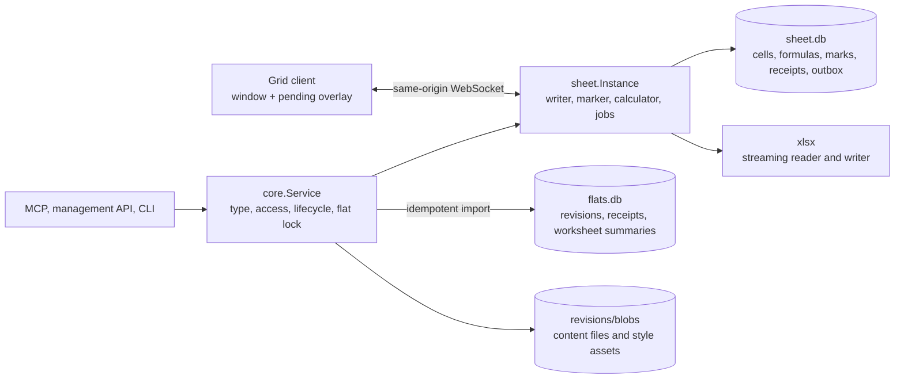

# Sheet content type technical design

Status: planned. Nothing on this page is implemented. See the product spec's
[Current state](sheet.md#current-state).
Base: `a9191be` (origin/main). Product contract: [sheet.md](sheet.md), S1.

This page specifies S1's server, storage, browser and agent contracts. Rule
numbers link to the product spec. Section numbers refer to this page.
Existing shared revision behavior is defined in
[the revision store](../revision-store.md). The closest existing type is the
notebook, and this page says where it follows
[the notebook design](notebook-technical-design.md) and where it differs.

## 1. Decision summary

The plan in [issue 233](https://github.com/gosuda/flats/issues/233) left ten
design decisions to this stage. The table gives each answer. Section 2 lists
the evidence.

| Topic | Decision |
|---|---|
| Runtime | One `internal/sheet.Instance` per sheet, inside the host process. No worker, auxiliary server or build step. It runs with the server runtime disabled |
| Where formulas calculate (decision 1) | In the host only, in Go. The browser shows what the server sends: inputs, results and the text of each cell. There is one implementation of every function, of input parsing and of number formats (section 9) |
| Cell identity (decision 2) | Rows and columns have stable ids and a separate order. A cell is (worksheet, row id, column id). A formula stores ids and shows A1 text made from current positions (sections 4 and 6) |
| Value groups (decision 3) | Twelve fixed groups, [rule 48](sheet.md#concurrency-rules). Writes of absolute values, ordered by one writer queue (section 10) |
| Results (decision 4) | A revision stores inputs. Results are a cache in `sheet.db`. An edit writes open records for the cells, rows and worksheets it changed, and a marker turns them into marks in bounded slices after the edit is confirmed. A reader returns a result as current only if no record is open and the formula has no `dirty` row, or if it calculated the result from the inputs at its own snapshot (sections 7 and 8) |
| Calculation order | Not stored. The host calculator is a long-lived task that keeps its place, resolves precedents depth-first with an explicit stack, and stores each result as it goes. This replaces the stored order that S0 step 3 asked for (section 8) |
| Storage (decision 5) | `flats/<slug>/sheet/sheet.db` is the only current-state source of truth. A durable outbox in the same transaction as the edit, imported idempotently into shared revision metadata and blobs. Revision files split each worksheet into row buckets by id and order chunks by content (section 12) |
| xlsx reader and writer (decision 6) | A reader and a writer in a new package on `archive/zip` with a small scanner for worksheet XML. No new module (section 14) |
| Import and export safety (decisions 7 and 8) | Limits checked on the zip directory, then while streaming. A counting pass before the first write. Text cells stay typed text in xlsx, and CSV export escapes (section 14) |
| Compatibility (decision 9) | [Rule 16](sheet.md#formulas) with the details of section 9 |
| Limits (decision 10) | [Rule 13](sheet.md#content) and the budgets of section 22 |
| Large work | Import, export, a rollback, a large duplication and opening an earlier revision are jobs: off the writer, applied in slices, with progress and cancel. A large sort plans off the writer and applies in one writer item (section 13.7). A host restart cancels them (section 13) |
| Reads | The browser reads windows of at most 512 KiB at a writer barrier. Agent pages and History use one disk-backed snapshot reader, as the notebook does (section 16) |
| Find | A scan of the string table, then an index from strings to cells, and an index of formulas with text results. It looks in text inputs and text results, not in numbers. No full-text index in S1 (section 20) |
| Browser | Plain JavaScript modules and a grid of plain DOM that holds only the rows near the viewport, as S0 measured (section 19) |
| Public | Read-only projection of current content. No sessions, presence, history, jobs or calculation started by a read (section 17) |
| Delivery | One feature PR. Section 24 gives its commit order |

## 2. Current state, scope and evidence

The base has board, notebook and document editors, `wsconn`, shared revision
storage, route access decisions, storage journals and content-type dispatch.
It has no sheet type, schema, tools, routes or browser client, no xlsx code
and no job with progress. This document does not claim that planned
interfaces are available.

S1 includes every browser and agent operation of the product spec. Its
exclusions are the spec's [Not in S1](sheet.md#not-in-s1).

### 2.1 Evidence

Two sources back the decisions. Both ran on one Windows 11 machine, so each
timing is a range and a bound for that machine, not a release measurement.
The release criteria are measured by the scripts of section 25 in the
reference environment.

**S0 prototype.** A server flat (JavaScript in the QuickJS runtime, `env.DB`)
with files of 100,000, 300,000 and 1,000,000 rows. Its reports are on issue
233: [step 1](https://github.com/gosuda/flats/issues/233#issuecomment-6827276732),
[step 2](https://github.com/gosuda/flats/issues/233#issuecomment-6832855924),
[step 3](https://github.com/gosuda/flats/issues/233#issuecomment-6840842120).
The server flat uses the same `modernc.org/sqlite` as the host, so its
storage numbers carry over. Its JavaScript speed does not.

| S0 result | Used for |
|---|---|
| 26 bytes per cell in the database, 36 bytes per row with its order key, 61 bytes per formula with two references | The cell limit, the quota estimate of an import (sections 12 and 14) |
| A 20 MiB xlsx file holds 2.9 million cells (generated) to 5.2 million (real) | The reference workbooks |
| A bucket map from row number to row: reads, edits and inserts take the same time at 1,000,000 rows as at 100,000 (a one-row insert took a median of 9.8 ms at 100,000 rows and 13 to 14 ms at 1,000,000 as a round trip through the runtime, with the server part 7 to 8 ms) | Section 4 |
| A range read of 60 rows costs 8 to 21 ms and a cold jump to any row 59 to 84 ms | The window read of section 15 |
| Formulas that store row ids follow inserts with no rewrite; a range grows when rows go in between its ends | Section 6 |
| The eager dirty mark costs about 4 microseconds for each dependent, and the same when the dependents are dirty already | Section 7 |
| A pull that walks a chain of dirty cells makes no progress when its request ends first | Section 8 |
| Finding the formulas that read a range scans every range of the column: 7 to 49 ms at 100,000 ranges, and 71 ms for the insert that reads every range of `INDEX` and `MATCH` | Section 7.4 |
| Three query-plan traps that small tests did not show | Section 25.2 |

**Design-stage probes.** Small Go programs outside the repository, with Go
1.27.1 and `modernc.org/sqlite` v1.60.1 as in `go.mod`, a file database in
WAL mode with `synchronous=FULL` and one writer connection, as the notebook
opens its database, and with a page cache of 64 MiB, which the notebook does
not set (section 12.1). No two probes ran at the same time. Other programs on
the machine were not stopped and their load was not recorded.

| Probe result | Used for |
|---|---|
| The eager mark in Go costs 3.5 to 4.0 microseconds for each dependent: 354 to 399 ms for 100,000 (three runs, one of which is saved in the review package) and 3,980 ms for 1,000,000 (one run). With the default `temp_store` the recursive statement takes 11.5 to 12.3 s at 1,000,000, because its queue goes to a temporary file | Section 7: the mark cannot stay in the edit, and no statement of the design recurses over an unbounded set |
| An edit that writes one open record in place of the mark takes 2.6 to 5.4 ms, also with 1,000,000 dependents. A plain edit takes 1.6 to 2.1 ms (p95 2.6 to 4.3 ms in the saved outputs). Each run has one sample of the open-record edit | The large edit criterion |
| A marker that marks 2,000 dependents in each slice: slice p50 12 to 16 ms, p95 17 to 19 ms, worst 40 ms. It marks 1,000,000 dependents in 7.8 to 8.6 s, and in 6.7 s with slices of 5,000. An edit placed between two slices takes p95 3.0 to 4.3 ms, worst 5.5 ms | Section 7.2, the slice budget |
| The lookup of an open record and of the `dirty` row for 60 formulas on screen: 0.5 to 0.6 ms. It is the only read-side cost that the probe measured. The recalculation from inputs of section 7.3 is not measured | Section 7.3 |
| Reading a formula and two inputs, writing a result and clearing its mark, 4 statements per cell in batches of 500: 23,500 to 33,400 cells per second | The large recalculation criterion. It is a bound from storage alone; the engine adds its own time |
| xlsx read of a 120.9 MiB file with 18.7 million `c` elements: a minimal scanner that reads only the tags `row`, `c`, `v` and `/v` 8.8 s (2.1 million cells per second), `encoding/xml` 30.5 to 37.5 s, excelize 62.6 s. Peak working set 14 to 54 MiB for all three | Section 14.1 |
| xlsx write of 20 million cells, numbers and a table of 1,000 shared strings only: standard library zip with hand-written XML 4.2 s and 18 MiB peak; excelize `StreamWriter` 16.0 s and 308 MiB peak | Section 14.1 |
| The bundled SQLite is 3.53.4 with FTS5 and R*Tree compiled in. A trigram index over 1,000,000 distinct strings (29.9 MiB of text) takes 21.8 MiB with `detail=none` and finds a rare text in 3 ms. A plain scan of the same table takes about 200 ms | Section 20 |
| An index from string id to text cells costs 14.7 bytes for each text cell. From a matched string to its cells: 6.7 ms | Section 20 |

### 2.2 What S0 did not measure

S0 stopped after step 3 at the requester's decision. Its fourth step, find
and export, was not built.

- **Find.** The plan asked whether FTS5 and its trigram tokenizer work in the
  host build, and for the index size. The probe above answers both.
- **Export.** S0 would have assembled the file in the browser, because a
  server flat cannot stream a response. That number would not carry over.
  The probe measured the Go writer instead.
- **Grid frame time.** S0 step 1 measured a median frame of 16.7 ms, a p95 of 17.0 to 17.2 ms
  and a worst frame of 22 to 30 ms while scrolling 1,000,000 rows. The
  criterion asks for a p95 of 16.7 ms or less, so S0 did not meet it by a
  small margin. Its grid was
  plain DOM that held only the rows near the viewport, with rows of one
  fixed height. Section 19 keeps that kind of grid. Rows of different
  heights, formats and frozen regions were not in that measurement.
- **Everything else S0 step 3 left out.** Its report lists these as not
  covered: row delete, other worksheets, whole-column references, named
  ranges, array formulas, volatile functions, approximate match, `XLOOKUP`,
  `SUMIF` and the other conditional totals, date and most text functions,
  number formats of results, undo, revisions, custom functions, more than
  one editor, Firefox and Safari, phone widths and Public flats. The design
  decisions that rest on them have no measurement behind them: deleting rows
  and shortening ranges (section 6.2), whole-column ranges (section 6.1),
  names (section 6.4), the lookup and time functions (sections 9 and 8.4),
  number formats (section 5.4), undo (section 10.4), revisions (section 11),
  concurrent editing (section 15), and Public routes (section 17). Section 25
  names the tests that settle them.
- **Element height caps.** The plan asks the design to verify the caps on
  the height of one element (about 17.9 million pixels in Firefox and 33.5
  million in Chrome). S0 kept its scroll element at 10,000,000 pixels or
  less and mapped the scroll position to a row number, and reached the last
  of 1,048,676 rows that way in the Chromium engine. Section 19 keeps that
  bound, so the design needs no element near either cap. The two caps
  themselves are not verified here.

## 3. Package structure and alternatives



`internal/sheet` owns the model, the operations, the formula engine, the
marker and calculator, persistence, jobs, transport and the embedded client.
Mutation internals stay private to the package. `internal/sheet/formula`
holds the parser, the stored form and the functions, with no SQL in it: it
reads cells through an interface that the instance implements, as the S0
engine did. `internal/xlsx` holds the reader and writer and knows nothing
about `sheet.db`; it produces and consumes a stream of rows.

The package exposes `Open`, `Stop`, `Shutdown`, `ServeHTTP`, `Read`,
`Update`, `StartJob`, `Job` and `CancelJob`. Its importer interface exposes
`Outbox`, `SnapshotData`, `Acknowledge`, `Op`, `References`, `Barrier` and
`Remeasure`, with the meanings of
[notebook-TECH section 3](notebook-technical-design.md#3-package-structure-and-alternatives).
Core calls one atomic `Update`.

| Alternative | Decision |
|---|---|
| Extend the notebook inline database with formulas and files | Rejected by the requester's product decision. A database is a typed table of 5,000 rows; a sheet is a free grid of 20,000,000 cells with a different storage shape |
| Hold the workbook in memory in the instance, as a board holds its elements | Rejected. The plan forbids holding a whole worksheet in memory, and the estimate is several GiB of Go heap for 20,000,000 cells at a few hundred bytes for each cell, which is not measured |
| One JavaScript engine in the browser and, through `internal/jsengine`, in the host | Rejected. The browser holds only a window of the workbook, so it cannot calculate a lookup over rows it has not loaded. S0 measured the interpreted engine at about 2,500 cells per second |
| A Go engine and a JavaScript engine checked against shared vectors | Rejected. It doubles 111 functions, input parsing and number formats, and the browser engine has the same window problem |
| Current state in `flats.db` | Rejected, as for the notebook: it would exclude current content from the per-flat disk accounting |
| A sheet-owned SQL store that follows the notebook's writer, receipt, outbox and quota patterns | Selected |

### 3.1 Lock order and lifecycle

Core orders storage-journal admission, the flat lock and the sheet writer in
that order, as for the notebook. A writer closure never acquires the flat
lock, walks the flat directory, performs blob I/O or calls a host history
API. Blob preparation, historical reads, leases and fresh agent quota
measurements happen before queue admission.

Rename, deletion and stop refuse new work with `unavailable`, cancel running
jobs, snapshot readers and scratch databases, delete their files, and close
sockets before moving or removing storage. Creation uses the existing durable
`content_state` initialization phases. It creates one empty worksheet and its
initial revision, then marks the flat ready. A refused first write or import
to a new slug leaves no adopted sheet, partial shell or temporary database
([rules 1](sheet.md#content) and [61](sheet.md#agents)).

## 4. Worksheets, rows, columns and order

### 4.1 Identity

| Item | Public id | Storage key |
|---|---|---|
| Worksheet | `ws_` and 26 lowercase base-32 characters, random | A small integer `sheet`, unique in the database and never reused |
| Row | `r` and a decimal number | The integer `row`, unique in its worksheet and never reused |
| Column | `c` and a decimal number | The integer `col`, unique in its worksheet and never reused |
| Name | `nm_` and 26 characters, random | An integer |
| Merged range | `mg_` and 26 characters, random | An integer |

A worksheet has both keys so a rollback can build a hidden copy of a
worksheet under a new storage key and give it the public id at the switch
(section 13.3). Row and column numbers come from a counter of the worksheet.
An import takes row ids from the row numbers of the file and column ids from
its column numbers, so the same file gives the same ids and a formula can
name a row that the import has not read yet.

The counters are runtime data, not content. When a worksheet is built from
content (an import, a rollback, a duplicate), each counter starts above the
largest id that the content holds, and above the counter of the live
worksheet with the same public id if there is one. A rollback, an insert and
a second rollback therefore never give one id to two different rows of one
public id.

Every mutation target on the wire carries the public id. The storage keys
never leave the host except as the row and column ids, which are the same
numbers.

### 4.2 Row order

Row order follows the S0 step 2 design, which held at 1,000,000 rows.

- `rows(sheet, row, okey, height, flags, style, ver, dead)` has the primary key
  `(sheet, row)` and a unique index on `(sheet, okey)`. `okey` is a
  fractional key in base 62 of at most 32 characters, as in
  [notebook-TECH section 5](notebook-technical-design.md#5-positions-and-structural-rules).
- Every position has a row, blank rows included, up to the size of the
  worksheet ([rule 4](sheet.md#content)). A row costs 36 bytes with its
  index entry.
- `ver` is the workbook sequence of the last change to the row or to any
  of its cells, or NULL when nothing changed since the worksheet was built, and
  its effective value is then the `built_seq` of the worksheet. A cell that
  is cleared leaves no row in `cells`, so guards read this column (section
  18.3).
- `buckets(sheet, lo, cnt)` holds the number of rows in each key range of
  about 1,024 rows. Position to row and row to position each read the bucket
  list of the worksheet and one bucket. The instance keeps the bucket list of
  an open worksheet in memory: about 1,000 entries for 1,048,576 rows.
- A deleted row stays in `rows` with `dead` set and keeps its key (section
  7.4). It has no position, it is not counted in `buckets`, and a rebalance
  gives it a key in the same order as the live rows. An insert takes a key
  between its live neighbors and above every dead row in that gap. An insert
  changes one bucket count. It rewrites no cell and no other row. A delete lowers a bucket count, and a
  bucket of fewer than 256 rows merges with its smaller neighbor when the two
  together hold at most 1,536 rows, so the bucket list stays at about 1,000
  entries for 1,048,576 rows.
- A bucket that passes 2,048 rows splits. A bucket that cannot give a new
  row a key under the cap is rebalanced: its rows get evenly spaced keys.
  S0 found that repeated blocks of 1,000 rows at one place exhaust one
  bucket's key range after about 190 blocks. The rebalance therefore widens:
  when the keys of one bucket do not fit, it takes the two neighbor buckets,
  then doubles the run until they fit. A rebalance rewrites keys only, in the
  transaction of the insert that needs it.
- One transaction rewrites at most 65,536 row keys. A run that needs more
  is respaced by a background job in slices of at most 65,536 keys, with
  progress. The insert that needs it is not refused for key space: its
  actor waits for the job and sees "saving", and other editors are not held,
  because each slice is one background unit (section 11). The mechanism of
  the slices, and whether the key length of 32 characters must grow, are
  open technical question 1 of section 26. A test at 1,048,576 rows with
  repeated blocks at one place covers it (section 25.2).

Order keys are runtime data. They are not content and never enter a revision
file (section 12.2).

### 4.3 Column order

`cols(sheet, col, okey, width, flags, style)` uses the same fractional keys
without buckets. A worksheet has at most 16,384 columns, so the instance
keeps the ordered column list of an open worksheet in memory, and a
rebalance rewrites all keys of the worksheet.

A window of columns is a list of column ids. The reader turns it into runs of
adjacent ids. After an import with no column insert, a window is one run, so
a row's cells for a window are one range of the primary key of `cells`.

### 4.4 Sizes and flags

Widths are stored in hundredths of the character unit of an xlsx file and
heights in hundredths of a point, so an import and an export do not drift.
The browser turns them into pixels. `flags` holds the hidden bit.

## 5. Cells, text and formats

### 5.1 The cell table

`cells(sheet, row, col, k, v, f, s, rk, ver, sver)` has the primary key
`(sheet, row, col)` and no row id of its own. This is the S0 layout with a
column id in place of a column number. S0 measured 23.4 bytes per cell in
this table for the generated files.

| Column | Holds |
|---|---|
| `k` | The kind of input: 0 none (format only), 1 text, 2 number, 3 boolean, 4 error value, 5 formula, 6 formula with a kept result, 7 formula text that S1 cannot parse |
| `v` | The input value: a string id for text, a number, 0 or 1, or an error code. For a formula, its last result |
| `f` | For a formula, its stored form (section 6.1). For kind 7, the text of the file |
| `s` | A format id (section 5.3), or NULL for none |
| `rk` | For a formula, the kind of the last result (text, number, boolean, error), or NULL when it has none. A text result is stored inline in `v` |
| `ver`, `sver` | The workbook sequence of the last change to the input and to the format, or NULL for a cell that is unchanged since its worksheet was built. Undo compares them (section 10.4) |

A cell with `k = 0` and `s` NULL is deleted. Kinds 6 and 7 hold the stored
result of [rule 22](sheet.md#formulas) in `v` and `rk`, and that result is
content.

Whether a formula result is current is not in this table. It is the absence
of a row in `dirty` while no record other than `time` is open (section 7).

### 5.2 Text

Cell text is interned: `strings(id, h, s)` holds each distinct text once,
with `h` a 64-bit hash of the text and an index on `h` for the lookup when a
person types a text. An import takes string ids from the shared string index
of the file.

`cells_ftext` is a partial index on `cells(sheet, row, col) WHERE k IN (5, 6) AND rk = 1`: the formulas whose last or kept result is text (section 20).
`cells_str` is a partial index on `cells(v, sheet, row, col) WHERE k = 1`.
It finds the cells of a string (section 20) and tells whether a string is
still in use. When a text cell is overwritten or deleted, its string id goes
into `string_gc`. A maintenance step deletes the strings of that list that no
cell uses, a bounded number in each step.

### 5.3 Formats

`formats(id, base, num, flags, color, fill, align)` holds each distinct cell
format once. `base` is the entry of the imported style table that the format
came from, or NULL ([rule 8](sheet.md#content)). The other columns are the
fields of [rule 7](sheet.md#content). A format change looks up or inserts the
row for the new combination and writes its id to the cell, row or column.

Formats are content, so a format id must mean the same thing in every
revision. Ids are never reused, and a format row is never changed. A
maintenance step removes format rows that no cell, row, column or retained
undo entry uses. A retained revision lists its formats in `formats.json`, so
a rollback inserts again the rows it needs (section 13.5).

The imported style table and theme are two blobs, `source/styles.xml` and
`source/theme.xml`, of at most 8 MiB and 1 MiB. A file with a larger part
keeps the rule 7 fields, loses the rest, and the import report says so. The
reader resolves theme and indexed colors to RGB at import, so the browser
never needs the theme.

### 5.4 What a cell shows

The host sends, for each cell of a window, its input and the text it shows:
the result of a formula, drawn through the number format. The Go renderer is
the only one. It serves the grid, `TEXT`, `get_sheet` and CSV export. The
browser shows a person's typed text as typed until the answer of the action
brings the text the cell now shows.

## 6. Formulas and references

### 6.1 Stored form

A formula is stored as text in which every reference is a token of ids. The
form extends the one S0 step 3 tested.

| A1 text | Stored token | Notes |
|---|---|---|
| `B7` | `@12.2` | Row id 12, column id 2 |
| `$B7`, `B$7`, `$B$7` | `@12.2c`, `@12.2r`, `@12.2rc` | The letters keep the absolute marks |
| `Costs!B7` | `@3!12.2` | Storage key 3 of the worksheet |
| `A1:B9`, `$A:$A`, `2:5` | `#41`, `#42`, `#43` with absolute marks after it | The id of a row in `ranges` |
| `Sales` | `!nm17` | The storage key of a name node (section 6.4) |
| `#REF!` | `@0.0` | Also what a relative part that leaves the worksheet becomes |

Text values in a formula can hold these characters, so every scan of stored
text skips quoted text. S0 found and fixed a cache that did not.

`ranges(id, sheet, r1, c1, r2, c2, kind)` holds each range that a formula
names: a rectangle between two rows and two columns, whole columns between
two columns, or whole rows between two rows. A formula text names the range
by id. Formulas that name the same range share one row, so one million
filled copies of `VLOOKUP(x, $A$1:$B$90000, 2, 0)` store one range. Sharing
is found by a lookup when a formula is stored and is not enforced: two rows
with the same ends are allowed.

A whole-column range has no end rows, and a whole-row range has no end
columns, so a new row or column never changes it. It covers the whole grid of
its worksheet, as in Excel ([rule 17](sheet.md#formulas)): the positions 1 to
1,048,576, or 1 to 16,384 for a whole-row range. A position past the last row
(or column) that the worksheet has reads as empty. A function that reads the
range directly reads only the rows (or columns) that exist. `ROWS` and
`COLUMNS` of such a range give the grid size, and `COUNTBLANK` counts the blank
positions of the grid without a read of the rows that do not exist, as do
`COUNTIF` and `COUNTIFS` with a criterion that matches blank cells. With several criteria, the count is
over the grid positions that match all of them, computed from the rows that
exist. `INDEX` and
`MATCH` address the positions of the grid. An array that an expression builds
from a whole column holds a value for each position, so it has 1,048,576
values for each column, counts them toward the work limit of
[rule 21](sheet.md#formulas), and costs their time. The blank flag and the
marking of section 7.4 do not change, because they only mark more than they
need.

The parser limits a formula to 8,192 characters of A1 text, a parse tree of
height 128, 64 nested function calls and 255 arguments per call. A typed
formula that names ids, with `@`, `#` followed by digits, or `!nm`, is
refused, so a person cannot forge a reference.

### 6.2 What a structure edit does

| Edit | Effect on formulas |
|---|---|
| Insert or move rows or columns | No formula text changes. A1 text shows new addresses because positions changed |
| Insert inside a range | The range holds the new rows or columns, because it is defined by its ends. Its readers are reached by the records of section 7.5 |
| Delete a row or column that a cell reference names | The reference still holds the id. An id with no row or column shows and evaluates as `#REF!`. If the row comes back with its id, the reference works again ([rule 17](sheet.md#formulas)) |
| Delete an end of a range | The `ranges` row does not change. The deleted row or column stays as a dead row with its order key, and the range reaches to the nearest live one inside it. If none remains, the range is `#REF!` (section 7.4) |
| Delete a worksheet | A reference with its storage key is `#REF!` |
| Sort | Inputs move between rows as in a copy: the host renders each moved formula as A1 text at its old place and stores it again at its new place ([rule 12](sheet.md#content)) |

`ranges` has an index on each end, `(sheet, r1)` and `(sheet, r2)`, and on
`(sheet, c1)` and `(sheet, c2)`, so the marker finds the ranges that have a
given row or column as an end without a scan.

### 6.3 Dependency tables

| Table | Key | Holds |
|---|---|---|
| `formulas` | `(sheet, row, col)` | One row for each formula cell, with `flags`: reads `TODAY` or `NOW` (the time flag); calls `ROW`, `COLUMN`, `ROWS` or `COLUMNS` with any argument or none, or reads a position inside a range with `INDEX`, `MATCH`, `VLOOKUP`, `HLOOKUP` or `XLOOKUP` (the position flag); reads a range other than as the direct argument of `SUM`, `PRODUCT`, `AVERAGE`, `MIN`, `MAX`, `COUNT`, `COUNTA`, `MEDIAN`, `LARGE`, `SMALL`, `STDEV` or `VAR` and their variants, so that blank cells can change its result (the blank flag) |
| `pos_formulas` | `(ssheet, fsheet, frow, fcol)` | One row for each worksheet that a formula with the position flag reads, and one for its own worksheet when it calls `ROW` or `COLUMN` without an argument, so that a structure edit of a worksheet finds those formulas without a scan |
| `refs` | `(ssheet, srow, scol, fsheet, frow, fcol)` | Formula f reads cell s. A second index on `(ssheet, scol, srow, fsheet, frow, fcol)` finds the formulas that read any cell of a column without a scan, for `delete_cols` and a large sort |
| `uses` | `(range, fsheet, frow, fcol)` | Formula f reads the range |

A name is a node of these tables in worksheet 0 (section 6.4).

Storing a formula writes its rows in the transaction of the edit. The cost
depends on the references of that formula, not on the workbook. S0 measured
61 bytes for a formula with two cell references. The second index of `refs`
adds about 22 bytes for them, so the design counts 83 bytes until it is
measured (section 26).

### 6.4 Names

`names(id, pubid, scope, word, key, def, state)` holds the word, its
case-folded key, the definition and one of three states: live, deleted, or
kept as text ([rule 10](sheet.md#content)). A deleted name keeps its row
while any formula uses it, so the formula can show the word and a new
definition of the same word in the same scope takes over the row. A unique
index on `(scope, key)` covers live names.

A name is a node in worksheet 0 of the dependency tables: its row is the name's
storage key and its column is 0. The cells and ranges that its definition
names are read by the node through `refs` and `uses` rows, and the
formulas that use the name read the node through `refs` rows with `ssheet =
0`. A formula that uses a name stores one reference, to the node, and none to
the target. Changing a name's definition rewrites the few rows of the node
and writes one `cell` record for it, so the edit costs the same whatever the
number of formulas that use the name. A `struct` record reaches the node
through its `refs` and `uses` rows and marks all its users (section 7.2), so a
formula such as `=ROW(Rate)` or `=INDEX(Prices, MATCH(x, Codes, 0))` is found
even though its own rows name only the node. The marker passes through a name node
without writing a `dirty` row for it, because the evaluator resolves the
name to its target and the node has no result of its own. A formula that uses
a deleted name evaluates to `#NAME?`.

## 7. The dirty mark

### 7.1 Why the mark leaves the edit

A formula is **dirty** when its stored result may not match its inputs. S0
marked every dependent of an edited cell in the transaction of the edit, with
one recursive statement. That costs about 4 microseconds for each dependent
in the host too (section 2.1): 0.4 s for 100,000 dependents and 4 s for
1,000,000, while the writer holds its transaction. The
[large edit criterion](sheet.md#success-criteria) allows 200 ms.

Version stamps that a read compares were the other option of the plan. A
stamp makes an edit cost one write, but then every read of a formula must
check all its precedents, through other formulas, after every edit anywhere
in the workbook. A dirty set keeps reads cheap when nothing is open, which is
almost always. The design keeps the dirty set and moves the marking out of
the edit.

### 7.2 Records and the marker

An edit changes inputs and writes **open records**. The **marker** turns
records into `dirty` rows later, in bounded slices. The design rests on three
rules, and section 7.3 argues from them.

1. **Completeness.** When no record other than `time` is open, every formula
   whose stored result can differ from the calculation at the current inputs
   has a `dirty` row. Time is the one thing that changes without an edit. A
   formula with the time flag is current as of the last time step, and the step
   marks it when its result would differ (section 8.4). The calculation of a
   marked formula reads the real time of that calculation.
2. **Rows go away by a store, an overwrite or a retirement.** A `dirty` row is
   removed by a store of a result for that formula (section 8.1), or by an
   edit that overwrites, clears or moves the formula cell, or by the garbage
   deletion that retires the formula's row, column or worksheet, or by the
   switch of a job. The calculator skips the `dirty` rows of retired formulas
   until then, and its gate looks only at rows of live formulas. The marker, an edit
   and a job write rows. The `mseq` of a row is the sequence of the edit that
   caused the write, so marks of different edits have different values. The
   same edit can write a row again with the same value, and a result
   computed after that edit committed is correct for it.
3. **A reader decides by the work list.** While any record is open, a reader
   does not trust the absence of a `dirty` row (section 7.3).

`open(id, root, seq, kind, sheet, a, b, c, cur_row, cur_col)` is the work list.
An edit's records all carry `root` equal to the edit's sequence, and a record
that the marker writes keeps the `root` of its parent. `open_ids(record, id)`
holds the row or column ids of an `ids` record. Section 7.5 lists which
operation writes which record. The kinds are:

| Kind | Source | Dependents that the marker marks |
|---|---|---|
| `cell` | One cell, by ids. The name nodes of section 6.4 are cells of worksheet 0 | The formulas that read it through `refs`, and the formulas whose range holds it (section 7.4) |
| `ids` | Rows or columns, by id, whose cells were deleted, came back, or were moved by a large sort (section 13.7) | The same, for every cell of those rows or columns, found by key prefix in `refs` for rows and by its second index for columns (section 6.3), and the formulas whose range holds their keys |
| `range` | One range, by id, that the stab of section 7.4 found | The formulas that use it, found through `uses` |
| `sheet` | One worksheet that was deleted or came back | The formulas that read any cell of it, found by key prefix in `refs` and `uses` |
| `struct` | One worksheet whose rows or columns were inserted, deleted, moved or created, and a flag for edits that only add blank rows or columns | Every formula with a range over the worksheet, found through `uses`, every formula of `pos_formulas` for it (section 6.3), and every name node that reads a cell or a range of the worksheet, with all its users, whatever their flags, because a name hides what its users read. With the blank flag, the formulas found through `uses` and `pos_formulas` are only those that have the blank flag or the position flag |
| `time` | Nothing in particular | None by itself. The calculator handles it (section 8.4), and what it then writes is the work of an edit. A `time` record marks nothing, so it does not count as an open record in sections 7.3 and 8.2 and in the overload bound |

**One slice** is one transaction of the writer. It takes the open records of
the oldest `root`, the newest first, and for each record walks the dependents
after its cursor in key order. Each dependent Y gets one of three treatments:

0. If Y is a cell of kind 6 or 7 (rule 22), the slice skips Y. Such a cell
   never gets a `dirty` row or the time flag, no store writes into it, and its
   kept result changes only when an edit changes its own input.
1. If `dirty` has Y with `mseq` of at least the record's `seq`, the slice
   skips Y. That row was written by a record of the same or a later sequence,
   so the dependents of Y are marked or queued with at least that sequence.
2. Otherwise the slice writes `dirty(Y, mseq = seq)`, replacing an older row,
   and continues with the dependents of Y in the same transaction, without
   writing a record for Y. The slice is therefore depth-first.

The slice ends after 2,000 marks, or once 15 ms have passed, checked after
every 100 dependents visited, skipped ones included, or when the root has no
more records. A slice of 2,000 marks
took p95 17 to 19 ms in the probe, so 15 ms is a target that the
measurement of section 26 confirms or changes. At its end it writes a `cell` record, with the same `seq` and `root`,
for every marked formula whose expansion has not finished. That includes a
formula whose expansion has begun: its record carries a cursor at the last
dependent that the slice expanded, so the next slice resumes there. It also
moves the cursor of the record it was working on. A chain of 1,000,000 formulas needs
500 slices of 2,000 marks and one open record between them. A cell with
1,000,000 dependents needs the slices of its own record, and each slice leaves
at most 2,000 child records. Marking never looks at whether a read has
calculated a formula since: it may mark a formula that is current already, and
its recalculation then gives the same result.

- **A new edit of a source** writes a `cell` record with a greater `seq`.
  When an open record for the same cell has not started (its cursor is at its
  start), the edit raises that record's `seq` and root instead of writing a
  second one. A record that has started stays. Its dependents are marked
  again by the new record, because their `mseq` is lower. A `struct`, `ids`
  or `sheet` record that has not started absorbs a later record of the same
  kind for the same worksheet in the same way: the blank flag stays only if
  both had it, the id lists are joined (an `ids` record holds row ids or column
  ids, and absorbs only a record of the same axis), and the merged record
  takes the greater `seq` and the later `root`. A burst of structure edits then
  costs one marking plus at most one that has started.
- **Overload.** Two bounds keep the work list from staying open for ever.
  An edit that would leave more than 10,000 open roots is refused as
  `unavailable` with a retry hint. One root is one edit, however many cells it
  changed. And while the work list has been non-empty for more than 60
  seconds without a break, every edit that would write a record is refused in
  the same way until the list is empty. Coalescing keeps the number of roots
  low when one cell is edited over and over, so the time bound is the one
  that applies. For one cell with 1,000,000 dependents, edits more often than
  every 8 s therefore stop after at most 60 s plus the marking time, and then
  the marker drains. The refusal reaches every editor of the workbook for that
  time. When the list becomes empty after a refusal, the writer admits no
  edit that writes a record until the exports and agent reads that were
  waiting have taken their snapshots and the calculator has stored one batch,
  for at most 1 s. In that gap the waiting exports and agent reads take
  their snapshots and the calculator stores its batch before the time step
  writes its first unit. While a `time` record has units left, the gap lasts
  until it has none left, or for at most 10 s. It does not wait for a `time`
  record whose step has failed. Each refusal period is therefore followed by a
  gap in which the time step also advances. This is the
  product cost of open question 15 of the spec. A stream of
  structure edits that each mark 1,000,000 range formulas is bounded the same
  way.
- **Memory.** Records are rows. The instance keeps in memory the number of
  open records and the open records of kind `struct`, `ids`, `sheet` and
  `time`. An open `cell` record is found by an index on `(sheet, row, col)`.
  Every structure that the instance keeps in memory for correctness (the
  counts of open records, the column spans of the ranges of a worksheet, the
  ordered column list) is rebuilt from its table before the first read, edit
  or marker slice after a start, a switch or a rollback, and each change
  updates it in the same transaction that writes the table, and only when
  that transaction commits. The number of formula cells of each column is a
  table, `col_formulas`, keyed by sheet and column id, updated in the same
  transaction as each formula write and as each removal of a formula (a clear,
  an overwrite, a deletion, a retirement, a switch), so a reader sees the count of its own snapshot, and a unit that
  rolls back leaves it unchanged.
- `dirty(sheet, row, col, mseq)` has the primary key `(sheet, row, col)`.

The writer serves waiting edits before the next slice (section 11), so an
edit waits for at most one slice. The probe measured a slice of 2,000 marks at
p95 17 to 19 ms and the worst at 40 ms, and an edit between two slices at p95
3.0 to 4.3 ms. Marking 1,000,000 direct dependents took 7.8 to 8.6 s of
slices. The probe's second level held 1,000 formulas, so the cost of a chain
of 1,000,000 links is not measured (section 26).

When the work list is empty, the writer runs one slice in the same turn as
the edit, and it runs more of them while the list is not empty and no other
foreground item waits, starting a slice only while less than 100 ms of the
turn have passed. If no other foreground item waits, the
records of an edit with up to 2,000 marks are therefore gone before the edit
is confirmed, and its confirmation carries up to 100 ms of marking. The time
bound refuses every edit that would write a record or raise one that has
not started.

### 7.3 Reads and stores while records are open

**No record is open.** A reader decides whether a record is open from the
`open` table at its own snapshot, never from a count in memory, because such
a count can be newer than the snapshot. Records of kind `time` are not counted
here, except for the formulas with the time flag (section 8.4). A formula is current exactly when it has no `dirty` row. Rule 1 of section 7.2 makes this true.

**A record is open.** The work list says that marking is not finished, and
nothing about which formulas it will reach. A reader therefore does not trust
a missing `dirty` row. It returns a formula's result as current only if it
calculated it **from the inputs** at its own snapshot: its evaluation ignores
the stored result of every formula that has no `dirty` row, and every
formula that it reaches is calculated again from the inputs, nested as in
section 8.1. A value computed this way equals the calculation of the formula
at that snapshot. When the budget of the read ends first, the formula is
pending, shown with its last result
([rule 18](sheet.md#formulas)). A Public read has a budget of 0 (section 8.3), so
its formulas are all pending while a record is open.

**Stores.** A result is stored only for a formula that has a `dirty` row, and
only if that row still has the `mseq` that the evaluation saw. The store
deletes the row. A reader or the calculator that computed a formula that has
no `dirty` row stores nothing, because the formula may be marked a moment
later and its result would then be wrong. A row that was deleted and written again by a later edit has a different
`mseq`, so an evaluation that began before that edit cannot store into it.

**The calculator waits** while any record is open (section 8.2).

**Why this holds.** Take an edit with sequence `s` and a formula F whose
result it can change. Records are written in the edit's own transaction, so no
reader sees the edit without seeing its records. Until those records and their
children are gone, a reader computes from inputs and a store needs a `dirty`
row, so a stale stored result cannot be returned as current and cannot be
stored over a newer one. The marker writes a `dirty` row for every transitive
dependent of every record before the record is deleted, or finds the row
already written by a record of the same or a later sequence. When the last
record is gone, F has a `dirty` row (rule 1), and the calculator stores its
result by the store rule. Section 25.1 names the tests, with the orders of
events that the reviews found.

The cost to the reader is a recalculation from inputs for the formulas of its
window, while records are open. A formula such as `=C2*2` costs two cell reads.
A formula over a long chain or a large range exceeds the budget and shows as
pending. Most edits close their records in the turn that wrote them, so the
state of this section is visible only after an edit of a cell with many
dependents, a large paste, or a structure edit, and for seconds.

### 7.4 Ranges that contain a cell

The marker must find the ranges that contain a changed cell. S0 did this with
a stab of the `ranges` table by the bounding box of the cells of one wave, in
at most 4 rounds, then marked every formula with a range in the worksheet. It
measured 7 to 49 ms for 100,000 ranges. S1 keeps that method.

**Ends by key.** A range names its end rows and columns by id. Its extent is
the interval between the order keys of those rows. Deleting an end row does
not rewrite the range: a deleted row stays in `rows` with a `dead` flag and its
key, and the range then reaches to the nearest live row inside it. A range
whose interval holds no live row is `#REF!`. A moved end row moves the end
with it, so the range now reaches the new position. An interval whose ends are
in the wrong order is read with the ends swapped. Because a dead row is a row
with a key, the unique index on keys covers it, a rebalance gives it a key in
the same order as the live rows, and a new row can never receive its key. A
new row inserted into a gap that holds dead rows takes a key greater than all
of them, just below the live row that follows, so it is not inside the extent
of a range whose end is a dead row in that gap, and it is inside the extent of
a range that starts at a dead row there. Excel keeps a row inserted above the
first row of a range outside it, so this differs for a range whose start row
was deleted (open question 12 of the spec). Dead rows have no position and are
not counted in the buckets. Maintenance deletes a dead row that no range end,
undo entry, open record or content file names (section 12.2). An edit
therefore never rewrites a range, whatever the number of formulas that share
one of its ends.

**Shared ranges.** Section 6.1 stores equal ranges once, so a filled lookup
over one table is one range with many rows in `uses`.

**The stab.** The instance keeps in memory, for each worksheet, the set of
distinct column spans of its ranges. A **wave** is the set of cells that one
slice marks and does not skip, together with the cells of the record it
works on. At the end of each slice, in the same transaction, the marker runs
the stab once for each worksheet that holds a cell of the wave. For that
worksheet it takes the spans that hold the columns of the wave's cells there,
reads the ranges of each span by the index on `(sheet, c1, c2)`, and keeps
those whose row interval overlaps the bounding box of those cells, comparing
order keys. It reads at most 2,000 ranges in one slice in all, over every worksheet of
the wave. If it reaches that count with ranges left to read, it stops and
writes a `struct` record without the blank flag for every worksheet of the
wave, with the slice's `seq` and `root`, and keeps no continuation. Such a
record marks every formula with a range over its worksheet in later slices,
under the bound. A stab does not write a `struct` record of a worksheet while
an open `struct` record without the blank flag, of the same root and
worksheet, exists. Otherwise the marker queues each
range that it found as a `range` record, unless an open `range` record of the
same root exists for that range. The slices then mark the users of a `range`
record through `uses`, under the bound of 2,000 marks and with a cursor, as
for `refs` dependents. The stab runs at the end of each slice, so the first
slice of an edit includes it, within the bound of the edit's turn (section
7.2). A shared range with 1,000,000 users therefore adds one record to the
first slice and not 1,000,000 marks. A slice with more than 2,000 ranges to read, counting ranges
that do not overlap the edit (for example a column span with 1,000,000
cumulative sums over one column), makes the edit mark every range formula of
the worksheet. That takes about 4 s for each 1,000,000
formulas (section 7.1), and repeated edits then bring the time bound of
section 7.2. A two-dimensional index removes this cost and is the next step
(section 26). Whether S1 needs it is open question 17 of the spec.

### 7.5 What each operation writes

The edit transaction writes the records below, and nothing whose size depends
on the number of dependents. Records that count cells or rows are bounded by
the limits of [rule 13](sheet.md#content): at most 100,000 cells and at most
100,000 rows or columns in one action.

| Operation | Records written by the edit |
|---|---|
| `set_cells`, `clear`, `fill`, `copy`, paste, `sort`, `merge` | A `cell` record for each cell whose input or formula changed, including the cells that a merge clears and the cells that a sort moves, and a `dirty` row for each formula cell that was written, because it has no current result |
| A large sort (section 13.7) | One `ids` record with the column ids of the sorted range, and a `dirty` row for each formula cell that it wrote. No `cell` record, so the records stay bounded by the number of columns |
| `set_format`, `set_rows`, `set_cols` (sizes, hidden flags, formats), `set_sheet`, `move_sheet`, `add_sheet` | None. A format or a size changes no result |
| `duplicate_sheet` | None for the existing worksheets. Every formula of kind 5 of the copy gets a `dirty` row, on both paths of section 10.2 |
| `insert_rows`, `insert_cols`, and a write that creates blank rows or columns below or right of the last one | A `struct` record with the blank flag |
| `delete_rows`, `delete_cols` | An `ids` record with the deleted ids, and a `struct` record without the blank flag |
| `move_rows`, `move_cols` | A `struct` record without the blank flag |
| `delete_sheet` | A `sheet` record |
| `set_name`, `delete_name` | A `cell` record for the name node |
| `set_settings` (time zone) | A `time` record |
| Undo of any of these | The records of the inverse operation. An undo that brings back rows, columns or a worksheet writes `ids` or `sheet` records for them |
| Import, rollback, duplicate of a large worksheet | None. The job gave every formula of kind 5 of the new worksheets a `dirty` row before its switch (section 13.3) |

A structure edit does not rewrite any formula, range or `refs` row. The
blank flag applies to a formula that reads a range only as the direct argument
of `SUM`, `PRODUCT`, `AVERAGE`, `MIN`, `MAX`, `COUNT`, `COUNTA`, `MEDIAN`,
`LARGE`, `SMALL`, `STDEV`, `STDEV.S`, `STDEV.P`, `VAR`, `VAR.S` or `VAR.P`: a
new blank row changes none of their results. Every other formula that reads a
range over the worksheet, among them `SUMPRODUCT`, `COUNTBLANK`, `COUNTIF`,
`TEXTJOIN`, `ROWS` and every comparison over a range, is marked by every
`struct` record. So are the formulas of `pos_formulas`.

## 8. Calculation

### 8.1 The pull

Calculation follows the S0 step 3 engine, whose results a model test
compared with a calculation from scratch. S0 ran 300 random edit sequences
against its first version and 120, 60 and 40 against later ones. That test
made no cycles, no chains deeper than 4, no decimals and no fills with `$` or
`#REF!`, and the review found those. Section 25.1 requires them.

- To calculate a formula, the engine evaluates its expression. When the
  evaluation meets a reference to a formula that is not current, it makes that
  formula current first, nested and depth-first, and then goes on. It does
  this by stopping the evaluation, making the reference current, and
  evaluating the formula again from its start. A range is made current as a
  whole before the function that reads it runs: the dirty formulas inside it
  are found, from the cheaper of two sides as in S0 (the dirty rows when they
  are few, the rows of the range when it is small), and calculated. While a
  record is open, every formula that the evaluation reaches counts as not
  current, unless the same evaluation has calculated it already
  (section 7.3).
- `IF`, `IFS`, `IFERROR`, `IFNA`, `SWITCH` and `CHOOSE` evaluate only the
  branch they take. A reference in the other branch is never made current,
  and it never closes a cycle. A formula can therefore be current while a
  precedent it did not read is dirty. This is correct, because a later change
  of the condition marks the formula through that reference. `A1 =IF(FALSE,
  B1, 1)` with `B1 =A1` gives 1 in both cells.
- The walk uses an explicit stack of formula frames, not recursion, so a
  chain of any length cannot overflow the Go stack. The first 1,024 frames
  are in memory. Deeper frames go to a scratch table keyed by cell, in a
  scratch database outside `sheet.db`, and that key is also the test for a
  cycle. The scratch databases of all walks live under `<data dir>/cache/sheet-walk/`,
  at most 2 GiB for the host, and are deleted when the walk ends and at startup.
  A walk that would pass the budget stores nothing and leaves its formulas
  pending. An export whose walk or `calcres` would pass the
  budget fails as `unavailable`. A time step that fails in the same way keeps
  its `time` record for the next minute step to continue (section 8.4). The calculator tries again when space frees, and a read that needs
  the walk is answered as unavailable. `#LIMIT!` comes only from the work
  limit of rule 21, so a stored result never depends on what other sheets do. A cell that the walk meets again
  while it is on the stack closes a cycle, and every cell of the stack from
  that cell up gets `#CIRC!` ([rule 20](sheet.md#formulas)). The stack is
  never larger than the number of formulas, so a walk ends.
- Each formula counts the cells it reads: a single reference counts one, and
  a range counts the cells that exist in it ([rule 21](sheet.md#formulas)).
  Above the work limit it gets `#LIMIT!`. `#LIMIT!` and `#CIRC!` pass through
  `IFERROR`.
- A cell of kind 6 or 7 gives its kept result to the formulas that read it,
  as if it were an input of the kind of that result. Without a kept result it
  gives `#NAME?` ([rule 22](sheet.md#formulas)).
- **Values.** Every value that an evaluation uses is the value at its
  snapshot, with the results that the evaluation has calculated itself laid
  over it. This holds for single references, for the SQL aggregates and
  lookups of section 9, and for the shared totals below. An evaluation keeps
  its own results in a scratch table `calcres`, which lives in the scratch database of
  the evaluation under `<data dir>/cache/sheet-walk/`, with the budget and the
  deletion rules of the walks (below), when the evaluation is not bounded to
  one batch, as for an export or a time step, and reads a range through
  `COALESCE(calcres.v, cells.v)` after it has made the formulas of the range
  current. While a record is open, a range whose columns hold any formula
  (the table `col_formulas` holds the number of formula cells of each column) is not read
  through SQL at all: its formulas are calculated again from the inputs, as
  section 7.3 says, and the function runs over those results.
- **One snapshot.** An evaluation takes values only from one snapshot. A walk
  that yields keeps the keys of its stack, and no value. When it goes on, it
  takes a new snapshot. A frame is evaluated again from its start when it
  becomes the top of the stack, and not before, so a yield costs one
  evaluation and not the depth of the stack. A stored result is therefore
  always computed entirely from the snapshot whose `mseq` it records. A batch
  ends after 2,000 results, or after the formula that is running when 100 ms
  have passed, whichever comes first. A snapshot lives for one batch, so it
  stays open for at most 100 ms plus the time of one formula at the work limit
  of rule 21. While it is open the WAL cannot
  shrink, as for an export capture (section 13.4).

**Storing results.** For each formula that has a `dirty` row, the evaluation
records the `mseq` of that row at its snapshot. The writer stores a result in
a batch only if the row still exists with that `mseq`, and then deletes it. A
formula that was marked again meanwhile keeps its mark and is calculated again.
A formula without a `dirty` row is never stored (section 7.3). The rule
applies to each result alone. A result that read a rejected result of the same
evaluation can still be stored, and this is safe: the rejected formula was
marked again, so its dependents are marked again from its own mark or are
dirty already. Evaluations can therefore run beside edits, and several at
once.

**Shared totals.** The totals of a range (`SUM`, `COUNT`, `MIN`, `MAX`,
`AVERAGE` and the conditional totals over it) are kept per range and function.
`col_seq(sheet, col, seq)` holds, for each column of each worksheet, the
workbook sequence of the last transaction that changed an input or stored a
result in that column. The writer updates it in the same transaction as the
change, one row for each column that the transaction touched. An entry of the
cache stores the `seq` of every column of its range and the structure sequence
of its worksheet at its snapshot, and is used only while every one of them is
unchanged. An insert, a delete, a move, the undo of one, and a switch raise
the structure sequence, so a move that puts a row into the range drops the
entry although no input changed. An entry is never taken from or stored by an
evaluation that has results of its own inside the range that are not stored
yet, and no entry is used at all while a record other than `time` is open,
because an open record can change a member that its columns do not show. A change of a member by an
edit, by a stored result, by a name or by a cell of another worksheet that a
member reads therefore drops the entry. S0 measured the calculation of
formulas over one shared range at 372 cells per second without this cache and
2,218 with it. The reference data of section 25.5 holds 1,000,000 formulas
that each divide by one whole-column total.

### 8.2 The calculator

S0 step 3 concluded that S1 needs a stored calculation order. Two facts of S0
led to that: a pull walked down a chain of dirty cells at about 1.5 ms for
each cell, and a request that ended first had calculated nothing, because a
pull kept no state. In the host a read still has a budget (section 8.3), so a
read cannot finish a long chain by itself either. The design does not store an
order. An order must change when an edit adds a reference, which is work
for each cell on the path, in the edit or in the marker, and it cannot hold a
cycle. A task that keeps its state does the long walks instead. Section 26
asks for the measurement that confirms this, and the design returns to a
stored depth for each formula if the measurement fails.

Each instance has one **calculator** task. It runs only while no record
other than `time` is open and `dirty` has rows, and it gives way to the writer
after each batch of results. It also handles a `time` record whenever no other
record is open, also when `dirty` is empty. It takes cells in this order: cells that a reader is waiting for,
then the rest by worksheet, row and column key. For each cell it runs the pull
of section 8.1.

- A reader that runs out of budget hands the cells it did not reach to the
  calculator as wanted cells, so a read of a cell far down a chain starts the
  work on that chain.
- The walk goes down a chain once. Its stack is bounded only by the number of
  formulas, and deep frames are in the scratch table of section 8.1.
- After it calculates a formula, it takes the dirty dependents of that formula
  next. A dependent whose precedents are all current is calculated at once,
  and another dependent is calculated by a walk of its own. A chain is
  therefore calculated from its root upward, also when its links run against
  the key order.
- A cycle is found by the walk that meets it, wherever its length. The
  formulas on it get `#CIRC!`, and a formula that reads one gets it as an error
  value. The formulas of a worksheet that is still being built (state
  building) are not calculated.
- While records stay open, the calculator does not run, and readers show
  pending or compute from inputs (section 7.3). After records have been open for 60
  seconds without a break, the time bound of section 7.2 refuses edits until
  the list is empty, and then the gap of section 7.2 follows. Background
  calculation, the time step and exports therefore wait for at most one
  episode of 60 seconds plus the marking that has started. Under a stream of
  edits that never stops, the episodes recur, and these tasks advance in the
  gaps between them. A read does not get further while records are open,
  because it trusts no stored result of a formula without a `dirty` row. The
  rule that repeated reads get further holds once the work list is empty.

### 8.3 Reads and their budgets

| Reader | What it starts | Budget |
|---|---|---|
| The answer to a person's action | A pull for the dirty formulas of that person's window, or, while a record is open, an evaluation from inputs | 50 ms, then the rest is pending |
| A window read of a Private editor | The same | 50 ms |
| `get_sheet` with a range | The same, for the range | `wait_ms`, 2,000 ms by default and at most 20,000 ms |
| A Public window read | Nothing. Dirty formulas are pending, and while a record is open every formula is pending ([rule 77](sheet.md#lifecycle-and-access)) | 0 |
| Export | Waits for the work list to empty, then runs (section 13.4) | The job has no deadline; it must keep writing |

A reader that runs out of budget hands its cells to the calculator as
wanted, so the next read finds more of them current
([rule 19](sheet.md#formulas)). A budget decides when a result arrives. It
never changes a result. An evaluation looks at its budget after each 10,000
cells it reads. When the budget is spent, it stops, leaves the formula
pending and gives it to the calculator, which has no budget except the work
limit of rule 21. A formula that needs more than one budget therefore always
finishes, in the calculator.

### 8.4 Time functions

A maintenance step writes one `time` record when a minute has passed since
the last one and at least one Private connection is open, or an agent read or
an export asks. A Public connection never causes this minute step. While only
Public viewers have the sheet open, the step runs at most once an hour, so a
Public viewer sees a time function at most an hour old. No other Public
activity starts it.

The calculator handles a `time` record when no other record is open. It
evaluates the formulas with the time flag in batches, each at its own
snapshot, and stores nothing.
For each formula whose result differs from the stored one, it writes a
`dirty` row and a `cell` record for that formula, as an edit would, all with one
new `root`. It writes them in background units of at most 2,000 formulas, and
a formula that it has not written yet keeps its last result. The `time` record
stays open, with a cursor that stands after the last written unit, until its
last unit is written, and the export's Settle waits for it. Each unit writes its rows with the sequence of its own
transaction, and a write never lowers the `mseq` of an existing row. A unit
is written when no record other than the `time` record is open and the `cell`
records of its previous unit have closed, or in the gap of section 7.2, and the time bound does not refuse it, because it is not
an edit. A time step evaluates with the time at which its batch starts, and the normal
path evaluates with the time at which it calculates. The marker then marks
the dependents of a written formula, and the formula is calculated by the
normal path and the store rule. A formula whose
result did not change writes nothing, and it keeps its stored result, which
is current at the moment of the step. `TODAY` changes once a
day, so a minute step over a formula `=TODAY()` that a million formulas read
writes no record on 1,439 of 1,440 minutes. `NOW` changes every minute, and
its dependents are marked every minute. For a million of them this is 8 s of
marking and then their calculation, every minute, so a sheet that does this
spends much of its time in the state of section 7.3. A new minute step continues an open `time` record that has written a unit,
with the new clock and the cursor of that record, and replaces one that has
written none, so at most one is open. The step waits while records of other kinds are open. The time bound of
section 7.2 limits that wait to 60 s plus the draining. A time formula, and
the formulas that read it, lag by the length of the pass that carries them,
which can be many minutes under a stream of edits. A time step that fails is
counted in the sheet metrics (section 23). An export that asks for a look
whose step has failed fails as `unavailable` and does not write, and an agent
read in that case returns the time formulas and their readers as pending. An export that asks for the step (rule 23) waits for the `time` record to be
handled, as well as for every other record. An agent read waits for it for at
most its `wait_ms`, and after that it returns the time formulas and their
readers as pending. The work of a `time` record depends
on the number of formulas with the time flag and on the dependents of those
whose result changed, so a viewer, and the number of viewers, add no work of
their own. A workbook with no formula that has the time flag never gets the
record. While a `time` record is open, a reader computes the formulas with the time
flag from inputs, within its budget, and shows them as pending when the
budget ends. The formulas that read them keep their stored results until the
step writes their marks. A formula that
reads a time formula, and an edit of another input of a time formula between
the snapshot and the write, are marked by their own records, so the step cannot
store a wrong result.

## 9. Engine semantics

[Rule 16](sheet.md#formulas) is the contract. This section adds what an
implementer needs to make the conformance corpus pass.

**Values.** An evaluation works with numbers (`float64`), text, booleans,
error values, the empty value, references to a cell or range, and arrays. An
array exists only inside an evaluation, holds at most 4,194,304 values (four
whole columns), and counts toward the work limit. An array above that gives
`#LIMIT!`, which differs from Excel, and each intermediate array of an
expression counts its values toward the work limit. A formula whose final value is an array or a
range of more than one cell gives `#VALUE!`
([rule 15](sheet.md#formulas)).

**Numbers.** A comparison rounds both numbers to 15 significant digits
first, as S0 did. Sums use the `total()` aggregate, not `sum()`, so a column
of large whole numbers cannot overflow an integer. A whole number of 2^53 or
more is stored as a real.

**Text.** Comparison folds letter case with Unicode simple case folding and
then compares code points. This is not a locale collation: the order of two
texts can differ from Excel outside ASCII letters and digits. Hangul
syllables sort in dictionary order by code point. The conformance corpus
orders only texts for which both agree.

**Dates.** Serial numbers follow the 1900 system with serial 60, or the 1904
system of the workbook. Date functions accept serials from 0 to 2,958,465
(9999-12-31) and give `#NUM!` outside. `WEEKDAY`, `WEEKNUM`, `DATEDIF`,
`NETWORKDAYS` and `WORKDAY` take the argument forms that Excel documents.

**Input parsing.** One Go function implements
[rule 6](sheet.md#content). Typed cell input, typed input from agents, CSV
fields, `VALUE`, `DATEVALUE` and the conversion of text in arithmetic all
call it, so they cannot disagree.

**Number formats.** One Go renderer turns a value and a format code into the
text a cell shows. It handles General, digit placeholders with a decimal
point and grouping, percent, scientific form, currency signs and quoted
text, the text placeholder, up to four sections, and the date and time codes
`y m d h s`, `AM/PM` and elapsed forms. General shows a whole number of up
to 11 digits in full, another number rounded to 10 significant digits, and
scientific form beyond that. A code it cannot render gives the General text
in the grid and `#VALUE!` in `TEXT`.

**Lookups.** An exact lookup asks SQL for candidates in a window of about
1e-14 relative around a number, or by string id for text, and lets the Go
comparison decide, because SQL equality and the 15-digit rule differ. A
nearest-match lookup does a binary search over the positions of the range,
which reads a logarithmic number of cells. Wildcard criteria become one scan
of the range.

**Aggregates.** `SUM`, `COUNT`, `MIN`, `MAX` and `AVERAGE` over a range run
as SQL aggregates. A range of whole columns skips the join through row
order. The totals of a range are kept and reused by every formula that
reads the same range under the conditions of section 8.1, which also limit
SQL aggregates and lookups while a record is open. S0 measured the calculation of
formulas over one shared range at 372 cells per second without that and
2,218 with it.

**Function names in files.** Excel stores newer functions with the prefix
`_xlfn.`, for example `_xlfn.XLOOKUP`. The reader removes the prefix from
the functions of rule 15 and the writer adds it back for the functions that
need it. A function that S1 does not have keeps its prefix in the stored
text.

**Determinism.** The same inputs give the same results on every host, except
for `TODAY` and `NOW`. No result depends on a time budget, on the order of
calculation, or on which reader asked.

## 10. Operations and apply results

### 10.1 Vocabulary

People's actions and agent calls use one operation vocabulary. The server
computes structure from the current state.

| Operation | Does |
|---|---|
| `set_cells` | Writes inputs to cells: typed text, or an explicit number, text, boolean, error value or formula |
| `clear` | Removes inputs, formats or both from a range |
| `set_format` | Changes named fields of the format of a range, of rows or of columns |
| `fill` | Repeats a source range over a target range, or one formula over a range, with relative references moved |
| `copy` | Copies a range to a place: inputs and formats, values only, or formats only |
| `insert_rows`, `insert_cols` | Adds rows or columns before a row or column, or at the end |
| `delete_rows`, `delete_cols` | Removes rows or columns and their cells |
| `move_rows`, `move_cols` | Moves a run of rows or columns before another |
| `set_rows`, `set_cols` | Sets height or width, hidden flag or format |
| `sort` | Sorts a range ([rule 12](sheet.md#content)) |
| `merge`, `unmerge` | Creates or removes a merged range ([rule 9](sheet.md#content)) |
| `add_sheet`, `set_sheet`, `move_sheet`, `duplicate_sheet`, `delete_sheet` | Manage worksheets and their view group |
| `set_name`, `delete_name` | Create, change or delete a name |
| `set_settings` | Sets the time zone |

A browser action names rows, columns and worksheets by id. An agent call
names cells by address or by id (section 18.3). Each operation is one unit:
it applies whole or not at all, inside a savepoint. An action of several
operations rolls back a failed unit and continues with the others, as a
notebook action does. An agent call is one unit as a whole
([rule 56](sheet.md#concurrency-rules)).

### 10.2 Counting and limits

Before an operation runs, the server counts the cells it will change and the
rows and columns it will create, delete or move. A `set_cells` below the last
row of a worksheet creates the blank rows between, and they count. More than
100,000 cells, or more than 100,000 rows or columns, in one action or agent
call is refused as `sheet_capacity` with the limit named
([rule 13](sheet.md#content)), except that a `sort` of up to 2,000,000 cells is a
large sort (section 13.7). Deleting a whole worksheet counts as one. The count of a range
operation is the number of cells that exist in the range plus the number it
will create, read from the primary key of `cells`. It stops at the limit plus
one, so a refused operation costs at most that many key reads.

The count bounds the time the writer spends on one action. The probe wrote
about 200,000 rows per second with prepared statements. A formula costs a
cell row, a `formulas` row and its reference rows, so a fill of 100,000
formulas with two references each is about 400,000 rows, an estimated 2
seconds. Section 26 lists this for measurement. If other editors wait too
long, the transaction is split in a way that keeps the action whole, and the
limit is not lowered ([rule 13](sheet.md#content)).

A row or column deletion does not delete cells in its transaction when they
are many. It sets `dead` on the row or column records and keeps their order
keys, so the cells are out of reach at once, and puts the rows
into `garbage`. A maintenance step deletes those cells in slices, but only
while no content file is sealed and not yet encoded (section 11.1). Unreached
cells count toward the disk quota until they are gone, and never toward the
cell limit.

A merged range is stored by the ids of its corner rows and columns. When a
corner row or column is deleted, the corner moves to the nearest remaining
one inside the range, as the end of a formula range does (section 6.2).

A formula of kind 7 is text that does not follow its cells. A copy, fill or
sort never moves it as a formula: the target gets its stored result as a
plain input.

`duplicate_sheet` of a worksheet with at most 100,000 cells and at most
100,000 rows runs in the writer in one transaction. Every formula of kind 5 of the copy
gets a `dirty` row, whatever the state of the source. A larger worksheet is a job (section 13.1). The job
reads the source through one read transaction, as an export does
(section 13.4), so the copy is the source at one point of the server's order,
the sequence of that transaction. It writes the copy as a hidden worksheet in
load slices, and makes it live in a short switch, as one ordinary revision.
An edit of the source while the job runs is not in the copy.

### 10.3 Apply result

The result of a person's action lists, for each operation, whether it was
applied, ignored (a deleted target, [rule 51](sheet.md#concurrency-rules)) or
refused, with a reason category. An agent call has no ignored operation.
A deleted target refuses the whole call as `conflict`
([rule 56](sheet.md#concurrency-rules)). It carries the text that each changed cell now
shows, and the results of the dirty formulas of the actor's window that the
50 ms budget reached. Encoded results are at most 64 KiB; a larger list of
changed cells is left out, and the client reads its window again.

A formula that does not parse refuses its operation with the position of the
problem ([rule 38](sheet.md#editing-in-the-browser)). A cycle never refuses
anything.

### 10.4 Undo records

Each applied action stores its inverse in `undo`, for the session that sent
it: the earlier inputs and formats of changed cells, the rows, columns and
cells of a deletion, and the earlier record of a changed name, merged range or worksheet. Undo applies the
inverse as a new action, cell by cell: a cell whose `ver`, or `sver` for a
format, is no longer the one the action wrote, or that no longer exists, was
changed by someone else and is left alone
([rule 44](sheet.md#editing-in-the-browser)). The undo of a sort is one unit:
it is applied only if no cell of the sorted range changed after the sort, and
otherwise it is refused whole with the notice of rule 44, so it never loses a
value that nobody deleted. A large sort stores no entry (section 13.7).

A session keeps 100 entries and 64 MiB. A sheet keeps 256 MiB for all
sessions, counted against the disk quota. An action whose inverse would pass
16 MiB is applied without an entry only after the client confirmed it. Cells
that are in `garbage` and also in an undo record are kept until the record
goes.

## 11. Writer loop, receipts and revision boundaries

The writer follows
[notebook-TECH section 8](notebook-technical-design.md#8-writer-loop-durable-receipts-and-revision-boundaries).
One queue orders browser actions, agent calls, switches, rollbacks, import
acknowledgements and timers, and entry into the queue is the server's
receive order. Browser actions share a transaction for at most 10 ms, each
with its own savepoint and receipt. Agent calls, switches and rollbacks are
queue boundaries. A commit uses `synchronous=FULL`, and deltas and
acknowledgements go out only after it succeeds.

Sheets add **background units**: work that belongs to no request.

| Unit | Bound of one unit |
|---|---|
| A batch of results from evaluations (section 8.1) | 2,000 results or 10 ms |
| A marker slice (section 7.2) | 2,000 marks or 15 ms |
| A load slice of a job (section 13.2) | 20 ms |
| Maintenance: close due groups, delete garbage cells, dead rows, unused strings and formats (these only while no file is sealed and not yet encoded, section 11.1), expire runtime rows, try to truncate the WAL, write the `time` record | 10 ms, every 5 seconds |

The writer takes every waiting foreground item before a background unit, and
one background unit before it looks at the queue again. A foreground item
therefore waits for at most one unit. Among background units, the classes
that have work (result batches, marker slices, load slices, maintenance) take
turns, one unit each, so no class starves another. When foreground items keep
arriving, one background unit still runs after every tenth foreground
transaction, so background work always goes forward. The Apply item of a
large sort (section 13.7) is the one foreground item that holds the writer for
longer than a unit, by decision of the requester
([rule 41](sheet.md#editing-in-the-browser)).

Receipts, sessions, exactly-once replay and the bounded 64 KiB outcome follow
the notebook: a browser receipt is keyed by `(session, n)`, an agent command
by `op_id` with a request hash, and a replay returns the stored outcome
without applying anything.

### 11.1 Revision boundaries

A boundary is where a revision's content is fixed: a due edit group, the
state before an agent call, switch or rollback, and the state after an agent
call ([rule 68](sheet.md#revisions)).

`files(path, dirty_seq, sealed_seq, hash, size)` has one row for each
content file of section 12.2. An edit that changes the content of a file
sets its `dirty_seq`. At a boundary with sequence S, the writer writes the
outbox row and sets `sealed_seq = S` on every dirty file, in the boundary's
transaction. It encodes nothing there.

- A sealed file holds exactly its content at S until it is encoded, because
  an edit that is about to change a sealed file encodes it first. That
  encoding runs inside the writer and puts the bytes into
  `sealed(path, seq, bytes)` in the edit's transaction, since a writer
  closure does no blob I/O (section 3.1). An edit therefore pays for at most
  the files it touches.
- An **encoder** task handles the other sealed files outside the writer. It
  reads a file's rows on a read connection, or its bytes from `sealed`,
  stores them as a blob under a lease, and asks the writer to record the
  hash. The writer accepts the hash only if the file was not encoded
  meanwhile, and deletes the `sealed` row.
- Nothing that a sealed file is built from may disappear before the file is
  encoded. Maintenance therefore deletes garbage cells, dead rows, strings
  and format rows only while no file is sealed and not yet encoded, and
  deletions of rows, columns and worksheets are logical (section 10.2). The
  encoder serves boundaries in order, so idle moments occur whenever it keeps
  up, and the deletions run in them. If the encoder cannot keep up, the
  outbox backpressure of the notebook refuses edits as `unavailable` before
  garbage can grow without limit. The disk quota counts the garbage
  meanwhile.
- An edit that would change a sealed file and then needs to encode more than
  8 files inside the writer waits for the encoder before it enters the
  queue, and the writer checks the count again when the edit runs. An edit
  that finds more than 8 is put back to wait, so no foreground item holds the
  writer for the encoding of many files. A file holds at most 32,768 cells (section 12.2).
- When every file sealed at S has a hash, the outbox row for S is complete
  and core imports it (section 12.3).
- After a crash the seals are still in the database and the sealed files are
  still unchanged, so the encoder continues. A revision is exactly the state
  at its boundary, also across a restart.

A boundary costs a number of small row updates. The encoding of a paste of
100,000 cells happens after the action is confirmed.

## 12. Storage, revision files, import and quota

### 12.1 Sheet database

The live path is `flats/<slug>/sheet/sheet.db`. Shared content blobs stay
under `flats/<slug>/revisions/blobs`. Uploaded files of running imports are
in `flats/<slug>/sheet/import/`. All persistent sheet files stay inside the
flat root for the existing rename and deletion journals. Snapshot-reader
spills, export files and scratch databases of earlier revisions are host
scratch files under `<data dir>/cache/`, outside the flat root and outside
its quota.

The schema starts at `user_version=1`, independent of the host metadata
schema. Opening a newer schema fails without writes. Connections enable WAL,
`synchronous=FULL`, foreign keys, incremental auto-vacuum and
`temp_store=MEMORY`. One connection owns writes and eight read. The
connection setup follows the notebook's `openStore`, which sets no
`cache_size`. The probes of section 2.1 ran with a page cache of 64 MiB on
one connection, 32 times the default, so their numbers are for that setting.
`sheet.db` opens with `cache_size` of 64 MiB on the writer connection and 16
MiB on each reader while the sheet has a connection or a job, and an idle
sheet closes its connections after 5 minutes. A host with many active sheets
spends up to 192 MiB of cache for each. The numbers of section 2.1 must be
measured again with the readers' smaller cache (section 26).

| Table | Key and required data |
|---|---|
| `meta` | Singleton store id, sequence, settings, date system, newest file list, WAL maintenance state |
| `sheets` | Storage key, public id, name and its folded key, order key, state (live, building, garbage), view group, counters for row and column ids, size, structure sequence and `built_seq` |
| `col_seq`, `col_formulas`, `pos_formulas` | Sections 7.2, 8.1 and 6.3 |
| `rows`, `buckets`, `cols` | Section 4 |
| `cells`, `strings`, `string_gc`, `formats` | Section 5 |
| `ranges`, `formulas`, `refs`, `uses`, `names` | Section 6 |
| `merges` | Storage key, public id, worksheet, the two rows and two columns of the corners |
| `dirty`, `open`, `open_ids` | Section 7 |
| `garbage` | Worksheet ranges whose cells wait for deletion |
| `sessions`, `receipts`, `commands`, `undo`, `groups` | As in the notebook: token hash and editor key, `(session, n)` outcomes, agent and rollback op ids, undo entries, open edit groups |
| `files`, `sealed`, `outbox` | Section 11.1 and 12.3 |
| `jobs` | Id, kind, state, phase, progress, op id, request hash, report reference, error |

There is no delta log. A reconnecting browser reads its window again and
replays its own pending actions (section 15).

### 12.2 Content files

Canonical JSON uses sorted object keys, deterministic number strings, UTF-8
and no insignificant whitespace, as for the notebook. Revision files hold
content only: no order key, storage key, range id, string id, version,
editor, result or mark. An order chunk lists the dead rows and columns that a
range end names, flagged dead, in their place among the live ones, so a
workbook rebuilt from a revision reads every range as it was at the boundary,
also when the file of the formula did not change. An undo or a load that
makes a range end name a dead row again marks the chunk that holds that row
dirty, so the next revision lists it.

```text
workbook.json                       {"format":1}, date system, time zone, worksheet ids in order
formats.json                        the formats in id order
names.json                          the names in id order
source/styles.xml, source/theme.xml the kept parts of the imported file
sheets/<ws>/sheet.json              name, view group, rows per file, columns in order, merged ranges
sheets/<ws>/order/<row>.json        row ids in order, one chunk
sheets/<ws>/rows/<n>.json           the rows of one id run: look, and cells by column id
```

- **Row files.** File `n` holds the rows whose id divided by 256 is `n`.
  A file that would hold more than 32,768 cells is written as two files,
  split at the median row, and each half is split again by the same rule. A
  split file is named by its first row id, as an order chunk is
  (`rows/<n>.<first row id>.json`). A file that is split is replaced by its
  halves, and the name `rows/<n>.json` is not kept.
  Which files exist is therefore a function of the content, so the same
  content always gives the same files. A single row has at most 16,384
  cells and is never split. An import gives ids in row order, so neighbor
  rows share a file, and a paste over 5,000 rows changes about 20 files. A
  worksheet of 1,048,576 rows has at least 4,096 row files.
- **Order chunks.** The order of a worksheet's rows is the list of their ids,
  cut into chunks. A row whose id is a multiple of 4,096 starts a chunk, and
  so does the row after 16,384 rows without a start. The file is named by
  its first row id. An insert or a move changes the chunks it touches and no
  other.
- **Cells.** A cell is written as its column id, kind, value, format id and,
  for kinds 6 and 7, its kept result. Text is written in full. A formula is
  written in a content form of section 6.1 that names worksheets and names
  by public id and writes each range as its two ends, so a file needs no
  other table to be read. An end is the id of its row or column, which an
  order chunk lists as live or dead (see below).
- **Results** are not written ([rule 69](sheet.md#revisions)).

Every identifier and path is validated, never joined from user-supplied
path fragments. The file list of one revision has one row in
`revision_files` for each file, so a workbook at the cell limit costs about
4,400 metadata rows for each retained revision with 4,096 rows to the file. A workbook at the limit of 20,000,000 rows has about 80,000 row and order files, so the metadata of one revision can reach that many rows. Open technical question 13 asks for the cost. A file that the split rule divides is named `rows/<n>.<k>.json`, with `k` the position of the part.

### 12.3 Outbox and host metadata

Core imports a complete outbox row under the flat lock in the order of
[notebook-TECH section 12.3](notebook-technical-design.md#123-outbox-and-host-metadata):
acknowledge an earlier committed cursor, validate identity, paths and
hashes, check that every new blob is stored, insert the revision and its
rows in one `flats.db` transaction, then acknowledge to the sheet writer.
Every crash between steps can replay without a second revision.

Host migration 25 appends after migration 24. It creates `sheet_imports`
keyed by `(flat, store, outbox_seq)`, `sheet_rev_sheets` keyed by
`(flat, revision, sheet)` with the change and the names before and after,
and `sheet_rev_reports` keyed by `(flat, revision)` with the hash and size of
an import report. Composite revision foreign keys cascade on update and
delete. The blob sweep counts a report as referenced while its row exists.

### 12.4 Disk quota

The quota follows [rule 79](sheet.md#lifecycle-and-access). The post-write
estimate inside an action transaction is the notebook's formula of
[section 12.4](notebook-technical-design.md#124-disk-quota-formula) with the
sheet's terms: used and future database pages, the bytes of sealed files not
yet stored as blobs, the estimated bytes of dirty files, pending blob bytes,
the WAL allowance, undo bytes and the uploaded files of running imports. A
dirty row file is charged as 24 bytes for each of its cells plus its text
until it is encoded, at most 32,768 cells and their text for each file.

An import reserves its whole need before its first write, from the counting
pass. For the database: 26 bytes for each cell, 36 for each row, 83 for each
formula, and the bytes of each distinct text once. For the revision files:
the same terms again, but with the bytes of each text counted for every cell
that holds it, because a revision writes the text in full (section 12.2).
Then the uploaded file. S0 found this estimate 10 percent above the real size
for a generated file. The reservation is released as real bytes replace it.

A rollback is exempt from quota admission. It still needs free space on the
disk for the worksheets it rebuilds, and fails without a change when the
disk itself is full.

## 13. Jobs

### 13.1 Model

A job is work that is too long for one request: an xlsx or CSV import, an
export, a rollback that rebuilds worksheets, the duplication of a large
worksheet, a sort of more than 100,000 cells, and opening an earlier revision.
The base has no such thing: board import and data restore run inside their
request.

| State | Meaning |
|---|---|
| `running` | A phase and two numbers, done and total, in units the phase names |
| `done` | The result: a revision, a report reference, or a file to fetch |
| `failed` | A refusal category and reason. Nothing changed |
| `cancelled` | A writer asked. Nothing changed |
| `interrupted` | The host stopped. Nothing changed |

- A job belongs to the instance and runs in its own task. The writer sees it
  only as background units and as one switch item.
- Starting a job returns its id at once. Progress goes to Private
  connections at most 4 times per second, and `get_sheet` with the job id
  reads it. Starting with an `op_id` that was used before returns that job.
- A sheet runs one import, rollback, large duplication or large sort at a
  time. A second start is refused as `conflict` and names the running job.
- Cancel is possible in every phase before the switch.
- When the instance opens and finds a running job, it marks it interrupted,
  deletes its hidden worksheets through `garbage`, and deletes its uploaded
  and scratch files ([rule 30](sheet.md#files)). Finished job rows expire
  after 24 hours.

### 13.2 Import

| Phase | Does |
|---|---|
| Receive | Streams the body to `sheet/import/<job>.xlsx` under `http.MaxBytesReader` with the upload limit, after a quota check for that size. A larger body is refused before the workbook is touched, and the refusal names `system.upload_max_bytes` |
| Check | Reads the zip directory and applies the limits of section 14.2. Scans every worksheet once to count rows, cells, formulas and text bytes. Refuses on a limit of [rule 13](sheet.md#content) and reserves the quota. Nothing is written to the workbook before this phase passes |
| Load | Reads styles, theme and shared strings, then each worksheet, into hidden worksheets (state building) in load slices. Formulas are parsed and stored with their reference rows, and every formula of kind 5 gets a `dirty` row. The calculator skips a worksheet until it is live |
| Encode | Encodes the content files of the new worksheets to blobs outside the writer |
| Switch | Section 13.3 |

The reader and the writer are joined by a bounded channel of row batches, so
the memory of an import is the batches in flight and does not grow with the
file. A load slice writes rows until 20 ms have passed. Editors keep working
on the earlier workbook during all of this.

The scan of the Check phase ran at 2.1 to 2.6 million cells per second in
the probe for a minimal scanner. The full reader of section 14.1 must reach
500,000 cells per second, so a file of 2.9 to 5.2 million cells is counted in
6 to 10 s, and progress shows from the first worksheet.

### 13.3 Switch

The switch is one writer item:

1. Close open edit groups as a revision, so the earlier workbook with every
   edit up to now is kept ([rule 55](sheet.md#concurrency-rules)).
2. Set the earlier worksheets, names and formats to garbage and the new ones
   to live, replace the style assets and settings, and give each new
   worksheet its public id.
3. Write the outbox row of the import revision with the hashes from the
   Encode phase, and the report reference.
4. Raise the structure sequence of every worksheet, set `built_seq` of the new
   worksheets to the sequence of the switch, clear undo, and tell every
   connection to read again.

The switch writes no record. The job gave every formula of kind 5 of the new worksheets
a `dirty` row before the switch, and the earlier worksheets, with their
formulas, are out of reach, and the switch removes the `dirty` rows and the open
records of the earlier worksheets. It touches a number of rows that depends on the
number of worksheets, not cells. The earlier cells leave through `garbage`,
and so does every row, dead row and dependency row of the earlier worksheets.

### 13.4 Export

| Phase | Does |
|---|---|
| Settle | Waits until no record of any kind, `time` included, is open, for at most 10 minutes, and fails as `unavailable` with a retry hint if records stay open. An export that starts while an edit is being marked therefore waits for the marker and then runs. An export that asks for a look whose step has failed fails as `unavailable` without writing (section 8.4) |
| Write | Opens one read transaction, in which no record is open, and streams the workbook through the xlsx writer into a file under `<data dir>/cache/sheet-export/`. A formula that has a `dirty` row in that transaction is evaluated against it, and its result is written but not stored. Records written after the transaction began are not in its snapshot |
| Done | The file can be fetched with a range request for 10 minutes, then it is deleted |

The read transaction gives one state of the workbook
([rule 27](sheet.md#files)). While it is open the WAL cannot shrink, and its
real size counts against the quota, as for a notebook capture. The Write
phase must add at least 1 MiB to the file or evaluate 10,000 cells in every
10 seconds, or it fails as `unavailable`, so a stalled export cannot hold the transaction. A CSV
export is the same job with another writer.

### 13.5 Rollback

Every rollback is one job with one path. It rebuilds the whole workbook
from R's blobs as hidden worksheets, then ends with the switch of section
13.3, without an Encode phase. A small workbook is expected to finish in well under a
second. It rebuilds the worksheets that did not change too, for two reasons.
A formula names a worksheet by its storage key, and a rebuilt worksheet has
a new key (section 4.1), so a worksheet that was kept would hold formulas
that name dead keys. And the switch replaces everything, so the live
workbook equals R's whole workbook whatever people edited while the job ran:
those edits are in the revision that the switch closes first
([rule 55](sheet.md#concurrency-rules)). The Load phase turns the public ids
in the content form of every formula into the new keys, as an import does,
and gives every formula of kind 5 a `dirty` row ([rule 18](sheet.md#formulas)).

The job inserts the rows of `formats` and `names` that R's `formats.json` and
`names.json` list and the database no longer holds, with their ids, so every
format id and name id of R means in the live state what it means in R
(section 5.3). A worksheet's id counters start above the largest id R holds
and above the live counters of the same public id (section 4.1).

The new revision names exactly R's files, so it adds only metadata
([rule 71](sheet.md#revisions)). The existing `content_holds` row protects R
until then. The rebuilt worksheets need free space on the disk beside the
current ones until their garbage is deleted, and the flat may be over its
quota meanwhile ([rule 79](sheet.md#lifecycle-and-access)). A rollback fails
without a change when the disk itself is full.

### 13.6 Earlier revisions

Opening revision R builds a scratch database under
`<data dir>/cache/sheet-history/` from R's blobs, with the same schema, as a
job. Reads of R, by the History panel and by `get_revision`, then use the
same window and snapshot readers, and the same engine with the read budgets
of section 8.3. Results are stored in the scratch database only.

The host keeps at most 2 scratch databases for one sheet and 4 GiB for all
sheets, and deletes one that was not read for 10 minutes. A start that does
not fit because other scratch databases use the budget is refused as
`unavailable`, and it works after they expire. A revision that is within the
limits of [rule 13](sheet.md#content) always fits one scratch database. The
scratch database holds each text once, and the limits keep its size below
about 3.3 GiB (26 bytes for each of 20,000,000 cells, 36 bytes for each of
20,000,000 rows, and at most 2 GiB of text).

### 13.7 Large sort

A `sort` of more than 100,000 cells and at most 2,000,000 cells
([rule 41](sheet.md#editing-in-the-browser)) is a job. A person confirms it
first, and the confirmation says that writes to the sheet pause during the
apply. An agent starts it with the option `large` as the only operation of its
call (section 18.4).

| Phase | Does |
|---|---|
| Count | The count of section 10.2 for the range, as a read. It refuses a range of more than 2,000,000 cells as `sheet_capacity` and a range that holds part of a merged range |
| Plan | Opens one read transaction, as an export does (section 13.4), and records the structure sequence of the worksheet. It reads the sort keys of the range, a formula by its stored result as of that transaction (a pending formula by its last result, [rule 12](sheet.md#content)), computes the order of the rows, which it keeps in memory (at most 4 MiB for 1,048,576 rows), and computes a SHA-256 digest of the keys in row order. The keys stay in memory only up to 128 MiB, and a sort with more key bytes is refused as `sheet_capacity` with that limit named. Other people keep editing |
| Settle | If more than 8 files of the range are dirty, or sealed and not yet encoded, the job closes the open edit group as a revision once, in one writer item as the switch does ([rule 55](sheet.md#concurrency-rules)), and then waits until the encoder has encoded the files that are sealed (section 11.1). It ends as `unavailable` after 10 minutes. It closes no further group, so a stream of edits cannot fill the revision quota ([rule 70](sheet.md#revisions)). Other people keep editing. A job that ends after a Settle leaves the revision that it closed in the history and changes no content |
| Apply | One writer item. It first counts the files of the range that are dirty or sealed and not yet encoded, and asks the bounds of section 7.2 and the quota check of [rule 79](sheet.md#lifecycle-and-access). It is put back, as an edit is (section 11.1), if that count is more than 8 or if a bound of section 7.2 refuses it, and the job ends as `unavailable` after 10 minutes put back. A refusal by the quota check ends the job at once with nothing changed. The item then reads the keys of the range again and checks four things: the worksheet is live and not deleted, its structure sequence equals the one of the Plan, the digest of the keys equals the digest of the Plan, and no merged range holds part of the range. If one fails, the job ends as `conflict` with the reason and nothing changed. Otherwise the item closes the open edit group in its own transaction, so that the revision before the sort holds the workbook as of just before the apply, and it encodes the at most 8 files that this boundary sealed and that it touches. It then moves the inputs and formats between the rows by the order, renders each moved formula as A1 text at its old place and stores it again at its new place (section 6.2), writes a `dirty` row for each formula cell that it wrote and one `ids` record with the column ids of the range (section 7.5), raises the structure sequence of the worksheet, and tells every connection to read the worksheet again |

The guard is the digest, not the row `ver` of section 18.3. An edit of a cell
that is not a key, a format change, and a change of a row height do not stop
the sort, because the Apply moves the current content of each row. A change of
a key cell does, and so does a new stored result of a key formula. A key
formula that the host is still calculating, after an import or a large edit,
can therefore end the job as `conflict` until its results are current.

The Apply item holds the writer, so every other write to the sheet waits for
it and then runs in order. It takes about 10 seconds for 2,000,000 cells
without formulas, at 200,000 cells per second as [rule 41](sheet.md#editing-in-the-browser)
states (one row of `cells` for each cell, section 10.2), about 1 second more to
read 1,000,000 keys again, and about 40 seconds for 2,000,000 formulas with
two references each. Nobody has measured these estimates (section 26). The
marker does not run during the apply. If its work list was open before the
apply, the 60 second bound of section 7.2 can therefore refuse edits right
after it.

The `ids` record marks the readers of every cell of its columns, not only of
the sorted rows. A sort of a few rows in a tall column therefore marks more
than it needs, about 4 seconds for each 1,000,000 readers (section 7.1). After
the apply the marker works as after any record (section 7), so formulas that
read the range show pending for seconds.

A large sort has no entry in `undo`, because its inverse would pass 16 MiB
(section 10.4). The way back is a rollback to the revision that the Apply item
closed ([rule 71](sheet.md#revisions)). Cancel is possible in the Count, Plan
and Settle phases. A host restart before the Apply commits leaves the sheet as
it was.

## 14. xlsx and CSV

### 14.1 Reader and writer

`go.mod` has no xlsx library. The probe compared three ways to read and two
ways to write (section 2.1). The numbers below are for what each probe program
did, and they do less than the designed reader and writer. The scanner read
only the tags `row`, `c`, `v` and `/v`, parsed no attribute, read no shared
string, and ignored formulas, inline strings and rich text. The two
`encoding/xml` modes read the shared strings but built no cell. The excelize
mode returned each row's columns as text. The writer probe wrote numbers and
indexes into a table of 1,000 shared strings, with no formula, no inline text
and no style. The designed reader needs the attributes, formulas, shared
formulas, inline strings, rich text and every limit of section 14.2, so it will
be slower than the scanner.

| | Small scanner on `archive/zip` | `encoding/xml` tokens | excelize v2.11.1 |
|---|---|---|---|
| Read 18.7 million cells | 8.8 s | 30.5 to 37.5 s | 62.6 s |
| First row after | 0.6 ms | 5 to 8 ms | 4.1 s |
| Peak working set, read | 14 to 54 MiB | 16 MiB | 20 MiB, and it unpacks parts to temporary files |
| Write 20 million cells | 4.2 s, 18 MiB | not measured | 16.0 s, 308 MiB |
| New modules | 0 | 0 | 9 |
| Limits while unpacking | Ours, checked as bytes arrive | Ours | Two size options of the library |

The design takes the first column, because its lower bound is the highest
and it needs no module: a package `internal/xlsx` on `archive/zip` and
`compress/flate`. It must read at least 500,000 cells per second with every
feature, which is the speed of the `encoding/xml` token mode in the probe, and
the reader is rejected for the first column's purpose if it cannot (section
26). A file of 18.4 million cells then takes at most 37 s to read. Worksheet and shared-string parts go
through a scanner that knows the few elements it needs. The small parts
(workbook, relationships, styles, theme) go through `encoding/xml`, where
speed does not matter. The writer formats XML by hand into a
`zip.Writer`. Both sides stream, as AGENTS.md asks, and reuse their buffers.

excelize covers far more of the format than S1 keeps. It would be the choice
if S1 had to edit charts or pivot tables in place. S1 drops those.

### 14.2 Limits of the reader

Checked on the zip directory, before any part is read:

| Limit | Value |
|---|---|
| File size | `system.upload_max_bytes` |
| Zip entries | 10,000. The reader reads the end-of-central-directory record first, with the count and size of the directory, and refuses a count over 10,000 or a directory over 4 MiB before it calls `zip.NewReader`, which allocates one record for every entry |
| A file that starts with the compound-file signature | Refused as encrypted or legacy |
| Entry names | No absolute path, no `..`, no duplicate |
| Worksheets | 200 |

Checked while a part streams, with declared sizes never trusted:

| Limit | Value |
|---|---|
| Unpacked bytes of one entry | 100 times its packed bytes plus 4,096, the board archive rule |
| Unpacked bytes of all entries read | 100 times the file size |
| One XML tag | 64 KiB |
| One text | 32,767 characters |
| Nesting depth in every part the reader parses, the scanner included | 64 |
| A document type declaration or an entity other than the five of XML and numeric ones | Refused |
| Rows, columns, cells, formats, merged ranges, names | [Rule 13](sheet.md#content) |

Parts that S1 does not read are never unpacked. They are counted for the
report by their content type and place. The reader opens no relationship
target outside the zip.

### 14.3 What the reader maps

- Cell types `n`, `s`, `b`, `e`, `str`, `inlineStr` and `d`. A number with a
  date format is still a number; the format carries the meaning.
- Shared formulas: each cell of a shared group gets the group's formula
  moved to its place.
- A formula that parses becomes kind 5. With a function outside rule 15 it
  becomes kind 6, and with syntax outside rule 14, or as an array formula,
  kind 7. Kinds 6 and 7 keep the cached value of the file as their stored
  result ([rule 22](sheet.md#formulas)). Kind 5 keeps it as its last result
  and is dirty.
- Rich text runs are joined to plain text and counted for the report.
  Phonetic runs are skipped.
- Row and column sizes, hidden flags and formats; frozen panes; merged
  ranges; defined names, with built-in names kept as text.

### 14.4 What the writer writes

- One worksheet part for each worksheet, rows in order, with `r`
  attributes, formulas as A1 text and their results as cached values. A
  result of `#CIRC!` or `#LIMIT!` is written as `#N/A`
  ([rule 27](sheet.md#files)).
- A formula of kind 7, and a formula of kind 6 whose text names a dropped
  part (a table, a link to another workbook, a name that is not supported),
  as its stored result alone. The reader flags such formulas when it reads
  them ([rule 22](sheet.md#formulas)).
- Text as inline strings, so the writer needs no table of all strings. Excel
  reads inline strings and writes a shared table when it saves.
- `styles.xml`: the kept style table with one new entry for each format
  whose rule 7 fields differ from its base, or a generated table when there
  is none ([rule 8](sheet.md#content)).
- Sizes, hidden flags, frozen panes, merged ranges, defined names and the
  date system.

### 14.5 CSV

The CSV reader and writer are in `internal/xlsx` too and follow
[rule 28](sheet.md#files). An import of CSV is a job with the phases Receive,
Check, Load and a short switch that makes the one new worksheet live as an
ordinary revision.

## 15. Live protocol

The version-1 JSON protocol uses `wsconn` at `/_sheet/ws`. Admission,
origin, identities and projections are sheet responsibilities. Client frames
are at most 256 KiB and server frames 512 KiB. An action is assembled from
at most 32 parts and 8 MiB in 30 seconds.

**Header.** Every connection gets the workbook header and its changes: the
worksheet list, the names, the settings, the number of pending formulas and
running jobs.

**Window.** A `watch` names a worksheet, a range of row positions and of
column positions, and a generation. The server answers from one read at a
writer barrier with the rows and columns of the window (ids and looks), its
cells, the merged ranges that touch it, the formats those cells use that the
client has not seen, and the sequence. A window holds at most 500 rows and
100 columns and at most 512 KiB of encoded bytes. The server cuts a window
after the last cell that fits the bytes, which can be inside a row, and the
answer says the row and column where it stopped, so the client asks again for
the rest. A text cell is at most 32,767 characters, so one cell always fits. S0 read 60 rows of 10 to 19 columns
in 8 to 21 ms, and the cost was linear in the cells. A window of the largest
size is not measured (section 26). The client keeps one or two windows: the
visible range and a margin.

**Deltas.** After each commit the server sends, to each connection, the
changes that touch its window: cell inputs with the text they show, row and
column looks, merged ranges, and new formats. A change that moves rows or
columns at or above the window sends `structure` with the worksheet's
structure sequence, and the client watches again. Structure edits are rare
next to cell edits.

**Results.** After every commit that wrote an open record for any worksheet,
after every batch of results, and while a window has pending cells, the server
reads the `dirty` rows and the work list for the formulas of the window. When a
record is open it evaluates them from inputs as section 7.3 says. It sends the
pending marks and the new results that it finds, at most 4 times per second
for one connection. Another editor's screen therefore shows the dependents of
an edit, in whatever worksheet, as pending or with their new results within
the cadence of 250 ms plus the cost of the evaluation.
These reads run on read connections, not in the writer. The actor's own
screen gets the results that the 50 ms pull reached in the ack, so the edit to
result criterion is measured on that screen.

**Actions.** `action {session, n, ops, window}` carries the operations and
the actor's window. The ack carries the apply result of section 10.3. The
client shows its own edits at once in a pending overlay and drops an entry
when its ack arrives.

**Reconnect.** After a reconnect the client sends `hello` with its session
token, watches its window again, and sends its unconfirmed actions again
with their numbers. Receipts make each apply once
([rules 58 to 60](sheet.md#disconnection-and-reconnection)). No log of past
deltas is needed, because the window read is the current state.

**Presence and notices.** Presence carries the worksheet and selection of
each Private editor and never reaches agents or Public routes. An agent
call sends Private connections a notice with its message, the worksheets it
touched and the number of changed cells
([rule 47](sheet.md#collaboration)). When a write
replaces a cell input that another live session wrote less than 5 minutes
ago, that session gets `overwritten` with the cell, so its tab can offer
**Put my value back** from the text it remembers
([rule 50](sheet.md#concurrency-rules)).

**Composition.** While an input method composes in the cell editor, the
client holds deltas for that cell and applies them when the composition
ends ([rule 38](sheet.md#editing-in-the-browser)).

Send queues, shared budgets and close codes come from `wsconn`. A sheet
allows 64 Private and 256 Public connections.

**Public rates.** `wsconn` has no rate limiter, so the sheet keeps its own,
as the notebook does in `internal/notebook/protocol.go`. A Public connection
may start 4 watches per second with a burst of 8, one find step per second and
one result refresh per second. Public starts of watches, find steps and
refreshes are limited to 8 per second for each sheet and 32 for the host, and they run on 2 of
the 8 read connections, so Private reads keep 6. A Public refresh reads the `dirty` rows and the
work list and evaluates nothing. While a record is open every formula is
pending. A Public request over a rate is answered
with a retry hint and no work. A Private connection may send 30 actions and 20 presence messages per
second, as for the notebook. A Private action, a presence message and a
background unit never wait for Public work. Section 25.6 floods the Public
route.

## 16. Reads

**Window reads** serve browsers (section 15). They are small, so they need
no spill.

**The snapshot reader** serves agent range reads and find results. It works
as the notebook's does
([notebook-TECH section 16.1](notebook-technical-design.md#161-structured-reads-and-consistent-paging)):
one read transaction at a writer barrier streams the range into a spill file
in host scratch storage, the transaction ends with the capture, and every
later page reads the spill. A cursor binds a random token, the query hash
and an offset to the flat and store identity. A capture must add 1 MiB to
its spill in every 10 seconds. Sheets use their own spill directory with the
same manager and budgets.

Before the capture, a range read runs the pull of section 8.3 for its
`wait_ms`. Cells that are dirty at the barrier, and, while a record is open,
every formula that the read did not calculate from inputs, are written to the
spill as pending, with their last results.

One range read covers at most 1,000,000 cells. A page holds at most 5,000
cells or 1 MiB.

**History reads** use the scratch database of section 13.6 with the same two
readers.

## 17. HTTP routes, access and Public projection

| Route | Purpose | Access |
|---|---|---|
| `GET /` | Embedded shell | Current content reader |
| `GET /_sheet/app/<version>/<file>` | Embedded versioned modules and styles | Reader |
| `GET /_sheet/ws` | Upgrade, header, windows and deltas | Current reader, Private actions only |
| `POST /_sheet/api/import` | Start an import job; the body is the file | Private writer |
| `POST /_sheet/api/export` | Start an export job | Private writer |
| `GET /_sheet/api/export/<job>` | Fetch the exported file | Private writer |
| `GET`, `DELETE /_sheet/api/jobs/<job>` | Read or cancel a job | Private writer |
| `GET /_sheet/api/revisions` | History metadata and changed worksheets | Private writer |
| `POST /_sheet/api/revisions/<n>/open` | Start opening an earlier revision | Private writer |
| `GET /_sheet/api/revisions/<n>` | Summary, window or import report of an earlier revision | Private writer |
| `POST /_sheet/api/pin`, `POST /_sheet/api/rollback` | Pin or unpin; whole-workbook rollback | Private writer |
| `GET`, `POST /api/flats/<slug>/sheet` | Management read and atomic update | Existing agent API authorization |
| `POST /api/flats/<slug>/sheet/import`, `POST .../export`, `GET .../export/<job>`, `GET`, `DELETE .../jobs/<job>` | Management import, export and jobs | Existing agent API authorization |

Only core's exact trusted `X-Flats-Access: private` grants browser writes.
Missing or unknown access is Public. Core strips incoming forged access,
identity and epoch headers. POST and DELETE routes require same-origin
validation and `X-Flats-Sheet: 1`, and upgrades require same-origin
validation too. `X-Flats-Public-Access: edit` never grants sheet writes
([rule 76](sheet.md#lifecycle-and-access)).

Public data is built from an allow-list: the header without job state and
without hidden worksheets, and windows with inputs, formula text, results,
shown text, looks, formats and merged ranges. A window leaves out the cells of
hidden rows and columns and the cells of hidden worksheets
([rule 77](sheet.md#lifecycle-and-access)). It leaves out versions, store identity, receipts, editor
names, presence, undo, jobs and reports. A Public window read never starts a
pull and writes no result. A Public find uses one bounded step of
section 20 and returns no cursor. Action, presence, import, export, job,
History, pin and rollback requests are refused server-side even if the
client omits their controls ([rule 77](sheet.md#lifecycle-and-access)).

Current content responses are `Cache-Control: no-store`. Versioned
application files can be immutable. The core Public route epoch cancels
sockets and responses in progress on withdrawal, stop, rename and deletion.

The shell has a self-only CSP for modules, styles and connections. Frames,
external fonts and remote images are absent. Cell text is set as text
nodes, never as HTML
([rule 78](sheet.md#lifecycle-and-access)).

## 18. Agent interface

### 18.1 Reads

`get_sheet` accepts one selector.

| Selector | Returns |
|---|---|
| None | The summary: state token `{store, seq}`, settings, each worksheet with its id, name, size, range in use, structure sequence and view group, the names, the number of pending formulas, and running jobs |
| `range` | The cells of one range of one worksheet, by address (`"Costs!A1:F50"`) or by worksheet id and addresses. Options: `include` with `formats` and `ids`, and `wait_ms` |
| `find` | Matches of a text (section 20): addresses and the matched text, in pages |
| `cursor` | The next page of a range or find read |
| `job` | The state, progress and report of a job |
| `op_id` | The stored result of an earlier `update_sheet` or `import_sheet` call |

A range result names the worksheet's structure sequence and gives each
non-empty cell: its address; its input as a JSON number, string or boolean,
`{"f": "=SUM(A1:A6)"}` for a formula or `{"e": "#N/A"}` for an error value;
for a formula its result in the same form, `"pending": true` when the
result is not current, and `"kept": true` for a stored result of
[rule 22](sheet.md#formulas); and the text the cell shows. A number with a
date or time format also has `"iso"`, its ISO 8601 form, so an agent need
not know serial numbers. The result ends with the number of cells still
pending in the range.

Pages follow section 16. `get_revision` takes the same `range` and `find`
selectors for an earlier revision (section 13.6) and answers `unavailable`
with the job to wait for while the revision is being opened.

### 18.2 Writes

`update_sheet` accepts `slug`, `op_id`, an optional message, `structure`,
optional `guards`, and `ops` from section 10.1. A cell input in an operation
is typed text (`"12%"`), or an explicit value in the read's form, so text
that looks like a number stays text when the agent writes it as
`{"text": "00123"}`. `{"date": "2026-11-13"}` writes the serial number and a
date format.

A structured round trip:

```json
{
	"get_sheet": {"slug": "budget", "range": "Costs!A1:C3"},
	"result": {
		"state": {"store": "store-token", "seq": "118"},
		"sheet": {"id": "ws_aaaaaaaaaaaaaaaaaaaaaaaaaa", "name": "Costs", "structure": "41"},
		"rows": [
			{"row": 1, "cells": {"A": {"in": "Item", "text": "Item"}, "B": {"in": "Cost", "text": "Cost"}}},
			{"row": 2, "cells": {"A": {"in": "Paper", "text": "Paper"}, "B": {"in": 1200, "text": "1,200"}}},
			{"row": 3, "cells": {"B": {"in": {"f": "=SUM(B2:B2)"}, "out": 1200, "text": "1,200"}}}
		],
		"pending": 0
	}
}
```

```json
{
	"slug": "budget", "op_id": "add-ink-1",
	"structure": {"ws_aaaaaaaaaaaaaaaaaaaaaaaaaa": "41"},
	"ops": [
		{"op": "insert_rows", "sheet": "Costs", "before": 3, "count": 1},
		{"op": "set_cells", "range": "Costs!A3:B3", "values": [["Ink", 800]]},
		{"op": "set_cells", "range": "Costs!B4", "values": [[{"f": "=SUM(B2:B3)"}]]}
	]
}
```

Addresses in later operations of one call mean the workbook as the earlier
operations of that call left it. The result returns the new state token,
the new structure sequences, the revision or `revision_pending`, the number
of changed cells, the ids of worksheets created under temporary names, and
the number of pending formulas.

### 18.3 Addresses and guards

An address is a position. Between an agent's read and its write, a person
can insert a row, and the same address then names another cell. The call
therefore carries `structure`: for each worksheet that an operation names by
address, the structure sequence the agent read. Each worksheet has a
structure sequence that changes when its rows or columns are inserted,
deleted, moved or sorted, and when a switch replaces it. If a named
worksheet's sequence differs, the host refuses the whole call as `conflict`,
and the agent reads again ([rule 56](sheet.md#concurrency-rules)). An
operation that names rows and columns by id (from `include: ["ids"]`) needs
no entry. A range named by the ids of its corners is refused if the worksheet's
structure sequence differs from the one given for it, because rows may have
come between the corners, so such a range carries `structure` too. A
rollback, an import and a duplication raise the structure sequence of every
worksheet they replace, and give each row and cell they build the effective
`ver` of the switch (section 5.1), so a guard of an earlier read refuses.

A cell edit by a person does not change the structure sequence, so an agent
write is not refused because someone typed elsewhere. For more, `guards`
takes:

- `state`: refuse if the workbook sequence is no longer the one given.
- `ranges`: each a range and a sequence. Refuse if a row of the range has a
  `ver` above that sequence, or the worksheet's structure changed after it.
  The check is by row, so a change in another column of a guarded row also
  refuses. A guarded range holds at most 100,000 rows.

Guards are checked in the writer against the current state, in the
transaction that applies the call.

### 18.4 Import, export and jobs

`import_sheet` accepts `slug`, `op_id`, `file` in base64, `format` (`xlsx` or
`csv`), `mode` and an optional `wait_ms`. `mode` is `create` for a slug that
does not exist, `replace` to replace the workbook of an existing sheet with
an xlsx file, and `add` to add a CSV file as a worksheet. A call whose mode
does not fit is refused, so an agent never replaces a workbook by accident.
The decoded file is at most `system.upload_max_bytes`. The MCP body limit of
the base (`mcpx.maxBody`) already admits that size in base64.

The tool starts the job (section 13) and returns its state, after waiting
up to `wait_ms` for it to end. `get_sheet` with `job` reads progress and the
import report. There is no MCP export tool, as there is none for boards.

A `sort` operation with the option `large` is the only operation of its call.
It starts the job of section 13.7 and returns its state like `import_sheet`,
after waiting up to `wait_ms`, and `get_sheet` with `job` reads its progress. A
`sort` of more than 100,000 cells without `large` is refused as
`sheet_capacity`, and the message names the option.

The CLI streams the file as the request body, as `flats board import` does:

```sh
flats sheet import budget budget.xlsx        # creates, or replaces with --replace
flats sheet import budget rows.csv --add --name November
flats sheet export budget -o budget.xlsx     # or --csv --sheet Costs
flats sheet get budget --range 'Costs!A1:F50'
flats sheet apply budget ops.json
```

`flats sheet import` and `export` print progress while the job runs and stop
it on interrupt.

## 19. Browser client

Plain JavaScript modules embedded from `internal/sheet/web`, with no build
step. Every `.js` file declares `'use strict';`.

| Module | Owns |
|---|---|
| `app.js` | Shell, worksheet tabs, header state, theme |
| `conn.js` | Socket, session, pending overlay, replay |
| `grid.js` | Rows and cells near the viewport, scroll model, frozen regions, grid semantics |
| `select.js` | Selection, keyboard movement |
| `editor.js` | Cell editor and formula bar, composition, reference picking, function hints |
| `clip.js`, `fill.js` | Clipboard, fill handle, the series of [rule 41](sheet.md#editing-in-the-browser) |
| `menu.js`, `dialogs.js` | Menus; Names, Sort, Find, Import, Export and History |

**Grid.** The grid is plain DOM that holds only the rows and cells near the
viewport and reuses their elements while scrolling. The board and notebook
clients have no build step, and a third-party grid would add a bundler and a
dependency, so the grid is written for this type. S0 measured a median frame
of 16.7 ms, a p95 of 17.0 to 17.2 ms and a worst frame of 22 to 30 ms on such a
grid at 1,000,000 rows. If the measured p95 fails the scrolling criterion with formats and
rows of different heights, a canvas for the cell area is the fallback, with
the DOM kept for the editor and for screen readers.

**Scroll model.** The vertical position is a row index and an offset inside
that row. The scroll element is at most 10,000,000 pixels high, and its
scroll position maps linearly to the row index, as in S0. The grid places
rows downward from the top row with their own heights, so it never needs the
pixel position of a far row or an element as tall as the worksheet. Columns
work the same way. A jump sets the row index and watches a new window.

**Accessibility.** The grid element has `role="grid"` with `aria-rowcount`
and `aria-colcount` for the whole worksheet. Its row and cell elements carry
`aria-rowindex` and `aria-colindex`, so a screen reader knows where the
visible part lies. Focus stays on the grid and the active cell is named
through `aria-activedescendant`. A live region says when the selected cell's
result arrives ([rule 37](sheet.md#viewing)).

**Editor.** A `textarea` placed over the cell takes input, so composition is
the browser's own. The formula bar is a second view of the same edit. The
editor is bound to the row and column ids of its cell: when rows are
inserted above while a person types, the editor moves with its cell.

**Text.** The client draws the text the server sent. It parses no input and
formats no number. Text that does not fit is cut at the cell edge, or
wrapped when the format says so. Overflow into empty neighbor cells is not
in S1.

**Clipboard.** Copy writes `text/plain` with tabs and a `text/html` table
that carries the sheet id, range and state token in a data attribute. A
paste whose table carries the same sheet id becomes a `copy` operation on
the server, which keeps formulas and formats. The operation names the source
range by address and the structure sequence of the worksheet at copy time. If
the structure sequence has changed, the server refuses the operation and the
client pastes the copied text as typed text instead. Any other paste becomes
`set_cells` with typed text.

**Function hints.** `fn.js` lists the functions of
[rule 15](sheet.md#formulas) with their arguments. A Go test compares it
with the engine's table, so the two cannot drift.

Difficult interactions that need a real-browser check before release:
composition in the cell editor on Chrome and Safari while deltas arrive,
touch scrolling and selection at phone width, the four drawing regions of
frozen rows and columns, selection that reaches past the window, and a
structure change that arrives while a range is selected.

## 20. Find

Find answers "the next match after this cell" ([rule 43](sheet.md#editing-in-the-browser)).
It has two sources and takes the earliest match among them. It does not look
in numbers: a walk over 18.4 million number cells costs about 35 s on the probe's
rate, and an index of numbers would cost about 14.7 bytes for each cell, which the probe measured for text cells only.

1. **Text inputs.** One scan of `strings` finds the strings that hold the
   text. The probe measured about 200 ms for 1,000,000 distinct strings. An
   ASCII text is matched with `LIKE`, which ignores ASCII letter case. A
   text with no cased letters outside ASCII, such as Korean, is matched with
   `instr`. Other texts use a Go function that folds case. If no string
   matches, find is done. If at most 1,000 strings match, `cells_str` gives
   the cells of those strings and find takes the next position. If more
   match, find walks the cells in row order from the cursor and tests the
   string of each cell. On the probe this found a common text, with 28,006
   matching strings, within 1 ms from the middle of the worksheet. A walk
   that finds nothing costs 1.9 microseconds for each cell, 2.8 s for
   1,500,000 cells, so a text whose matches all lie far from the cursor can
   need many steps.

   The probe also timed a join of the matched strings to their cells that the
   SQLite planner ran with the full-text table as the outer loop. It took 17
   to 19 s for a common text. S1 must not use that plan, and a plan test pins
   the plans above (section 25.2). The cost of one `cells_str` probe for each
   matching string is not measured (section 26).
2. **Text results of formulas.** Find reads the formulas whose last result is
   text through `cells_ftext`, from the cursor in row order, and tests each
   result. A workbook whose formulas have number results has no entry in this
   index, so the step costs nothing on large workbook B. A formula with a
   pending result is tested with its last result.

The walk of source 2 stops at the position of the match from source 1, since
a later match cannot be the next one.

One step works for at most 200 ms and returns either a match or a cursor to
continue from. The browser continues by itself and shows how far the search
is. An agent gets the cursor. A Public find gets one step and no cursor
([rule 77](sheet.md#lifecycle-and-access)).

**The trigram index.** FTS5 and its trigram tokenizer work in the bundled
SQLite. Over the string table, with `detail=none`, the index costs 22.9
bytes for each distinct string and finds a text of 11
characters that matches no string in 3 ms where the scan needs 198 ms, and a
Korean text of 3 characters that matches 17,238 strings in 38 to 40 ms where the
scan needs 206 ms. For a text of two characters it is slower than the scan
(461 to 497 ms against 213 to 227 ms). S1 does
not build it. The scan meets the find criterion on the measured cases and the two reference
texts of section 25.5, and the index costs every import 4.7 s and 21.8 MiB for each
million strings. It is the next step if the find measurement of section 25.5
fails on real workbooks.

## 21. Refusal categories and surface parity

Two categories are new: `not_sheet`, when a sheet tool meets a flat of
another type, and `sheet_capacity`, for a limit of [rule 13](sheet.md#content),
of section 14.2 or of section 22, and for the disk quota with the reason
`disk_quota`, with the limit named, as `notebook_capacity` does. Existing
categories keep their meaning: `conflict` for a guard or structure mismatch, a
deleted target of an agent call and a running job, `unavailable` for a
retryable state, and `invalid` for a formula that does not parse, an operation
that does not fit its schema, and a version tool that meets a sheet, as for a
notebook (`ErrNotebookUnversioned` wraps `ErrInvalid`).
Each new category gets a `refusal.<category>` section in
`docs/agent/refusals.md`.

Every edit that a person can make in the browser has an operation that an
agent can send, except personal undo and presence. The management API and
the CLI accept the same operations and return the same results as MCP.

## 22. Limits and resource budgets

Product content limits are in [rule 13](sheet.md#content). The values below
are S1 targets marked **fixed after measurement**, except where a row says
otherwise.

| Limit | S1 value | Status or enforcement |
|---|---:|---|
| Rows and columns per worksheet | 1,048,576 and 16,384 | Decided |
| Rows of all worksheets of one workbook | 20,000,000 | Fixed after measurement. A row costs 36 bytes whether it holds a cell or not |
| Rows or columns created, deleted or moved by one action or agent call | 100,000 | Fixed after measurement |
| Open root records of the marker; time with open records | 10,000; 60 seconds | An edit over either is refused as `unavailable` (section 7.2) |
| Public rates | 4 watches per second with burst 8, one find step and one refresh per second for a connection; 8 starts per second for a sheet and 32 for the host; 2 of 8 read connections | Section 15 |
| `cache_size` of `sheet.db` | 64 MiB writer, 16 MiB each reader | Section 12.1 |
| Cells with an input or a format per workbook | 20,000,000 | Decided |
| Worksheets, formats, merged ranges per worksheet, names | 200; 65,490; 100,000; 10,000 | Fixed after measurement |
| Text cell; formula text; nesting; arguments | 32,767; 8,192 characters; 64; 255 | Excel's limits |
| Parse tree height | 128 | Parser |
| Cells one formula may read | 50,000,000 | `#LIMIT!` above it |
| Values in one array inside an evaluation | 4,194,304 | Counts toward the line above |
| Stored data per workbook | 2 GiB | Fixed after measurement |
| Cells changed by one action or agent call | 100,000 | Fixed after measurement (section 26) |
| Cells in one large sort | 2,000,000 | Fixed after measurement (section 26) |
| Sort key bytes that one large sort holds in memory | 128 MiB | Fixed after measurement |
| Operations per call or action | 500 | Admission bound |
| Assembled browser action; agent operation JSON | 8 MiB, 32 parts, 30 seconds; 8 MiB | Admission bound |
| Row keys rewritten by one rebalance | 65,536 | Section 4.2 |
| Order key | 32 characters | Rebalance before overflow |
| Marker slice | 2,000 marks or 15 ms | Section 7.2 |
| Result batch | 2,000 results or 10 ms | Section 11 |
| Load slice | 20 ms | Section 13.2 |
| Calculator stack | 1,024 frames in memory, deeper frames in a scratch table | Section 8.1 |
| Pull for an action or a Private window | 50 ms | Section 8.3 |
| `wait_ms` of an agent read | 2,000 ms default, 20,000 ms at most | Section 8.3 |
| Window | 500 rows, 100 columns, 512 KiB of encoded bytes, cut at a row | Section 15 |
| Agent range read; page | 1,000,000 cells; 5,000 cells or 1 MiB | Section 16 |
| Guarded range | 100,000 rows | Section 18.3 |
| Find step | 200 ms | Section 20 |
| Snapshot-reader spills | The notebook's budgets, in a sheet directory | Section 16 |
| Export file | Kept 10 minutes; at least 1 MiB written in every 10 seconds | Section 13.4 |
| Scratch databases of earlier revisions | 2 for one sheet, 4 GiB for the host, 10 minutes idle | Section 13.6 |
| Kept style table; theme | 8 MiB; 1 MiB | Section 5.3 |
| Zip entries; unpack ratio; XML tag | 10,000; 100 plus 4,096 bytes; 64 KiB | Section 14.2 |
| Imports or rollbacks running for one sheet | 1 | Section 13.1 |
| Finished job rows | 24 hours | Section 13.1 |
| Undo | 100 entries and 64 MiB for a session, 256 MiB for a sheet, 16 MiB for one entry | Section 10.4 |
| Ack, receipt outcome and agent write result | 64 KiB each | As the notebook |
| Browser session | 24 hours idle | As the notebook |
| Revision idle and maximum age | 30 seconds and 5 minutes | Maintenance step every 5 seconds |
| Revision and pin quota defaults | 100 and 20 | Shared per-flat settings |
| Connections | 64 Private and 256 Public for one sheet | Section 15 |
| Memory added by an import or export | 256 MiB, except that `import_sheet` over MCP holds its base64 body and the decoded file, up to 2.4 times the file plus 2 MiB | A design target. The success criteria say a fixed bound without a number; fixed after measurement |

Each content limit is judged separately against the excess at the start of
the action, as in a notebook. A workbook that is over a limit, after a
lowered limit or a rollback, accepts edits that do not increase the excess.
Whole rollback bypasses the content limits. Undo does not.

## 23. Changes elsewhere in Flats

The checklist names integration sites, not every matching line. It follows
[notebook-TECH section 20](notebook-technical-design.md#20-changes-elsewhere-in-flats),
which lists what the notebook changed.

| Sites | Required change or deliberate reuse |
|---|---|
| `internal/contenttype`, `internal/bundle` | Add the `Sheet` constant, its `Types()` entry and Revision-model membership. Admit an explicit sheet shell, reject content bundles and type changes |
| `internal/core/service.go`, `flattype.go`, `lifecycle.go`, `version.go`, new `sheet*.go` | Creation, adoption, pending-init recovery, in-process build, stop before a storage move, and every Version-model refusal path |
| `internal/core/design.go`, `docsrev.go`, storage lifecycle | Extend catch-up, rollback holds, sweep preparation, import tick, retention and remeasurement to sheets. The sweep counts import reports as referenced |
| `internal/core/settings.go`, `reload.go`, `publicedit.go` | Remeasure the sheet quota on changes. Keep sheets out of anonymous edit eligibility |
| `internal/store/content.go`, new sheet metadata, `migrate.go` | Migration 25 (section 12.3), with rename, deletion and retention cascades. Test the upgrade from 24, backup, failure and restart |
| New `internal/sheet`, `internal/sheet/formula`, `internal/sheet/web`, `internal/xlsx` | This design |
| `internal/mcpx/tools.go`, new sheet adapter | Register `get_sheet`, `update_sheet` and `import_sheet`, the creation enum, strict operation schemas and actionable refusals. Test both Autopilot states |
| `internal/api`, `internal/cli` | Sheet management routes with a streamed import body and a ranged export download; `flats sheet get`, `apply`, `import`, `export` |
| Console `list.js`, `dom.js`, `flat.js`, `site.js`, `actions.js`, `share.js`, `settings.js`, `app.css` and their tests | Sheet label, icon and theme tokens, revision quotas, onboarding. Hide version, preview, database, server, env and secrets settings. Keep Public-edit choices to boards and documents |
| `internal/core/metrics.go`, `usage_contract.go`, new sheet metrics, `internal/metrics` | Classify sheets as in-process. Add action batches by result, current connections, open records, pending formulas, jobs by kind and result, and revision import duration. No ids, names or unbounded labels |
| `docs/agent/topics/index.md`, new `sheet.md` topic, references, `refusals.md`, `runtime_reference.go` | `topic.sheet`, the two refusal sections, topic order and content-type sections, when the feature ships |
| `docs/instructions.go`, Autopilot overlays, MCP llms and reference renderers | Extend Revision-model wording without changing visibility and deletion approvals. Keep initialize instructions within their size test |
| Generated references, plugin catalogs | Regenerate from `docs/agent`. A guide-only edit does not raise the bootstrap revision |
| README, documentation and spec indexes, `design.md`, `surfaces.md`, `revision-store.md`, `configuration.md`, lifecycle and metrics docs | Publish the type when implemented, and fold this page into the architecture docs at shipping |
| `scripts/ci-test.sh`, `ci-race.sh`, `ci-memory.sh`, workflows | Discover sheet Go tests, keep race coverage and plain-JavaScript checks on every PR, run the large fixtures without race instrumentation |
| `internal/lifecyclecheck/gate.py`, discovery and lifecycle tests | Add sheet valid payloads and wrong-type outcomes |
| Networking docs, provider lifecycle, `internal/app` proxy and host tests | Reuse host startup, origin rewriting, trusted route decisions and Public withdrawal on every supported provider. No new listener or worker. Test with the server runtime disabled |

The design adds no configuration key. `system.upload_max_bytes` and
`system.disk_quota_bytes` keep their meaning. Notebook, board and document
code does not change.

## 24. Implementation order

One PR delivers S1. The order below is the commit order inside that PR.
Intermediate commits do not advertise partially available sheet tools. Each
unit includes its own executable checks.

| Commit unit | Output and exit check |
|---|---|
| 1. Formula package | Parser, stored form, A1 rendering, values, the functions of rule 15, input parsing and number formats, with no SQL. Hand-worked vectors pass |
| 2. Schema, identity and order | `sheet.db`, rows, buckets, columns, cells, strings, formats. Position lookups hold at 1,048,576 rows, with pinned query plans |
| 3. Operations and value groups | Every operation of section 10.1, structure rules, merged ranges, names, sort and undo records. A positional model agrees after random structure edits |
| 4. Dependencies, marker and pending mode | Reference tables, open records, slices, the stab of ranges. No read returns a stale result as current under random pauses of the marker |
| 5. Calculator and budgets | Pull, cycles, work limit, result batches, time record. Lazy results equal a calculation from scratch |
| 6. Durability and quota | Writer, receipts, seals and the encoder, outbox, reservation formula. A revision is exact across a kill at every step |
| 7. Core and metadata | Type registration, migration 25, creation recovery, revision import, retention, sweep, lifecycle |
| 8. xlsx and CSV | Reader, writer, limits. The hostile corpus is refused inside the memory bound, and the round-trip corpus holds |
| 9. Jobs | Import, switch, export, rollback, earlier revisions, large sort. A kill in each phase leaves the sheet unchanged, and a large sort whose range is edited during its plan ends as `conflict` and changes nothing |
| 10. Live transport and access | Windows, deltas, result refresh, receipts over reconnect, Public projection tests |
| 11. Grid client | Grid, scroll model, selection, grid semantics for screen readers, themes, phone width |
| 12. Editing client | Editor and composition, clipboard, fill, action series, menus, dialogs, find, History |
| 13. Host interfaces and discovery | MCP, management API, CLI, console, categories, metrics, guide topic, generated references |
| 14. Integrated acceptance | Crash and race suites, browser workflows, the conformance corpus saved by Excel, measured success criteria, documentation gates and review corrections |

Units 1 to 5 need no host integration and can be reviewed as a library. The
formula conformance corpus needs one manual step by the requester (section
25.4) before unit 14 can pass.

## 25. Validation plan and release evidence

### 25.1 Models and randomized tests

- **From-scratch oracle.** After any sequence of edits, the results the
  engine holds as current equal the results of a calculation of every
  formula from the inputs alone. S0 ran this for 300 sequences on its first
  version and 120, 60 and 40 on later ones, and its generator made no cycles,
  no chains deeper than 4, no decimals and no fills with `$` or `#REF!`. The
  generator here makes all of them, and cycles through branches that are not
  taken.
- **No stale current.** The same sequences run with the marker paused after
  a random number of slices and with reads and stores at random moments.
  Every cell that a read returns as current equals the oracle, also after the
  last record has closed. Cells returned as pending are not compared. The
  generator must produce each of these orders, and each test must fail on a
  build that has the matching defect.
  1. Edit an input; read a precedent that is not dirty yet; read its
     dependent; let the marker finish.
  2. An evaluation takes its snapshot; an edit lands; the marker marks the
     formula; the calculator stores a correct result; then the first
     evaluation stores. A second form replaces the formula between the
     snapshot and the store.
  3. A read at a snapshot before an edit that the marker has not reached.
  4. A range over formulas whose precedents lie in another worksheet, behind a
     name, or in a time function, with a backlog ahead of the record, and a
     total of that range that the cache of section 8.1 holds.
  5. Inserts and writes below the last row under `SUMPRODUCT(--(A1:A4=""))`,
     `COUNTBLANK`, `COUNTIF`, `TEXTJOIN`, `ROWS`, `ROW` of a single cell, and
     `ROW()` and `COLUMN()` with no argument, also when the formula reads
     the range through a name.
  5a. A day change with no edit and an empty `dirty` table; a time formula
     whose other input is edited between the snapshot of the step and its
     writes; a clear of a dirty formula, after which the calculator goes
     idle; a slice that stops inside nested expansions, with a fan-out of
     3,000 cut at 2,000 marks; an edit of a cell in a column that a total
     shared by 1,000,000 formulas covers, with the time to confirm it and a
     second editor's edit in the same second; and an edit of an input of a
     formula of kind 6.
  5b. A chain of 1,000,000 formulas in a column that a shared whole-column
     total covers: one `range` record for the total per root, and no slice
     visits more than 100 dependents without a time check.
  5c. A box that overlaps 150,000 ranges: one `struct` record replaces the
     stab and no mark is lost.
  5d. A wave cell on another worksheet than the edited cell, under a range over
     its column.
  5e. An import with a function outside rule 15: no `dirty` row of kind 6, and
     the calculator goes idle.
  5f. A `time` record cut after its first unit, and an export that starts then.
  5g. A restart with open records, before the rebuild of the column spans.
  5h. A reader at a snapshot before an edit that clears the only formula of a
     column, while a record is open, and a unit that rolls back.
  6. Deletions of an end row of a range, then rebalances of its bucket, then a
     rollback to and a view of a revision taken after the deletion.
  7. Moves, row and column deletions, worksheet deletions and undo, with open
     records of every kind, and names redefined under 1,000 users.
  8. Cycles of 3, 2,000 and 1,100,000 formulas, chains deeper than 1,024, and
     the lazy functions of section 8.1.
- **Marking progress.** Three workloads, each measured: one cell with
  1,000,000 dependents edited every 10 s for ten minutes; a chain of
  1,000,000 links; a two-level fan-out of 5,000,000 pairs. In each, every
  record closes once the edits stop, the backlog stays under the overload
  bounds while edits arrive no faster than the marker marks, and repeated
  reads of one cell far down a chain get further each time once the work list
  is empty. A fourth workload edits that cell every 2 s for ten minutes. It
  checks that the time bound turns edits away after at most 60 s, that the
  work list then drains, that the calculator makes progress between the
  refusals, and that an export started during the stream completes.
- **Positional model.** A small model keeps formulas as A1 text and applies
  Excel's rules for insert, delete and move. After random structure edits,
  the A1 text the engine renders equals the model's.
- **Convergence.** Random concurrent actions from several sessions, with
  cuts before and after commit and ack. Every window equals the server
  state, and every admitted action applied once.

### 25.2 Query plans and scale

S0 found three statements whose plan was right on small data and wrong at
1,000,000 rows. Every statement of the edit, mark, read and calculation
paths has a test that pins its plan with `EXPLAIN QUERY PLAN`. The lookup of the formulas that read a column, through the second index of `refs`, is one of them. A fixture of
1,048,576 rows runs the position, edit, insert, mark and window paths in the
memory job, without race instrumentation. A second fixture holds a chain of
1,100,000 formulas whose links run against the key order. After an edit of
its root, every result is current, the work for each formula stays constant,
and a read of the last formula makes progress each time it is repeated
once no record is open (section 8.2). A third fixture creates repeated blocks of 1,000 rows at one
place until the key length of one bucket would pass its cap, and checks that no
insert is refused for key space, that an insert that needs the respacing
completes after it, and that no other editor's item waits for more than one
unit (section 4.2). A fourth fixture interleaves deletions of range ends,
rebalances and respacing, and checks every range against a model.

### 25.3 Crash, quota and jobs

Kill the host before and after each commit of an action, a boundary, an
encoder step, an outbox import step, each job phase and the switch. After a
restart, no acknowledged edit is lost and no edit is applied twice. Every
revision equals the state at its boundary, and a running job is
`interrupted` and left no worksheet, file or reservation. Add kills between a switch and the encoder, between a format or garbage
collection and the encoder of a sealed file, and edits and new worksheets that
arrive in each phase of a rollback, after which the live workbook equals R's.
Quota tests cover refusal before fanout, an import refused before its first
write, and a rollback at full quota.

### 25.4 File corpora

- **Conformance.** A generator in the repository writes xlsx files that
  hold, for every function of rule 15, formulas over fixed inputs including
  the boundary cases of rule 16, with no cached results. The requester opens
  each file in Excel and saves it, once, so each formula has the result
  Excel calculated. The saved files go into
  `internal/sheet/testdata/conformance/` with a manifest of the Excel
  version and date. The test imports each file and compares every result
  with the cached one by the criterion's tolerance. The files hold no real
  data. Until they exist, unit 1 uses hand-worked vectors, and the
  conformance criterion is not met.
- **Round trip.** Generated files that use every kept feature and every
  dropped kind, and the conformance files, with files whose import drops a
  table, a link to another workbook or an array formula. The test checks
  [rule 29](sheet.md#files) and the exact import report, and that each
  exported file opens in Excel without a repair prompt.
- **Hostile.** A script builds a zip bomb, an entry over the ratio, a text
  over the limit, deep XML, a document type declaration, 10,001 entries, a
  duplicate entry name, an entry name with `..`, a shared-string table with an
  oversized string and one with millions of strings, a relationship that
  names an outside target, rows and columns past the grid, overlapping and
  grid-sized merged ranges, a central directory with millions of entries, an
  encrypted file's signature and a legacy file. The run uses the raised upload
  limit that large workbook B needs. Each file is refused with its reason, or
  imported with its overlap reported, while the host's memory stays inside the
  bound, and the sheet is unchanged after a refusal.

### 25.5 Reference data and performance scripts

A deterministic generator with a fixed seed writes the three reference
workbooks of the [success criteria](sheet.md#success-criteria) and a
manifest of their counts. Large workbook B has one column of 1,000,000
distinct texts, a column of 1,000,000 formulas that read one shared cell and
one cell of their own row, a column of 1,000,000 formulas that each divide the
row's value by the total of a whole column, and a column of running balances
`C_n = C_{n-1} + B_n` that forms a chain of 1,000,000 links.

Every script records the commit, environment, browser version, fixture
digest and counts, cache state and raw samples as JSON. No measurement is a
pass without the recorded prerequisites and a correctness check.

| Success criterion | Planned script and release oracle |
|---|---|
| Open | `scripts/sheet-perf/open.mjs`: 30 warm and 30 cold runs for each desktop browser, from navigation to a painted first worksheet with a selected cell that takes input |
| Edit to result | `edit.mjs`: 200 edits of inputs that visible formulas read; from Enter to the dependent text painted |
| Scrolling | `scroll.mjs`: 30 seconds of real scroll on the reference workbook and on B; p95 frame time |
| Remote display, concurrent editing | `remote.mjs` and `convergence.mjs`, as the notebook's, with five sessions |
| Formula conformance, round trip, import safety | The Go tests of section 25.4 |
| Large import | `import.mjs`: time to first progress; peak memory of the host process during A and B against the 256 MiB bound, measured as the growth of the process's physical footprint over its value before the import |
| Large open and scroll | `jump.mjs`: 200 jumps to random rows of B, cold |
| Large edit | `large-edit.mjs`: 50 edits of the shared cell of B. Time to ack; time to the visible dependents; the ack time of a second session's edits during the marking; and the time at which a second session's screen shows the dependents as pending or updated |
| Large recalculation, long chain | The same script: time until the header reports no pending formula, for the shared cell, for the first cell of the chain, and for an edit of the total column |
| Large export | `export.mjs`: memory as for import. Re-import the file and compare every value of every cell with the workbook, and run the export while the marker works. The file is also opened in Excel by hand and a fixed sample is compared: the first and last 100 rows of every worksheet, and 100 rows drawn with the seed of the generator |
| Find | `find.mjs`: next match of a rare text and of a common text in B, from the first cell; p95 of 1 second or less. The two texts are fixed by the generator. A text that matches at least 1,000 strings and has its first match far from the cursor is measured and reported, and is not part of the criterion |
| Reconnection, recovery, refusal | E2E suites with cuts around commit and ack, restore at full quota, and raw Public requests |
| Dependencies | Start one binary with the server runtime disabled |

### 25.6 Browser and security tests

Real Chrome and Safari for the difficult interactions of section 19, an
iPhone for touch, VoiceOver for the grid, and Korean composition in
the cell editor. A security suite sends forged access headers, cross-origin
posts, Public writes and job requests, formulas with injected reference
tokens, and cell text with HTML. A flood test opens 256 Public connections that
send watches, find steps and refreshes without pause while 5 Private editors
edit, and checks the p95 of the Private acks and that marking and calculation
keep going.

### 25.7 Repository gates

Unit checks after each unit. After integration: all Go test shards, sheet
race coverage, the lifecycle census, MCP and plugin contracts, sheet browser
suites and performance scripts, `make docs-verify` and `make docs-audit`. No
planned script, unrun benchmark or incomplete independent stage review counts
as release evidence.

## 26. Open technical questions

These questions do not relax a product requirement. Each names the
measurement that settles it.

1. **Wide rebalance.** Section 4.2 bounds one transaction at 65,536 row keys
   and respaces a wider run in a background job. Design the slices so that
   the order stays valid while the job runs, measure the job at 1,048,576 rows,
   and say whether the key length of 32 characters must grow. S0 reached the
   one-bucket limit only with repeated blocks of 1,000 rows at one place.
2. **The stab and the marker.** Section 7.4 keeps the S0 stab, and S0 found it
   slow past 100,000 ranges that share a column span. The cap of 2,000 ranges
   moves the cost to the `struct` record when a slice has more than 2,000
   ranges to read. A two-dimensional index
   is the next step, for example an R-tree over stable coordinates, which the
   bundled SQLite has. This is not measured. Measure the marker on 1,000,000 running totals, on
   100,000 scattered ranges, on a chain of 1,000,000 links and on a two-level
   fan-out of 5,000,000 pairs, and the cost of a bucket split that moves range
   ends. The probe of this design marked 1,000,000 direct dependents and a
   second level of 1,000 formulas only. Measure the cost of the structure edits of section 7.5
   that mark every formula with a range over a worksheet.
3. **Action size.** 100,000 changed cells is the plan's case, and the limit
   may be raised after measurement but not lowered below it. The estimate for
   a fill of 100,000 formulas is 2 seconds of writer time. Measure it. If
   other editors wait too long, split the transaction in a way that keeps the
   action whole, because lowering the limit would break the plan's case. The
   plan's case also needs an action size above 8 MiB for 100,000 cells of long
   text: measure the assembled size of such a paste, and either raise the
   admission bound or state that only ordinary cells fit. The large sort of
   section 13.7 adds two measurements: the apply time at 2,000,000 cells, without
   formulas and with formulas, which fixes the limit of 2,000,000 cells and the
   pause that people see, and the wait of the Apply item for the encoder when
   it touches many sealed files (item 6). Measure also the storage and the write
   cost that the second index of `refs` adds to a formula (section 6.3).
4. **Long chains.** Section 8.2 replaces the stored order that S0 asked for with
   a calculator that keeps its state. Measure a chain of 1,000,000 formulas
   against the key order on the real engine. If the work for each formula
   grows, a stored depth for each formula is the next step.
5. **Engine speed.** The xlsx reader must reach 500,000 cells per second with
   every feature (section 14.1). Storage alone allows 23,500 to 33,400 cells per second
   on the probe machine, which leaves the 120 seconds of the large
   recalculation criterion a factor of about 3 for the engine and the result
   check. Measure with the real engine before fixing the number.
6. **Sealed files.** An edit that touches at most 8 sealed files encodes
   them inside the writer, and one that touches more waits for the encoder
   (section 11.1). Measure the worst wait when a large paste lands on files
   that a boundary sealed a moment before, and the encoder's throughput after
   a paste of 100,000 cells.
7. **Case folding in find.** The probe measured `instr`. Measure the `LIKE`
   scan and the Go folding function on 1,000,000 strings.
8. **Grid frame time, Safari and iPhone, and screen readers.** S0 measured
   the grid with rows of one height in one engine, and its p95 was 17.0 to
   17.2 ms, above the criterion of 16.7 ms. Measure p95 frame time with
   formats, rows of different heights and frozen regions. If the p95 on large
   workbook B is above 16.7 ms, the canvas for the cell area of section 19
   becomes the design. A failing real-browser gate blocks release rather than
   reducing the editing scope.
9. **Window read.** S0 read 60 rows of 10 to 19 columns. Measure a window of
   500 rows and 100 columns on the Go host, with the recalculation from inputs
   of section 7.3 for its formulas.
10. **Cache size.** The probes used a page cache of 64 MiB. Measure the mark,
    the recalculation from inputs, the calculation and the string scan with the cache that
    section 12.1 specifies for readers.
11. **Find on common texts.** Measure the cost of one `cells_str` probe for each
    matching string, and the walk of section 20 when many strings match and the
    first match is far from the cursor.
12. **Time functions at scale.** A million dependents of `NOW()` are marked and
    calculated every minute while a Private editor has the sheet open (section
    8.4). Measure the share of time that such a sheet spends with every
    formula pending.
13. **Revision file lists.** A workbook of 20,000,000 rows has about 80,000 row
    and order files, and each retained revision has a row of
    `revision_files` for each. Measure the metadata cost of 100 revisions and the
    time to close one.
14. **Pending mode.** Section 7.3 recalculates the window from inputs while a
    record is open. Measure its cost for windows of 500 rows with formulas of
    typical depth, and the time that large workbook B spends in that state
    after an edit of the shared cell.
15. **Quota reservation.** The import estimate was 10 percent high for one
   generated file. The test suite must show that it bounds real growth for
   text-heavy and formula-heavy files before release.
